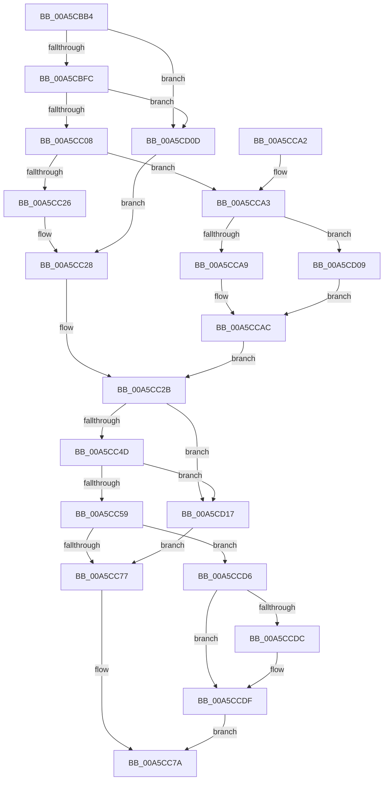

# WdipSemGetLoggerIds

- RVA: `0x00A5CBB4`–`0x00A5CD21` (길이 `365` bytes)
- VA: `0x0000000140A5CBB4`
- 실행 섹션: `PAGE`
- PDB 이름 있음: `예`; PDB Function 태그: `아니요`
- unwind 정보 RVA: `0x000B27C4`
- 디코드: `88`개 명령, `365/365` bytes 표시
- 미해석 바이트: `0` (있으면 어셈블리에 `.byte`로 보존)

> 이 문서는 커널 이미지의 기계어와 PDB 기호를 분석해 생성했습니다. 4번과 5번은 함수 원형과 자료형을 바이너리 사용 방식에서 추정한 C 해석이며 원본 소스 복구 결과는 아닙니다.

## 1. Dependencies

- 직접 호출 지점: **8**; 고유 호출 대상: **4**
- 직접 호출자로 확인된 함수: **3**
- RIP 상대 이미지 참조: **4**

### Outgoing calls
- `0x00A5CBDF` → [RtlInitUnicodeString](../../text/42/RtlInitUnicodeString_function_0042A780.md) (function, `0x0042A780`)
- `0x00A5CC08` → [PsGetCurrentServerSiloGlobals](../../text/2F/PsGetCurrentServerSiloGlobals_function_002FE1F0.md) (function, `0x002FE1F0`)
- `0x00A5CC1C` → [EtwpAcquireLoggerContextByLoggerName](../93/EtwpAcquireLoggerContextByLoggerName_function_0093283C.md) (function, `0x0093283C`)
- `0x00A5CC3D` → [RtlInitUnicodeString](../../text/42/RtlInitUnicodeString_function_0042A780.md) (function, `0x0042A780`)
- `0x00A5CC59` → [PsGetCurrentServerSiloGlobals](../../text/2F/PsGetCurrentServerSiloGlobals_function_002FE1F0.md) (function, `0x002FE1F0`)
- `0x00A5CC6D` → [EtwpAcquireLoggerContextByLoggerName](../93/EtwpAcquireLoggerContextByLoggerName_function_0093283C.md) (function, `0x0093283C`)
- `0x00A5CCC6` → [ExReleaseRundownProtectionCacheAwareEx](../../text/25/ExReleaseRundownProtectionCacheAwareEx_function_0025F050.md) (function, `0x0025F050`)
- `0x00A5CCF9` → [ExReleaseRundownProtectionCacheAwareEx](../../text/25/ExReleaseRundownProtectionCacheAwareEx_function_0025F050.md) (function, `0x0025F050`)

### Direct callers
- [WdipSemCleanStart](../7A/WdipSemCleanStart_function_007AF590.md) at `0x007AF596`
- [WdipSemDisableScenario](WdipSemDisableScenario_function_00A5BC00.md) at `0x00A5BCA1`
- [WdipSemEnableScenario](WdipSemEnableScenario_function_00A5C424.md) at `0x00A5C4C5`

### Static image references
- `0x00A5CBD0` → RVA `0x00B06B10` (` ?? ::NNGAKEGL::`string'`; read)
- `0x00A5CC2B` → RVA `0x00F02450` (`.data`; read/write)
- `0x00A5CC31` → RVA `0x00B06840` (` ?? ::NNGAKEGL::`string'`; read)
- `0x00A5CC7A` → RVA `0x00F02454` (`.data`; read/write)

## 2. Other-region calls and transfers

- 다른 실행 섹션으로 향하는 call: **6**
  - `0x00A5CBDF` → [RtlInitUnicodeString](../../text/42/RtlInitUnicodeString_function_0042A780.md) (`PAGE` → `.text`)
  - `0x00A5CC08` → [PsGetCurrentServerSiloGlobals](../../text/2F/PsGetCurrentServerSiloGlobals_function_002FE1F0.md) (`PAGE` → `.text`)
  - `0x00A5CC3D` → [RtlInitUnicodeString](../../text/42/RtlInitUnicodeString_function_0042A780.md) (`PAGE` → `.text`)
  - `0x00A5CC59` → [PsGetCurrentServerSiloGlobals](../../text/2F/PsGetCurrentServerSiloGlobals_function_002FE1F0.md) (`PAGE` → `.text`)
  - `0x00A5CCC6` → [ExReleaseRundownProtectionCacheAwareEx](../../text/25/ExReleaseRundownProtectionCacheAwareEx_function_0025F050.md) (`PAGE` → `.text`)
  - `0x00A5CCF9` → [ExReleaseRundownProtectionCacheAwareEx](../../text/25/ExReleaseRundownProtectionCacheAwareEx_function_0025F050.md) (`PAGE` → `.text`)
- 별도 외부 분기/꼬리 이동을 확인하지 못했습니다.

## 3. Assembly (complete function range)

```asm
00A5CBB4  48 8B C4                        mov rax, rsp
00A5CBB7  48 89 58 08                     mov qword ptr [rax + 8], rbx
00A5CBBB  48 89 68 10                     mov qword ptr [rax + 0x10], rbp
00A5CBBF  48 89 70 18                     mov qword ptr [rax + 0x18], rsi
00A5CBC3  48 89 78 20                     mov qword ptr [rax + 0x20], rdi
00A5CBC7  41 56                           push r14
00A5CBC9  48 83 EC 30                     sub rsp, 0x30
00A5CBCD  0F 57 C0                        xorps xmm0, xmm0
00A5CBD0  48 8D 15 39 9F 0A 00            lea rdx, [rip + 0xa9f39]
00A5CBD7  48 8D 48 E8                     lea rcx, [rax - 0x18]
00A5CBDB  0F 11 40 E8                     movups xmmword ptr [rax - 0x18], xmm0
00A5CBDF  E8 9C DB 9C FF                  call 0x14042a780
00A5CBE4  45 33 F6                        xor r14d, r14d
00A5CBE7  BB 96 02 00 C0                  mov ebx, 0xc0000296
00A5CBEC  BD FF FF 00 00                  mov ebp, 0xffff
00A5CBF1  4C 39 74 24 28                  cmp qword ptr [rsp + 0x28], r14
00A5CBF6  0F 84 11 01 00 00               je 0x140a5cd0d
00A5CBFC  66 44 39 74 24 20               cmp word ptr [rsp + 0x20], r14w
00A5CC02  0F 84 05 01 00 00               je 0x140a5cd0d
00A5CC08  E8 E3 15 8A FF                  call 0x1402fe1f0
00A5CC0D  45 33 C0                        xor r8d, r8d
00A5CC10  48 8D 54 24 20                  lea rdx, [rsp + 0x20]
00A5CC15  48 8B 88 40 03 00 00            mov rcx, qword ptr [rax + 0x340]
00A5CC1C  E8 1B 5C ED FF                  call 0x14093283c
00A5CC21  48 85 C0                        test rax, rax
00A5CC24  75 7D                           jne 0x140a5cca3
00A5CC26  8B FB                           mov edi, ebx
00A5CC28  41 8B C6                        mov eax, r14d
00A5CC2B  87 05 1F 58 4A 00               xchg dword ptr [rip + 0x4a581f], eax
00A5CC31  48 8D 15 08 9C 0A 00            lea rdx, [rip + 0xa9c08]
00A5CC38  48 8D 4C 24 20                  lea rcx, [rsp + 0x20]
00A5CC3D  E8 3E DB 9C FF                  call 0x14042a780
00A5CC42  4C 39 74 24 28                  cmp qword ptr [rsp + 0x28], r14
00A5CC47  0F 84 CA 00 00 00               je 0x140a5cd17
00A5CC4D  66 44 39 74 24 20               cmp word ptr [rsp + 0x20], r14w
00A5CC53  0F 84 BE 00 00 00               je 0x140a5cd17
00A5CC59  E8 92 15 8A FF                  call 0x1402fe1f0
00A5CC5E  45 33 C0                        xor r8d, r8d
00A5CC61  48 8D 54 24 20                  lea rdx, [rsp + 0x20]
00A5CC66  48 8B 88 40 03 00 00            mov rcx, qword ptr [rax + 0x340]
00A5CC6D  E8 CA 5B ED FF                  call 0x14093283c
00A5CC72  48 85 C0                        test rax, rax
00A5CC75  75 5F                           jne 0x140a5ccd6
00A5CC77  41 8B C6                        mov eax, r14d
00A5CC7A  87 05 D4 57 4A 00               xchg dword ptr [rip + 0x4a57d4], eax
00A5CC80  48 8B 6C 24 48                  mov rbp, qword ptr [rsp + 0x48]
00A5CC85  85 FF                           test edi, edi
00A5CC87  48 8B 74 24 50                  mov rsi, qword ptr [rsp + 0x50]
00A5CC8C  0F 48 DF                        cmovs ebx, edi
00A5CC8F  48 8B 7C 24 58                  mov rdi, qword ptr [rsp + 0x58]
00A5CC94  8B C3                           mov eax, ebx
00A5CC96  48 8B 5C 24 40                  mov rbx, qword ptr [rsp + 0x40]
00A5CC9B  48 83 C4 30                     add rsp, 0x30
00A5CC9F  41 5E                           pop r14
00A5CCA1  C3                              ret
00A5CCA2  CC                              int3
00A5CCA3  8B 08                           mov ecx, dword ptr [rax]
00A5CCA5  85 C9                           test ecx, ecx
00A5CCA7  74 60                           je 0x140a5cd09
00A5CCA9  0F B7 30                        movzx esi, word ptr [rax]
00A5CCAC  48 8B 80 50 05 00 00            mov rax, qword ptr [rax + 0x550]
00A5CCB3  4C 8B C1                        mov r8, rcx
00A5CCB6  BA 01 00 00 00                  mov edx, 1
00A5CCBB  48 8B 88 C0 02 00 00            mov rcx, qword ptr [rax + 0x2c0]
00A5CCC2  4A 8B 0C C1                     mov rcx, qword ptr [rcx + r8*8]
00A5CCC6  E8 85 23 80 FF                  call 0x14025f050
00A5CCCB  0F B7 C6                        movzx eax, si
00A5CCCE  41 8B FE                        mov edi, r14d
00A5CCD1  E9 55 FF FF FF                  jmp 0x140a5cc2b
00A5CCD6  8B 08                           mov ecx, dword ptr [rax]
00A5CCD8  85 C9                           test ecx, ecx
00A5CCDA  74 03                           je 0x140a5ccdf
00A5CCDC  0F B7 28                        movzx ebp, word ptr [rax]
00A5CCDF  48 8B 80 50 05 00 00            mov rax, qword ptr [rax + 0x550]
00A5CCE6  4C 8B C1                        mov r8, rcx
00A5CCE9  BA 01 00 00 00                  mov edx, 1
00A5CCEE  48 8B 88 C0 02 00 00            mov rcx, qword ptr [rax + 0x2c0]
00A5CCF5  4A 8B 0C C1                     mov rcx, qword ptr [rcx + r8*8]
00A5CCF9  E8 52 23 80 FF                  call 0x14025f050
00A5CCFE  0F B7 C5                        movzx eax, bp
00A5CD01  41 8B DE                        mov ebx, r14d
00A5CD04  E9 71 FF FF FF                  jmp 0x140a5cc7a
00A5CD09  8B F5                           mov esi, ebp
00A5CD0B  EB 9F                           jmp 0x140a5ccac
00A5CD0D  BF 0D 00 00 C0                  mov edi, 0xc000000d
00A5CD12  E9 11 FF FF FF                  jmp 0x140a5cc28
00A5CD17  BB 0D 00 00 C0                  mov ebx, 0xc000000d
00A5CD1C  E9 56 FF FF FF                  jmp 0x140a5cc77
```

## 4. C-style interpretation (structured pseudocode)

```c
__int64 __fastcall WdipSemGetLoggerIds(__int64 a1, __int64 a2, int a3)
{
    __int64 result;
    __int64 v_r14;
    __int64 v_rbp;
    __int64 v_rbx;
    __int64 v_rsp;
    unsigned __int64 v_stack_m10;
    unsigned __int16 v_stack_m18;
    unsigned __int64 v_stack_p10;
    unsigned __int64 v_stack_p18;
    unsigned __int64 v_stack_p20;
    unsigned __int64 v_stack_p8;

    *(unsigned __int64 *)(v_rsp + 8) = v_rbx;
    *(unsigned __int64 *)(v_rsp + 16) = v_rbp;
    *(unsigned __int64 *)(v_rsp + 24) = v_rsi;
    *(unsigned __int64 *)(v_rsp + 32) = v_rdi;
    v_rsp = (v_rsp) - (48);
    *(unsigned __int64 *)(v_rsp - 24) = v_xmm0;
    result = RtlInitUnicodeString(v_rsp - 24, v_rip + 696121, a3, a4);
    v_r14 = 0;
    if (v_stack_m10 == 0) goto loc_00A5CD0D;
    if (v_stack_m18 == 0) goto loc_00A5CD0D;
    result = PsGetCurrentServerSiloGlobals(v_rsp - 24, v_rip + 696121, a3, a4);
    a3 = 0;
    result = EtwpAcquireLoggerContextByLoggerName(*(unsigned __int64 *)(result + 832), v_stack_m18, a3, a4);
    if (result != 0) goto loc_00A5CCA3;
loc_00A5CC28:
loc_00A5CC2B:
    result = RtlInitUnicodeString(v_stack_m18, v_rip + 695304, a3, a4);
    if (v_stack_m10 == 0) goto loc_00A5CD17;
    if (v_stack_m18 == 0) goto loc_00A5CD17;
    result = PsGetCurrentServerSiloGlobals(v_stack_m18, v_rip + 695304, a3, a4);
    a3 = 0;
    result = EtwpAcquireLoggerContextByLoggerName(*(unsigned __int64 *)(result + 832), v_stack_m18, a3, a4);
    if (result != 0) goto loc_00A5CCD6;
loc_00A5CC77:
loc_00A5CC7A:
    v_rbx = (unsigned int)(0xC0000296ULL);
    if (sign_flag) { v_rbx = (unsigned int)((unsigned int)((unsigned int)((unsigned int)(0xC0000296ULL)))); }
    v_rsp = (v_rsp) + (48);
    return (unsigned int)((unsigned int)(v_rbx));
loc_00A5CCA3:
    if ((unsigned int)((unsigned int)(*(unsigned int *)((unsigned int)((unsigned int)(v_rbx))))) == 0) goto loc_00A5CD09;
loc_00A5CCAC:
    result = ExReleaseRundownProtectionCacheAwareEx(*(unsigned __int64 *)(*(unsigned __int64 *)(*(unsigned __int64 *)((unsigned int)((unsigned int)(v_rbx)) + 1360) + 704) + (unsigned int)(*(unsigned int *)((unsigned int)((unsigned int)(v_rbx)))) * 8), 1, (unsigned int)(*(unsigned int *)((unsigned int)((unsigned int)(v_rbx)))), a4);
    goto loc_00A5CC2B;
loc_00A5CCD6:
    v_rbp = v_stack_p10;
    if ((unsigned int)((unsigned int)(*(unsigned int *)((unsigned __int16)(*(unsigned __int16 *)((unsigned int)((unsigned int)(v_rbx))))))) != 0) {
        v_rbp = *(unsigned __int16 *)((unsigned __int16)(*(unsigned __int16 *)((unsigned int)((unsigned int)(v_rbx)))));
    }
    result = ExReleaseRundownProtectionCacheAwareEx(*(unsigned __int64 *)(*(unsigned __int64 *)(*(unsigned __int64 *)((unsigned __int16)(*(unsigned __int16 *)((unsigned int)((unsigned int)(v_rbx)))) + 1360) + 704) + (unsigned int)(*(unsigned int *)((unsigned __int16)(*(unsigned __int16 *)((unsigned int)((unsigned int)(v_rbx)))))) * 8), 1, (unsigned int)(*(unsigned int *)((unsigned __int16)(*(unsigned __int16 *)((unsigned int)((unsigned int)(v_rbx)))))), a4);
    goto loc_00A5CC7A;
loc_00A5CD09:
    goto loc_00A5CCAC;
loc_00A5CD0D:
    goto loc_00A5CC28;
loc_00A5CD17:
    goto loc_00A5CC77;
}
```

## 5. (Beta) C Style

```c
int64_t WdipSemGetLoggerIds(int64_t Arg1, int64_t Arg2, int32_t Arg3)
{
    int64_t result;
    int64_t local_r14;
    int64_t local_rbp;
    int64_t local_rbx;
    int64_t local_rsp;
    uint64_t v_stack_m10;
    uint16_t v_stack_m18;
    uint64_t v_stack_p10;
    uint64_t v_stack_p18;
    uint64_t v_stack_p20;
    uint64_t v_stack_p8;

    *(uint64_t *)(local_rsp + 0x8) = local_rbx;
    *(uint64_t *)(local_rsp + 0x10) = local_rbp;
    *(uint64_t *)(local_rsp + 0x18) = local_rsi;
    *(uint64_t *)(local_rsp + 0x20) = local_rdi;
    local_rsp = (local_rsp) - (48);
    *(uint64_t *)(local_rsp - 0x18) = v_xmm0;
    result = RtlInitUnicodeString(local_rsp - 24, v_rip + 696121, Arg3, a4);
    local_r14 = 0;
    if (v_stack_m10 == 0) goto loc_00A5CD0D;
    if (v_stack_m18 == 0) goto loc_00A5CD0D;
    result = PsGetCurrentServerSiloGlobals(local_rsp - 24, v_rip + 696121, Arg3, a4);
    Arg3 = 0;
    result = EtwpAcquireLoggerContextByLoggerName(*(uint64_t *)(result + 0x340), v_stack_m18, Arg3, a4);
    if (result != 0) goto loc_00A5CCA3;
loc_00A5CC28:
loc_00A5CC2B:
    result = RtlInitUnicodeString(v_stack_m18, v_rip + 695304, Arg3, a4);
    if (v_stack_m10 == 0) goto loc_00A5CD17;
    if (v_stack_m18 == 0) goto loc_00A5CD17;
    result = PsGetCurrentServerSiloGlobals(v_stack_m18, v_rip + 695304, Arg3, a4);
    Arg3 = 0;
    result = EtwpAcquireLoggerContextByLoggerName(*(uint64_t *)(result + 0x340), v_stack_m18, Arg3, a4);
    if (result != 0) goto loc_00A5CCD6;
loc_00A5CC77:
loc_00A5CC7A:
    local_rbx = (uint32_t)(0xC0000296ULL);
    if (sign_flag) { local_rbx = (uint32_t)((uint32_t)((uint32_t)((uint32_t)(0xC0000296ULL)))); }
    local_rsp = (local_rsp) + (48);
    return (uint32_t)((uint32_t)(local_rbx));
loc_00A5CCA3:
    if ((uint32_t)((uint32_t)(*(uint32_t *)((uint32_t)((uint32_t)(local_rbx))))) == 0) goto loc_00A5CD09;
loc_00A5CCAC:
    result = ExReleaseRundownProtectionCacheAwareEx(*(uint64_t *)(*(uint64_t *)(*(uint64_t *)((uint32_t)((uint32_t)(local_rbx)) + 0x550) + 0x2C0) + (uint32_t)(*(uint32_t *)((uint32_t)((uint32_t)(local_rbx)))) * 8), 1, (uint32_t)(*(uint32_t *)((uint32_t)((uint32_t)(local_rbx)))), a4);
    goto loc_00A5CC2B;
loc_00A5CCD6:
    local_rbp = v_stack_p10;
    if ((uint32_t)((uint32_t)(*(uint32_t *)((uint16_t)(*(uint16_t *)((uint32_t)((uint32_t)(local_rbx))))))) != 0) {
        local_rbp = *(uint16_t *)((uint16_t)(*(uint16_t *)((uint32_t)((uint32_t)(local_rbx)))));
    }
    result = ExReleaseRundownProtectionCacheAwareEx(*(uint64_t *)(*(uint64_t *)(*(uint64_t *)((uint16_t)(*(uint16_t *)((uint32_t)((uint32_t)(local_rbx)))) + 0x550) + 0x2C0) + (uint32_t)(*(uint32_t *)((uint16_t)(*(uint16_t *)((uint32_t)((uint32_t)(local_rbx)))))) * 8), 1, (uint32_t)(*(uint32_t *)((uint16_t)(*(uint16_t *)((uint32_t)((uint32_t)(local_rbx)))))), a4);
    goto loc_00A5CC7A;
loc_00A5CD09:
    goto loc_00A5CCAC;
loc_00A5CD0D:
    goto loc_00A5CC28;
loc_00A5CD17:
    goto loc_00A5CC77;
}
```

## 6. Execution-region graph

[열기: 2D/3D 그래프와 함수 탐색 컨트롤 패널](../../../control-panel.html?section=page&rva=0x00A5CBB4&view=graph)

- 2D 그래프는 위에서 아래로 흐르고, 3D 그래프는 빈 공간을 드래그해 회전합니다. Shift+드래그는 이동, 휠은 확대·축소, 함수 노드 선택은 대상 보고서 이동입니다.

### Static fallback


