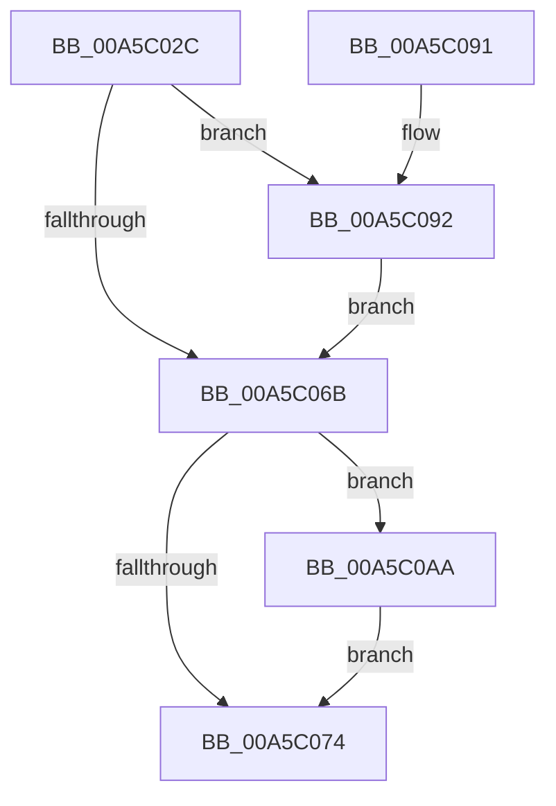

# WdipSemLogTimeoutInformation

- RVA: `0x00A5C02C`–`0x00A5C0BE` (길이 `146` bytes)
- VA: `0x0000000140A5C02C`
- 실행 섹션: `PAGE`
- PDB 이름 있음: `예`; PDB Function 태그: `아니요`
- unwind 정보 RVA: `0x0009E744`
- 디코드: `44`개 명령, `146/146` bytes 표시
- 미해석 바이트: `0` (있으면 어셈블리에 `.byte`로 보존)

> 이 문서는 커널 이미지의 기계어와 PDB 기호를 분석해 생성했습니다. 4번과 5번은 함수 원형과 자료형을 바이너리 사용 방식에서 추정한 C 해석이며 원본 소스 복구 결과는 아닙니다.

## 1. Dependencies

- 직접 호출 지점: **4**; 고유 호출 대상: **4**
- 직접 호출자로 확인된 함수: **1**
- RIP 상대 이미지 참조: **2**

### Outgoing calls
- `0x00A5C062` → [EtwEventEnabled](../../text/39/EtwEventEnabled_function_00392450.md) (function, `0x00392450`)
- `0x00A5C06B` → [WdipSemSqmEnabled](../70/WdipSemSqmEnabled_function_0070276C.md) (function, `0x0070276C`)
- `0x00A5C09B` → [WdipSemWriteTimeoutEvent](WdipSemWriteTimeoutEvent_function_00A5C0C4.md) (function, `0x00A5C0C4`)
- `0x00A5C0AF` → [WdipSemSqmLogTimeoutDataPoints](../7B/WdipSemSqmLogTimeoutDataPoints_function_007B1F1C.md) (function, `0x007B1F1C`)

### Direct callers
- [WdipTimeoutCheckRoutine](WdipTimeoutCheckRoutine_function_00A5B910.md) at `0x00A5BA53`

### Static image references
- `0x00A5C04B` → RVA `0x00F01DD0` (`.data`; read)
- `0x00A5C052` → RVA `0x0001A768` (`.rdata`; read)

## 2. Other-region calls and transfers

- 다른 실행 섹션으로 향하는 call: **1**
  - `0x00A5C062` → [EtwEventEnabled](../../text/39/EtwEventEnabled_function_00392450.md) (`PAGE` → `.text`)
- 별도 외부 분기/꼬리 이동을 확인하지 못했습니다.

## 3. Assembly (complete function range)

```asm
00A5C02C  48 8B C4                        mov rax, rsp
00A5C02F  48 89 58 08                     mov qword ptr [rax + 8], rbx
00A5C033  48 89 68 10                     mov qword ptr [rax + 0x10], rbp
00A5C037  48 89 70 18                     mov qword ptr [rax + 0x18], rsi
00A5C03B  48 89 78 20                     mov qword ptr [rax + 0x20], rdi
00A5C03F  41 56                           push r14
00A5C041  48 83 EC 20                     sub rsp, 0x20
00A5C045  0F B7 FA                        movzx edi, dx
00A5C048  48 8B F1                        mov rsi, rcx
00A5C04B  48 8B 0D 7E 5D 4A 00            mov rcx, qword ptr [rip + 0x4a5d7e]
00A5C052  48 8D 15 0F E7 5B FF            lea rdx, [rip - 0xa418f1]
00A5C059  45 33 F6                        xor r14d, r14d
00A5C05C  49 8B E8                        mov rbp, r8
00A5C05F  41 8B DE                        mov ebx, r14d
00A5C062  E8 E9 63 93 FF                  call 0x140392450
00A5C067  84 C0                           test al, al
00A5C069  75 27                           jne 0x140a5c092
00A5C06B  E8 FC 66 CA FF                  call 0x14070276c
00A5C070  84 C0                           test al, al
00A5C072  75 36                           jne 0x140a5c0aa
00A5C074  48 8B 6C 24 38                  mov rbp, qword ptr [rsp + 0x38]
00A5C079  8B C3                           mov eax, ebx
00A5C07B  48 8B 5C 24 30                  mov rbx, qword ptr [rsp + 0x30]
00A5C080  48 8B 74 24 40                  mov rsi, qword ptr [rsp + 0x40]
00A5C085  48 8B 7C 24 48                  mov rdi, qword ptr [rsp + 0x48]
00A5C08A  48 83 C4 20                     add rsp, 0x20
00A5C08E  41 5E                           pop r14
00A5C090  C3                              ret
00A5C091  CC                              int3
00A5C092  4C 8B C5                        mov r8, rbp
00A5C095  0F B7 D7                        movzx edx, di
00A5C098  48 8B CE                        mov rcx, rsi
00A5C09B  E8 24 00 00 00                  call 0x140a5c0c4
00A5C0A0  85 C0                           test eax, eax
00A5C0A2  8B D8                           mov ebx, eax
00A5C0A4  41 0F 48 DE                     cmovs ebx, r14d
00A5C0A8  EB C1                           jmp 0x140a5c06b
00A5C0AA  8B D7                           mov edx, edi
00A5C0AC  48 8B CE                        mov rcx, rsi
00A5C0AF  E8 68 5E D5 FF                  call 0x1407b1f1c
00A5C0B4  85 C0                           test eax, eax
00A5C0B6  8B D8                           mov ebx, eax
00A5C0B8  41 0F 48 DE                     cmovs ebx, r14d
00A5C0BC  EB B6                           jmp 0x140a5c074
```

## 4. C-style interpretation (structured pseudocode)

```c
__int64 __fastcall WdipSemLogTimeoutInformation(__int64 a1, unsigned __int16 a2, __int64 a3)
{
    __int64 result;
    __int64 v_r14;
    __int64 v_rbx;
    __int64 v_rsp;
    unsigned __int64 v_stack_p10;
    unsigned __int64 v_stack_p18;
    unsigned __int64 v_stack_p20;
    unsigned __int64 v_stack_p8;

    *(unsigned __int64 *)(v_rsp + 8) = v_rbx;
    *(unsigned __int64 *)(v_rsp + 16) = v_rbp;
    *(unsigned __int64 *)(v_rsp + 24) = v_rsi;
    *(unsigned __int64 *)(v_rsp + 32) = v_rdi;
    v_rsp = (v_rsp) - (32);
    v_r14 = 0;
    result = EtwEventEnabled(*(unsigned __int64 *)(v_rip + 4873598), v_rip - 10754289, a3, a4);
    if ((unsigned __int8)(result) != 0) goto loc_00A5C092;
loc_00A5C06B:
    result = WdipSemSqmEnabled(*(unsigned __int64 *)(v_rip + 4873598), v_rip - 10754289, a3, a4);
    if ((unsigned __int8)(result) != 0) goto loc_00A5C0AA;
loc_00A5C074:
    v_rsp = (v_rsp) + (32);
    return 0;
loc_00A5C092:
    result = WdipSemWriteTimeoutEvent(v_stack_p18, (unsigned __int16)(v_stack_p20), v_stack_p10, a4);
    v_rbx = (unsigned int)((unsigned int)(result));
    if (sign_flag) { v_rbx = 0; }
    goto loc_00A5C06B;
loc_00A5C0AA:
    result = WdipSemSqmLogTimeoutDataPoints(v_stack_p18, (unsigned int)((unsigned int)(v_stack_p20)), v_stack_p10, a4);
    v_rbx = (unsigned int)((unsigned int)(result));
    if (sign_flag) { v_rbx = 0; }
    goto loc_00A5C074;
}
```

## 5. (Beta) C Style

```c
int64_t WdipSemLogTimeoutInformation(int64_t Arg1, uint16_t Arg2, int64_t Arg3)
{
    int64_t result;
    int64_t local_r14;
    int64_t local_rbx;
    int64_t local_rsp;
    uint64_t v_stack_p10;
    uint64_t v_stack_p18;
    uint64_t v_stack_p20;
    uint64_t v_stack_p8;

    *(uint64_t *)(local_rsp + 0x8) = local_rbx;
    *(uint64_t *)(local_rsp + 0x10) = local_rbp;
    *(uint64_t *)(local_rsp + 0x18) = local_rsi;
    *(uint64_t *)(local_rsp + 0x20) = local_rdi;
    local_rsp = (local_rsp) - (32);
    local_r14 = 0;
    result = EtwEventEnabled(*(uint64_t *)(v_rip + 0x4A5D7E), v_rip - 10754289, Arg3, a4);
    if ((uint8_t)(result) != 0) goto loc_00A5C092;
loc_00A5C06B:
    result = WdipSemSqmEnabled(*(uint64_t *)(v_rip + 0x4A5D7E), v_rip - 10754289, Arg3, a4);
    if ((uint8_t)(result) != 0) goto loc_00A5C0AA;
loc_00A5C074:
    local_rsp = (local_rsp) + (32);
    return 0;
loc_00A5C092:
    result = WdipSemWriteTimeoutEvent(v_stack_p18, (uint16_t)(v_stack_p20), v_stack_p10, a4);
    local_rbx = (uint32_t)((uint32_t)(result));
    if (sign_flag) { local_rbx = 0; }
    goto loc_00A5C06B;
loc_00A5C0AA:
    result = WdipSemSqmLogTimeoutDataPoints(v_stack_p18, (uint32_t)((uint32_t)(v_stack_p20)), v_stack_p10, a4);
    local_rbx = (uint32_t)((uint32_t)(result));
    if (sign_flag) { local_rbx = 0; }
    goto loc_00A5C074;
}
```

## 6. Execution-region graph

[열기: 2D/3D 그래프와 함수 탐색 컨트롤 패널](../../../control-panel.html?section=page&rva=0x00A5C02C&view=graph)

- 2D 그래프는 위에서 아래로 흐르고, 3D 그래프는 빈 공간을 드래그해 회전합니다. Shift+드래그는 이동, 휠은 확대·축소, 함수 노드 선택은 대상 보고서 이동입니다.

### Static fallback


