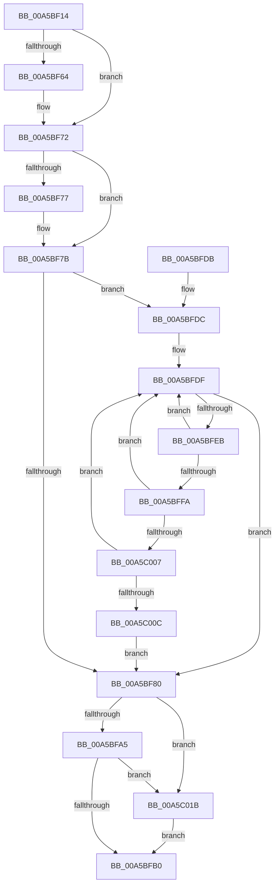

# WdipSemMarkNextTimedOutInstanceForDeletion

- RVA: `0x00A5BF14`–`0x00A5C025` (길이 `273` bytes)
- VA: `0x0000000140A5BF14`
- 실행 섹션: `PAGE`
- PDB 이름 있음: `예`; PDB Function 태그: `아니요`
- unwind 정보 RVA: `0x000B26D4`
- 디코드: `73`개 명령, `273/273` bytes 표시
- 미해석 바이트: `0` (있으면 어셈블리에 `.byte`로 보존)

> 이 문서는 커널 이미지의 기계어와 PDB 기호를 분석해 생성했습니다. 4번과 5번은 함수 원형과 자료형을 바이너리 사용 방식에서 추정한 C 해석이며 원본 소스 복구 결과는 아닙니다.

## 1. Dependencies

- 직접 호출 지점: **5**; 고유 호출 대상: **5**
- 직접 호출자로 확인된 함수: **1**
- RIP 상대 이미지 참조: **2**

### Outgoing calls
- `0x00A5BF54` → [KeAbPreAcquire](../../text/21/KeAbPreAcquire_function_00210230.md) (function, `0x00210230`)
- `0x00A5BF6D` → [ExfAcquirePushLockExclusiveEx](../../text/20/ExfAcquirePushLockExclusiveEx_function_0020FC90.md) (function, `0x0020FC90`)
- `0x00A5BFB3` → [KeAbPostRelease](../../text/2E/KeAbPostRelease_function_002E1600.md) (function, `0x002E1600`)
- `0x00A5BFB8` → [KeLeaveCriticalRegion](../../text/25/KeLeaveCriticalRegion_function_0025D8B0.md) (function, `0x0025D8B0`)
- `0x00A5C01E` → [ExfReleasePushLock](../../text/26/ExfReleasePushLock_function_002638D0.md) (function, `0x002638D0`)

### Direct callers
- [WdipTimeoutCheckRoutine](WdipTimeoutCheckRoutine_function_00A5B910.md) at `0x00A5BA1E`
- [WdipTimeoutCheckRoutine](WdipTimeoutCheckRoutine_function_00A5B910.md) at `0x00A5BA3F`

### Static image references
- `0x00A5BF36` → RVA `0x00F01DF8` (`.data`; read)
- `0x00A5BFDF` → RVA `0x00F01DE0` (`.data`; read)

## 2. Other-region calls and transfers

- 다른 실행 섹션으로 향하는 call: **5**
  - `0x00A5BF54` → [KeAbPreAcquire](../../text/21/KeAbPreAcquire_function_00210230.md) (`PAGE` → `.text`)
  - `0x00A5BF6D` → [ExfAcquirePushLockExclusiveEx](../../text/20/ExfAcquirePushLockExclusiveEx_function_0020FC90.md) (`PAGE` → `.text`)
  - `0x00A5BFB3` → [KeAbPostRelease](../../text/2E/KeAbPostRelease_function_002E1600.md) (`PAGE` → `.text`)
  - `0x00A5BFB8` → [KeLeaveCriticalRegion](../../text/25/KeLeaveCriticalRegion_function_0025D8B0.md) (`PAGE` → `.text`)
  - `0x00A5C01E` → [ExfReleasePushLock](../../text/26/ExfReleasePushLock_function_002638D0.md) (`PAGE` → `.text`)
- 별도 외부 분기/꼬리 이동을 확인하지 못했습니다.

## 3. Assembly (complete function range)

```asm
00A5BF14  48 8B C4                        mov rax, rsp
00A5BF17  48 89 58 08                     mov qword ptr [rax + 8], rbx
00A5BF1B  48 89 68 10                     mov qword ptr [rax + 0x10], rbp
00A5BF1F  48 89 70 18                     mov qword ptr [rax + 0x18], rsi
00A5BF23  48 89 78 20                     mov qword ptr [rax + 0x20], rdi
00A5BF27  41 56                           push r14
00A5BF29  48 83 EC 20                     sub rsp, 0x20
00A5BF2D  65 48 8B 04 25 88 01 00 00      mov rax, qword ptr gs:[0x188]
00A5BF36  4C 8D 35 BB 5E 4A 00            lea r14, [rip + 0x4a5ebb]
00A5BF3D  48 8B F9                        mov rdi, rcx
00A5BF40  33 ED                           xor ebp, ebp
00A5BF42  45 33 C0                        xor r8d, r8d
00A5BF45  33 D2                           xor edx, edx
00A5BF47  49 8B CE                        mov rcx, r14
00A5BF4A  8B F5                           mov esi, ebp
00A5BF4C  66 FF 88 E4 01 00 00            dec word ptr [rax + 0x1e4]
00A5BF53  90                              nop
00A5BF54  E8 D7 42 7B FF                  call 0x140210230
00A5BF59  F0 49 0F BA 2E 00               lock bts qword ptr [r14], 0
00A5BF5F  48 8B D8                        mov rbx, rax
00A5BF62  73 0E                           jae 0x140a5bf72
00A5BF64  4D 8B C6                        mov r8, r14
00A5BF67  48 8B D0                        mov rdx, rax
00A5BF6A  49 8B CE                        mov rcx, r14
00A5BF6D  E8 1E 3D 7B FF                  call 0x14020fc90
00A5BF72  48 85 DB                        test rbx, rbx
00A5BF75  74 04                           je 0x140a5bf7b
00A5BF77  C6 43 0A 01                     mov byte ptr [rbx + 0xa], 1
00A5BF7B  48 85 FF                        test rdi, rdi
00A5BF7E  75 5C                           jne 0x140a5bfdc
00A5BF80  0F 0D 0D 71 5E 4A 00            prefetchw byte ptr [rip + 0x4a5e71]
00A5BF87  48 8B 05 6A 5E 4A 00            mov rax, qword ptr [rip + 0x4a5e6a]
00A5BF8E  48 8B C8                        mov rcx, rax
00A5BF91  48 83 E1 F0                     and rcx, 0xfffffffffffffff0
00A5BF95  48 83 F9 10                     cmp rcx, 0x10
00A5BF99  48 8D 50 F0                     lea rdx, [rax - 0x10]
00A5BF9D  48 0F 46 D5                     cmovbe rdx, rbp
00A5BFA1  A8 02                           test al, 2
00A5BFA3  75 76                           jne 0x140a5c01b
00A5BFA5  F0 48 0F B1 15 4A 5E 4A 00      lock cmpxchg qword ptr [rip + 0x4a5e4a], rdx
00A5BFAE  75 6B                           jne 0x140a5c01b
00A5BFB0  49 8B CE                        mov rcx, r14
00A5BFB3  E8 48 56 88 FF                  call 0x1402e1600
00A5BFB8  E8 F3 18 80 FF                  call 0x14025d8b0
00A5BFBD  48 8B 5C 24 30                  mov rbx, qword ptr [rsp + 0x30]
00A5BFC2  48 8B C6                        mov rax, rsi
00A5BFC5  48 8B 74 24 40                  mov rsi, qword ptr [rsp + 0x40]
00A5BFCA  48 8B 6C 24 38                  mov rbp, qword ptr [rsp + 0x38]
00A5BFCF  48 8B 7C 24 48                  mov rdi, qword ptr [rsp + 0x48]
00A5BFD4  48 83 C4 20                     add rsp, 0x20
00A5BFD8  41 5E                           pop r14
00A5BFDA  C3                              ret
00A5BFDB  CC                              int3
00A5BFDC  48 8B 17                        mov rdx, qword ptr [rdi]
00A5BFDF  48 8D 05 FA 5D 4A 00            lea rax, [rip + 0x4a5dfa]
00A5BFE6  48 3B D0                        cmp rdx, rax
00A5BFE9  74 95                           je 0x140a5bf80
00A5BFEB  48 8B CA                        mov rcx, rdx
00A5BFEE  48 8B 12                        mov rdx, qword ptr [rdx]
00A5BFF1  FF 41 28                        inc dword ptr [rcx + 0x28]
00A5BFF4  83 79 28 0A                     cmp dword ptr [rcx + 0x28], 0xa
00A5BFF8  72 E5                           jb 0x140a5bfdf
00A5BFFA  48 8B 41 20                     mov rax, qword ptr [rcx + 0x20]
00A5BFFE  40 38 A8 98 04 00 00            cmp byte ptr [rax + 0x498], bpl
00A5C005  74 D8                           je 0x140a5bfdf
00A5C007  39 69 2C                        cmp dword ptr [rcx + 0x2c], ebp
00A5C00A  75 D3                           jne 0x140a5bfdf
00A5C00C  C7 41 2C 01 00 00 00            mov dword ptr [rcx + 0x2c], 1
00A5C013  48 8B F1                        mov rsi, rcx
00A5C016  E9 65 FF FF FF                  jmp 0x140a5bf80
00A5C01B  49 8B CE                        mov rcx, r14
00A5C01E  E8 AD 78 80 FF                  call 0x1402638d0
00A5C023  EB 8B                           jmp 0x140a5bfb0
```

## 4. C-style interpretation (structured pseudocode)

```c
__int64 __fastcall WdipSemMarkNextTimedOutInstanceForDeletion(__int64 a1, int a2, int a3)
{
    __int64 result;
    __int64 v_rbp;
    __int64 v_rsp;
    unsigned __int64 v_stack_p10;
    unsigned __int64 v_stack_p18;
    unsigned __int64 v_stack_p20;
    unsigned __int64 v_stack_p8;

    *(unsigned __int64 *)(v_rsp + 8) = v_rbx;
    *(unsigned __int64 *)(v_rsp + 16) = v_rbp;
    *(unsigned __int64 *)(v_rsp + 24) = v_rsi;
    *(unsigned __int64 *)(v_rsp + 32) = v_rdi;
    v_rsp = (v_rsp) - (32);
    v_rbp = 0;
    a3 = 0;
    a2 = 0;
    result = KeAbPreAcquire(v_rip + 4873915, a2, a3, a4);
    if (!(condition_is_above_or_equal)) {
        a3 = v_rip + 4873915;
        a2 = result;
        a1 = v_rip + 4873915;
        result = ExfAcquirePushLockExclusiveEx(a1, a2, a3, a4);
    }
    if (result != 0) {
        *(unsigned __int8 *)(result + 10) = 1;
    }
    if (a1 != 0) goto loc_00A5BFDC;
loc_00A5BF80:
    a1 = (*(unsigned __int64 *)(v_rip + 4873834)) & (-16);
    a2 = *(unsigned __int64 *)(v_rip + 4873834) - 16;
    if (a1 <= 16) { a2 = 0; }
    if ((((unsigned __int8)(*(unsigned __int64 *)(v_rip + 4873834))) & (2)) != 0) goto loc_00A5C01B;
    if ((((unsigned __int8)(*(unsigned __int64 *)(v_rip + 4873834))) & (2)) != 0) goto loc_00A5C01B;
loc_00A5BFB0:
    result = KeAbPostRelease(v_rip + 4873915, a2, a3, a4);
    result = KeLeaveCriticalRegion(v_rip + 4873915, a2, a3, a4);
    v_rsp = (v_rsp) + (32);
    return 0;
loc_00A5BFDC:
loc_00A5BFDF:
    if ((*(unsigned __int64 *)(v_stack_p20)) == (v_rip + 4873722)) goto loc_00A5BF80;
    if ((*(unsigned int *)(*(unsigned __int64 *)(v_stack_p20) + 40)) < 10) goto loc_00A5BFDF;
    if ((*(unsigned __int8 *)(*(unsigned __int64 *)(*(unsigned __int64 *)(v_stack_p20) + 32) + 1176)) == ((unsigned __int8)(v_stack_p10))) goto loc_00A5BFDF;
    if ((*(unsigned int *)(*(unsigned __int64 *)(v_stack_p20) + 44)) != ((unsigned int)(v_stack_p10))) goto loc_00A5BFDF;
    *(unsigned int *)(*(unsigned __int64 *)(v_stack_p20) + 44) = 1;
    goto loc_00A5BF80;
loc_00A5C01B:
    result = ExfReleasePushLock(v_rip + 4873915, *(unsigned __int64 *)(*(unsigned __int64 *)(v_stack_p20)), a3, a4);
    goto loc_00A5BFB0;
}
```

## 5. (Beta) C Style

```c
int64_t WdipSemMarkNextTimedOutInstanceForDeletion(int64_t Arg1, int32_t Arg2, int32_t Arg3)
{
    int64_t result;
    int64_t local_rbp;
    int64_t local_rsp;
    uint64_t v_stack_p10;
    uint64_t v_stack_p18;
    uint64_t v_stack_p20;
    uint64_t v_stack_p8;

    *(uint64_t *)(local_rsp + 0x8) = local_rbx;
    *(uint64_t *)(local_rsp + 0x10) = local_rbp;
    *(uint64_t *)(local_rsp + 0x18) = local_rsi;
    *(uint64_t *)(local_rsp + 0x20) = local_rdi;
    local_rsp = (local_rsp) - (32);
    local_rbp = 0;
    Arg3 = 0;
    Arg2 = 0;
    result = KeAbPreAcquire(v_rip + 4873915, Arg2, Arg3, a4);
    if (!(condition_is_above_or_equal)) {
        Arg3 = v_rip + 4873915;
        Arg2 = result;
        Arg1 = v_rip + 4873915;
        result = ExfAcquirePushLockExclusiveEx(Arg1, Arg2, Arg3, a4);
    }
    if (result != 0) {
        *(uint8_t *)(result + 0xA) = 1;
    }
    if (Arg1 != 0) goto loc_00A5BFDC;
loc_00A5BF80:
    Arg1 = (*(uint64_t *)(v_rip + 0x4A5E6A)) & (-16);
    Arg2 = *(uint64_t *)(v_rip + 0x4A5E6A) - 16;
    if (Arg1 <= 16) { Arg2 = 0; }
    if ((((uint8_t)(*(uint64_t *)(v_rip + 0x4A5E6A))) & (2)) != 0) goto loc_00A5C01B;
    if ((((uint8_t)(*(uint64_t *)(v_rip + 0x4A5E6A))) & (2)) != 0) goto loc_00A5C01B;
loc_00A5BFB0:
    result = KeAbPostRelease(v_rip + 4873915, Arg2, Arg3, a4);
    result = KeLeaveCriticalRegion(v_rip + 4873915, Arg2, Arg3, a4);
    local_rsp = (local_rsp) + (32);
    return 0;
loc_00A5BFDC:
loc_00A5BFDF:
    if ((*(uint64_t *)(v_stack_p20)) == (v_rip + 4873722)) goto loc_00A5BF80;
    if ((*(uint32_t *)(*(uint64_t *)(v_stack_p20) + 0x28)) < 10) goto loc_00A5BFDF;
    if ((*(uint8_t *)(*(uint64_t *)(*(uint64_t *)(v_stack_p20) + 0x20) + 0x498)) == ((uint8_t)(v_stack_p10))) goto loc_00A5BFDF;
    if ((*(uint32_t *)(*(uint64_t *)(v_stack_p20) + 0x2C)) != ((uint32_t)(v_stack_p10))) goto loc_00A5BFDF;
    *(uint32_t *)(*(uint64_t *)(v_stack_p20) + 0x2C) = 1;
    goto loc_00A5BF80;
loc_00A5C01B:
    result = ExfReleasePushLock(v_rip + 4873915, *(uint64_t *)(*(uint64_t *)(v_stack_p20)), Arg3, a4);
    goto loc_00A5BFB0;
}
```

## 6. Execution-region graph

[열기: 2D/3D 그래프와 함수 탐색 컨트롤 패널](../../../control-panel.html?section=page&rva=0x00A5BF14&view=graph)

- 2D 그래프는 위에서 아래로 흐르고, 3D 그래프는 빈 공간을 드래그해 회전합니다. Shift+드래그는 이동, 휠은 확대·축소, 함수 노드 선택은 대상 보고서 이동입니다.

### Static fallback


