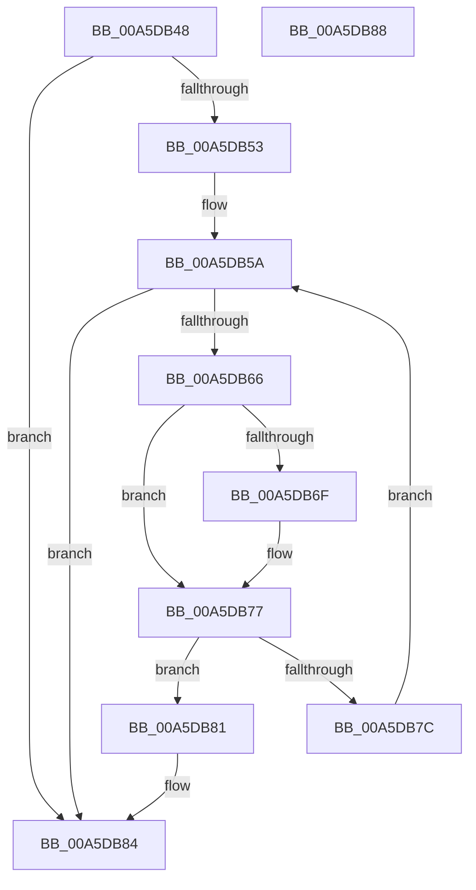

# WdipSemQueryEnabledInstanceTable

- RVA: `0x00A5DB48`–`0x00A5DB89` (길이 `65` bytes)
- VA: `0x0000000140A5DB48`
- 실행 섹션: `PAGE`
- PDB 이름 있음: `예`; PDB Function 태그: `아니요`
- unwind 정보 RVA: `0x000DB714`
- 디코드: `21`개 명령, `65/65` bytes 표시
- 미해석 바이트: `0` (있으면 어셈블리에 `.byte`로 보존)

> 이 문서는 커널 이미지의 기계어와 PDB 기호를 분석해 생성했습니다. 4번과 5번은 함수 원형과 자료형을 바이너리 사용 방식에서 추정한 C 해석이며 원본 소스 복구 결과는 아닙니다.

## 1. Dependencies

- 직접 호출 지점: **0**; 고유 호출 대상: **0**
- 직접 호출자로 확인된 함수: **2**
- RIP 상대 이미지 참조: **1**

### Outgoing calls
- 직접 디코드된 call 명령이 없습니다.

### Direct callers
- [WdipSemMarkInstanceForDeletion](../7B/WdipSemMarkInstanceForDeletion_function_007B0C84.md) at `0x007B0CF3`
- [WdipSemReserveInstanceTableEntry](WdipSemReserveInstanceTableEntry_function_00A5DA08.md) at `0x00A5DA90`

### Static image references
- `0x00A5DB53` → RVA `0x00F01DE0` (`.data`; read)

## 2. Other-region calls and transfers

- 다른 실행 섹션으로 향하는 call: **0**
- 별도 외부 분기/꼬리 이동을 확인하지 못했습니다.

## 3. Assembly (complete function range)

```asm
00A5DB48  45 33 C0                        xor r8d, r8d
00A5DB4B  4C 8B C9                        mov r9, rcx
00A5DB4E  48 85 C9                        test rcx, rcx
00A5DB51  74 31                           je 0x140a5db84
00A5DB53  48 8B 15 86 42 4A 00            mov rdx, qword ptr [rip + 0x4a4286]
00A5DB5A  48 8D 05 7F 42 4A 00            lea rax, [rip + 0x4a427f]
00A5DB61  48 3B C2                        cmp rax, rdx
00A5DB64  74 1E                           je 0x140a5db84
00A5DB66  49 8B 09                        mov rcx, qword ptr [r9]
00A5DB69  48 2B 4A 10                     sub rcx, qword ptr [rdx + 0x10]
00A5DB6D  75 08                           jne 0x140a5db77
00A5DB6F  49 8B 49 08                     mov rcx, qword ptr [r9 + 8]
00A5DB73  48 2B 4A 18                     sub rcx, qword ptr [rdx + 0x18]
00A5DB77  48 85 C9                        test rcx, rcx
00A5DB7A  74 05                           je 0x140a5db81
00A5DB7C  48 8B 12                        mov rdx, qword ptr [rdx]
00A5DB7F  EB D9                           jmp 0x140a5db5a
00A5DB81  4C 8B C2                        mov r8, rdx
00A5DB84  49 8B C0                        mov rax, r8
00A5DB87  C3                              ret
00A5DB88  CC                              int3
```

## 4. C-style interpretation (structured pseudocode)

```c
__int64 __fastcall WdipSemQueryEnabledInstanceTable(__int64 a1, __int64 a2, int a3)
{
    a3 = 0;
    if (a1 == 0) goto loc_00A5DB84;
loc_00A5DB5A:
    if ((v_rip + 4866687) == (*(unsigned __int64 *)(v_rip + 4866694))) goto loc_00A5DB84;
    a1 = (*(unsigned __int64 *)(a1)) - (*(unsigned __int64 *)(*(unsigned __int64 *)(v_rip + 4866694) + 16));
    if (!(condition_is_not_equal)) {
        a1 = *(unsigned __int64 *)(a1 + 8);
        a1 = (a1) - (*(unsigned __int64 *)(*(unsigned __int64 *)(v_rip + 4866694) + 24));
    }
    if (a1 == 0) goto loc_00A5DB81;
    goto loc_00A5DB5A;
loc_00A5DB81:
loc_00A5DB84:
    return *(unsigned __int64 *)(*(unsigned __int64 *)(v_rip + 4866694));
}
```

## 5. (Beta) C Style

```c
int64_t WdipSemQueryEnabledInstanceTable(void *Arg1, int64_t Arg2, int32_t Arg3)
{
    uint8_t *arg1 = (uint8_t *)Arg1;

    Arg3 = 0;
    if (Arg1 == NULL) goto loc_00A5DB84;
loc_00A5DB5A:
    if ((v_rip + 4866687) == (*(uint64_t *)(v_rip + 0x4A4286))) goto loc_00A5DB84;
    Arg1 = (*(uint64_t *)(arg1)) - (*(uint64_t *)(*(uint64_t *)(v_rip + 0x4A4286) + 0x10));
    if (!(condition_is_not_equal)) {
        Arg1 = *(uint64_t *)(arg1 + 0x8);
        Arg1 = (Arg1) - (*(uint64_t *)(*(uint64_t *)(v_rip + 0x4A4286) + 0x18));
    }
    if (Arg1 == NULL) goto loc_00A5DB81;
    goto loc_00A5DB5A;
loc_00A5DB81:
loc_00A5DB84:
    return *(uint64_t *)(*(uint64_t *)(v_rip + 0x4A4286));
}
```

### 관측된 메모리 오프셋

구조체 형식이 확인되지 않은 접근은 인자 기준의 오프셋으로만 기록했습니다.

| 기준 인자 | 오프셋 표현 | 폭 (bit) | 접근 |
|---|---:|---:|---|
| `Arg1` | `+ 0x0` | `64` | `R` |
| `Arg1` | `+ 0x8` | `64` | `R` |

## 6. Execution-region graph

[열기: 2D/3D 그래프와 함수 탐색 컨트롤 패널](../../../control-panel.html?section=page&rva=0x00A5DB48&view=graph)

- 2D 그래프는 위에서 아래로 흐르고, 3D 그래프는 빈 공간을 드래그해 회전합니다. Shift+드래그는 이동, 휠은 확대·축소, 함수 노드 선택은 대상 보고서 이동입니다.

### Static fallback


