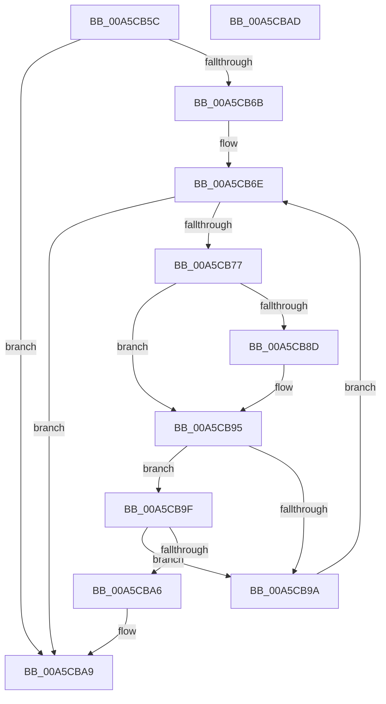

# WdipSemQueryScenarioTable

- RVA: `0x00A5CB5C`–`0x00A5CBAE` (길이 `82` bytes)
- VA: `0x0000000140A5CB5C`
- 실행 섹션: `PAGE`
- PDB 이름 있음: `예`; PDB Function 태그: `아니요`
- unwind 정보 RVA: `0x000DB714`
- 디코드: `26`개 명령, `82/82` bytes 표시
- 미해석 바이트: `0` (있으면 어셈블리에 `.byte`로 보존)

> 이 문서는 커널 이미지의 기계어와 PDB 기호를 분석해 생성했습니다. 4번과 5번은 함수 원형과 자료형을 바이너리 사용 방식에서 추정한 C 해석이며 원본 소스 복구 결과는 아닙니다.

## 1. Dependencies

- 직접 호출 지점: **0**; 고유 호출 대상: **0**
- 직접 호출자로 확인된 함수: **1**
- RIP 상대 이미지 참조: **2**

### Outgoing calls
- 직접 디코드된 call 명령이 없습니다.

### Direct callers
- [WdipSemEnableScenario](WdipSemEnableScenario_function_00A5C424.md) at `0x00A5C4DB`

### Static image references
- `0x00A5CB6E` → RVA `0x00F02020` (`.data`; read)
- `0x00A5CB7A` → RVA `0x00F01E20` (`.data`; read)

## 2. Other-region calls and transfers

- 다른 실행 섹션으로 향하는 call: **0**
- 별도 외부 분기/꼬리 이동을 확인하지 못했습니다.

## 3. Assembly (complete function range)

```asm
00A5CB5C  45 33 C0                        xor r8d, r8d
00A5CB5F  44 0F B7 DA                     movzx r11d, dx
00A5CB63  4C 8B D1                        mov r10, rcx
00A5CB66  48 85 C9                        test rcx, rcx
00A5CB69  74 3E                           je 0x140a5cba9
00A5CB6B  45 8B C8                        mov r9d, r8d
00A5CB6E  44 3B 0D AB 54 4A 00            cmp r9d, dword ptr [rip + 0x4a54ab]
00A5CB75  73 32                           jae 0x140a5cba9
00A5CB77  49 8B 0A                        mov rcx, qword ptr [r10]
00A5CB7A  48 8D 15 9F 52 4A 00            lea rdx, [rip + 0x4a529f]
00A5CB81  41 8B C1                        mov eax, r9d
00A5CB84  48 8B 14 C2                     mov rdx, qword ptr [rdx + rax*8]
00A5CB88  48 2B 0A                        sub rcx, qword ptr [rdx]
00A5CB8B  75 08                           jne 0x140a5cb95
00A5CB8D  49 8B 4A 08                     mov rcx, qword ptr [r10 + 8]
00A5CB91  48 2B 4A 08                     sub rcx, qword ptr [rdx + 8]
00A5CB95  48 85 C9                        test rcx, rcx
00A5CB98  74 05                           je 0x140a5cb9f
00A5CB9A  41 FF C1                        inc r9d
00A5CB9D  EB CF                           jmp 0x140a5cb6e
00A5CB9F  66 44 3B 5A 10                  cmp r11w, word ptr [rdx + 0x10]
00A5CBA4  75 F4                           jne 0x140a5cb9a
00A5CBA6  4C 8B C2                        mov r8, rdx
00A5CBA9  49 8B C0                        mov rax, r8
00A5CBAC  C3                              ret
00A5CBAD  CC                              int3
```

## 4. C-style interpretation (structured pseudocode)

```c
__int64 __fastcall WdipSemQueryScenarioTable(__int64 a1, unsigned __int16 a2, int a3)
{
    a3 = 0;
    if (a1 == 0) goto loc_00A5CBA9;
loc_00A5CB6E:
    if (0 >= (*(unsigned int *)(v_rip + 4871339))) goto loc_00A5CBA9;
    a1 = (*(unsigned __int64 *)(a1)) - (*(unsigned __int64 *)(*(unsigned __int64 *)(v_rip + 4870815 + 0 * 8)));
    if (!(condition_is_not_equal)) {
        a1 = *(unsigned __int64 *)(a1 + 8);
        a1 = (a1) - (*(unsigned __int64 *)(*(unsigned __int64 *)(v_rip + 4870815 + 0 * 8) + 8));
    }
    if (a1 == 0) goto loc_00A5CB9F;
loc_00A5CB9A:
    a4 = (unsigned int)((0) + 1);
    goto loc_00A5CB6E;
loc_00A5CB9F:
    if (a2 != (*(unsigned __int16 *)(*(unsigned __int64 *)(v_rip + 4870815 + 0 * 8) + 16))) goto loc_00A5CB9A;
loc_00A5CBA9:
    return *(unsigned __int64 *)(v_rip + 4870815 + 0 * 8);
}
```

## 5. (Beta) C Style

```c
int64_t WdipSemQueryScenarioTable(void *Arg1, uint16_t Arg2, int32_t Arg3)
{
    uint8_t *arg1 = (uint8_t *)Arg1;

    Arg3 = 0;
    if (Arg1 == NULL) goto loc_00A5CBA9;
loc_00A5CB6E:
    if (0 >= (*(uint32_t *)(v_rip + 0x4A54AB))) goto loc_00A5CBA9;
    Arg1 = (*(uint64_t *)(arg1)) - (*(uint64_t *)(*(uint64_t *)(v_rip + 0x4A529F + 0x0 * 8)));
    if (!(condition_is_not_equal)) {
        Arg1 = *(uint64_t *)(arg1 + 0x8);
        Arg1 = (Arg1) - (*(uint64_t *)(*(uint64_t *)(v_rip + 0x4A529F + 0x0 * 8) + 0x8));
    }
    if (Arg1 == NULL) goto loc_00A5CB9F;
loc_00A5CB9A:
    a4 = (uint32_t)((0) + 1);
    goto loc_00A5CB6E;
loc_00A5CB9F:
    if (Arg2 != (*(uint16_t *)(*(uint64_t *)(v_rip + 0x4A529F + 0x0 * 8) + 0x10))) goto loc_00A5CB9A;
loc_00A5CBA9:
    return *(uint64_t *)(v_rip + 0x4A529F + 0x0 * 8);
}
```

### 관측된 메모리 오프셋

구조체 형식이 확인되지 않은 접근은 인자 기준의 오프셋으로만 기록했습니다.

| 기준 인자 | 오프셋 표현 | 폭 (bit) | 접근 |
|---|---:|---:|---|
| `Arg1` | `+ 0x0` | `64` | `R` |
| `Arg1` | `+ 0x8` | `64` | `R` |

## 6. Execution-region graph

[열기: 2D/3D 그래프와 함수 탐색 컨트롤 패널](../../../control-panel.html?section=page&rva=0x00A5CB5C&view=graph)

- 2D 그래프는 위에서 아래로 흐르고, 3D 그래프는 빈 공간을 드래그해 회전합니다. Shift+드래그는 이동, 휠은 확대·축소, 함수 노드 선택은 대상 보고서 이동입니다.

### Static fallback


