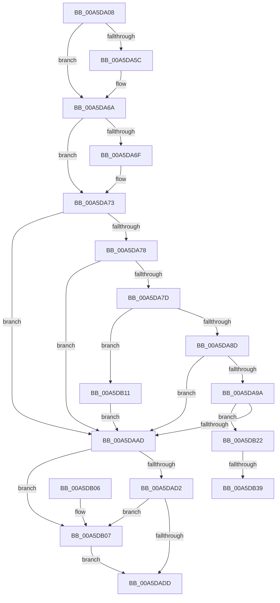

# WdipSemReserveInstanceTableEntry

- RVA: `0x00A5DA08`–`0x00A5DB40` (길이 `312` bytes)
- VA: `0x0000000140A5DA08`
- 실행 섹션: `PAGE`
- PDB 이름 있음: `예`; PDB Function 태그: `예`
- unwind 정보 RVA: `0x0006FDA0`
- 디코드: `83`개 명령, `312/312` bytes 표시
- 미해석 바이트: `0` (있으면 어셈블리에 `.byte`로 보존)

> 이 문서는 커널 이미지의 기계어와 PDB 기호를 분석해 생성했습니다. 4번과 5번은 함수 원형과 자료형을 바이너리 사용 방식에서 추정한 C 해석이며 원본 소스 복구 결과는 아닙니다.

## 1. Dependencies

- 직접 호출 지점: **8**; 고유 호출 대상: **8**
- 직접 호출자로 확인된 함수: **1**
- RIP 상대 이미지 참조: **4**

### Outgoing calls
- `0x00A5DA4C` → [KeAbPreAcquire](../../text/21/KeAbPreAcquire_function_00210230.md) (function, `0x00210230`)
- `0x00A5DA65` → [ExfAcquirePushLockExclusiveEx](../../text/20/ExfAcquirePushLockExclusiveEx_function_0020FC90.md) (function, `0x0020FC90`)
- `0x00A5DA90` → [WdipSemQueryEnabledInstanceTable](WdipSemQueryEnabledInstanceTable_function_00A5DB48.md) (function, `0x00A5DB48`)
- `0x00A5DAA0` → [WdipSemBuildScenarioInstance](WdipSemBuildScenarioInstance_function_00A5DB90.md) (function, `0x00A5DB90`)
- `0x00A5DAE0` → [KeAbPostRelease](../../text/2E/KeAbPostRelease_function_002E1600.md) (function, `0x002E1600`)
- `0x00A5DAE5` → [KeLeaveCriticalRegion](../../text/25/KeLeaveCriticalRegion_function_0025D8B0.md) (function, `0x0025D8B0`)
- `0x00A5DB0A` → [ExfReleasePushLock](../../text/26/ExfReleasePushLock_function_002638D0.md) (function, `0x002638D0`)
- `0x00A5DB1B` → [WdipSemLogInflightLimitExceededInformation](../7B/WdipSemLogInflightLimitExceededInformation_function_007B0B38.md) (function, `0x007B0B38`)

### Direct callers
- [WdipSemEnableScenario](WdipSemEnableScenario_function_00A5C424.md) at `0x00A5C4EF`

### Static image references
- `0x00A5DA29` → RVA `0x00F01DF8` (`.data`; read)
- `0x00A5DA7D` → RVA `0x00F01DF0` (`.data`; read)
- `0x00A5DB22` → RVA `0x00F01DE8` (`.data`; read)
- `0x00A5DB29` → RVA `0x00F01DE0` (`.data`; read)

## 2. Other-region calls and transfers

- 다른 실행 섹션으로 향하는 call: **5**
  - `0x00A5DA4C` → [KeAbPreAcquire](../../text/21/KeAbPreAcquire_function_00210230.md) (`PAGE` → `.text`)
  - `0x00A5DA65` → [ExfAcquirePushLockExclusiveEx](../../text/20/ExfAcquirePushLockExclusiveEx_function_0020FC90.md) (`PAGE` → `.text`)
  - `0x00A5DAE0` → [KeAbPostRelease](../../text/2E/KeAbPostRelease_function_002E1600.md) (`PAGE` → `.text`)
  - `0x00A5DAE5` → [KeLeaveCriticalRegion](../../text/25/KeLeaveCriticalRegion_function_0025D8B0.md) (`PAGE` → `.text`)
  - `0x00A5DB0A` → [ExfReleasePushLock](../../text/26/ExfReleasePushLock_function_002638D0.md) (`PAGE` → `.text`)
- call이 아닌 외부 분기/꼬리 이동: **1**
  - `0x00A5DB33` → [sub_00B3DF8C](../B3/Unknown_function_00B3DF8C.md) (`tail-transfer`)

## 3. Assembly (complete function range)

```asm
00A5DA08  48 89 5C 24 08                  mov qword ptr [rsp + 8], rbx
00A5DA0D  48 89 6C 24 10                  mov qword ptr [rsp + 0x10], rbp
00A5DA12  48 89 74 24 18                  mov qword ptr [rsp + 0x18], rsi
00A5DA17  57                              push rdi
00A5DA18  41 56                           push r14
00A5DA1A  41 57                           push r15
00A5DA1C  48 83 EC 20                     sub rsp, 0x20
00A5DA20  65 48 8B 04 25 88 01 00 00      mov rax, qword ptr gs:[0x188]
00A5DA29  4C 8D 3D C8 43 4A 00            lea r15, [rip + 0x4a43c8]
00A5DA30  48 8B FA                        mov rdi, rdx
00A5DA33  48 8B F1                        mov rsi, rcx
00A5DA36  45 33 F6                        xor r14d, r14d
00A5DA39  45 33 C0                        xor r8d, r8d
00A5DA3C  33 D2                           xor edx, edx
00A5DA3E  49 8B CF                        mov rcx, r15
00A5DA41  66 FF 88 E4 01 00 00            dec word ptr [rax + 0x1e4]
00A5DA48  41 8B DE                        mov ebx, r14d
00A5DA4B  90                              nop
00A5DA4C  E8 DF 27 7B FF                  call 0x140210230
00A5DA51  F0 49 0F BA 2F 00               lock bts qword ptr [r15], 0
00A5DA57  48 8B E8                        mov rbp, rax
00A5DA5A  73 0E                           jae 0x140a5da6a
00A5DA5C  4D 8B C7                        mov r8, r15
00A5DA5F  48 8B D0                        mov rdx, rax
00A5DA62  49 8B CF                        mov rcx, r15
00A5DA65  E8 26 22 7B FF                  call 0x14020fc90
00A5DA6A  48 85 ED                        test rbp, rbp
00A5DA6D  74 04                           je 0x140a5da73
00A5DA6F  C6 45 0A 01                     mov byte ptr [rbp + 0xa], 1
00A5DA73  48 85 F6                        test rsi, rsi
00A5DA76  74 35                           je 0x140a5daad
00A5DA78  48 85 FF                        test rdi, rdi
00A5DA7B  74 30                           je 0x140a5daad
00A5DA7D  81 3D 69 43 4A 00 80 00 00 00   cmp dword ptr [rip + 0x4a4369], 0x80
00A5DA87  0F 83 84 00 00 00               jae 0x140a5db11
00A5DA8D  48 8B CF                        mov rcx, rdi
00A5DA90  E8 B3 00 00 00                  call 0x140a5db48
00A5DA95  48 85 C0                        test rax, rax
00A5DA98  75 13                           jne 0x140a5daad
00A5DA9A  48 8B D7                        mov rdx, rdi
00A5DA9D  48 8B CE                        mov rcx, rsi
00A5DAA0  E8 EB 00 00 00                  call 0x140a5db90
00A5DAA5  48 8B D8                        mov rbx, rax
00A5DAA8  48 85 C0                        test rax, rax
00A5DAAB  75 75                           jne 0x140a5db22
00A5DAAD  0F 0D 0D 44 43 4A 00            prefetchw byte ptr [rip + 0x4a4344]
00A5DAB4  48 8B 05 3D 43 4A 00            mov rax, qword ptr [rip + 0x4a433d]
00A5DABB  48 8B C8                        mov rcx, rax
00A5DABE  48 83 E1 F0                     and rcx, 0xfffffffffffffff0
00A5DAC2  48 83 F9 10                     cmp rcx, 0x10
00A5DAC6  48 8D 50 F0                     lea rdx, [rax - 0x10]
00A5DACA  49 0F 46 D6                     cmovbe rdx, r14
00A5DACE  A8 02                           test al, 2
00A5DAD0  75 35                           jne 0x140a5db07
00A5DAD2  F0 48 0F B1 15 1D 43 4A 00      lock cmpxchg qword ptr [rip + 0x4a431d], rdx
00A5DADB  75 2A                           jne 0x140a5db07
00A5DADD  49 8B CF                        mov rcx, r15
00A5DAE0  E8 1B 3B 88 FF                  call 0x1402e1600
00A5DAE5  E8 C6 FD 7F FF                  call 0x14025d8b0
00A5DAEA  48 8B 6C 24 48                  mov rbp, qword ptr [rsp + 0x48]
00A5DAEF  48 8B C3                        mov rax, rbx
00A5DAF2  48 8B 5C 24 40                  mov rbx, qword ptr [rsp + 0x40]
00A5DAF7  48 8B 74 24 50                  mov rsi, qword ptr [rsp + 0x50]
00A5DAFC  48 83 C4 20                     add rsp, 0x20
00A5DB00  41 5F                           pop r15
00A5DB02  41 5E                           pop r14
00A5DB04  5F                              pop rdi
00A5DB05  C3                              ret
00A5DB06  CC                              int3
00A5DB07  49 8B CF                        mov rcx, r15
00A5DB0A  E8 C1 5D 80 FF                  call 0x1402638d0
00A5DB0F  EB CC                           jmp 0x140a5dadd
00A5DB11  0F B7 56 10                     movzx edx, word ptr [rsi + 0x10]
00A5DB15  4C 8B C7                        mov r8, rdi
00A5DB18  48 8B CE                        mov rcx, rsi
00A5DB1B  E8 18 30 D5 FF                  call 0x1407b0b38
00A5DB20  EB 8B                           jmp 0x140a5daad
00A5DB22  48 8B 0D BF 42 4A 00            mov rcx, qword ptr [rip + 0x4a42bf]
00A5DB29  48 8D 05 B0 42 4A 00            lea rax, [rip + 0x4a42b0]
00A5DB30  48 39 01                        cmp qword ptr [rcx], rax
00A5DB33  0F 84 53 04 0E 00               je 0x140b3df8c
00A5DB39  B9 03 00 00 00                  mov ecx, 3
00A5DB3E  CD 29                           int 0x29
```

## 4. C-style interpretation (structured pseudocode)

```c
__int64 __fastcall WdipSemReserveInstanceTableEntry(__int64 a1, __int64 a2, int a3)
{
    __int64 result;
    __int64 v_r14;
    __int64 v_rsp;
    unsigned __int64 v_stack_p10;
    unsigned __int64 v_stack_p18;
    unsigned __int64 v_stack_p8;

    v_stack_p8 = v_rbx;
    v_stack_p10 = v_rbp;
    v_stack_p18 = v_rsi;
    v_rsp = (v_rsp) - (32);
    v_r14 = 0;
    a3 = 0;
    a2 = 0;
    result = KeAbPreAcquire(v_rip + 4867016, a2, a3, a4);
    if (!(condition_is_above_or_equal)) {
        a3 = v_rip + 4867016;
        a2 = result;
        a1 = v_rip + 4867016;
        result = ExfAcquirePushLockExclusiveEx(a1, a2, a3, a4);
    }
    if (result != 0) {
        *(unsigned __int8 *)(result + 10) = 1;
    }
    if (a1 == 0) goto loc_00A5DAAD;
    if (a2 == 0) goto loc_00A5DAAD;
    if ((*(unsigned int *)(v_rip + 4866921)) >= 128) goto loc_00A5DB11;
    result = WdipSemQueryEnabledInstanceTable(a2, a2, a3, a4);
    if (result != 0) goto loc_00A5DAAD;
    result = WdipSemBuildScenarioInstance(a1, a2, a3, a4);
    if (result != 0) goto loc_00A5DB22;
loc_00A5DAAD:
    a1 = (*(unsigned __int64 *)(v_rip + 4866877)) & (-16);
    a2 = *(unsigned __int64 *)(v_rip + 4866877) - 16;
    if (a1 <= 16) { a2 = 0; }
    if ((((unsigned __int8)(*(unsigned __int64 *)(v_rip + 4866877))) & (2)) != 0) goto loc_00A5DB07;
    if ((((unsigned __int8)(*(unsigned __int64 *)(v_rip + 4866877))) & (2)) != 0) goto loc_00A5DB07;
loc_00A5DADD:
    result = KeAbPostRelease(v_rip + 4867016, a2, a3, a4);
    result = KeLeaveCriticalRegion(v_rip + 4867016, a2, a3, a4);
    v_rsp = (v_rsp) + (32);
    return result;
loc_00A5DB07:
    result = ExfReleasePushLock(v_rip + 4867016, a2, a3, a4);
    goto loc_00A5DADD;
loc_00A5DB11:
    result = WdipSemLogInflightLimitExceededInformation(v_stack_p18, *(unsigned __int16 *)(v_stack_p18 + 16), a2, a4);
    goto loc_00A5DAAD;
loc_00A5DB22:
    return v_rip + 4866736;
}
```

## 5. (Beta) C Style

```c
int64_t WdipSemReserveInstanceTableEntry(int64_t Arg1, int64_t Arg2, int32_t Arg3)
{
    int64_t result;
    int64_t local_r14;
    int64_t local_rsp;
    uint64_t v_stack_p10;
    uint64_t v_stack_p18;
    uint64_t v_stack_p8;

    v_stack_p8 = local_rbx;
    v_stack_p10 = local_rbp;
    v_stack_p18 = local_rsi;
    local_rsp = (local_rsp) - (32);
    local_r14 = 0;
    Arg3 = 0;
    Arg2 = 0;
    result = KeAbPreAcquire(v_rip + 4867016, Arg2, Arg3, a4);
    if (!(condition_is_above_or_equal)) {
        Arg3 = v_rip + 4867016;
        Arg2 = result;
        Arg1 = v_rip + 4867016;
        result = ExfAcquirePushLockExclusiveEx(Arg1, Arg2, Arg3, a4);
    }
    if (result != 0) {
        *(uint8_t *)(result + 0xA) = 1;
    }
    if (Arg1 == 0) goto loc_00A5DAAD;
    if (Arg2 == 0) goto loc_00A5DAAD;
    if ((*(uint32_t *)(v_rip + 0x4A4369)) >= 128) goto loc_00A5DB11;
    result = WdipSemQueryEnabledInstanceTable(Arg2, Arg2, Arg3, a4);
    if (result != 0) goto loc_00A5DAAD;
    result = WdipSemBuildScenarioInstance(Arg1, Arg2, Arg3, a4);
    if (result != 0) goto loc_00A5DB22;
loc_00A5DAAD:
    Arg1 = (*(uint64_t *)(v_rip + 0x4A433D)) & (-16);
    Arg2 = *(uint64_t *)(v_rip + 0x4A433D) - 16;
    if (Arg1 <= 16) { Arg2 = 0; }
    if ((((uint8_t)(*(uint64_t *)(v_rip + 0x4A433D))) & (2)) != 0) goto loc_00A5DB07;
    if ((((uint8_t)(*(uint64_t *)(v_rip + 0x4A433D))) & (2)) != 0) goto loc_00A5DB07;
loc_00A5DADD:
    result = KeAbPostRelease(v_rip + 4867016, Arg2, Arg3, a4);
    result = KeLeaveCriticalRegion(v_rip + 4867016, Arg2, Arg3, a4);
    local_rsp = (local_rsp) + (32);
    return result;
loc_00A5DB07:
    result = ExfReleasePushLock(v_rip + 4867016, Arg2, Arg3, a4);
    goto loc_00A5DADD;
loc_00A5DB11:
    result = WdipSemLogInflightLimitExceededInformation(v_stack_p18, *(uint16_t *)(v_stack_p18 + 0x10), Arg2, a4);
    goto loc_00A5DAAD;
loc_00A5DB22:
    return v_rip + 4866736;
}
```

## 6. Execution-region graph

[열기: 2D/3D 그래프와 함수 탐색 컨트롤 패널](../../../control-panel.html?section=page&rva=0x00A5DA08&view=graph)

- 2D 그래프는 위에서 아래로 흐르고, 3D 그래프는 빈 공간을 드래그해 회전합니다. Shift+드래그는 이동, 휠은 확대·축소, 함수 노드 선택은 대상 보고서 이동입니다.

### Static fallback


