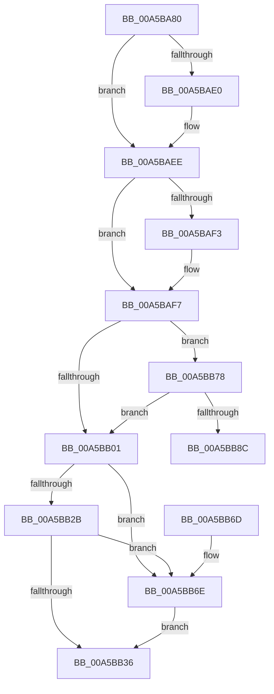

# WdipSemSqmLogInflightLimitExceededDataPoints

- RVA: `0x00A5BA80`–`0x00A5BB98` (길이 `280` bytes)
- VA: `0x0000000140A5BA80`
- 실행 섹션: `PAGE`
- PDB 이름 있음: `예`; PDB Function 태그: `예`
- unwind 정보 RVA: `0x000B2654`
- 디코드: `72`개 명령, `280/280` bytes 표시
- 미해석 바이트: `0` (있으면 어셈블리에 `.byte`로 보존)

> 이 문서는 커널 이미지의 기계어와 PDB 기호를 분석해 생성했습니다. 4번과 5번은 함수 원형과 자료형을 바이너리 사용 방식에서 추정한 C 해석이며 원본 소스 복구 결과는 아닙니다.

## 1. Dependencies

- 직접 호출 지점: **8**; 고유 호출 대상: **8**
- 직접 호출자로 확인된 함수: **1**
- RIP 상대 이미지 참조: **4**

### Outgoing calls
- `0x00A5BAD0` → [KeAbPreAcquire](../../text/21/KeAbPreAcquire_function_00210230.md) (function, `0x00210230`)
- `0x00A5BAE9` → [ExfAcquirePushLockExclusiveEx](../../text/20/ExfAcquirePushLockExclusiveEx_function_0020FC90.md) (function, `0x0020FC90`)
- `0x00A5BB01` → [WdipSemFreeFrequentScenarioTable](WdipSemFreeFrequentScenarioTable_function_00A5BBA0.md) (function, `0x00A5BBA0`)
- `0x00A5BB39` → [KeAbPostRelease](../../text/2E/KeAbPostRelease_function_002E1600.md) (function, `0x002E1600`)
- `0x00A5BB3E` → [KeLeaveCriticalRegion](../../text/25/KeLeaveCriticalRegion_function_0025D8B0.md) (function, `0x0025D8B0`)
- `0x00A5BB4D` → [_security_check_cookie](../../text/6A/_security_check_cookie_function_006AC640.md) (function, `0x006AC640`)
- `0x00A5BB71` → [ExfReleasePushLock](../../text/26/ExfReleasePushLock_function_002638D0.md) (function, `0x002638D0`)
- `0x00A5BB7A` → [WdipSemSqmIncrementDword](../7B/WdipSemSqmIncrementDword_function_007B1DF8.md) (function, `0x007B1DF8`)

### Direct callers
- [WdipTimeoutCheckRoutine](WdipTimeoutCheckRoutine_function_00A5B910.md) at `0x00A5B979`

### Static image references
- `0x00A5BA99` → RVA `0x00E0A740` (`.data`; read)
- `0x00A5BAB1` → RVA `0x00F02448` (`.data`; read)
- `0x00A5BAF7` → RVA `0x00F02440` (`.data`; read)
- `0x00A5BB8C` → RVA `0x00F02040` (`.data`; read)

## 2. Other-region calls and transfers

- 다른 실행 섹션으로 향하는 call: **6**
  - `0x00A5BAD0` → [KeAbPreAcquire](../../text/21/KeAbPreAcquire_function_00210230.md) (`PAGE` → `.text`)
  - `0x00A5BAE9` → [ExfAcquirePushLockExclusiveEx](../../text/20/ExfAcquirePushLockExclusiveEx_function_0020FC90.md) (`PAGE` → `.text`)
  - `0x00A5BB39` → [KeAbPostRelease](../../text/2E/KeAbPostRelease_function_002E1600.md) (`PAGE` → `.text`)
  - `0x00A5BB3E` → [KeLeaveCriticalRegion](../../text/25/KeLeaveCriticalRegion_function_0025D8B0.md) (`PAGE` → `.text`)
  - `0x00A5BB4D` → [_security_check_cookie](../../text/6A/_security_check_cookie_function_006AC640.md) (`PAGE` → `.text`)
  - `0x00A5BB71` → [ExfReleasePushLock](../../text/26/ExfReleasePushLock_function_002638D0.md) (`PAGE` → `.text`)
- call이 아닌 외부 분기/꼬리 이동: **1**
  - `0x00A5BB93` → [sub_00B3DAFC](../B3/Unknown_function_00B3DAFC.md) (`tail-transfer`)

## 3. Assembly (complete function range)

```asm
00A5BA80  48 8B C4                        mov rax, rsp
00A5BA83  48 89 58 08                     mov qword ptr [rax + 8], rbx
00A5BA87  48 89 68 10                     mov qword ptr [rax + 0x10], rbp
00A5BA8B  48 89 70 18                     mov qword ptr [rax + 0x18], rsi
00A5BA8F  48 89 78 20                     mov qword ptr [rax + 0x20], rdi
00A5BA93  41 56                           push r14
00A5BA95  48 83 EC 40                     sub rsp, 0x40
00A5BA99  48 8B 05 A0 EC 3A 00            mov rax, qword ptr [rip + 0x3aeca0]
00A5BAA0  48 33 C4                        xor rax, rsp
00A5BAA3  48 89 44 24 38                  mov qword ptr [rsp + 0x38], rax
00A5BAA8  65 48 8B 04 25 88 01 00 00      mov rax, qword ptr gs:[0x188]
00A5BAB1  4C 8D 35 90 69 4A 00            lea r14, [rip + 0x4a6990]
00A5BAB8  33 ED                           xor ebp, ebp
00A5BABA  45 33 C0                        xor r8d, r8d
00A5BABD  33 D2                           xor edx, edx
00A5BABF  89 6C 24 20                     mov dword ptr [rsp + 0x20], ebp
00A5BAC3  49 8B CE                        mov rcx, r14
00A5BAC6  8B DD                           mov ebx, ebp
00A5BAC8  66 FF 88 E4 01 00 00            dec word ptr [rax + 0x1e4]
00A5BACF  90                              nop
00A5BAD0  E8 5B 47 7B FF                  call 0x140210230
00A5BAD5  F0 49 0F BA 2E 00               lock bts qword ptr [r14], 0
00A5BADB  48 8B F8                        mov rdi, rax
00A5BADE  73 0E                           jae 0x140a5baee
00A5BAE0  4D 8B C6                        mov r8, r14
00A5BAE3  48 8B D0                        mov rdx, rax
00A5BAE6  49 8B CE                        mov rcx, r14
00A5BAE9  E8 A2 41 7B FF                  call 0x14020fc90
00A5BAEE  48 85 FF                        test rdi, rdi
00A5BAF1  74 04                           je 0x140a5baf7
00A5BAF3  C6 47 0A 01                     mov byte ptr [rdi + 0xa], 1
00A5BAF7  8B 3D 43 69 4A 00               mov edi, dword ptr [rip + 0x4a6943]
00A5BAFD  85 FF                           test edi, edi
00A5BAFF  75 77                           jne 0x140a5bb78
00A5BB01  E8 9A 00 00 00                  call 0x140a5bba0
00A5BB06  0F 0D 0D 3B 69 4A 00            prefetchw byte ptr [rip + 0x4a693b]
00A5BB0D  48 8B 05 34 69 4A 00            mov rax, qword ptr [rip + 0x4a6934]
00A5BB14  48 8B C8                        mov rcx, rax
00A5BB17  48 83 E1 F0                     and rcx, 0xfffffffffffffff0
00A5BB1B  48 83 F9 10                     cmp rcx, 0x10
00A5BB1F  48 8D 50 F0                     lea rdx, [rax - 0x10]
00A5BB23  48 0F 46 D5                     cmovbe rdx, rbp
00A5BB27  A8 02                           test al, 2
00A5BB29  75 43                           jne 0x140a5bb6e
00A5BB2B  F0 48 0F B1 15 14 69 4A 00      lock cmpxchg qword ptr [rip + 0x4a6914], rdx
00A5BB34  75 38                           jne 0x140a5bb6e
00A5BB36  49 8B CE                        mov rcx, r14
00A5BB39  E8 C2 5A 88 FF                  call 0x1402e1600
00A5BB3E  E8 6D 1D 80 FF                  call 0x14025d8b0
00A5BB43  8B C3                           mov eax, ebx
00A5BB45  48 8B 4C 24 38                  mov rcx, qword ptr [rsp + 0x38]
00A5BB4A  48 33 CC                        xor rcx, rsp
00A5BB4D  E8 EE 0A C5 FF                  call 0x1406ac640
00A5BB52  48 8B 5C 24 50                  mov rbx, qword ptr [rsp + 0x50]
00A5BB57  48 8B 6C 24 58                  mov rbp, qword ptr [rsp + 0x58]
00A5BB5C  48 8B 74 24 60                  mov rsi, qword ptr [rsp + 0x60]
00A5BB61  48 8B 7C 24 68                  mov rdi, qword ptr [rsp + 0x68]
00A5BB66  48 83 C4 40                     add rsp, 0x40
00A5BB6A  41 5E                           pop r14
00A5BB6C  C3                              ret
00A5BB6D  CC                              int3
00A5BB6E  49 8B CE                        mov rcx, r14
00A5BB71  E8 5A 7D 80 FF                  call 0x1402638d0
00A5BB76  EB BE                           jmp 0x140a5bb36
00A5BB78  8B D7                           mov edx, edi
00A5BB7A  E8 79 62 D5 FF                  call 0x1407b1df8
00A5BB7F  85 C0                           test eax, eax
00A5BB81  0F 49 D8                        cmovns ebx, eax
00A5BB84  85 FF                           test edi, edi
00A5BB86  0F 84 75 FF FF FF               je 0x140a5bb01
00A5BB8C  48 8D 35 AD 64 4A 00            lea rsi, [rip + 0x4a64ad]
00A5BB93  E9 64 1F 0E 00                  jmp 0x140b3dafc
```

## 4. C-style interpretation (structured pseudocode)

```c
__int64 __fastcall WdipSemSqmLogInflightLimitExceededDataPoints(__int64 a1, int a2, int a3)
{
    __int64 result;
    __int64 v_rbp;
    __int64 v_rbx;
    __int64 v_rsp;
    unsigned __int64 v_stack_m10;
    unsigned int v_stack_m28;
    unsigned __int64 v_stack_p10;
    unsigned __int64 v_stack_p18;
    unsigned __int64 v_stack_p20;
    unsigned __int64 v_stack_p8;

    *(unsigned __int64 *)(v_rsp + 8) = v_rbx;
    *(unsigned __int64 *)(v_rsp + 16) = v_rbp;
    *(unsigned __int64 *)(v_rsp + 24) = v_rsi;
    *(unsigned __int64 *)(v_rsp + 32) = v_rdi;
    v_rsp = (v_rsp) - (64);
    result = (*(unsigned __int64 *)(v_rip + 3861664)) ^ (v_rsp);
    v_stack_m10 = result;
    v_rbp = 0;
    a3 = 0;
    a2 = 0;
    v_stack_m28 = 0;
    result = KeAbPreAcquire(v_rip + 4876688, a2, a3, a4);
    if (!(condition_is_above_or_equal)) {
        a3 = v_rip + 4876688;
        a2 = result;
        a1 = v_rip + 4876688;
        result = ExfAcquirePushLockExclusiveEx(a1, a2, a3, a4);
    }
    if (result != 0) {
        *(unsigned __int8 *)(result + 10) = 1;
    }
    if ((unsigned int)((unsigned int)(*(unsigned int *)(v_rip + 4876611))) != 0) goto loc_00A5BB78;
loc_00A5BB01:
    result = WdipSemFreeFrequentScenarioTable(a1, a2, a3, a4);
    a1 = (*(unsigned __int64 *)(v_rip + 4876596)) & (-16);
    a2 = *(unsigned __int64 *)(v_rip + 4876596) - 16;
    if (a1 <= 16) { a2 = 0; }
    if ((((unsigned __int8)(*(unsigned __int64 *)(v_rip + 4876596))) & (2)) != 0) goto loc_00A5BB6E;
    if ((((unsigned __int8)(*(unsigned __int64 *)(v_rip + 4876596))) & (2)) != 0) goto loc_00A5BB6E;
loc_00A5BB36:
    result = KeAbPostRelease(v_rip + 4876688, a2, a3, a4);
    result = KeLeaveCriticalRegion(v_rip + 4876688, a2, a3, a4);
    a1 = (v_stack_m10) ^ (v_rsp);
    result = _security_check_cookie(a1, a2, a3, a4);
    v_rsp = (v_rsp) + (64);
    return result;
loc_00A5BB6E:
    result = ExfReleasePushLock(v_rip + 4876688, a2, a3, a4);
    goto loc_00A5BB36;
loc_00A5BB78:
    result = WdipSemSqmIncrementDword(v_rip + 4876688, (unsigned int)((unsigned int)(v_stack_p20)), a3, a4);
    v_rbx = v_stack_p8;
    if (!sign_flag) { v_rbx = (unsigned int)(result); }
    if ((unsigned int)(v_stack_p20) == 0) goto loc_00A5BB01;
}
```

## 5. (Beta) C Style

```c
int64_t WdipSemSqmLogInflightLimitExceededDataPoints(int64_t Arg1, int32_t Arg2, int32_t Arg3)
{
    int64_t result;
    int64_t local_rbp;
    int64_t local_rbx;
    int64_t local_rsp;
    uint64_t v_stack_m10;
    uint32_t v_stack_m28;
    uint64_t v_stack_p10;
    uint64_t v_stack_p18;
    uint64_t v_stack_p20;
    uint64_t v_stack_p8;

    *(uint64_t *)(local_rsp + 0x8) = local_rbx;
    *(uint64_t *)(local_rsp + 0x10) = local_rbp;
    *(uint64_t *)(local_rsp + 0x18) = local_rsi;
    *(uint64_t *)(local_rsp + 0x20) = local_rdi;
    local_rsp = (local_rsp) - (64);
    result = (*(uint64_t *)(v_rip + 0x3AECA0)) ^ (local_rsp);
    v_stack_m10 = result;
    local_rbp = 0;
    Arg3 = 0;
    Arg2 = 0;
    v_stack_m28 = 0;
    result = KeAbPreAcquire(v_rip + 4876688, Arg2, Arg3, a4);
    if (!(condition_is_above_or_equal)) {
        Arg3 = v_rip + 4876688;
        Arg2 = result;
        Arg1 = v_rip + 4876688;
        result = ExfAcquirePushLockExclusiveEx(Arg1, Arg2, Arg3, a4);
    }
    if (result != 0) {
        *(uint8_t *)(result + 0xA) = 1;
    }
    if ((uint32_t)((uint32_t)(*(uint32_t *)(v_rip + 0x4A6943))) != 0) goto loc_00A5BB78;
loc_00A5BB01:
    result = WdipSemFreeFrequentScenarioTable(Arg1, Arg2, Arg3, a4);
    Arg1 = (*(uint64_t *)(v_rip + 0x4A6934)) & (-16);
    Arg2 = *(uint64_t *)(v_rip + 0x4A6934) - 16;
    if (Arg1 <= 16) { Arg2 = 0; }
    if ((((uint8_t)(*(uint64_t *)(v_rip + 0x4A6934))) & (2)) != 0) goto loc_00A5BB6E;
    if ((((uint8_t)(*(uint64_t *)(v_rip + 0x4A6934))) & (2)) != 0) goto loc_00A5BB6E;
loc_00A5BB36:
    result = KeAbPostRelease(v_rip + 4876688, Arg2, Arg3, a4);
    result = KeLeaveCriticalRegion(v_rip + 4876688, Arg2, Arg3, a4);
    Arg1 = (v_stack_m10) ^ (local_rsp);
    result = _security_check_cookie(Arg1, Arg2, Arg3, a4);
    local_rsp = (local_rsp) + (64);
    return result;
loc_00A5BB6E:
    result = ExfReleasePushLock(v_rip + 4876688, Arg2, Arg3, a4);
    goto loc_00A5BB36;
loc_00A5BB78:
    result = WdipSemSqmIncrementDword(v_rip + 4876688, (uint32_t)((uint32_t)(v_stack_p20)), Arg3, a4);
    local_rbx = v_stack_p8;
    if (!sign_flag) { local_rbx = (uint32_t)(result); }
    if ((uint32_t)(v_stack_p20) == 0) goto loc_00A5BB01;
}
```

## 6. Execution-region graph

[열기: 2D/3D 그래프와 함수 탐색 컨트롤 패널](../../../control-panel.html?section=page&rva=0x00A5BA80&view=graph)

- 2D 그래프는 위에서 아래로 흐르고, 3D 그래프는 빈 공간을 드래그해 회전합니다. Shift+드래그는 이동, 휠은 확대·축소, 함수 노드 선택은 대상 보고서 이동입니다.

### Static fallback


