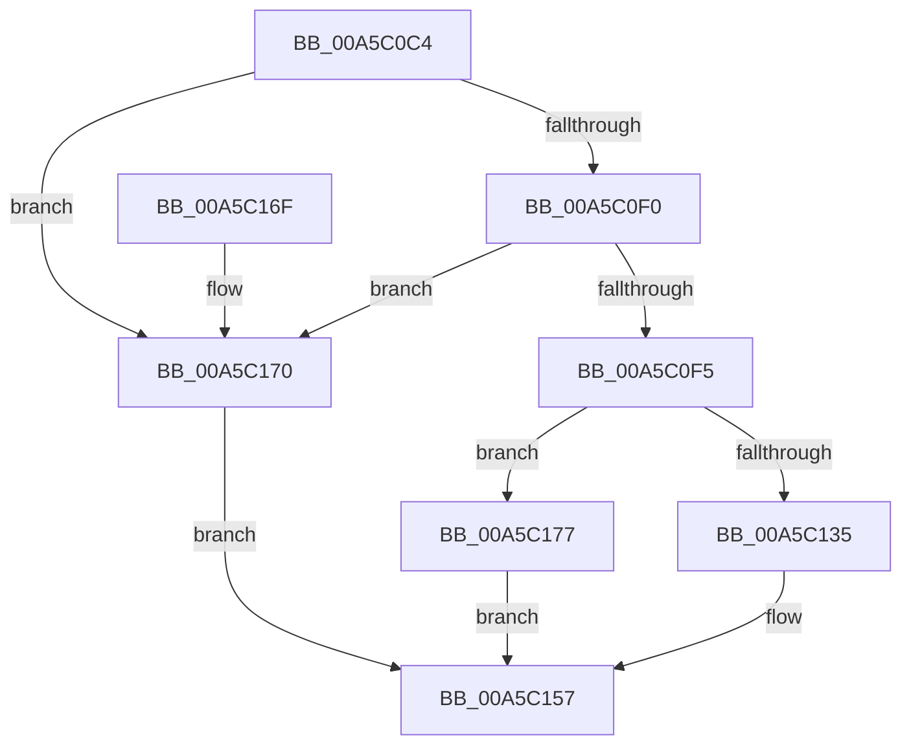

# WdipSemWriteTimeoutEvent

- RVA: `0x00A5C0C4`–`0x00A5C17E` (길이 `186` bytes)
- VA: `0x0000000140A5C0C4`
- 실행 섹션: `PAGE`
- PDB 이름 있음: `예`; PDB Function 태그: `아니요`
- unwind 정보 RVA: `0x000B26F0`
- 디코드: `45`개 명령, `186/186` bytes 표시
- 미해석 바이트: `0` (있으면 어셈블리에 `.byte`로 보존)

> 이 문서는 커널 이미지의 기계어와 PDB 기호를 분석해 생성했습니다. 4번과 5번은 함수 원형과 자료형을 바이너리 사용 방식에서 추정한 C 해석이며 원본 소스 복구 결과는 아닙니다.

## 1. Dependencies

- 직접 호출 지점: **3**; 고유 호출 대상: **3**
- 직접 호출자로 확인된 함수: **1**
- RIP 상대 이미지 참조: **3**

### Outgoing calls
- `0x00A5C12C` → [EtwEventEnabled](../../text/39/EtwEventEnabled_function_00392450.md) (function, `0x00392450`)
- `0x00A5C152` → [EtwWrite](../../text/41/EtwWrite_function_0041C720.md) (function, `0x0041C720`)
- `0x00A5C15F` → [_security_check_cookie](../../text/6A/_security_check_cookie_function_006AC640.md) (function, `0x006AC640`)

### Direct callers
- [WdipSemLogTimeoutInformation](WdipSemLogTimeoutInformation_function_00A5C02C.md) at `0x00A5C09B`

### Static image references
- `0x00A5C0D5` → RVA `0x00E0A740` (`.data`; read)
- `0x00A5C0F5` → RVA `0x00F01DD0` (`.data`; read)
- `0x00A5C104` → RVA `0x0001A768` (`.rdata`; read)

## 2. Other-region calls and transfers

- 다른 실행 섹션으로 향하는 call: **3**
  - `0x00A5C12C` → [EtwEventEnabled](../../text/39/EtwEventEnabled_function_00392450.md) (`PAGE` → `.text`)
  - `0x00A5C152` → [EtwWrite](../../text/41/EtwWrite_function_0041C720.md) (`PAGE` → `.text`)
  - `0x00A5C15F` → [_security_check_cookie](../../text/6A/_security_check_cookie_function_006AC640.md) (`PAGE` → `.text`)
- 별도 외부 분기/꼬리 이동을 확인하지 못했습니다.

## 3. Assembly (complete function range)

```asm
00A5C0C4  4C 8B DC                        mov r11, rsp
00A5C0C7  49 89 5B 08                     mov qword ptr [r11 + 8], rbx
00A5C0CB  66 89 54 24 10                  mov word ptr [rsp + 0x10], dx
00A5C0D0  57                              push rdi
00A5C0D1  48 83 EC 60                     sub rsp, 0x60
00A5C0D5  48 8B 05 64 E6 3A 00            mov rax, qword ptr [rip + 0x3ae664]
00A5C0DC  48 33 C4                        xor rax, rsp
00A5C0DF  48 89 44 24 50                  mov qword ptr [rsp + 0x50], rax
00A5C0E4  49 8B D8                        mov rbx, r8
00A5C0E7  48 85 C9                        test rcx, rcx
00A5C0EA  0F 84 80 00 00 00               je 0x140a5c170
00A5C0F0  48 85 DB                        test rbx, rbx
00A5C0F3  74 7B                           je 0x140a5c170
00A5C0F5  48 8B 3D D4 5C 4A 00            mov rdi, qword ptr [rip + 0x4a5cd4]
00A5C0FC  49 8D 43 10                     lea rax, [r11 + 0x10]
00A5C100  49 89 4B C8                     mov qword ptr [r11 - 0x38], rcx
00A5C104  48 8D 15 5D E6 5B FF            lea rdx, [rip - 0xa419a3]
00A5C10B  83 64 24 3C 00                  and dword ptr [rsp + 0x3c], 0
00A5C110  48 8B CF                        mov rcx, rdi
00A5C113  C7 44 24 38 10 00 00 00         mov dword ptr [rsp + 0x38], 0x10
00A5C11B  49 89 43 D8                     mov qword ptr [r11 - 0x28], rax
00A5C11F  83 64 24 4C 00                  and dword ptr [rsp + 0x4c], 0
00A5C124  C7 44 24 48 02 00 00 00         mov dword ptr [rsp + 0x48], 2
00A5C12C  E8 1F 63 93 FF                  call 0x140392450
00A5C131  84 C0                           test al, al
00A5C133  74 42                           je 0x140a5c177
00A5C135  48 8D 44 24 30                  lea rax, [rsp + 0x30]
00A5C13A  41 B9 02 00 00 00               mov r9d, 2
00A5C140  4C 8B C3                        mov r8, rbx
00A5C143  48 89 44 24 20                  mov qword ptr [rsp + 0x20], rax
00A5C148  48 8D 15 19 E6 5B FF            lea rdx, [rip - 0xa419e7]
00A5C14F  48 8B CF                        mov rcx, rdi
00A5C152  E8 C9 05 9C FF                  call 0x14041c720
00A5C157  48 8B 4C 24 50                  mov rcx, qword ptr [rsp + 0x50]
00A5C15C  48 33 CC                        xor rcx, rsp
00A5C15F  E8 DC 04 C5 FF                  call 0x1406ac640
00A5C164  48 8B 5C 24 70                  mov rbx, qword ptr [rsp + 0x70]
00A5C169  48 83 C4 60                     add rsp, 0x60
00A5C16D  5F                              pop rdi
00A5C16E  C3                              ret
00A5C16F  CC                              int3
00A5C170  B8 0D 00 00 C0                  mov eax, 0xc000000d
00A5C175  EB E0                           jmp 0x140a5c157
00A5C177  B8 08 00 00 C0                  mov eax, 0xc0000008
00A5C17C  EB D9                           jmp 0x140a5c157
```

## 4. C-style interpretation (structured pseudocode)

```c
__int64 __fastcall WdipSemWriteTimeoutEvent(__int64 a1, unsigned __int16 a2, __int64 a3)
{
    __int64 result;
    __int64 v_rsp;
    unsigned __int64 v_stack_m18;
    unsigned int v_stack_m1C;
    unsigned int v_stack_m20;
    unsigned int v_stack_m2C;
    unsigned int v_stack_m30;
    unsigned __int64 v_stack_m38;
    unsigned __int64 v_stack_m48;
    unsigned __int16 v_stack_p10;
    unsigned __int64 v_stack_p8;

    *(unsigned __int64 *)(v_rsp + 8) = v_rbx;
    v_stack_p10 = a2;
    v_rsp = (v_rsp) - (96);
    result = (*(unsigned __int64 *)(v_rip + 3860068)) ^ (v_rsp);
    v_stack_m18 = result;
    if (a1 == 0) goto loc_00A5C170;
    if (a3 == 0) goto loc_00A5C170;
    *(unsigned __int64 *)(v_rsp - 56) = a1;
    v_stack_m30 = 16;
    *(unsigned __int64 *)(v_rsp - 40) = v_rsp + 16;
    v_stack_m20 = 2;
    result = EtwEventEnabled(*(unsigned __int64 *)(v_rip + 4873428), v_rip - 10754467, a3, a4);
    if ((unsigned __int8)(result) == 0) goto loc_00A5C177;
    v_stack_m48 = v_stack_m38;
    result = EtwWrite(*(unsigned __int64 *)(v_rip + 4873428), v_rip - 10754535, a3, 2);
loc_00A5C157:
    a1 = (v_stack_m18) ^ (v_rsp);
    result = _security_check_cookie(a1, v_rip - 10754535, a3, 2);
    v_rsp = (v_rsp) + (96);
    return result;
loc_00A5C170:
    goto loc_00A5C157;
loc_00A5C177:
    goto loc_00A5C157;
}
```

## 5. (Beta) C Style

```c
int64_t WdipSemWriteTimeoutEvent(int64_t Arg1, uint16_t Arg2, int64_t Arg3)
{
    int64_t result;
    int64_t local_rsp;
    uint64_t v_stack_m18;
    uint32_t v_stack_m1C;
    uint32_t v_stack_m20;
    uint32_t v_stack_m2C;
    uint32_t v_stack_m30;
    uint64_t v_stack_m38;
    uint64_t v_stack_m48;
    uint16_t v_stack_p10;
    uint64_t v_stack_p8;

    *(uint64_t *)(local_rsp + 0x8) = local_rbx;
    v_stack_p10 = Arg2;
    local_rsp = (local_rsp) - (96);
    result = (*(uint64_t *)(v_rip + 0x3AE664)) ^ (local_rsp);
    v_stack_m18 = result;
    if (Arg1 == 0) goto loc_00A5C170;
    if (Arg3 == 0) goto loc_00A5C170;
    *(uint64_t *)(local_rsp - 0x38) = Arg1;
    v_stack_m30 = 16;
    *(uint64_t *)(local_rsp - 0x28) = local_rsp + 16;
    v_stack_m20 = 2;
    result = EtwEventEnabled(*(uint64_t *)(v_rip + 0x4A5CD4), v_rip - 10754467, Arg3, a4);
    if ((uint8_t)(result) == 0) goto loc_00A5C177;
    v_stack_m48 = v_stack_m38;
    result = EtwWrite(*(uint64_t *)(v_rip + 0x4A5CD4), v_rip - 10754535, Arg3, 2);
loc_00A5C157:
    Arg1 = (v_stack_m18) ^ (local_rsp);
    result = _security_check_cookie(Arg1, v_rip - 10754535, Arg3, 2);
    local_rsp = (local_rsp) + (96);
    return result;
loc_00A5C170:
    goto loc_00A5C157;
loc_00A5C177:
    goto loc_00A5C157;
}
```

## 6. Execution-region graph

[열기: 2D/3D 그래프와 함수 탐색 컨트롤 패널](../../../control-panel.html?section=page&rva=0x00A5C0C4&view=graph)

- 2D 그래프는 위에서 아래로 흐르고, 3D 그래프는 빈 공간을 드래그해 회전합니다. Shift+드래그는 이동, 휠은 확대·축소, 함수 노드 선택은 대상 보고서 이동입니다.

### Static fallback


