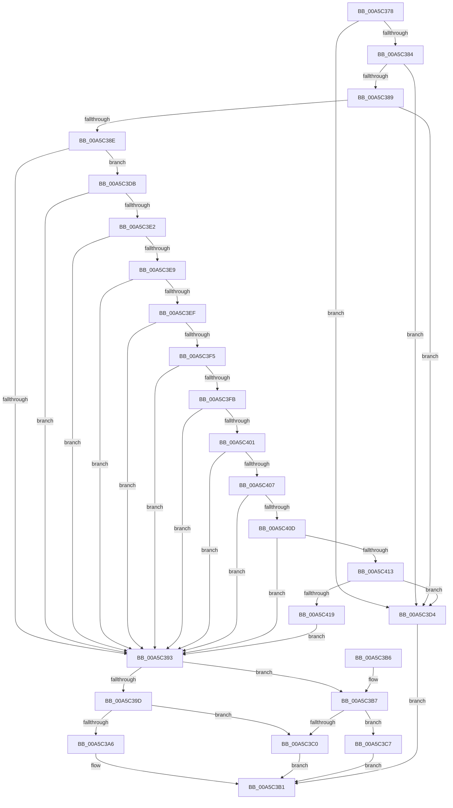

# WdipStartEndScenario

- RVA: `0x00A5C378`–`0x00A5C41E` (길이 `166` bytes)
- VA: `0x0000000140A5C378`
- 실행 섹션: `PAGE`
- PDB 이름 있음: `예`; PDB Function 태그: `아니요`
- unwind 정보 RVA: `0x000B2738`
- 디코드: `52`개 명령, `166/166` bytes 표시
- 미해석 바이트: `0` (있으면 어셈블리에 `.byte`로 보존)

> 이 문서는 커널 이미지의 기계어와 PDB 기호를 분석해 생성했습니다. 4번과 5번은 함수 원형과 자료형을 바이너리 사용 방식에서 추정한 C 해석이며 원본 소스 복구 결과는 아닙니다.

## 1. Dependencies

- 직접 호출 지점: **2**; 고유 호출 대상: **2**
- 직접 호출자로 확인된 함수: **2**
- RIP 상대 이미지 참조: **1**

### Outgoing calls
- `0x00A5C3AC` → [WdipSemEnableScenario](WdipSemEnableScenario_function_00A5C424.md) (function, `0x00A5C424`)
- `0x00A5C3CD` → [WdipSemDisableScenario](WdipSemDisableScenario_function_00A5BC00.md) (function, `0x00A5BC00`)

### Direct callers
- [WdiDispatchControl](WdiDispatchControl_function_00A5C308.md) at `0x00A5C350`
- [EtwWriteStartScenario](../AB/EtwWriteStartScenario_function_00AB75B0.md) at `0x00AB76C6`

### Static image references
- `0x00A5C39D` → RVA `0x00F01E18` (`.data`; read)

## 2. Other-region calls and transfers

- 다른 실행 섹션으로 향하는 call: **0**
- 별도 외부 분기/꼬리 이동을 확인하지 못했습니다.

## 3. Assembly (complete function range)

```asm
00A5C378  48 83 EC 28                     sub rsp, 0x28
00A5C37C  45 33 D2                        xor r10d, r10d
00A5C37F  48 85 C9                        test rcx, rcx
00A5C382  74 50                           je 0x140a5c3d4
00A5C384  48 85 D2                        test rdx, rdx
00A5C387  74 4B                           je 0x140a5c3d4
00A5C389  4D 85 C0                        test r8, r8
00A5C38C  74 46                           je 0x140a5c3d4
00A5C38E  44 39 12                        cmp dword ptr [rdx], r10d
00A5C391  74 48                           je 0x140a5c3db
00A5C393  41 0F B7 00                     movzx eax, word ptr [r8]
00A5C397  41 83 F9 0A                     cmp r9d, 0xa
00A5C39B  75 1A                           jne 0x140a5c3b7
00A5C39D  44 38 15 74 5A 4A 00            cmp byte ptr [rip + 0x4a5a74], r10b
00A5C3A4  74 1A                           je 0x140a5c3c0
00A5C3A6  4C 8B C2                        mov r8, rdx
00A5C3A9  0F B7 D0                        movzx edx, ax
00A5C3AC  E8 73 00 00 00                  call 0x140a5c424
00A5C3B1  48 83 C4 28                     add rsp, 0x28
00A5C3B5  C3                              ret
00A5C3B6  CC                              int3
00A5C3B7  44 38 15 5A 5A 4A 00            cmp byte ptr [rip + 0x4a5a5a], r10b
00A5C3BE  75 07                           jne 0x140a5c3c7
00A5C3C0  B8 01 00 00 C0                  mov eax, 0xc0000001
00A5C3C5  EB EA                           jmp 0x140a5c3b1
00A5C3C7  4C 8B C2                        mov r8, rdx
00A5C3CA  0F B7 D0                        movzx edx, ax
00A5C3CD  E8 2E F8 FF FF                  call 0x140a5bc00
00A5C3D2  EB DD                           jmp 0x140a5c3b1
00A5C3D4  B8 0D 00 00 C0                  mov eax, 0xc000000d
00A5C3D9  EB D6                           jmp 0x140a5c3b1
00A5C3DB  66 44 39 52 04                  cmp word ptr [rdx + 4], r10w
00A5C3E0  75 B1                           jne 0x140a5c393
00A5C3E2  66 44 39 52 06                  cmp word ptr [rdx + 6], r10w
00A5C3E7  75 AA                           jne 0x140a5c393
00A5C3E9  44 38 52 08                     cmp byte ptr [rdx + 8], r10b
00A5C3ED  75 A4                           jne 0x140a5c393
00A5C3EF  44 38 52 09                     cmp byte ptr [rdx + 9], r10b
00A5C3F3  75 9E                           jne 0x140a5c393
00A5C3F5  44 38 52 0A                     cmp byte ptr [rdx + 0xa], r10b
00A5C3F9  75 98                           jne 0x140a5c393
00A5C3FB  44 38 52 0B                     cmp byte ptr [rdx + 0xb], r10b
00A5C3FF  75 92                           jne 0x140a5c393
00A5C401  44 38 52 0C                     cmp byte ptr [rdx + 0xc], r10b
00A5C405  75 8C                           jne 0x140a5c393
00A5C407  44 38 52 0D                     cmp byte ptr [rdx + 0xd], r10b
00A5C40B  75 86                           jne 0x140a5c393
00A5C40D  44 38 52 0E                     cmp byte ptr [rdx + 0xe], r10b
00A5C411  75 80                           jne 0x140a5c393
00A5C413  44 38 52 0F                     cmp byte ptr [rdx + 0xf], r10b
00A5C417  74 BB                           je 0x140a5c3d4
00A5C419  E9 75 FF FF FF                  jmp 0x140a5c393
```

## 4. C-style interpretation (structured pseudocode)

```c
__int64 __fastcall WdipStartEndScenario(__int64 a1, __int64 a2, __int64 a3, int a4)
{
    __int64 result;
    __int64 v_r10;
    __int64 v_rsp;

    v_rsp = (v_rsp) - (40);
    v_r10 = 0;
    if (a1 == 0) goto loc_00A5C3D4;
    if (a2 == 0) goto loc_00A5C3D4;
    if (a3 == 0) goto loc_00A5C3D4;
    if ((*(unsigned int *)(a2)) == 0) goto loc_00A5C3DB;
loc_00A5C393:
    if (a4 != 10) goto loc_00A5C3B7;
    if ((*(unsigned __int8 *)(v_rip + 4872820)) == 0) goto loc_00A5C3C0;
    result = WdipSemEnableScenario(a1, (unsigned __int16)(*(unsigned __int16 *)(a3)), a2, a4);
loc_00A5C3B1:
    v_rsp = (v_rsp) + (40);
    return result;
loc_00A5C3B7:
    if ((*(unsigned __int8 *)(v_rip + 4872794)) != 0) goto loc_00A5C3C7;
loc_00A5C3C0:
    goto loc_00A5C3B1;
loc_00A5C3C7:
    result = WdipSemDisableScenario(a1, (unsigned __int16)((unsigned int)(0xC0000001ULL)), (unsigned __int16)(*(unsigned __int16 *)(a3)), a4);
    goto loc_00A5C3B1;
loc_00A5C3D4:
    goto loc_00A5C3B1;
loc_00A5C3DB:
    if ((*(unsigned __int16 *)((unsigned __int16)((unsigned int)(0xC0000001ULL)) + 4)) != 0) goto loc_00A5C393;
    if ((*(unsigned __int16 *)((unsigned __int16)((unsigned int)(0xC0000001ULL)) + 6)) != 0) goto loc_00A5C393;
    if ((*(unsigned __int8 *)((unsigned __int16)((unsigned int)(0xC0000001ULL)) + 8)) != 0) goto loc_00A5C393;
    if ((*(unsigned __int8 *)((unsigned __int16)((unsigned int)(0xC0000001ULL)) + 9)) != 0) goto loc_00A5C393;
    if ((*(unsigned __int8 *)((unsigned __int16)((unsigned int)(0xC0000001ULL)) + 10)) != 0) goto loc_00A5C393;
    if ((*(unsigned __int8 *)((unsigned __int16)((unsigned int)(0xC0000001ULL)) + 11)) != 0) goto loc_00A5C393;
    if ((*(unsigned __int8 *)((unsigned __int16)((unsigned int)(0xC0000001ULL)) + 12)) != 0) goto loc_00A5C393;
    if ((*(unsigned __int8 *)((unsigned __int16)((unsigned int)(0xC0000001ULL)) + 13)) != 0) goto loc_00A5C393;
    if ((*(unsigned __int8 *)((unsigned __int16)((unsigned int)(0xC0000001ULL)) + 14)) != 0) goto loc_00A5C393;
    if ((*(unsigned __int8 *)((unsigned __int16)((unsigned int)(0xC0000001ULL)) + 15)) == 0) goto loc_00A5C3D4;
    goto loc_00A5C393;
}
```

## 5. (Beta) C Style

```c
int64_t WdipStartEndScenario(int64_t Arg1, int64_t Arg2, int64_t Arg3, int32_t Arg4)
{
    int64_t result;
    int64_t local_r10;
    int64_t local_rsp;

    local_rsp = (local_rsp) - (40);
    local_r10 = 0;
    if (Arg1 == 0) goto loc_00A5C3D4;
    if (Arg2 == 0) goto loc_00A5C3D4;
    if (Arg3 == 0) goto loc_00A5C3D4;
    if ((*(uint32_t *)(Arg2)) == 0) goto loc_00A5C3DB;
loc_00A5C393:
    if (Arg4 != 10) goto loc_00A5C3B7;
    if ((*(uint8_t *)(v_rip + 0x4A5A74)) == 0) goto loc_00A5C3C0;
    result = WdipSemEnableScenario(Arg1, (uint16_t)(*(uint16_t *)(Arg3)), Arg2, Arg4);
loc_00A5C3B1:
    local_rsp = (local_rsp) + (40);
    return result;
loc_00A5C3B7:
    if ((*(uint8_t *)(v_rip + 0x4A5A5A)) != 0) goto loc_00A5C3C7;
loc_00A5C3C0:
    goto loc_00A5C3B1;
loc_00A5C3C7:
    result = WdipSemDisableScenario(Arg1, (uint16_t)((uint32_t)(0xC0000001ULL)), (uint16_t)(*(uint16_t *)(Arg3)), Arg4);
    goto loc_00A5C3B1;
loc_00A5C3D4:
    goto loc_00A5C3B1;
loc_00A5C3DB:
    if ((*(uint16_t *)((uint16_t)((uint32_t)(0xC0000001ULL)) + 0x4)) != 0) goto loc_00A5C393;
    if ((*(uint16_t *)((uint16_t)((uint32_t)(0xC0000001ULL)) + 0x6)) != 0) goto loc_00A5C393;
    if ((*(uint8_t *)((uint16_t)((uint32_t)(0xC0000001ULL)) + 0x8)) != 0) goto loc_00A5C393;
    if ((*(uint8_t *)((uint16_t)((uint32_t)(0xC0000001ULL)) + 0x9)) != 0) goto loc_00A5C393;
    if ((*(uint8_t *)((uint16_t)((uint32_t)(0xC0000001ULL)) + 0xA)) != 0) goto loc_00A5C393;
    if ((*(uint8_t *)((uint16_t)((uint32_t)(0xC0000001ULL)) + 0xB)) != 0) goto loc_00A5C393;
    if ((*(uint8_t *)((uint16_t)((uint32_t)(0xC0000001ULL)) + 0xC)) != 0) goto loc_00A5C393;
    if ((*(uint8_t *)((uint16_t)((uint32_t)(0xC0000001ULL)) + 0xD)) != 0) goto loc_00A5C393;
    if ((*(uint8_t *)((uint16_t)((uint32_t)(0xC0000001ULL)) + 0xE)) != 0) goto loc_00A5C393;
    if ((*(uint8_t *)((uint16_t)((uint32_t)(0xC0000001ULL)) + 0xF)) == 0) goto loc_00A5C3D4;
    goto loc_00A5C393;
}
```

## 6. Execution-region graph

[열기: 2D/3D 그래프와 함수 탐색 컨트롤 패널](../../../control-panel.html?section=page&rva=0x00A5C378&view=graph)

- 2D 그래프는 위에서 아래로 흐르고, 3D 그래프는 빈 공간을 드래그해 회전합니다. Shift+드래그는 이동, 휠은 확대·축소, 함수 노드 선택은 대상 보고서 이동입니다.

### Static fallback


