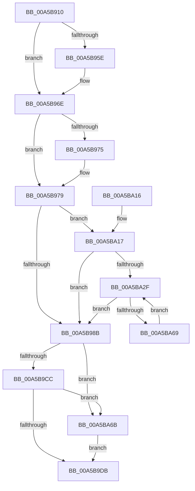

# WdipTimeoutCheckRoutine

- RVA: `0x00A5B910`–`0x00A5BA78` (길이 `360` bytes)
- VA: `0x0000000140A5B910`
- 실행 섹션: `PAGE`
- PDB 이름 있음: `예`; PDB Function 태그: `아니요`
- unwind 정보 RVA: `0x000B263C`
- 디코드: `85`개 명령, `360/360` bytes 표시
- 미해석 바이트: `0` (있으면 어셈블리에 `.byte`로 보존)

> 이 문서는 커널 이미지의 기계어와 PDB 기호를 분석해 생성했습니다. 4번과 5번은 함수 원형과 자료형을 바이너리 사용 방식에서 추정한 C 해석이며 원본 소스 복구 결과는 아닙니다.

## 1. Dependencies

- 직접 호출 지점: **12**; 고유 호출 대상: **11**
- 직접 호출자로 확인된 함수: **0**
- RIP 상대 이미지 참조: **7**

### Outgoing calls
- `0x00A5B944` → [KeAbPreAcquire](../../text/21/KeAbPreAcquire_function_00210230.md) (function, `0x00210230`)
- `0x00A5B969` → [ExfAcquirePushLockSharedEx](../../text/21/ExfAcquirePushLockSharedEx_function_0021044C.md) (function, `0x0021044C`)
- `0x00A5B979` → [WdipSemSqmLogInflightLimitExceededDataPoints](WdipSemSqmLogInflightLimitExceededDataPoints_function_00A5BA80.md) (function, `0x00A5BA80`)
- `0x00A5B9DE` → [KeAbPostRelease](../../text/2E/KeAbPostRelease_function_002E1600.md) (function, `0x002E1600`)
- `0x00A5B9E3` → [KeLeaveCriticalRegion](../../text/25/KeLeaveCriticalRegion_function_0025D8B0.md) (function, `0x0025D8B0`)
- `0x00A5B9FC` → [ExSetTimer](../../text/3A/ExSetTimer_function_003A0800.md) (function, `0x003A0800`)
- `0x00A5BA1E` → [WdipSemMarkNextTimedOutInstanceForDeletion](WdipSemMarkNextTimedOutInstanceForDeletion_function_00A5BF14.md) (function, `0x00A5BF14`)
- `0x00A5BA34` → [WdipSemDisableContextProviders](WdipSemDisableContextProviders_function_00A5BDB4.md) (function, `0x00A5BDB4`)
- `0x00A5BA3F` → [WdipSemMarkNextTimedOutInstanceForDeletion](WdipSemMarkNextTimedOutInstanceForDeletion_function_00A5BF14.md) (function, `0x00A5BF14`)
- `0x00A5BA53` → [WdipSemLogTimeoutInformation](WdipSemLogTimeoutInformation_function_00A5C02C.md) (function, `0x00A5C02C`)
- `0x00A5BA5B` → [WdipSemDeleteTransitionalInstance](WdipSemDeleteTransitionalInstance_function_00A5BE28.md) (function, `0x00A5BE28`)
- `0x00A5BA6E` → [ExfReleasePushLock](../../text/26/ExfReleasePushLock_function_002638D0.md) (function, `0x002638D0`)

### Direct callers
- 이 함수 시작 RVA로 연결되는 직접 call은 확인되지 않았습니다. 간접 호출은 완전히 역산할 수 없습니다.

### Static image references
- `0x00A5B92D` → RVA `0x00F01E08` (`.data`; read)
- `0x00A5B97E` → RVA `0x00F02028` (`.data`; read)
- `0x00A5B990` → RVA `0x00F01E04` (`.data`; read)
- `0x00A5B99B` → RVA `0x0001A750` (`.rdata`; read)
- `0x00A5B9E8` → RVA `0x00EFFC70` (`.data`; read)
- `0x00A5B9EF` → RVA `0x00EFFC60` (`.data`; read)
- `0x00A5BA17` → RVA `0x00F01DE0` (`.data`; read)

## 2. Other-region calls and transfers

- 다른 실행 섹션으로 향하는 call: **6**
  - `0x00A5B944` → [KeAbPreAcquire](../../text/21/KeAbPreAcquire_function_00210230.md) (`PAGE` → `.text`)
  - `0x00A5B969` → [ExfAcquirePushLockSharedEx](../../text/21/ExfAcquirePushLockSharedEx_function_0021044C.md) (`PAGE` → `.text`)
  - `0x00A5B9DE` → [KeAbPostRelease](../../text/2E/KeAbPostRelease_function_002E1600.md) (`PAGE` → `.text`)
  - `0x00A5B9E3` → [KeLeaveCriticalRegion](../../text/25/KeLeaveCriticalRegion_function_0025D8B0.md) (`PAGE` → `.text`)
  - `0x00A5B9FC` → [ExSetTimer](../../text/3A/ExSetTimer_function_003A0800.md) (`PAGE` → `.text`)
  - `0x00A5BA6E` → [ExfReleasePushLock](../../text/26/ExfReleasePushLock_function_002638D0.md) (`PAGE` → `.text`)
- 별도 외부 분기/꼬리 이동을 확인하지 못했습니다.

## 3. Assembly (complete function range)

```asm
00A5B910  48 89 5C 24 08                  mov qword ptr [rsp + 8], rbx
00A5B915  48 89 6C 24 18                  mov qword ptr [rsp + 0x18], rbp
00A5B91A  48 89 74 24 20                  mov qword ptr [rsp + 0x20], rsi
00A5B91F  57                              push rdi
00A5B920  48 83 EC 20                     sub rsp, 0x20
00A5B924  65 48 8B 04 25 88 01 00 00      mov rax, qword ptr gs:[0x188]
00A5B92D  48 8D 2D D4 64 4A 00            lea rbp, [rip + 0x4a64d4]
00A5B934  45 33 C0                        xor r8d, r8d
00A5B937  33 D2                           xor edx, edx
00A5B939  48 8B CD                        mov rcx, rbp
00A5B93C  66 FF 88 E4 01 00 00            dec word ptr [rax + 0x1e4]
00A5B943  90                              nop
00A5B944  E8 E7 48 7B FF                  call 0x140210230
00A5B949  48 8B D8                        mov rbx, rax
00A5B94C  B9 11 00 00 00                  mov ecx, 0x11
00A5B951  33 C0                           xor eax, eax
00A5B953  F0 48 0F B1 0D AC 64 4A 00      lock cmpxchg qword ptr [rip + 0x4a64ac], rcx
00A5B95C  74 10                           je 0x140a5b96e
00A5B95E  4C 8B CD                        mov r9, rbp
00A5B961  4C 8B C3                        mov r8, rbx
00A5B964  33 D2                           xor edx, edx
00A5B966  48 8B CD                        mov rcx, rbp
00A5B969  E8 DE 4A 7B FF                  call 0x14021044c
00A5B96E  33 F6                           xor esi, esi
00A5B970  48 85 DB                        test rbx, rbx
00A5B973  74 04                           je 0x140a5b979
00A5B975  C6 43 0A 01                     mov byte ptr [rbx + 0xa], 1
00A5B979  E8 02 01 00 00                  call 0x140a5ba80
00A5B97E  40 38 35 A3 66 4A 00            cmp byte ptr [rip + 0x4a66a3], sil
00A5B985  0F 85 8C 00 00 00               jne 0x140a5ba17
00A5B98B  B8 CD CC CC CC                  mov eax, 0xcccccccd
00A5B990  F7 25 6E 64 4A 00               mul dword ptr [rip + 0x4a646e]
00A5B996  C1 EA 03                        shr edx, 3
00A5B999  8B DA                           mov ebx, edx
00A5B99B  48 0F AF 1D AD ED 5B FF         imul rbx, qword ptr [rip - 0xa41253]
00A5B9A3  0F 0D 0D 5E 64 4A 00            prefetchw byte ptr [rip + 0x4a645e]
00A5B9AA  48 8B 05 57 64 4A 00            mov rax, qword ptr [rip + 0x4a6457]
00A5B9B1  48 8B C8                        mov rcx, rax
00A5B9B4  48 83 E1 F0                     and rcx, 0xfffffffffffffff0
00A5B9B8  48 83 F9 10                     cmp rcx, 0x10
00A5B9BC  48 8D 50 F0                     lea rdx, [rax - 0x10]
00A5B9C0  48 0F 46 D6                     cmovbe rdx, rsi
00A5B9C4  A8 02                           test al, 2
00A5B9C6  0F 85 9F 00 00 00               jne 0x140a5ba6b
00A5B9CC  F0 48 0F B1 15 33 64 4A 00      lock cmpxchg qword ptr [rip + 0x4a6433], rdx
00A5B9D5  0F 85 90 00 00 00               jne 0x140a5ba6b
00A5B9DB  48 8B CD                        mov rcx, rbp
00A5B9DE  E8 1D 5C 88 FF                  call 0x1402e1600
00A5B9E3  E8 C8 1E 80 FF                  call 0x14025d8b0
00A5B9E8  48 8B 0D 81 42 4A 00            mov rcx, qword ptr [rip + 0x4a4281]
00A5B9EF  4C 8D 0D 6A 42 4A 00            lea r9, [rip + 0x4a426a]
00A5B9F6  45 33 C0                        xor r8d, r8d
00A5B9F9  48 8B D3                        mov rdx, rbx
00A5B9FC  E8 FF 4D 94 FF                  call 0x1403a0800
00A5BA01  48 8B 5C 24 30                  mov rbx, qword ptr [rsp + 0x30]
00A5BA06  48 8B 6C 24 40                  mov rbp, qword ptr [rsp + 0x40]
00A5BA0B  48 8B 74 24 48                  mov rsi, qword ptr [rsp + 0x48]
00A5BA10  48 83 C4 20                     add rsp, 0x20
00A5BA14  5F                              pop rdi
00A5BA15  C3                              ret
00A5BA16  CC                              int3
00A5BA17  48 8D 0D C2 63 4A 00            lea rcx, [rip + 0x4a63c2]
00A5BA1E  E8 F1 04 00 00                  call 0x140a5bf14
00A5BA23  48 8B F8                        mov rdi, rax
00A5BA26  48 85 C0                        test rax, rax
00A5BA29  0F 84 5C FF FF FF               je 0x140a5b98b
00A5BA2F  B2 01                           mov dl, 1
00A5BA31  48 8B CF                        mov rcx, rdi
00A5BA34  E8 7B 03 00 00                  call 0x140a5bdb4
00A5BA39  48 8B CF                        mov rcx, rdi
00A5BA3C  48 8B DF                        mov rbx, rdi
00A5BA3F  E8 D0 04 00 00                  call 0x140a5bf14
00A5BA44  48 8B 4B 20                     mov rcx, qword ptr [rbx + 0x20]
00A5BA48  4C 8D 43 10                     lea r8, [rbx + 0x10]
00A5BA4C  48 8B F8                        mov rdi, rax
00A5BA4F  0F B7 51 10                     movzx edx, word ptr [rcx + 0x10]
00A5BA53  E8 D4 05 00 00                  call 0x140a5c02c
00A5BA58  48 8B CB                        mov rcx, rbx
00A5BA5B  E8 C8 03 00 00                  call 0x140a5be28
00A5BA60  48 85 FF                        test rdi, rdi
00A5BA63  0F 84 22 FF FF FF               je 0x140a5b98b
00A5BA69  EB C4                           jmp 0x140a5ba2f
00A5BA6B  48 8B CD                        mov rcx, rbp
00A5BA6E  E8 5D 7E 80 FF                  call 0x1402638d0
00A5BA73  E9 63 FF FF FF                  jmp 0x140a5b9db
```

## 4. C-style interpretation (structured pseudocode)

```c
__int64 __fastcall WdipTimeoutCheckRoutine(__int64 a1, int a2, int a3)
{
    __int64 result;
    __int64 v_rbx;
    __int64 v_rsi;
    __int64 v_rsp;
    unsigned __int64 v_stack_p18;
    unsigned __int64 v_stack_p20;
    unsigned __int64 v_stack_p8;

    v_stack_p8 = v_rbx;
    v_stack_p18 = v_rbp;
    v_stack_p20 = v_rsi;
    v_rsp = (v_rsp) - (32);
    a3 = 0;
    a2 = 0;
    result = KeAbPreAcquire(v_rip + 4875476, a2, a3, a4);
    result = 0;
    if (!(condition_is_equal)) {
        a4 = v_rip + 4875476;
        a3 = 0;
        a2 = 0;
        a1 = v_rip + 4875476;
        result = ExfAcquirePushLockSharedEx(a1, a2, a3, a4);
    }
    v_rsi = 0;
    if (result != 0) {
        *(unsigned __int8 *)(result + 10) = 1;
    }
    result = WdipSemSqmLogInflightLimitExceededDataPoints(a1, a2, a3, a4);
    if ((*(unsigned __int8 *)(v_rip + 4875939)) != 0) goto loc_00A5BA17;
loc_00A5B98B:
    a2 = (unsigned int)((a2) >> (3));
    v_rbx = ((unsigned int)(a2)) * (*(unsigned __int64 *)(v_rip - 10752595));
    a1 = (*(unsigned __int64 *)(v_rip + 4875351)) & (-16);
    a2 = *(unsigned __int64 *)(v_rip + 4875351) - 16;
    if (a1 <= 16) { a2 = 0; }
    if ((((unsigned __int8)(*(unsigned __int64 *)(v_rip + 4875351))) & (2)) != 0) goto loc_00A5BA6B;
    if ((((unsigned __int8)(*(unsigned __int64 *)(v_rip + 4875351))) & (2)) != 0) goto loc_00A5BA6B;
loc_00A5B9DB:
    result = KeAbPostRelease(v_rip + 4875476, a2, a3, a4);
    result = KeLeaveCriticalRegion(v_rip + 4875476, a2, a3, a4);
    a3 = 0;
    result = ExSetTimer(*(unsigned __int64 *)(v_rip + 4866689), v_rbx, a3, v_rip + 4866666);
    v_rsp = (v_rsp) + (32);
    return result;
loc_00A5BA17:
    result = WdipSemMarkNextTimedOutInstanceForDeletion(v_rip + 4875202, v_rbx, a3, v_rip + 4866666);
    if (result == 0) goto loc_00A5B98B;
loc_00A5BA2F:
    result = WdipSemDisableContextProviders(result, 1, a3, v_rip + 4866666);
    result = WdipSemMarkNextTimedOutInstanceForDeletion(result, 1, a3, v_rip + 4866666);
    result = WdipSemLogTimeoutInformation(*(unsigned __int64 *)(result + 32), *(unsigned __int16 *)(*(unsigned __int64 *)(result + 32) + 16), result + 16, v_rip + 4866666);
    result = WdipSemDeleteTransitionalInstance(result, *(unsigned __int16 *)(*(unsigned __int64 *)(result + 32) + 16), result + 16, v_rip + 4866666);
    if (result == 0) goto loc_00A5B98B;
    goto loc_00A5BA2F;
loc_00A5BA6B:
    result = ExfReleasePushLock(v_stack_p18, *(unsigned __int16 *)(*(unsigned __int64 *)(result + 32) + 16), result + 16, v_rip + 4866666);
    goto loc_00A5B9DB;
}
```

## 5. (Beta) C Style

```c
int64_t WdipTimeoutCheckRoutine(int64_t Arg1, int32_t Arg2, int32_t Arg3)
{
    int64_t result;
    int64_t local_rbx;
    int64_t local_rsi;
    int64_t local_rsp;
    uint64_t v_stack_p18;
    uint64_t v_stack_p20;
    uint64_t v_stack_p8;

    v_stack_p8 = local_rbx;
    v_stack_p18 = local_rbp;
    v_stack_p20 = local_rsi;
    local_rsp = (local_rsp) - (32);
    Arg3 = 0;
    Arg2 = 0;
    result = KeAbPreAcquire(v_rip + 4875476, Arg2, Arg3, a4);
    result = 0;
    if (!(condition_is_equal)) {
        a4 = v_rip + 4875476;
        Arg3 = 0;
        Arg2 = 0;
        Arg1 = v_rip + 4875476;
        result = ExfAcquirePushLockSharedEx(Arg1, Arg2, Arg3, a4);
    }
    local_rsi = 0;
    if (result != 0) {
        *(uint8_t *)(result + 0xA) = 1;
    }
    result = WdipSemSqmLogInflightLimitExceededDataPoints(Arg1, Arg2, Arg3, a4);
    if ((*(uint8_t *)(v_rip + 0x4A66A3)) != 0) goto loc_00A5BA17;
loc_00A5B98B:
    Arg2 = (uint32_t)((Arg2) >> (3));
    local_rbx = ((uint32_t)(Arg2)) * (*(uint64_t *)(v_rip - 0xA41253));
    Arg1 = (*(uint64_t *)(v_rip + 0x4A6457)) & (-16);
    Arg2 = *(uint64_t *)(v_rip + 0x4A6457) - 16;
    if (Arg1 <= 16) { Arg2 = 0; }
    if ((((uint8_t)(*(uint64_t *)(v_rip + 0x4A6457))) & (2)) != 0) goto loc_00A5BA6B;
    if ((((uint8_t)(*(uint64_t *)(v_rip + 0x4A6457))) & (2)) != 0) goto loc_00A5BA6B;
loc_00A5B9DB:
    result = KeAbPostRelease(v_rip + 4875476, Arg2, Arg3, a4);
    result = KeLeaveCriticalRegion(v_rip + 4875476, Arg2, Arg3, a4);
    Arg3 = 0;
    result = ExSetTimer(*(uint64_t *)(v_rip + 0x4A4281), local_rbx, Arg3, v_rip + 4866666);
    local_rsp = (local_rsp) + (32);
    return result;
loc_00A5BA17:
    result = WdipSemMarkNextTimedOutInstanceForDeletion(v_rip + 4875202, local_rbx, Arg3, v_rip + 4866666);
    if (result == 0) goto loc_00A5B98B;
loc_00A5BA2F:
    result = WdipSemDisableContextProviders(result, 1, Arg3, v_rip + 4866666);
    result = WdipSemMarkNextTimedOutInstanceForDeletion(result, 1, Arg3, v_rip + 4866666);
    result = WdipSemLogTimeoutInformation(*(uint64_t *)(result + 0x20), *(uint16_t *)(*(uint64_t *)(result + 0x20) + 0x10), result + 16, v_rip + 4866666);
    result = WdipSemDeleteTransitionalInstance(result, *(uint16_t *)(*(uint64_t *)(result + 0x20) + 0x10), result + 16, v_rip + 4866666);
    if (result == 0) goto loc_00A5B98B;
    goto loc_00A5BA2F;
loc_00A5BA6B:
    result = ExfReleasePushLock(v_stack_p18, *(uint16_t *)(*(uint64_t *)(result + 0x20) + 0x10), result + 16, v_rip + 4866666);
    goto loc_00A5B9DB;
}
```

## 6. Execution-region graph

[열기: 2D/3D 그래프와 함수 탐색 컨트롤 패널](../../../control-panel.html?section=page&rva=0x00A5B910&view=graph)

- 2D 그래프는 위에서 아래로 흐르고, 3D 그래프는 빈 공간을 드래그해 회전합니다. Shift+드래그는 이동, 휠은 확대·축소, 함수 노드 선택은 대상 보고서 이동입니다.

### Static fallback


