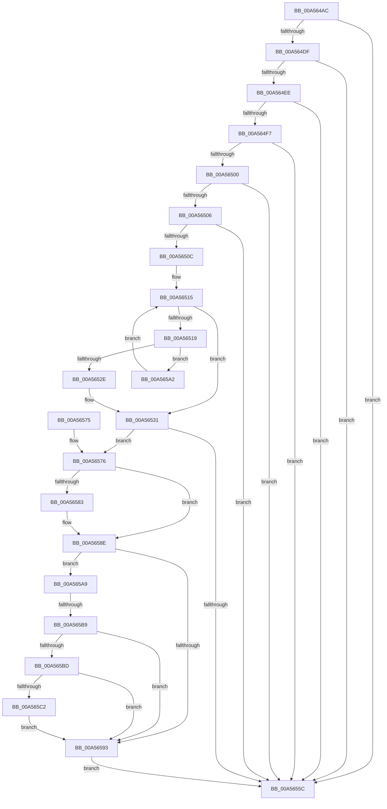

# WheapPredictiveFailureAnalysis

- RVA: `0x00A564AC`–`0x00A565DE` (길이 `306` bytes)
- VA: `0x0000000140A564AC`
- 실행 섹션: `PAGE`
- PDB 이름 있음: `예`; PDB Function 태그: `예`
- unwind 정보 RVA: `0x000B1498`
- 디코드: `88`개 명령, `306/306` bytes 표시
- 미해석 바이트: `0` (있으면 어셈블리에 `.byte`로 보존)

> 이 문서는 커널 이미지의 기계어와 PDB 기호를 분석해 생성했습니다. 4번과 5번은 함수 원형과 자료형을 바이너리 사용 방식에서 추정한 C 해석이며 원본 소스 복구 결과는 아닙니다.

## 1. Dependencies

- 직접 호출 지점: **4**; 고유 호출 대상: **4**
- 직접 호출자로 확인된 함수: **1**
- RIP 상대 이미지 참조: **5**

### Outgoing calls
- `0x00A564CE` → `PSHED.dll!PshedDoPfa` (import, 간접 대상; import `PSHED.dll!PshedDoPfa`)
- `0x00A5654F` → [ExAllocatePool2](../../poolcode/B8/ExAllocatePool2_function_00B820F0.md) (function, `0x00B820F0`)
- `0x00A5659B` → [ExFreePoolWithTag](../../poolcode/B8/ExFreePoolWithTag_function_00B82870.md) (function, `0x00B82870`)
- `0x00A565D7` → [WheaAttemptPhysicalPageOffline](../7D/WheaAttemptPhysicalPageOffline_function_007D7380.md) (function, `0x007D7380`)

### Direct callers
- [WheapProcessWorkQueueItem](../../text/48/WheapProcessWorkQueueItem_function_00484820.md) at `0x00484850`

### Static image references
- `0x00A564CE` → RVA `0x00151160` (`PSHED.dll!PshedDoPfa (IAT)`; read)
- `0x00A564DF` → RVA `0x00E095A8` (`.data`; read)
- `0x00A564EE` → RVA `0x00EEFB20` (`.data`; read)
- `0x00A5657A` → RVA `0x0001A738` (`.rdata`; read)
- `0x00A56587` → RVA `0x0001A740` (`.rdata`; read)

## 2. Other-region calls and transfers

- 다른 실행 섹션으로 향하는 call: **2**
  - `0x00A5654F` → [ExAllocatePool2](../../poolcode/B8/ExAllocatePool2_function_00B820F0.md) (`PAGE` → `POOLCODE`)
  - `0x00A5659B` → [ExFreePoolWithTag](../../poolcode/B8/ExFreePoolWithTag_function_00B82870.md) (`PAGE` → `POOLCODE`)
- call이 아닌 외부 분기/꼬리 이동: **1**
  - `0x00A565B3` → [sub_00B3D756](../B3/Unknown_function_00B3D756.md) (`tail-transfer`)

## 3. Assembly (complete function range)

```asm
00A564AC  48 89 5C 24 08                  mov qword ptr [rsp + 8], rbx
00A564B1  48 89 6C 24 10                  mov qword ptr [rsp + 0x10], rbp
00A564B6  48 89 74 24 18                  mov qword ptr [rsp + 0x18], rsi
00A564BB  57                              push rdi
00A564BC  41 56                           push r14
00A564BE  41 57                           push r15
00A564C0  48 83 EC 30                     sub rsp, 0x30
00A564C4  48 8D 59 28                     lea rbx, [rcx + 0x28]
00A564C8  48 8B F1                        mov rsi, rcx
00A564CB  48 8B CB                        mov rcx, rbx
00A564CE  48 FF 15 8B AC 6F FF            call qword ptr [rip - 0x905375]
00A564D5  0F 1F 44 00 00                  nop dword ptr [rax + rax]
00A564DA  83 F8 01                        cmp eax, 1
00A564DD  74 7D                           je 0x140a5655c
00A564DF  48 8B 05 C2 30 3B 00            mov rax, qword ptr [rip + 0x3b30c2]
00A564E6  45 33 F6                        xor r14d, r14d
00A564E9  44 38 30                        cmp byte ptr [rax], r14b
00A564EC  75 6E                           jne 0x140a5655c
00A564EE  44 38 35 2B 96 49 00            cmp byte ptr [rip + 0x49962b], r14b
00A564F5  74 65                           je 0x140a5655c
00A564F7  0F B7 4B 0A                     movzx ecx, word ptr [rbx + 0xa]
00A564FB  66 85 C9                        test cx, cx
00A564FE  74 5C                           je 0x140a5655c
00A56500  83 7B 0C 02                     cmp dword ptr [rbx + 0xc], 2
00A56504  75 56                           jne 0x140a5655c
00A56506  F6 43 68 01                     test byte ptr [rbx + 0x68], 1
00A5650A  75 50                           jne 0x140a5655c
00A5650C  45 8B C6                        mov r8d, r14d
00A5650F  45 8A CE                        mov r9b, r14b
00A56512  41 8B D6                        mov edx, r14d
00A56515  3B D1                           cmp edx, ecx
00A56517  73 18                           jae 0x140a56531
00A56519  8B C2                           mov eax, edx
00A5651B  4C 8D 40 02                     lea r8, [rax + 2]
00A5651F  4E 8D 04 C0                     lea r8, [rax + r8*8]
00A56523  4E 8D 04 C3                     lea r8, [rbx + r8*8]
00A56527  41 F6 40 0C 01                  test byte ptr [r8 + 0xc], 1
00A5652C  74 74                           je 0x140a565a2
00A5652E  41 B1 01                        mov r9b, 1
00A56531  45 84 C9                        test r9b, r9b
00A56534  48 8D BB 80 00 00 00            lea rdi, [rbx + 0x80]
00A5653B  BA 28 18 00 00                  mov edx, 0x1828
00A56540  B9 00 01 00 00                  mov ecx, 0x100
00A56545  49 0F 45 F8                     cmovne rdi, r8
00A56549  41 B8 57 68 65 61               mov r8d, 0x61656857
00A5654F  E8 9C BB 12 00                  call 0x140b820f0
00A56554  48 8B E8                        mov rbp, rax
00A56557  48 85 C0                        test rax, rax
00A5655A  75 1A                           jne 0x140a56576
00A5655C  48 8B 5C 24 50                  mov rbx, qword ptr [rsp + 0x50]
00A56561  48 8B 6C 24 58                  mov rbp, qword ptr [rsp + 0x58]
00A56566  48 8B 74 24 60                  mov rsi, qword ptr [rsp + 0x60]
00A5656B  48 83 C4 30                     add rsp, 0x30
00A5656F  41 5F                           pop r15
00A56571  41 5E                           pop r14
00A56573  5F                              pop rdi
00A56574  C3                              ret
00A56575  CC                              int3
00A56576  48 8B 4F 10                     mov rcx, qword ptr [rdi + 0x10]
00A5657A  48 2B 0D B7 41 5C FF            sub rcx, qword ptr [rip - 0xa3be49]
00A56581  75 0B                           jne 0x140a5658e
00A56583  48 8B 4F 18                     mov rcx, qword ptr [rdi + 0x18]
00A56587  48 2B 0D B2 41 5C FF            sub rcx, qword ptr [rip - 0xa3be4e]
00A5658E  48 85 C9                        test rcx, rcx
00A56591  74 16                           je 0x140a565a9
00A56593  BA 57 68 65 61                  mov edx, 0x61656857
00A56598  48 8B CD                        mov rcx, rbp
00A5659B  E8 D0 C2 12 00                  call 0x140b82870
00A565A0  EB BA                           jmp 0x140a5655c
00A565A2  FF C2                           inc edx
00A565A4  E9 6C FF FF FF                  jmp 0x140a56515
00A565A9  8B 3F                           mov edi, dword ptr [rdi]
00A565AB  8B 46 18                        mov eax, dword ptr [rsi + 0x18]
00A565AE  48 03 FB                        add rdi, rbx
00A565B1  A8 04                           test al, 4
00A565B3  0F 84 9D 71 0E 00               je 0x140b3d756
00A565B9  A8 08                           test al, 8
00A565BB  74 D6                           je 0x140a56593
00A565BD  F6 07 02                        test byte ptr [rdi], 2
00A565C0  74 D1                           je 0x140a56593
00A565C2  48 8B 4F 10                     mov rcx, qword ptr [rdi + 0x10]
00A565C6  45 33 C9                        xor r9d, r9d
00A565C9  48 C1 E9 0C                     shr rcx, 0xc
00A565CD  45 33 C0                        xor r8d, r8d
00A565D0  B2 01                           mov dl, 1
00A565D2  48 89 6C 24 20                  mov qword ptr [rsp + 0x20], rbp
00A565D7  E8 A4 0D D8 FF                  call 0x1407d7380
00A565DC  EB B5                           jmp 0x140a56593
```

## 4. C-style interpretation (structured pseudocode)

```c
__int64 __fastcall WheapPredictiveFailureAnalysis(__int64 a1)
{
    __int64 result;
    __int64 v_r14;
    __int64 v_rdi;
    __int64 v_rsp;
    unsigned __int64 v_stack_p10;
    unsigned __int64 v_stack_p18;
    unsigned __int64 v_stack_p20;
    unsigned __int64 v_stack_p8;

    v_stack_p8 = v_rbx;
    v_stack_p10 = v_rbp;
    v_stack_p18 = v_rsi;
    v_rsp = (v_rsp) - (48);
    result = PSHED_dll_PshedDoPfa(a1 + 40, a2, a3, a4);
    if (((unsigned int)(result)) == 1) goto loc_00A5655C;
    v_r14 = 0;
    if ((*(unsigned __int8 *)(*(unsigned __int64 *)(v_rip + 3879106))) != 0) goto loc_00A5655C;
    if ((*(unsigned __int8 *)(v_rip + 4822571)) == 0) goto loc_00A5655C;
    if ((unsigned __int16)(*(unsigned __int16 *)(a1 + 40 + 10)) == 0) goto loc_00A5655C;
    if ((*(unsigned int *)(a1 + 40 + 12)) != 2) goto loc_00A5655C;
    if (((*(unsigned __int8 *)(a1 + 40 + 104)) & (1)) != 0) goto loc_00A5655C;
loc_00A56515:
    if (0 >= ((unsigned int)(*(unsigned __int16 *)(a1 + 40 + 10)))) goto loc_00A56531;
    if (((*(unsigned __int8 *)(a1 + 40 + 0 + 0 + 2 * 8 * 8 + 12)) & (1)) == 0) goto loc_00A565A2;
loc_00A56531:
    v_rdi = a1 + 40 + 128;
    if (1 != 0) { v_rdi = a1 + 40 + 0 + 0 + 2 * 8 * 8; }
    result = ExAllocatePool2(256, (unsigned int)(0x1828ULL), (unsigned int)(0x61656857ULL), 1);
    if (result != 0) goto loc_00A56576;
loc_00A5655C:
    v_rsp = (v_rsp) + (48);
    return result;
loc_00A56576:
    a1 = (*(unsigned __int64 *)(v_rdi + 16)) - (*(unsigned __int64 *)(v_rip - 10731081));
    if (!(condition_is_not_equal)) {
        a1 = *(unsigned __int64 *)(v_rdi + 24);
        a1 = (a1) - (*(unsigned __int64 *)(v_rip - 10731086));
    }
    if (a1 == 0) goto loc_00A565A9;
loc_00A56593:
    result = ExFreePoolWithTag(v_stack_p10, (unsigned int)(0x61656857ULL), (unsigned int)(0x61656857ULL), 1);
    goto loc_00A5655C;
loc_00A565A2:
    a2 = (unsigned int)(((unsigned int)(0x61656857ULL)) + 1);
    goto loc_00A56515;
loc_00A565A9:
    v_rdi = ((unsigned int)(*(unsigned int *)(v_rdi))) + (v_stack_p8);
    if ((((unsigned __int8)((unsigned int)(*(unsigned int *)(v_stack_p18 + 24)))) & (8)) == 0) goto loc_00A56593;
    if (((*(unsigned __int8 *)(v_rdi)) & (2)) == 0) goto loc_00A56593;
    a4 = 0;
    a1 = (*(unsigned __int64 *)(v_rdi + 16)) >> (12);
    a3 = 0;
    v_stack_p20 = v_stack_p10;
    result = WheaAttemptPhysicalPageOffline(a1, 1, a3, a4);
    goto loc_00A56593;
}
```

## 5. (Beta) C Style

```c
int64_t WheapPredictiveFailureAnalysis(void *Arg1)
{
    uint8_t *arg1 = (uint8_t *)Arg1;

    int64_t result;
    int64_t local_r14;
    int64_t local_rdi;
    int64_t local_rsp;
    uint64_t v_stack_p10;
    uint64_t v_stack_p18;
    uint64_t v_stack_p20;
    uint64_t v_stack_p8;

    v_stack_p8 = local_rbx;
    v_stack_p10 = local_rbp;
    v_stack_p18 = local_rsi;
    local_rsp = (local_rsp) - (48);
    result = kernel_indirect_call(Arg1 + 40, a2, a3, a4);
    if (((uint32_t)(result)) == 1) goto loc_00A5655C;
    local_r14 = 0;
    if ((*(uint8_t *)(*(uint64_t *)(v_rip + 0x3B30C2))) != 0) goto loc_00A5655C;
    if ((*(uint8_t *)(v_rip + 0x49962B)) == 0) goto loc_00A5655C;
    if ((uint16_t)(*(uint16_t *)(arg1 + 0x28 + 0xA)) == 0) goto loc_00A5655C;
    if ((*(uint32_t *)(arg1 + 0x28 + 0xC)) != 2) goto loc_00A5655C;
    if (((*(uint8_t *)(arg1 + 0x28 + 0x68)) & (1)) != 0) goto loc_00A5655C;
loc_00A56515:
    if (0 >= ((uint32_t)(*(uint16_t *)(arg1 + 0x28 + 0xA)))) goto loc_00A56531;
    if (((*(uint8_t *)(arg1 + 0x28 + 0x0 + 0x0 + 0x2 * 8 * 8 + 0xC)) & (1)) == 0) goto loc_00A565A2;
loc_00A56531:
    local_rdi = Arg1 + 40 + 128;
    if (1 != 0) { local_rdi = Arg1 + 40 + 0 + 0 + 2 * 8 * 8; }
    result = ExAllocatePool2(256, (uint32_t)(0x1828ULL), (uint32_t)(0x61656857ULL), 1);
    if (result != 0) goto loc_00A56576;
loc_00A5655C:
    local_rsp = (local_rsp) + (48);
    return result;
loc_00A56576:
    Arg1 = (*(uint64_t *)(local_rdi + 0x10)) - (*(uint64_t *)(v_rip - 0xA3BE49));
    if (!(condition_is_not_equal)) {
        Arg1 = *(uint64_t *)(local_rdi + 0x18);
        Arg1 = (Arg1) - (*(uint64_t *)(v_rip - 0xA3BE4E));
    }
    if (Arg1 == NULL) goto loc_00A565A9;
loc_00A56593:
    result = ExFreePoolWithTag(v_stack_p10, (uint32_t)(0x61656857ULL), (uint32_t)(0x61656857ULL), 1);
    goto loc_00A5655C;
loc_00A565A2:
    a2 = (uint32_t)(((uint32_t)(0x61656857ULL)) + 1);
    goto loc_00A56515;
loc_00A565A9:
    local_rdi = ((uint32_t)(*(uint32_t *)(local_rdi))) + (v_stack_p8);
    if ((((uint8_t)((uint32_t)(*(uint32_t *)(v_stack_p18 + 0x18)))) & (8)) == 0) goto loc_00A56593;
    if (((*(uint8_t *)(local_rdi)) & (2)) == 0) goto loc_00A56593;
    a4 = 0;
    Arg1 = (*(uint64_t *)(local_rdi + 0x10)) >> (12);
    a3 = 0;
    v_stack_p20 = v_stack_p10;
    result = WheaAttemptPhysicalPageOffline(Arg1, 1, a3, a4);
    goto loc_00A56593;
}
```

### 관측된 메모리 오프셋

구조체 형식이 확인되지 않은 접근은 인자 기준의 오프셋으로만 기록했습니다.

| 기준 인자 | 오프셋 표현 | 폭 (bit) | 접근 |
|---|---:|---:|---|
| `Arg1` | `+ 0x0 + r8*8` | `64` | `R` |
| `Arg1` | `+ 0xA` | `16` | `R` |
| `Arg1` | `+ 0xC` | `8` | `R` |
| `Arg1` | `+ 0xC` | `32` | `R` |
| `Arg1` | `+ 0x18` | `32` | `R` |
| `Arg1` | `+ 0x28` | `64` | `R` |
| `Arg1` | `+ 0x68` | `8` | `R` |
| `Arg1` | `+ 0x80` | `64` | `R` |

## 6. Execution-region graph

[열기: 2D/3D 그래프와 함수 탐색 컨트롤 패널](../../../control-panel.html?section=page&rva=0x00A564AC&view=graph)

- 2D 그래프는 위에서 아래로 흐르고, 3D 그래프는 빈 공간을 드래그해 회전합니다. Shift+드래그는 이동, 휠은 확대·축소, 함수 노드 선택은 대상 보고서 이동입니다.

### Static fallback


