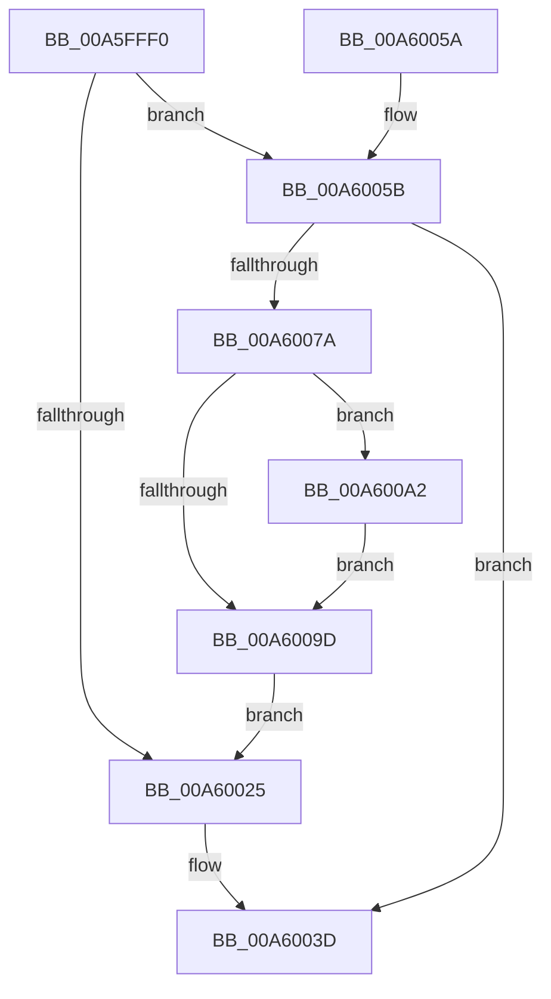

# WmipCachePtrs

- RVA: `0x00A5FFF0`–`0x00A600AE` (길이 `190` bytes)
- VA: `0x0000000140A5FFF0`
- 실행 섹션: `PAGE`
- PDB 이름 있음: `예`; PDB Function 태그: `아니요`
- unwind 정보 RVA: `0x000B2ED4`
- 디코드: `61`개 명령, `190/190` bytes 표시
- 미해석 바이트: `0` (있으면 어셈블리에 `.byte`로 보존)

> 이 문서는 커널 이미지의 기계어와 PDB 기호를 분석해 생성했습니다. 4번과 5번은 함수 원형과 자료형을 바이너리 사용 방식에서 추정한 C 해석이며 원본 소스 복구 결과는 아닙니다.

## 1. Dependencies

- 직접 호출 지점: **3**; 고유 호출 대상: **3**
- 직접 호출자로 확인된 함수: **1**
- RIP 상대 이미지 참조: **0**

### Outgoing calls
- `0x00A6006D` → [ExAllocatePool2](../../poolcode/B8/ExAllocatePool2_function_00B820F0.md) (function, `0x00B820F0`)
- `0x00A6008D` → [memcpy](../../text/6C/memcpy_function_006C6840.md) (function, `0x006C6840`)
- `0x00A600A7` → [ExFreePoolWithTag](../../poolcode/B8/ExFreePoolWithTag_function_00B82870.md) (function, `0x00B82870`)

### Direct callers
- [WmipUpdateDataSource](../9D/WmipUpdateDataSource_function_009DD474.md) at `0x009DD596`

### Static image references
- 디코드된 RIP-relative 메모리 참조가 없습니다.

## 2. Other-region calls and transfers

- 다른 실행 섹션으로 향하는 call: **3**
  - `0x00A6006D` → [ExAllocatePool2](../../poolcode/B8/ExAllocatePool2_function_00B820F0.md) (`PAGE` → `POOLCODE`)
  - `0x00A6008D` → [memcpy](../../text/6C/memcpy_function_006C6840.md) (`PAGE` → `.text`)
  - `0x00A600A7` → [ExFreePoolWithTag](../../poolcode/B8/ExFreePoolWithTag_function_00B82870.md) (`PAGE` → `POOLCODE`)
- 별도 외부 분기/꼬리 이동을 확인하지 못했습니다.

## 3. Assembly (complete function range)

```asm
00A5FFF0  48 89 5C 24 08                  mov qword ptr [rsp + 8], rbx
00A5FFF5  48 89 6C 24 10                  mov qword ptr [rsp + 0x10], rbp
00A5FFFA  48 89 74 24 18                  mov qword ptr [rsp + 0x18], rsi
00A5FFFF  57                              push rdi
00A60000  41 54                           push r12
00A60002  41 55                           push r13
00A60004  41 56                           push r14
00A60006  41 57                           push r15
00A60008  48 83 EC 20                     sub rsp, 0x20
00A6000C  41 8B 01                        mov eax, dword ptr [r9]
00A6000F  4D 8B F1                        mov r14, r9
00A60012  49 8B F0                        mov rsi, r8
00A60015  48 8B 7C 24 70                  mov rdi, qword ptr [rsp + 0x70]
00A6001A  4C 8B E2                        mov r12, rdx
00A6001D  4C 8B E9                        mov r13, rcx
00A60020  41 39 00                        cmp dword ptr [r8], eax
00A60023  74 36                           je 0x140a6005b
00A60025  8B 16                           mov edx, dword ptr [rsi]
00A60027  48 8B 0F                        mov rcx, qword ptr [rdi]
00A6002A  8B C2                           mov eax, edx
00A6002C  48 03 C0                        add rax, rax
00A6002F  4C 89 2C C1                     mov qword ptr [rcx + rax*8], r13
00A60033  4C 89 64 C1 08                  mov qword ptr [rcx + rax*8 + 8], r12
00A60038  8D 42 01                        lea eax, [rdx + 1]
00A6003B  89 06                           mov dword ptr [rsi], eax
00A6003D  48 8B 5C 24 50                  mov rbx, qword ptr [rsp + 0x50]
00A60042  48 8B 6C 24 58                  mov rbp, qword ptr [rsp + 0x58]
00A60047  48 8B 74 24 60                  mov rsi, qword ptr [rsp + 0x60]
00A6004C  48 83 C4 20                     add rsp, 0x20
00A60050  41 5F                           pop r15
00A60052  41 5E                           pop r14
00A60054  41 5D                           pop r13
00A60056  41 5C                           pop r12
00A60058  5F                              pop rdi
00A60059  C3                              ret
00A6005A  CC                              int3
00A6005B  8D 50 40                        lea edx, [rax + 0x40]
00A6005E  B9 00 01 00 00                  mov ecx, 0x100
00A60063  48 C1 E2 04                     shl rdx, 4
00A60067  41 B8 57 6D 69 70               mov r8d, 0x70696d57
00A6006D  E8 7E 20 12 00                  call 0x140b820f0
00A60072  48 8B E8                        mov rbp, rax
00A60075  48 85 C0                        test rax, rax
00A60078  74 C3                           je 0x140a6003d
00A6007A  41 8B 1E                        mov ebx, dword ptr [r14]
00A6007D  48 8B C8                        mov rcx, rax
00A60080  4C 8B 3F                        mov r15, qword ptr [rdi]
00A60083  44 8B C3                        mov r8d, ebx
00A60086  49 C1 E0 04                     shl r8, 4
00A6008A  49 8B D7                        mov rdx, r15
00A6008D  E8 AE 67 C6 FF                  call 0x1406c6840
00A60092  8D 53 40                        lea edx, [rbx + 0x40]
00A60095  41 89 16                        mov dword ptr [r14], edx
00A60098  4D 85 FF                        test r15, r15
00A6009B  75 05                           jne 0x140a600a2
00A6009D  48 89 2F                        mov qword ptr [rdi], rbp
00A600A0  EB 83                           jmp 0x140a60025
00A600A2  33 D2                           xor edx, edx
00A600A4  49 8B CF                        mov rcx, r15
00A600A7  E8 C4 27 12 00                  call 0x140b82870
00A600AC  EB EF                           jmp 0x140a6009d
```

## 4. C-style interpretation (structured pseudocode)

```c
__int64 __fastcall WmipCachePtrs(__int64 a1, __int64 a2, __int64 a3, __int64 a4, __int64 a5)
{
    __int64 result;
    __int64 v_rsp;
    unsigned __int64 v_stack_p10;
    unsigned __int64 v_stack_p18;
    unsigned __int64 v_stack_p8;

    v_stack_p8 = v_rbx;
    v_stack_p10 = v_rbp;
    v_stack_p18 = v_rsi;
    v_rsp = (v_rsp) - (32);
    if ((*(unsigned int *)(a3)) == ((unsigned int)((unsigned int)(*(unsigned int *)(a4))))) goto loc_00A6005B;
loc_00A60025:
    result = ((unsigned int)((unsigned int)((unsigned int)(*(unsigned int *)(a3))))) + ((unsigned int)((unsigned int)((unsigned int)(*(unsigned int *)(a3)))));
    *(unsigned __int64 *)(*(unsigned __int64 *)(a5) + result * 8) = a1;
    *(unsigned __int64 *)(*(unsigned __int64 *)(a5) + result * 8 + 8) = a2;
    *(unsigned int *)(a3) = (unsigned int)((unsigned int)(*(unsigned int *)(a3)) + 1);
loc_00A6003D:
    v_rsp = (v_rsp) + (32);
    return (unsigned int)(*(unsigned int *)(a3)) + 1;
loc_00A6005B:
    a2 = ((unsigned int)(*(unsigned int *)(a3)) + 1 + 64) << (4);
    result = ExAllocatePool2(256, a2, (unsigned int)(0x70696D57ULL), a4);
    if (result == 0) goto loc_00A6003D;
    a3 = ((unsigned int)((unsigned int)((unsigned int)(*(unsigned int *)(a4))))) << (4);
    result = memcpy(result, *(unsigned __int64 *)(a5), a3, a4);
    *(unsigned int *)(a4) = (unsigned int)((unsigned int)(*(unsigned int *)(a4)) + 64);
    if (*(unsigned __int64 *)(a5) != 0) goto loc_00A600A2;
loc_00A6009D:
    *(unsigned __int64 *)(a5) = result;
    goto loc_00A60025;
loc_00A600A2:
    a2 = 0;
    result = ExFreePoolWithTag(*(unsigned __int64 *)(a5), a2, a3, a4);
    goto loc_00A6009D;
}
```

## 5. (Beta) C Style

```c
int64_t WmipCachePtrs(int64_t Arg1, int64_t Arg2, void *Arg3, void *Arg4, void *Arg5)
{
    uint8_t *arg3 = (uint8_t *)Arg3;
    uint8_t *arg4 = (uint8_t *)Arg4;
    uint8_t *arg5 = (uint8_t *)Arg5;

    int64_t result;
    int64_t local_rsp;
    uint64_t v_stack_p10;
    uint64_t v_stack_p18;
    uint64_t v_stack_p8;

    v_stack_p8 = local_rbx;
    v_stack_p10 = local_rbp;
    v_stack_p18 = local_rsi;
    local_rsp = (local_rsp) - (32);
    if ((*(uint32_t *)(arg3)) == ((uint32_t)((uint32_t)(*(uint32_t *)(arg4))))) goto loc_00A6005B;
loc_00A60025:
    result = ((uint32_t)((uint32_t)((uint32_t)(*(uint32_t *)(arg3))))) + ((uint32_t)((uint32_t)((uint32_t)(*(uint32_t *)(arg3)))));
    *(uint64_t *)(*(uint64_t *)(arg5) + result * 8) = Arg1;
    *(uint64_t *)(*(uint64_t *)(arg5) + result * 8 + 0x8) = Arg2;
    *(uint32_t *)(arg3) = (uint32_t)((uint32_t)(*(uint32_t *)(arg3)) + 1);
loc_00A6003D:
    local_rsp = (local_rsp) + (32);
    return (uint32_t)(*(uint32_t *)(arg3)) + 1;
loc_00A6005B:
    Arg2 = ((uint32_t)(*(uint32_t *)(arg3)) + 1 + 64) << (4);
    result = ExAllocatePool2(256, Arg2, (uint32_t)(0x70696D57ULL), Arg4);
    if (result == 0) goto loc_00A6003D;
    Arg3 = ((uint32_t)((uint32_t)((uint32_t)(*(uint32_t *)(arg4))))) << (4);
    result = memcpy(result, *(uint64_t *)(arg5), Arg3, Arg4);
    *(uint32_t *)(arg4) = (uint32_t)((uint32_t)(*(uint32_t *)(arg4)) + 64);
    if (*(uint64_t *)(arg5) != 0) goto loc_00A600A2;
loc_00A6009D:
    *(uint64_t *)(arg5) = result;
    goto loc_00A60025;
loc_00A600A2:
    Arg2 = 0;
    result = ExFreePoolWithTag(*(uint64_t *)(arg5), Arg2, Arg3, Arg4);
    goto loc_00A6009D;
}
```

### 관측된 메모리 오프셋

구조체 형식이 확인되지 않은 접근은 인자 기준의 오프셋으로만 기록했습니다.

| 기준 인자 | 오프셋 표현 | 폭 (bit) | 접근 |
|---|---:|---:|---|
| `Arg3` | `+ 0x0` | `32` | `R` |
| `Arg3` | `+ 0x0` | `32` | `W` |
| `Arg4` | `+ 0x0` | `32` | `R` |
| `Arg4` | `+ 0x0` | `32` | `W` |
| `Arg5` | `+ 0x0` | `64` | `R` |
| `Arg5` | `+ 0x0` | `64` | `W` |

## 6. Execution-region graph

[열기: 2D/3D 그래프와 함수 탐색 컨트롤 패널](../../../control-panel.html?section=page&rva=0x00A5FFF0&view=graph)

- 2D 그래프는 위에서 아래로 흐르고, 3D 그래프는 빈 공간을 드래그해 회전합니다. Shift+드래그는 이동, 휠은 확대·축소, 함수 노드 선택은 대상 보고서 이동입니다.

### Static fallback


