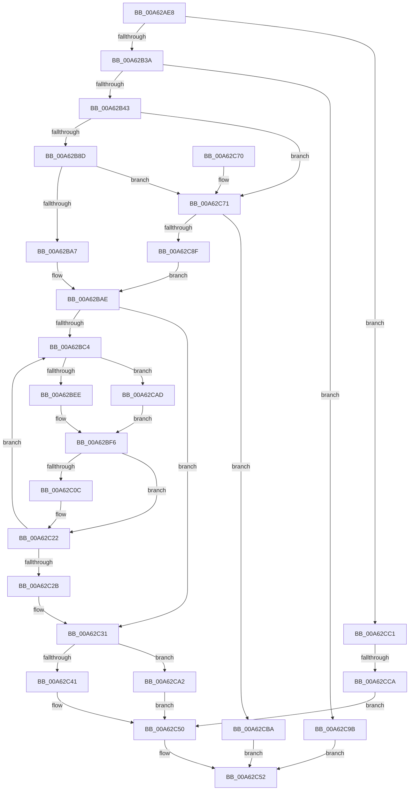

# AdtpBuildPrivilegeAuditString

- RVA: `0x00A62AE8`–`0x00A62CE1` (길이 `505` bytes)
- VA: `0x0000000140A62AE8`
- 실행 섹션: `PAGE`
- PDB 이름 있음: `예`; PDB Function 태그: `예`
- unwind 정보 RVA: `0x000B344C`
- 디코드: `139`개 명령, `505/505` bytes 표시
- 미해석 바이트: `0` (있으면 어셈블리에 `.byte`로 보존)

> 이 문서는 커널 이미지의 기계어와 PDB 기호를 분석해 생성했습니다. 4번과 5번은 함수 원형과 자료형을 바이너리 사용 방식에서 추정한 C 해석이며 원본 소스 복구 결과는 아닙니다.

## 1. Dependencies

- 직접 호출 지점: **6**; 고유 호출 대상: **4**
- 직접 호출자로 확인된 함수: **2**
- RIP 상대 이미지 참조: **4**

### Outgoing calls
- `0x00A62B4E` → [RtlInitUnicodeString](../../text/42/RtlInitUnicodeString_function_0042A780.md) (function, `0x0042A780`)
- `0x00A62B5E` → [RtlInitUnicodeString](../../text/42/RtlInitUnicodeString_function_0042A780.md) (function, `0x0042A780`)
- `0x00A62BDE` → [AdtpLookupKnownPrivilegeNameQuickly](../../text/4A/AdtpLookupKnownPrivilegeNameQuickly_function_004AA82C.md) (function, `0x004AA82C`)
- `0x00A62BF9` → [memcpy](../../text/6C/memcpy_function_006C6840.md) (function, `0x006C6840`)
- `0x00A62C1A` → [memcpy](../../text/6C/memcpy_function_006C6840.md) (function, `0x006C6840`)
- `0x00A62C82` → [ExAllocatePool2](../../poolcode/B8/ExAllocatePool2_function_00B820F0.md) (function, `0x00B820F0`)

### Direct callers
- [AdtpPackageParameters](../../text/45/AdtpPackageParameters_function_00459964.md) at `0x00459F9E`
- [sub_006ECA3A](../../text/6E/Unknown_function_006ECA3A.md) at `0x006ECAE3`

### Static image references
- `0x00A62B43` → RVA `0x0001A858` (`.rdata`; read)
- `0x00A62B53` → RVA `0x0001A850` (`.rdata`; read)
- `0x00A62B67` → RVA `0x00EF0DA0` (`.data`; read)
- `0x00A62CCA` → RVA `0x0001E0B0` (`.rdata`; read)

## 2. Other-region calls and transfers

- 다른 실행 섹션으로 향하는 call: **6**
  - `0x00A62B4E` → [RtlInitUnicodeString](../../text/42/RtlInitUnicodeString_function_0042A780.md) (`PAGE` → `.text`)
  - `0x00A62B5E` → [RtlInitUnicodeString](../../text/42/RtlInitUnicodeString_function_0042A780.md) (`PAGE` → `.text`)
  - `0x00A62BDE` → [AdtpLookupKnownPrivilegeNameQuickly](../../text/4A/AdtpLookupKnownPrivilegeNameQuickly_function_004AA82C.md) (`PAGE` → `.text`)
  - `0x00A62BF9` → [memcpy](../../text/6C/memcpy_function_006C6840.md) (`PAGE` → `.text`)
  - `0x00A62C1A` → [memcpy](../../text/6C/memcpy_function_006C6840.md) (`PAGE` → `.text`)
  - `0x00A62C82` → [ExAllocatePool2](../../poolcode/B8/ExAllocatePool2_function_00B820F0.md) (`PAGE` → `POOLCODE`)
- call이 아닌 외부 분기/꼬리 이동: **1**
  - `0x00A62CC4` → [sub_00B3E370](../B3/Unknown_function_00B3E370.md) (`tail-transfer`)

## 3. Assembly (complete function range)

```asm
00A62AE8  48 8B C4                        mov rax, rsp
00A62AEB  48 89 58 08                     mov qword ptr [rax + 8], rbx
00A62AEF  48 89 70 18                     mov qword ptr [rax + 0x18], rsi
00A62AF3  48 89 78 20                     mov qword ptr [rax + 0x20], rdi
00A62AF7  48 89 50 10                     mov qword ptr [rax + 0x10], rdx
00A62AFB  55                              push rbp
00A62AFC  41 54                           push r12
00A62AFE  41 55                           push r13
00A62B00  41 56                           push r14
00A62B02  41 57                           push r15
00A62B04  48 8B EC                        mov rbp, rsp
00A62B07  48 83 EC 60                     sub rsp, 0x60
00A62B0B  8B 01                           mov eax, dword ptr [rcx]
00A62B0D  45 33 E4                        xor r12d, r12d
00A62B10  44 89 65 D4                     mov dword ptr [rbp - 0x2c], r12d
00A62B14  0F 57 C0                        xorps xmm0, xmm0
00A62B17  0F 57 C9                        xorps xmm1, xmm1
00A62B1A  49 8B F9                        mov rdi, r9
00A62B1D  49 8B F0                        mov rsi, r8
00A62B20  4C 8B FA                        mov r15, rdx
00A62B23  4C 8B E9                        mov r13, rcx
00A62B26  0F 11 45 C0                     movups xmmword ptr [rbp - 0x40], xmm0
00A62B2A  0F 11 4D F0                     movups xmmword ptr [rbp - 0x10], xmm1
00A62B2E  0F 11 45 E0                     movups xmmword ptr [rbp - 0x20], xmm0
00A62B32  85 C0                           test eax, eax
00A62B34  0F 84 87 01 00 00               je 0x140a62cc1
00A62B3A  83 F8 42                        cmp eax, 0x42
00A62B3D  0F 87 58 01 00 00               ja 0x140a62c9b
00A62B43  48 8D 15 0E 7D 5B FF            lea rdx, [rip - 0xa482f2]
00A62B4A  48 8D 4D C0                     lea rcx, [rbp - 0x40]
00A62B4E  E8 2D 7C 9C FF                  call 0x14042a780
00A62B53  48 8D 15 F6 7C 5B FF            lea rdx, [rip - 0xa4830a]
00A62B5A  48 8D 4D F0                     lea rcx, [rbp - 0x10]
00A62B5E  E8 1D 7C 9C FF                  call 0x14042a780
00A62B63  0F B7 45 C0                     movzx eax, word ptr [rbp - 0x40]
00A62B67  66 03 05 32 E2 48 00            add ax, word ptr [rip + 0x48e232]
00A62B6E  41 0F B7 4D 00                  movzx ecx, word ptr [r13]
00A62B73  0F B7 D8                        movzx ebx, ax
00A62B76  0F AF D9                        imul ebx, ecx
00A62B79  66 2B 5D C0                     sub bx, word ptr [rbp - 0x40]
00A62B7D  66 83 C3 02                     add bx, 2
00A62B81  66 D1 EB                        shr bx, 1
00A62B84  48 85 FF                        test rdi, rdi
00A62B87  0F 84 E4 00 00 00               je 0x140a62c71
00A62B8D  48 8B 4D 50                     mov rcx, qword ptr [rbp + 0x50]
00A62B91  44 0F B7 C3                     movzx r8d, bx
00A62B95  8B 11                           mov edx, dword ptr [rcx]
00A62B97  44 03 C2                        add r8d, edx
00A62B9A  41 81 F8 00 04 00 00            cmp r8d, 0x400
00A62BA1  0F 83 CA 00 00 00               jae 0x140a62c71
00A62BA7  4C 8D 34 57                     lea r14, [rdi + rdx*2]
00A62BAB  44 89 01                        mov dword ptr [rcx], r8d
00A62BAE  66 03 DB                        add bx, bx
00A62BB1  4C 89 75 D8                     mov qword ptr [rbp - 0x28], r14
00A62BB5  33 C9                           xor ecx, ecx
00A62BB7  66 89 5D D2                     mov word ptr [rbp - 0x2e], bx
00A62BBB  49 8B FE                        mov rdi, r14
00A62BBE  41 39 4D 00                     cmp dword ptr [r13], ecx
00A62BC2  76 6D                           jbe 0x140a62c31
00A62BC4  41 8B C4                        mov eax, r12d
00A62BC7  48 8D 55 E0                     lea rdx, [rbp - 0x20]
00A62BCB  48 8D 48 01                     lea rcx, [rax + 1]
00A62BCF  48 8D 0C 48                     lea rcx, [rax + rcx*2]
00A62BD3  48 8D 0C 8D 00 00 00 00         lea rcx, [rcx*4]
00A62BDB  49 03 CD                        add rcx, r13
00A62BDE  E8 49 7C A4 FF                  call 0x1404aa82c
00A62BE3  48 8B CF                        mov rcx, rdi
00A62BE6  85 C0                           test eax, eax
00A62BE8  0F 85 BF 00 00 00               jne 0x140a62cad
00A62BEE  0F B7 5D E0                     movzx ebx, word ptr [rbp - 0x20]
00A62BF2  48 8B 55 E8                     mov rdx, qword ptr [rbp - 0x18]
00A62BF6  4C 8B C3                        mov r8, rbx
00A62BF9  E8 42 3C C6 FF                  call 0x1406c6840
00A62BFE  41 8B 45 00                     mov eax, dword ptr [r13]
00A62C02  48 03 FB                        add rdi, rbx
00A62C05  FF C8                           dec eax
00A62C07  44 3B E0                        cmp r12d, eax
00A62C0A  73 16                           jae 0x140a62c22
00A62C0C  0F B7 5D C0                     movzx ebx, word ptr [rbp - 0x40]
00A62C10  48 8B CF                        mov rcx, rdi
00A62C13  48 8B 55 C8                     mov rdx, qword ptr [rbp - 0x38]
00A62C17  44 8B C3                        mov r8d, ebx
00A62C1A  E8 21 3C C6 FF                  call 0x1406c6840
00A62C1F  48 03 FB                        add rdi, rbx
00A62C22  41 FF C4                        inc r12d
00A62C25  45 3B 65 00                     cmp r12d, dword ptr [r13]
00A62C29  72 99                           jb 0x140a62bc4
00A62C2B  4C 8B 7D 38                     mov r15, qword ptr [rbp + 0x38]
00A62C2F  33 C9                           xor ecx, ecx
00A62C31  66 89 0F                        mov word ptr [rdi], cx
00A62C34  66 41 2B FE                     sub di, r14w
00A62C38  66 89 7D D0                     mov word ptr [rbp - 0x30], di
00A62C3C  48 85 F6                        test rsi, rsi
00A62C3F  74 61                           je 0x140a62ca2
00A62C41  0F B7 C7                        movzx eax, di
00A62C44  83 C0 02                        add eax, 2
00A62C47  4C 89 36                        mov qword ptr [rsi], r14
00A62C4A  89 46 08                        mov dword ptr [rsi + 8], eax
00A62C4D  89 4E 0C                        mov dword ptr [rsi + 0xc], ecx
00A62C50  33 C0                           xor eax, eax
00A62C52  4C 8D 5C 24 60                  lea r11, [rsp + 0x60]
00A62C57  49 8B 5B 30                     mov rbx, qword ptr [r11 + 0x30]
00A62C5B  49 8B 73 40                     mov rsi, qword ptr [r11 + 0x40]
00A62C5F  49 8B 7B 48                     mov rdi, qword ptr [r11 + 0x48]
00A62C63  49 8B E3                        mov rsp, r11
00A62C66  41 5F                           pop r15
00A62C68  41 5E                           pop r14
00A62C6A  41 5D                           pop r13
00A62C6C  41 5C                           pop r12
00A62C6E  5D                              pop rbp
00A62C6F  C3                              ret
00A62C70  CC                              int3
00A62C71  0F B7 D3                        movzx edx, bx
00A62C74  B9 00 01 00 00                  mov ecx, 0x100
00A62C79  48 03 D2                        add rdx, rdx
00A62C7C  41 B8 53 65 41 6B               mov r8d, 0x6b416553
00A62C82  E8 69 F4 11 00                  call 0x140b820f0
00A62C87  4C 8B F0                        mov r14, rax
00A62C8A  48 85 C0                        test rax, rax
00A62C8D  74 2B                           je 0x140a62cba
00A62C8F  48 8B 45 58                     mov rax, qword ptr [rbp + 0x58]
00A62C93  C6 00 01                        mov byte ptr [rax], 1
00A62C96  E9 13 FF FF FF                  jmp 0x140a62bae
00A62C9B  B8 0D 00 00 C0                  mov eax, 0xc000000d
00A62CA0  EB B0                           jmp 0x140a62c52
00A62CA2  0F 10 45 D0                     movups xmm0, xmmword ptr [rbp - 0x30]
00A62CA6  F3 41 0F 7F 07                  movdqu xmmword ptr [r15], xmm0
00A62CAB  EB A3                           jmp 0x140a62c50
00A62CAD  0F B7 5D F0                     movzx ebx, word ptr [rbp - 0x10]
00A62CB1  48 8B 55 F8                     mov rdx, qword ptr [rbp - 8]
00A62CB5  E9 3C FF FF FF                  jmp 0x140a62bf6
00A62CBA  B8 17 00 00 C0                  mov eax, 0xc0000017
00A62CBF  EB 91                           jmp 0x140a62c52
00A62CC1  48 85 F6                        test rsi, rsi
00A62CC4  0F 84 A6 B6 0D 00               je 0x140b3e370
00A62CCA  48 8D 05 DF B3 5B FF            lea rax, [rip - 0xa44c21]
00A62CD1  49 C7 40 08 04 00 00 00         mov qword ptr [r8 + 8], 4
00A62CD9  49 89 00                        mov qword ptr [r8], rax
00A62CDC  E9 6F FF FF FF                  jmp 0x140a62c50
```

## 4. C-style interpretation (structured pseudocode)

```c
__int64 __fastcall AdtpBuildPrivilegeAuditString(__int64 a1, __int64 a2, __int64 a3, __int64 a4, __int64 a5, __int64 a6)
{
    __int64 result;
    __int64 v_r12;
    __int64 v_rbx;
    __int64 v_rdi;
    __int64 v_rsp;
    unsigned __int64 v_stack_m28;
    unsigned __int64 v_stack_m30;
    unsigned __int64 v_stack_m38;
    unsigned __int64 v_stack_m40;
    unsigned __int64 v_stack_m48;
    unsigned __int64 v_stack_m50;
    unsigned int v_stack_m54;
    unsigned __int16 v_stack_m56;
    unsigned __int16 v_stack_m58;
    unsigned __int64 v_stack_m60;
    unsigned __int64 v_stack_m68;
    unsigned __int64 v_stack_p10;

    *(unsigned __int64 *)(v_rsp + 8) = v_rbx;
    *(unsigned __int64 *)(v_rsp + 24) = v_rsi;
    *(unsigned __int64 *)(v_rsp + 32) = v_rdi;
    *(unsigned __int64 *)(v_rsp + 16) = a2;
    v_rsp = (v_rsp) - (96);
    v_r12 = 0;
    v_stack_m54 = 0;
    v_stack_m68 = v_xmm0;
    v_stack_m38 = v_xmm1;
    v_stack_m48 = v_xmm0;
    if ((unsigned int)((unsigned int)(*(unsigned int *)(a1))) == 0) goto loc_00A62CC1;
    if (((unsigned int)((unsigned int)(*(unsigned int *)(a1)))) > 66) goto loc_00A62C9B;
    result = RtlInitUnicodeString(v_stack_m68, v_rip - 10781426, a3, a4);
    result = RtlInitUnicodeString(v_stack_m38, v_rip - 10781450, a3, a4);
    result = (unsigned __int16)((v_stack_m68) + (*(unsigned __int16 *)(v_rip + 4776498)));
    v_rbx = (unsigned int)(((unsigned __int16)(result)) * ((unsigned int)(*(unsigned __int16 *)(a1))));
    v_rbx = (unsigned __int16)((v_rbx) - (v_stack_m68));
    v_rbx = (unsigned __int16)((v_rbx) + (2));
    v_rbx = (unsigned __int16)((v_rbx) >> (1));
    if (a4 == 0) goto loc_00A62C71;
    a3 = (unsigned int)(((unsigned __int16)(v_rbx)) + ((unsigned int)((unsigned int)(*(unsigned int *)(a5)))));
    if (((unsigned int)(a3)) >= 0x400ULL) goto loc_00A62C71;
    *(unsigned int *)(a5) = (unsigned int)(a3);
loc_00A62BAE:
    v_rbx = (unsigned __int16)((v_rbx) + ((unsigned __int16)(v_rbx)));
    v_stack_m50 = a4 + (unsigned int)(*(unsigned int *)(a5)) * 2;
    a1 = 0;
    v_stack_m56 = (unsigned __int16)(v_rbx);
    if ((*(unsigned int *)(a1)) <= 0) goto loc_00A62C31;
loc_00A62BC4:
    a1 = (0 + 0 + 1 * 2 * 4) + (0);
    result = AdtpLookupKnownPrivilegeNameQuickly(a1, v_stack_m48, a3, a4);
    if ((unsigned int)(result) != 0) goto loc_00A62CAD;
loc_00A62BF6:
    result = memcpy(a4 + (unsigned int)(*(unsigned int *)(a5)) * 2, v_stack_m40, v_stack_m48, a4);
    v_rdi = (a4 + (unsigned int)(*(unsigned int *)(a5)) * 2) + (v_stack_m48);
    result = (unsigned int)(((unsigned int)(*(unsigned int *)(a1))) - 1);
    v_rbx = v_stack_m48;
    if (0 < ((unsigned int)(result))) {
        v_rbx = v_stack_m68;
        a1 = v_rdi;
        a2 = v_stack_m60;
        a3 = (unsigned int)(v_rbx);
        result = memcpy(a1, a2, a3, a4);
        v_rdi = (v_rdi) + (v_rbx);
    }
    v_r12 = (unsigned int)((v_r12) + 1);
    if (((unsigned int)(v_r12)) < (*(unsigned int *)(a1))) goto loc_00A62BC4;
    a1 = 0;
loc_00A62C31:
    *(unsigned __int16 *)(v_rdi) = 0;
    v_rdi = (unsigned __int16)((v_rdi) - ((unsigned __int16)(a4 + (unsigned int)(*(unsigned int *)(a5)) * 2)));
    v_stack_m58 = (unsigned __int16)(v_rdi);
    if (a3 == 0) goto loc_00A62CA2;
    result = (unsigned int)(((unsigned __int16)(v_rdi)) + (2));
    *(unsigned __int64 *)(a3) = a4 + (unsigned int)(*(unsigned int *)(a5)) * 2;
    *(unsigned int *)(a3 + 8) = (unsigned int)(result);
    *(unsigned int *)(a3 + 12) = 0;
loc_00A62C50:
    result = 0;
loc_00A62C52:
    return result;
loc_00A62C71:
    a2 = ((unsigned __int16)(*(unsigned __int64 *)(v_stack_m28 + 48))) + ((unsigned __int16)(*(unsigned __int64 *)(v_stack_m28 + 48)));
    result = ExAllocatePool2(256, a2, (unsigned int)(0x6B416553ULL), a4);
    if (result == 0) goto loc_00A62CBA;
    *(unsigned __int8 *)(a6) = 1;
    goto loc_00A62BAE;
loc_00A62C9B:
    goto loc_00A62C52;
loc_00A62CA2:
    *(unsigned __int64 *)(v_stack_p10) = v_xmm0;
    goto loc_00A62C50;
loc_00A62CAD:
    goto loc_00A62BF6;
loc_00A62CBA:
    goto loc_00A62C52;
loc_00A62CC1:
    *(unsigned __int64 *)((unsigned int)(0x6B416553ULL) + 8) = 4;
    *(unsigned __int64 *)((unsigned int)(0x6B416553ULL)) = v_rip - 10767393;
    goto loc_00A62C50;
}
```

## 5. (Beta) C Style

```c
int64_t AdtpBuildPrivilegeAuditString(void *Arg1, int64_t Arg2, void *Arg3, int64_t Arg4, void *Arg5, void *Arg6)
{
    uint8_t *arg1 = (uint8_t *)Arg1;
    uint8_t *arg3 = (uint8_t *)Arg3;
    uint8_t *arg5 = (uint8_t *)Arg5;
    uint8_t *arg6 = (uint8_t *)Arg6;

    int64_t result;
    int64_t local_r12;
    int64_t local_rbx;
    int64_t local_rdi;
    int64_t local_rsp;
    uint64_t v_stack_m28;
    uint64_t v_stack_m30;
    uint64_t v_stack_m38;
    uint64_t v_stack_m40;
    uint64_t v_stack_m48;
    uint64_t v_stack_m50;
    uint32_t v_stack_m54;
    uint16_t v_stack_m56;
    uint16_t v_stack_m58;
    uint64_t v_stack_m60;
    uint64_t v_stack_m68;
    uint64_t v_stack_p10;

    *(uint64_t *)(local_rsp + 0x8) = local_rbx;
    *(uint64_t *)(local_rsp + 0x18) = local_rsi;
    *(uint64_t *)(local_rsp + 0x20) = local_rdi;
    *(uint64_t *)(local_rsp + 0x10) = Arg2;
    local_rsp = (local_rsp) - (96);
    local_r12 = 0;
    v_stack_m54 = 0;
    v_stack_m68 = v_xmm0;
    v_stack_m38 = v_xmm1;
    v_stack_m48 = v_xmm0;
    if ((uint32_t)((uint32_t)(*(uint32_t *)(arg1))) == 0) goto loc_00A62CC1;
    if (((uint32_t)((uint32_t)(*(uint32_t *)(arg1)))) > 66) goto loc_00A62C9B;
    result = RtlInitUnicodeString(v_stack_m68, v_rip - 10781426, Arg3, Arg4);
    result = RtlInitUnicodeString(v_stack_m38, v_rip - 10781450, Arg3, Arg4);
    result = (uint16_t)((v_stack_m68) + (*(uint16_t *)(v_rip + 0x48E232)));
    local_rbx = (uint32_t)(((uint16_t)(result)) * ((uint32_t)(*(uint16_t *)(arg1))));
    local_rbx = (uint16_t)((local_rbx) - (v_stack_m68));
    local_rbx = (uint16_t)((local_rbx) + (2));
    local_rbx = (uint16_t)((local_rbx) >> (1));
    if (Arg4 == 0) goto loc_00A62C71;
    Arg3 = (uint32_t)(((uint16_t)(local_rbx)) + ((uint32_t)((uint32_t)(*(uint32_t *)(arg5)))));
    if (((uint32_t)(Arg3)) >= 0x400ULL) goto loc_00A62C71;
    *(uint32_t *)(arg5) = (uint32_t)(Arg3);
loc_00A62BAE:
    local_rbx = (uint16_t)((local_rbx) + ((uint16_t)(local_rbx)));
    v_stack_m50 = Arg4 + (uint32_t)(*(uint32_t *)(arg5)) * 2;
    Arg1 = 0;
    v_stack_m56 = (uint16_t)(local_rbx);
    if ((*(uint32_t *)(arg1)) <= 0) goto loc_00A62C31;
loc_00A62BC4:
    Arg1 = (0 + 0 + 1 * 2 * 4) + (0);
    result = AdtpLookupKnownPrivilegeNameQuickly(Arg1, v_stack_m48, Arg3, Arg4);
    if ((uint32_t)(result) != 0) goto loc_00A62CAD;
loc_00A62BF6:
    result = memcpy(Arg4 + (uint32_t)(*(uint32_t *)(arg5)) * 2, v_stack_m40, v_stack_m48, Arg4);
    local_rdi = (Arg4 + (uint32_t)(*(uint32_t *)(arg5)) * 2) + (v_stack_m48);
    result = (uint32_t)(((uint32_t)(*(uint32_t *)(arg1))) - 1);
    local_rbx = v_stack_m48;
    if (0 < ((uint32_t)(result))) {
        local_rbx = v_stack_m68;
        Arg1 = local_rdi;
        Arg2 = v_stack_m60;
        Arg3 = (uint32_t)(local_rbx);
        result = memcpy(Arg1, Arg2, Arg3, Arg4);
        local_rdi = (local_rdi) + (local_rbx);
    }
    local_r12 = (uint32_t)((local_r12) + 1);
    if (((uint32_t)(local_r12)) < (*(uint32_t *)(arg1))) goto loc_00A62BC4;
    Arg1 = 0;
loc_00A62C31:
    *(uint16_t *)(local_rdi) = 0;
    local_rdi = (uint16_t)((local_rdi) - ((uint16_t)(Arg4 + (uint32_t)(*(uint32_t *)(arg5)) * 2)));
    v_stack_m58 = (uint16_t)(local_rdi);
    if (Arg3 == NULL) goto loc_00A62CA2;
    result = (uint32_t)(((uint16_t)(local_rdi)) + (2));
    *(uint64_t *)(arg3) = Arg4 + (uint32_t)(*(uint32_t *)(arg5)) * 2;
    *(uint32_t *)(arg3 + 0x8) = (uint32_t)(result);
    *(uint32_t *)(arg3 + 0xC) = 0;
loc_00A62C50:
    result = 0;
loc_00A62C52:
    return result;
loc_00A62C71:
    Arg2 = ((uint16_t)(*(uint64_t *)(v_stack_m28 + 0x30))) + ((uint16_t)(*(uint64_t *)(v_stack_m28 + 0x30)));
    result = ExAllocatePool2(256, Arg2, (uint32_t)(0x6B416553ULL), Arg4);
    if (result == 0) goto loc_00A62CBA;
    *(uint8_t *)(arg6) = 1;
    goto loc_00A62BAE;
loc_00A62C9B:
    goto loc_00A62C52;
loc_00A62CA2:
    *(uint64_t *)(v_stack_p10) = v_xmm0;
    goto loc_00A62C50;
loc_00A62CAD:
    goto loc_00A62BF6;
loc_00A62CBA:
    goto loc_00A62C52;
loc_00A62CC1:
    *(uint64_t *)((uint32_t)(0x6B416553ULL) + 0x8) = 4;
    *(uint64_t *)((uint32_t)(0x6B416553ULL)) = v_rip - 10767393;
    goto loc_00A62C50;
}
```

### 관측된 메모리 오프셋

구조체 형식이 확인되지 않은 접근은 인자 기준의 오프셋으로만 기록했습니다.

| 기준 인자 | 오프셋 표현 | 폭 (bit) | 접근 |
|---|---:|---:|---|
| `Arg1` | `+ 0x0` | `16` | `R` |
| `Arg1` | `+ 0x0` | `32` | `R` |
| `Arg3` | `+ 0x0` | `64` | `W` |
| `Arg3` | `+ 0x8` | `64` | `W` |
| `Arg5` | `+ 0x0` | `32` | `R` |
| `Arg5` | `+ 0x0` | `32` | `W` |
| `Arg6` | `+ 0x0` | `8` | `W` |

## 6. Execution-region graph

[열기: 2D/3D 그래프와 함수 탐색 컨트롤 패널](../../../control-panel.html?section=page&rva=0x00A62AE8&view=graph)

- 2D 그래프는 위에서 아래로 흐르고, 3D 그래프는 빈 공간을 드래그해 회전합니다. Shift+드래그는 이동, 휠은 확대·축소, 함수 노드 선택은 대상 보고서 이동입니다.

### Static fallback


