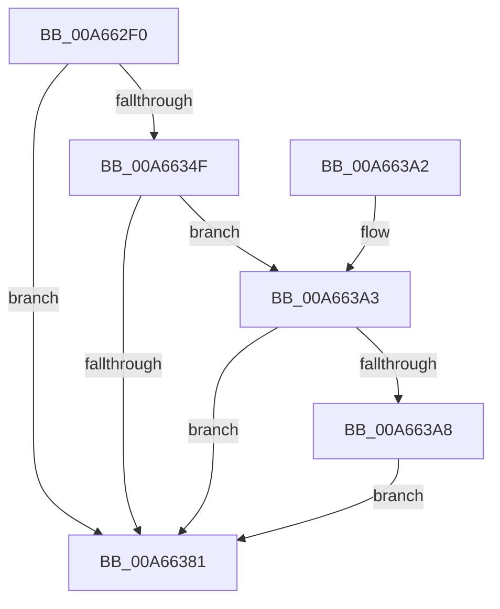

# AdtpBuildSecurityDescriptorChangeString

- RVA: `0x00A662F0`–`0x00A663B7` (길이 `199` bytes)
- VA: `0x0000000140A662F0`
- 실행 섹션: `PAGE`
- PDB 이름 있음: `예`; PDB Function 태그: `아니요`
- unwind 정보 RVA: `0x000B396C`
- 디코드: `54`개 명령, `199/199` bytes 표시
- 미해석 바이트: `0` (있으면 어셈블리에 `.byte`로 보존)

> 이 문서는 커널 이미지의 기계어와 PDB 기호를 분석해 생성했습니다. 4번과 5번은 함수 원형과 자료형을 바이너리 사용 방식에서 추정한 C 해석이며 원본 소스 복구 결과는 아닙니다.

## 1. Dependencies

- 직접 호출 지점: **3**; 고유 호출 대상: **2**
- 직접 호출자로 확인된 함수: **1**
- RIP 상대 이미지 참조: **0**

### Outgoing calls
- `0x00A66344` → [AdtpBuildSecurityDescriptorUnicodeString](AdtpBuildSecurityDescriptorUnicodeString_function_00A663C0.md) (function, `0x00A663C0`)
- `0x00A66376` → [AdtpBuildSecurityDescriptorUnicodeString](AdtpBuildSecurityDescriptorUnicodeString_function_00A663C0.md) (function, `0x00A663C0`)
- `0x00A663B0` → [ExFreePoolWithTag](../../poolcode/B8/ExFreePoolWithTag_function_00B82870.md) (function, `0x00B82870`)

### Direct callers
- [AdtpPackageParameters](../../text/45/AdtpPackageParameters_function_00459964.md) at `0x00459F17`

### Static image references
- 디코드된 RIP-relative 메모리 참조가 없습니다.

## 2. Other-region calls and transfers

- 다른 실행 섹션으로 향하는 call: **1**
  - `0x00A663B0` → [ExFreePoolWithTag](../../poolcode/B8/ExFreePoolWithTag_function_00B82870.md) (`PAGE` → `POOLCODE`)
- 별도 외부 분기/꼬리 이동을 확인하지 못했습니다.

## 3. Assembly (complete function range)

```asm
00A662F0  48 8B C4                        mov rax, rsp
00A662F3  48 89 58 08                     mov qword ptr [rax + 8], rbx
00A662F7  48 89 68 10                     mov qword ptr [rax + 0x10], rbp
00A662FB  48 89 70 18                     mov qword ptr [rax + 0x18], rsi
00A662FF  48 89 78 20                     mov qword ptr [rax + 0x20], rdi
00A66303  41 54                           push r12
00A66305  41 56                           push r14
00A66307  41 57                           push r15
00A66309  48 83 EC 40                     sub rsp, 0x40
00A6630D  48 8B BC 24 88 00 00 00         mov rdi, qword ptr [rsp + 0x88]
00A66315  4D 8B E0                        mov r12, r8
00A66318  4C 8B B4 24 B0 00 00 00         mov r14, qword ptr [rsp + 0xb0]
00A66320  45 33 C0                        xor r8d, r8d
00A66323  48 8B B4 24 80 00 00 00         mov rsi, qword ptr [rsp + 0x80]
00A6632B  8B E9                           mov ebp, ecx
00A6632D  4C 8B BC 24 A8 00 00 00         mov r15, qword ptr [rsp + 0xa8]
00A66335  4C 8B CE                        mov r9, rsi
00A66338  48 89 78 D8                     mov qword ptr [rax - 0x28], rdi
00A6633C  4C 89 70 D0                     mov qword ptr [rax - 0x30], r14
00A66340  4C 89 78 C8                     mov qword ptr [rax - 0x38], r15
00A66344  E8 77 00 00 00                  call 0x140a663c0
00A66349  8B D8                           mov ebx, eax
00A6634B  85 C0                           test eax, eax
00A6634D  78 32                           js 0x140a66381
00A6634F  48 8B 84 24 A0 00 00 00         mov rax, qword ptr [rsp + 0xa0]
00A66357  45 33 C0                        xor r8d, r8d
00A6635A  4C 8B 8C 24 98 00 00 00         mov r9, qword ptr [rsp + 0x98]
00A66362  49 8B D4                        mov rdx, r12
00A66365  48 89 44 24 30                  mov qword ptr [rsp + 0x30], rax
00A6636A  8B CD                           mov ecx, ebp
00A6636C  4C 89 74 24 28                  mov qword ptr [rsp + 0x28], r14
00A66371  4C 89 7C 24 20                  mov qword ptr [rsp + 0x20], r15
00A66376  E8 45 00 00 00                  call 0x140a663c0
00A6637B  8B D8                           mov ebx, eax
00A6637D  85 C0                           test eax, eax
00A6637F  78 22                           js 0x140a663a3
00A66381  48 8B 6C 24 68                  mov rbp, qword ptr [rsp + 0x68]
00A66386  8B C3                           mov eax, ebx
00A66388  48 8B 5C 24 60                  mov rbx, qword ptr [rsp + 0x60]
00A6638D  48 8B 74 24 70                  mov rsi, qword ptr [rsp + 0x70]
00A66392  48 8B 7C 24 78                  mov rdi, qword ptr [rsp + 0x78]
00A66397  48 83 C4 40                     add rsp, 0x40
00A6639B  41 5F                           pop r15
00A6639D  41 5E                           pop r14
00A6639F  41 5C                           pop r12
00A663A1  C3                              ret
00A663A2  CC                              int3
00A663A3  80 3F 00                        cmp byte ptr [rdi], 0
00A663A6  74 D9                           je 0x140a66381
00A663A8  C6 07 00                        mov byte ptr [rdi], 0
00A663AB  33 D2                           xor edx, edx
00A663AD  48 8B 0E                        mov rcx, qword ptr [rsi]
00A663B0  E8 BB C4 11 00                  call 0x140b82870
00A663B5  EB CA                           jmp 0x140a66381
```

## 4. C-style interpretation (structured pseudocode)

```c
__int64 __fastcall AdtpBuildSecurityDescriptorChangeString(int a1, __int64 a2, __int64 a3, __int64 a4, __int64 a5, __int64 a6, __int64 a7, __int64 a8, __int64 a9, __int64 a10, __int64 a11)
{
    __int64 result;
    __int64 v_rsp;
    unsigned __int64 v_stack_m28;
    unsigned __int64 v_stack_m30;
    unsigned __int64 v_stack_m38;
    unsigned __int64 v_stack_p10;
    unsigned __int64 v_stack_p18;
    unsigned __int64 v_stack_p20;
    unsigned __int64 v_stack_p8;

    *(unsigned __int64 *)(v_rsp + 8) = v_rbx;
    *(unsigned __int64 *)(v_rsp + 16) = v_rbp;
    *(unsigned __int64 *)(v_rsp + 24) = v_rsi;
    *(unsigned __int64 *)(v_rsp + 32) = v_rdi;
    v_rsp = (v_rsp) - (64);
    a3 = 0;
    *(unsigned __int64 *)(v_rsp - 40) = a6;
    *(unsigned __int64 *)(v_rsp - 48) = a11;
    *(unsigned __int64 *)(v_rsp - 56) = a10;
    result = AdtpBuildSecurityDescriptorUnicodeString(a1, a2, a3, a5);
    if (sign_flag) goto loc_00A66381;
    a3 = 0;
    v_stack_m28 = a9;
    v_stack_m30 = a11;
    v_stack_m38 = a10;
    result = AdtpBuildSecurityDescriptorUnicodeString((unsigned int)((unsigned int)((unsigned int)(a1))), 0, a3, a8);
    if (sign_flag) goto loc_00A663A3;
loc_00A66381:
    v_rsp = (v_rsp) + (64);
    return (unsigned int)((unsigned int)((unsigned int)((unsigned int)(result))));
loc_00A663A3:
    if ((*(unsigned __int8 *)(v_stack_p20)) == 0) goto loc_00A66381;
    *(unsigned __int8 *)(v_stack_p20) = 0;
    a2 = 0;
    result = ExFreePoolWithTag(*(unsigned __int64 *)(v_stack_p18), a2, a3, a8);
    goto loc_00A66381;
}
```

## 5. (Beta) C Style

```c
int64_t AdtpBuildSecurityDescriptorChangeString(int32_t Arg1, int64_t Arg2, int64_t Arg3, int64_t Arg4, void *Arg5, void *Arg6, uint64_t Arg7, int64_t Arg8, int64_t Arg9, int64_t Arg10, int64_t Arg11)
{
    uint8_t *arg5 = (uint8_t *)Arg5;
    uint8_t *arg6 = (uint8_t *)Arg6;

    int64_t result;
    int64_t local_rsp;
    uint64_t v_stack_m28;
    uint64_t v_stack_m30;
    uint64_t v_stack_m38;
    uint64_t v_stack_p10;
    uint64_t v_stack_p18;
    uint64_t v_stack_p20;
    uint64_t v_stack_p8;

    *(uint64_t *)(local_rsp + 0x8) = local_rbx;
    *(uint64_t *)(local_rsp + 0x10) = local_rbp;
    *(uint64_t *)(local_rsp + 0x18) = local_rsi;
    *(uint64_t *)(local_rsp + 0x20) = local_rdi;
    local_rsp = (local_rsp) - (64);
    Arg3 = 0;
    *(void **)(local_rsp - 0x28) = Arg6;
    *(uint64_t *)(local_rsp - 0x30) = Arg11;
    *(uint64_t *)(local_rsp - 0x38) = Arg10;
    result = AdtpBuildSecurityDescriptorUnicodeString(Arg1, Arg2, Arg3, Arg5);
    if (sign_flag) goto loc_00A66381;
    Arg3 = 0;
    v_stack_m28 = Arg9;
    v_stack_m30 = Arg11;
    v_stack_m38 = Arg10;
    result = AdtpBuildSecurityDescriptorUnicodeString((uint32_t)((uint32_t)((uint32_t)(Arg1))), 0, Arg3, Arg8);
    if (sign_flag) goto loc_00A663A3;
loc_00A66381:
    local_rsp = (local_rsp) + (64);
    return (uint32_t)((uint32_t)((uint32_t)((uint32_t)(result))));
loc_00A663A3:
    if ((*(uint8_t *)(v_stack_p20)) == 0) goto loc_00A66381;
    *(uint8_t *)(v_stack_p20) = 0;
    Arg2 = 0;
    result = ExFreePoolWithTag(*(uint64_t *)(v_stack_p18), Arg2, Arg3, Arg8);
    goto loc_00A66381;
}
```

### 관측된 메모리 오프셋

구조체 형식이 확인되지 않은 접근은 인자 기준의 오프셋으로만 기록했습니다.

| 기준 인자 | 오프셋 표현 | 폭 (bit) | 접근 |
|---|---:|---:|---|
| `Arg5` | `+ 0x0` | `64` | `R` |
| `Arg6` | `+ 0x0` | `8` | `R` |
| `Arg6` | `+ 0x0` | `8` | `W` |

## 6. Execution-region graph

[열기: 2D/3D 그래프와 함수 탐색 컨트롤 패널](../../../control-panel.html?section=page&rva=0x00A662F0&view=graph)

- 2D 그래프는 위에서 아래로 흐르고, 3D 그래프는 빈 공간을 드래그해 회전합니다. Shift+드래그는 이동, 휠은 확대·축소, 함수 노드 선택은 대상 보고서 이동입니다.

### Static fallback


