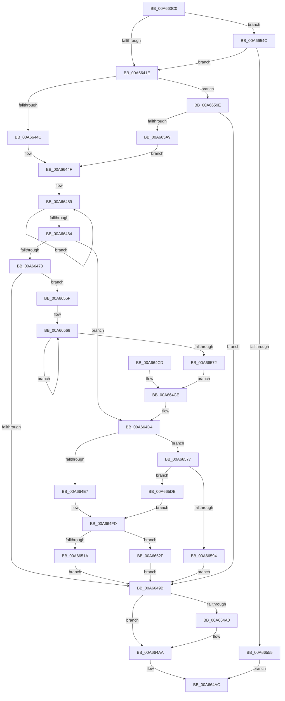

# AdtpBuildSecurityDescriptorUnicodeString

- RVA: `0x00A663C0`–`0x00A665E9` (길이 `553` bytes)
- VA: `0x0000000140A663C0`
- 실행 섹션: `PAGE`
- PDB 이름 있음: `예`; PDB Function 태그: `아니요`
- unwind 정보 RVA: `0x000B398C`
- 디코드: `145`개 명령, `553/553` bytes 표시
- 미해석 바이트: `0` (있으면 어셈블리에 `.byte`로 보존)

> 이 문서는 커널 이미지의 기계어와 PDB 기호를 분석해 생성했습니다. 4번과 5번은 함수 원형과 자료형을 바이너리 사용 방식에서 추정한 C 해석이며 원본 소스 복구 결과는 아닙니다.

## 1. Dependencies

- 직접 호출 지점: **7**; 고유 호출 대상: **7**
- 직접 호출자로 확인된 함수: **2**
- RIP 상대 이미지 참조: **4**

### Outgoing calls
- `0x00A66438` → [SeConvertSecurityDescriptorToStringSecurityDescriptor](../../text/4A/SeConvertSecurityDescriptorToStringSecurityDescriptor_function_004A18B0.md) (function, `0x004A18B0`)
- `0x00A6648A` → [RtlStringCbPrintfW](../../text/40/RtlStringCbPrintfW_function_0040FB40.md) (function, `0x0040FB40`)
- `0x00A664A5` → [ExFreePoolWithTag](../../poolcode/B8/ExFreePoolWithTag_function_00B82870.md) (function, `0x00B82870`)
- `0x00A664B4` → [_security_check_cookie](../../text/6A/_security_check_cookie_function_006AC640.md) (function, `0x006AC640`)
- `0x00A66510` → [memcpy](../../text/6C/memcpy_function_006C6840.md) (function, `0x006C6840`)
- `0x00A66587` → [ExAllocatePool2](../../poolcode/B8/ExAllocatePool2_function_00B820F0.md) (function, `0x00B820F0`)
- `0x00A665BD` → [StringCchPrintfW](../../text/47/StringCchPrintfW_function_0047BAD0.md) (function, `0x0047BAD0`)

### Direct callers
- [AdtpPackageParameters](../../text/45/AdtpPackageParameters_function_00459964.md) at `0x0045A27C`
- [AdtpBuildSecurityDescriptorChangeString](AdtpBuildSecurityDescriptorChangeString_function_00A662F0.md) at `0x00A66344`
- [AdtpBuildSecurityDescriptorChangeString](AdtpBuildSecurityDescriptorChangeString_function_00A662F0.md) at `0x00A66376`

### Static image references
- `0x00A663D4` → RVA `0x00E0A740` (`.data`; read)
- `0x00A66479` → RVA `0x00019A00` (`.rdata`; read)
- `0x00A665AC` → RVA `0x000419A8` (`.rdata`; read)
- `0x00A665C4` → RVA `0x0001A748` (`.rdata`; read)

## 2. Other-region calls and transfers

- 다른 실행 섹션으로 향하는 call: **7**
  - `0x00A66438` → [SeConvertSecurityDescriptorToStringSecurityDescriptor](../../text/4A/SeConvertSecurityDescriptorToStringSecurityDescriptor_function_004A18B0.md) (`PAGE` → `.text`)
  - `0x00A6648A` → [RtlStringCbPrintfW](../../text/40/RtlStringCbPrintfW_function_0040FB40.md) (`PAGE` → `.text`)
  - `0x00A664A5` → [ExFreePoolWithTag](../../poolcode/B8/ExFreePoolWithTag_function_00B82870.md) (`PAGE` → `POOLCODE`)
  - `0x00A664B4` → [_security_check_cookie](../../text/6A/_security_check_cookie_function_006AC640.md) (`PAGE` → `.text`)
  - `0x00A66510` → [memcpy](../../text/6C/memcpy_function_006C6840.md) (`PAGE` → `.text`)
  - `0x00A66587` → [ExAllocatePool2](../../poolcode/B8/ExAllocatePool2_function_00B820F0.md) (`PAGE` → `POOLCODE`)
  - `0x00A665BD` → [StringCchPrintfW](../../text/47/StringCchPrintfW_function_0047BAD0.md) (`PAGE` → `.text`)
- 별도 외부 분기/꼬리 이동을 확인하지 못했습니다.

## 3. Assembly (complete function range)

```asm
00A663C0  40 53                           push rbx
00A663C2  55                              push rbp
00A663C3  56                              push rsi
00A663C4  57                              push rdi
00A663C5  41 54                           push r12
00A663C7  41 55                           push r13
00A663C9  41 56                           push r14
00A663CB  41 57                           push r15
00A663CD  48 81 EC 88 00 00 00            sub rsp, 0x88
00A663D4  48 8B 05 65 43 3A 00            mov rax, qword ptr [rip + 0x3a4365]
00A663DB  48 33 C4                        xor rax, rsp
00A663DE  48 89 44 24 70                  mov qword ptr [rsp + 0x70], rax
00A663E3  4C 8B AC 24 F8 00 00 00         mov r13, qword ptr [rsp + 0xf8]
00A663EB  48 8B C2                        mov rax, rdx
00A663EE  48 8B 94 24 F0 00 00 00         mov rdx, qword ptr [rsp + 0xf0]
00A663F6  33 DB                           xor ebx, ebx
00A663F8  48 89 54 24 40                  mov qword ptr [rsp + 0x40], rdx
00A663FD  4D 8B F1                        mov r14, r9
00A66400  48 8B 94 24 00 01 00 00         mov rdx, qword ptr [rsp + 0x100]
00A66408  4D 8B F8                        mov r15, r8
00A6640B  48 89 54 24 48                  mov qword ptr [rsp + 0x48], rdx
00A66410  48 89 5C 24 30                  mov qword ptr [rsp + 0x30], rbx
00A66415  4D 85 C9                        test r9, r9
00A66418  0F 84 2E 01 00 00               je 0x140a6654c
00A6641E  48 8D 54 24 38                  lea rdx, [rsp + 0x38]
00A66423  44 8B C1                        mov r8d, ecx
00A66426  48 89 54 24 20                  mov qword ptr [rsp + 0x20], rdx
00A6642B  4C 8D 4C 24 30                  lea r9, [rsp + 0x30]
00A66430  BA 01 00 00 00                  mov edx, 1
00A66435  48 8B C8                        mov rcx, rax
00A66438  E8 73 B4 A3 FF                  call 0x1404a18b0
00A6643D  4C 8B 64 24 30                  mov r12, qword ptr [rsp + 0x30]
00A66442  8B F0                           mov esi, eax
00A66444  85 C0                           test eax, eax
00A66446  0F 88 52 01 00 00               js 0x140a6659e
00A6644C  49 8B EC                        mov rbp, r12
00A6644F  48 83 CF FF                     or rdi, 0xffffffffffffffff
00A66453  48 8B DF                        mov rbx, rdi
00A66456  45 33 C0                        xor r8d, r8d
00A66459  48 FF C3                        inc rbx
00A6645C  66 44 39 44 5D 00               cmp word ptr [rbp + rbx*2], r8w
00A66462  75 F5                           jne 0x140a66459
00A66464  FF C3                           inc ebx
00A66466  8B C3                           mov eax, ebx
00A66468  48 03 C0                        add rax, rax
00A6646B  48 3D FF FF 00 00               cmp rax, 0xffff
00A66471  76 61                           jbe 0x140a664d4
00A66473  41 B9 25 07 00 00               mov r9d, 0x725
00A66479  4C 8D 05 80 35 5B FF            lea r8, [rip - 0xa4ca80]
00A66480  BA 10 00 00 00                  mov edx, 0x10
00A66485  48 8D 4C 24 50                  lea rcx, [rsp + 0x50]
00A6648A  E8 B1 96 9A FF                  call 0x14040fb40
00A6648F  33 DB                           xor ebx, ebx
00A66491  8B F0                           mov esi, eax
00A66493  85 C0                           test eax, eax
00A66495  0F 89 C4 00 00 00               jns 0x140a6655f
00A6649B  4D 85 E4                        test r12, r12
00A6649E  74 0A                           je 0x140a664aa
00A664A0  33 D2                           xor edx, edx
00A664A2  49 8B CC                        mov rcx, r12
00A664A5  E8 C6 C3 11 00                  call 0x140b82870
00A664AA  8B C6                           mov eax, esi
00A664AC  48 8B 4C 24 70                  mov rcx, qword ptr [rsp + 0x70]
00A664B1  48 33 CC                        xor rcx, rsp
00A664B4  E8 87 61 C4 FF                  call 0x1406ac640
00A664B9  48 81 C4 88 00 00 00            add rsp, 0x88
00A664C0  41 5F                           pop r15
00A664C2  41 5E                           pop r14
00A664C4  41 5D                           pop r13
00A664C6  41 5C                           pop r12
00A664C8  5F                              pop rdi
00A664C9  5E                              pop rsi
00A664CA  5D                              pop rbp
00A664CB  5B                              pop rbx
00A664CC  C3                              ret
00A664CD  CC                              int3
00A664CE  8D 5F 01                        lea ebx, [rdi + 1]
00A664D1  45 33 C0                        xor r8d, r8d
00A664D4  41 8B 45 00                     mov eax, dword ptr [r13]
00A664D8  8D 0C 18                        lea ecx, [rax + rbx]
00A664DB  81 F9 00 04 00 00               cmp ecx, 0x400
00A664E1  0F 83 90 00 00 00               jae 0x140a66577
00A664E7  48 8B 54 24 40                  mov rdx, qword ptr [rsp + 0x40]
00A664EC  41 89 4D 00                     mov dword ptr [r13], ecx
00A664F0  41 BD 01 00 00 00               mov r13d, 1
00A664F6  48 8D 3C 42                     lea rdi, [rdx + rax*2]
00A664FA  41 8A C0                        mov al, r8b
00A664FD  48 8B 4C 24 48                  mov rcx, qword ptr [rsp + 0x48]
00A66502  48 8B D5                        mov rdx, rbp
00A66505  44 8B C3                        mov r8d, ebx
00A66508  4D 03 C0                        add r8, r8
00A6650B  88 01                           mov byte ptr [rcx], al
00A6650D  48 8B CF                        mov rcx, rdi
00A66510  E8 2B 03 C6 FF                  call 0x1406c6840
00A66515  4D 85 F6                        test r14, r14
00A66518  74 15                           je 0x140a6652f
00A6651A  8D 04 1B                        lea eax, [rbx + rbx]
00A6651D  49 89 3E                        mov qword ptr [r14], rdi
00A66520  33 DB                           xor ebx, ebx
00A66522  41 89 46 08                     mov dword ptr [r14 + 8], eax
00A66526  41 89 5E 0C                     mov dword ptr [r14 + 0xc], ebx
00A6652A  E9 6C FF FF FF                  jmp 0x140a6649b
00A6652F  66 41 2B DD                     sub bx, r13w
00A66533  49 89 7F 08                     mov qword ptr [r15 + 8], rdi
00A66537  66 03 DB                        add bx, bx
00A6653A  66 41 89 1F                     mov word ptr [r15], bx
00A6653E  66 83 C3 02                     add bx, 2
00A66542  66 41 89 5F 02                  mov word ptr [r15 + 2], bx
00A66547  E9 4F FF FF FF                  jmp 0x140a6649b
00A6654C  4D 85 FF                        test r15, r15
00A6654F  0F 85 C9 FE FF FF               jne 0x140a6641e
00A66555  B8 0D 00 00 C0                  mov eax, 0xc000000d
00A6655A  E9 4D FF FF FF                  jmp 0x140a664ac
00A6655F  48 8D 6C 24 50                  lea rbp, [rsp + 0x50]
00A66564  48 8D 44 24 50                  lea rax, [rsp + 0x50]
00A66569  48 FF C7                        inc rdi
00A6656C  66 39 1C 78                     cmp word ptr [rax + rdi*2], bx
00A66570  75 F7                           jne 0x140a66569
00A66572  E9 57 FF FF FF                  jmp 0x140a664ce
00A66577  8B D3                           mov edx, ebx
00A66579  B9 00 01 00 00                  mov ecx, 0x100
00A6657E  48 03 D2                        add rdx, rdx
00A66581  41 B8 53 65 41 6B               mov r8d, 0x6b416553
00A66587  E8 64 BB 11 00                  call 0x140b820f0
00A6658C  48 8B F8                        mov rdi, rax
00A6658F  48 85 C0                        test rax, rax
00A66592  75 47                           jne 0x140a665db
00A66594  BE 17 00 00 C0                  mov esi, 0xc0000017
00A66599  E9 FD FE FF FF                  jmp 0x140a6649b
00A6659E  3D 17 00 00 C0                  cmp eax, 0xc0000017
00A665A3  0F 84 F2 FE FF FF               je 0x140a6649b
00A665A9  44 8B C8                        mov r9d, eax
00A665AC  4C 8D 05 F5 B3 5D FF            lea r8, [rip - 0xa24c0b]
00A665B3  BA 10 00 00 00                  mov edx, 0x10
00A665B8  48 8D 4C 24 50                  lea rcx, [rsp + 0x50]
00A665BD  E8 0E 55 A1 FF                  call 0x14047bad0
00A665C2  85 C0                           test eax, eax
00A665C4  48 8D 0D 7D 41 5B FF            lea rcx, [rip - 0xa4be83]
00A665CB  48 8D 6C 24 50                  lea rbp, [rsp + 0x50]
00A665D0  8B F3                           mov esi, ebx
00A665D2  48 0F 48 E9                     cmovs rbp, rcx
00A665D6  E9 74 FE FF FF                  jmp 0x140a6644f
00A665DB  41 BD 01 00 00 00               mov r13d, 1
00A665E1  41 8A C5                        mov al, r13b
00A665E4  E9 14 FF FF FF                  jmp 0x140a664fd
```

## 4. C-style interpretation (structured pseudocode)

```c
__int64 __fastcall AdtpBuildSecurityDescriptorUnicodeString(int a1, __int64 a2, __int64 a3, __int64 a4, __int64 a5, __int64 a6, __int64 a7)
{
    __int64 result;
    __int64 v_rbp;
    __int64 v_rbx;
    __int64 v_rdi;
    __int64 v_rsp;
    unsigned __int64 v_stack_m58;
    unsigned __int64 v_stack_m78;
    unsigned __int64 v_stack_m80;
    unsigned __int64 v_stack_m88;
    unsigned __int64 v_stack_m90;
    unsigned __int64 v_stack_m98;
    unsigned __int64 v_stack_mA8;
    unsigned __int64 v_stack_p40;
    unsigned __int64 v_stack_p48;
    unsigned __int64 v_stack_p50;

    v_rsp = (v_rsp) - (136);
    result = (*(unsigned __int64 *)(v_rip + 3818341)) ^ (v_rsp);
    v_stack_m58 = result;
    v_rbx = 0;
    v_stack_m88 = a5;
    v_stack_m80 = a7;
    v_stack_m98 = 0;
    if (a4 == 0) goto loc_00A6654C;
loc_00A6641E:
    v_stack_mA8 = v_stack_m90;
    result = SeConvertSecurityDescriptorToStringSecurityDescriptor(a2, 1, (unsigned int)(a1), v_stack_m98);
    if (sign_flag) goto loc_00A6659E;
loc_00A6644F:
    v_rdi = (v_rdi) | (-1);
    a3 = 0;
loc_00A66459:
    v_rbx = (v_rdi) + 1;
    if ((*(unsigned __int16 *)(v_stack_m98 + v_rbx * 2)) != 0) goto loc_00A66459;
    v_rbx = (unsigned int)((v_rbx) + 1);
    result = ((unsigned int)((unsigned int)(v_rbx))) + ((unsigned int)((unsigned int)(v_rbx)));
    if (result <= 0xFFFFULL) goto loc_00A664D4;
    result = RtlStringCbPrintfW(v_stack_m78, 16, v_rip - 10799744, (unsigned int)(0x725ULL));
    v_rbx = 0;
    if (!sign_flag) goto loc_00A6655F;
loc_00A6649B:
    if (v_stack_m98 != 0) {
        a2 = 0;
        a1 = v_stack_m98;
        result = ExFreePoolWithTag(a1, a2, v_rip - 10799744, (unsigned int)(0x725ULL));
    }
loc_00A664AC:
    a1 = (v_stack_m58) ^ (v_rsp);
    result = _security_check_cookie(a1, a2, v_rip - 10799744, (unsigned int)(0x725ULL));
    v_rsp = (v_rsp) + (136);
    return result;
loc_00A664CE:
    a3 = 0;
loc_00A664D4:
    if (((unsigned int)((unsigned int)(*(unsigned int *)(a6)) + v_rdi + 1 * 1)) >= 0x400ULL) goto loc_00A66577;
    *(unsigned int *)(a6) = (unsigned int)((unsigned int)(*(unsigned int *)(a6)) + v_rdi + 1 * 1);
loc_00A664FD:
    a3 = ((unsigned int)((unsigned int)(v_rdi + 1))) + ((unsigned int)((unsigned int)(v_rdi + 1)));
    *(unsigned __int8 *)(v_stack_p48) = 0;
    result = memcpy(v_stack_p40 + (unsigned int)(*(unsigned int *)(a6)) * 2, v_stack_m98, a3, (unsigned int)(0x725ULL));
    if (a4 == 0) goto loc_00A6652F;
    *(unsigned __int64 *)(a4) = v_stack_p40 + (unsigned int)(*(unsigned int *)(a6)) * 2;
    v_rbx = 0;
    *(unsigned int *)(a4 + 8) = (unsigned int)(v_rdi + 1 + v_rdi + 1 * 1);
    *(unsigned int *)(a4 + 12) = 0;
    goto loc_00A6649B;
loc_00A6652F:
    v_rbx = (unsigned __int16)((v_rbx) - (1));
    *(unsigned __int64 *)(a3 + 8) = v_stack_p40 + (unsigned int)(*(unsigned int *)(a6)) * 2;
    v_rbx = (unsigned __int16)((v_rbx) + ((unsigned __int16)(v_rbx)));
    *(unsigned __int16 *)(a3) = (unsigned __int16)(v_rbx);
    v_rbx = (unsigned __int16)((v_rbx) + (2));
    *(unsigned __int16 *)(a3 + 2) = (unsigned __int16)(v_rbx);
    goto loc_00A6649B;
loc_00A6654C:
    if (a3 != 0) goto loc_00A6641E;
    goto loc_00A664AC;
loc_00A6655F:
loc_00A66569:
    v_rdi = (v_stack_p40 + (unsigned int)(*(unsigned int *)(a6)) * 2) + 1;
    if ((*(unsigned __int16 *)(v_stack_p50 + v_rdi * 2)) != ((unsigned __int16)(v_rbx))) goto loc_00A66569;
    goto loc_00A664CE;
loc_00A66577:
    a2 = ((unsigned int)((unsigned int)(v_rbx))) + ((unsigned int)((unsigned int)(v_rbx)));
    result = ExAllocatePool2(256, a2, (unsigned int)(0x6B416553ULL), (unsigned int)(0x725ULL));
    if (result != 0) goto loc_00A665DB;
    goto loc_00A6649B;
loc_00A6659E:
    if (((unsigned int)(result)) == 0xC0000017ULL) goto loc_00A6649B;
    result = StringCchPrintfW(v_stack_p50, 16, v_rip - 10636299, (unsigned int)((unsigned int)(result)));
    v_rbp = v_stack_p50;
    if (sign_flag) { v_rbp = v_rip - 10796675; }
    goto loc_00A6644F;
loc_00A665DB:
    goto loc_00A664FD;
}
```

## 5. (Beta) C Style

```c
int64_t AdtpBuildSecurityDescriptorUnicodeString(int32_t Arg1, int64_t Arg2, int64_t Arg3, int64_t Arg4, int64_t Arg5, void *Arg6, int64_t Arg7)
{
    uint8_t *arg6 = (uint8_t *)Arg6;

    int64_t result;
    int64_t local_rbp;
    int64_t local_rbx;
    int64_t local_rdi;
    int64_t local_rsp;
    uint64_t v_stack_m58;
    uint64_t v_stack_m78;
    uint64_t v_stack_m80;
    uint64_t v_stack_m88;
    uint64_t v_stack_m90;
    uint64_t v_stack_m98;
    uint64_t v_stack_mA8;
    uint64_t v_stack_p40;
    uint64_t v_stack_p48;
    uint64_t v_stack_p50;

    local_rsp = (local_rsp) - (136);
    result = (*(uint64_t *)(v_rip + 0x3A4365)) ^ (local_rsp);
    v_stack_m58 = result;
    local_rbx = 0;
    v_stack_m88 = Arg5;
    v_stack_m80 = Arg7;
    v_stack_m98 = 0;
    if (Arg4 == 0) goto loc_00A6654C;
loc_00A6641E:
    v_stack_mA8 = v_stack_m90;
    result = SeConvertSecurityDescriptorToStringSecurityDescriptor(Arg2, 1, (uint32_t)(Arg1), v_stack_m98);
    if (sign_flag) goto loc_00A6659E;
loc_00A6644F:
    local_rdi = (local_rdi) | (-1);
    Arg3 = 0;
loc_00A66459:
    local_rbx = (local_rdi) + 1;
    if ((*(uint16_t *)(v_stack_m98 + local_rbx * 2)) != 0) goto loc_00A66459;
    local_rbx = (uint32_t)((local_rbx) + 1);
    result = ((uint32_t)((uint32_t)(local_rbx))) + ((uint32_t)((uint32_t)(local_rbx)));
    if (result <= 0xFFFFULL) goto loc_00A664D4;
    result = RtlStringCbPrintfW(v_stack_m78, 16, v_rip - 10799744, (uint32_t)(0x725ULL));
    local_rbx = 0;
    if (!sign_flag) goto loc_00A6655F;
loc_00A6649B:
    if (v_stack_m98 != 0) {
        Arg2 = 0;
        Arg1 = v_stack_m98;
        result = ExFreePoolWithTag(Arg1, Arg2, v_rip - 10799744, (uint32_t)(0x725ULL));
    }
loc_00A664AC:
    Arg1 = (v_stack_m58) ^ (local_rsp);
    result = _security_check_cookie(Arg1, Arg2, v_rip - 10799744, (uint32_t)(0x725ULL));
    local_rsp = (local_rsp) + (136);
    return result;
loc_00A664CE:
    Arg3 = 0;
loc_00A664D4:
    if (((uint32_t)((uint32_t)(*(uint32_t *)(arg6)) + local_rdi + 1 * 1)) >= 0x400ULL) goto loc_00A66577;
    *(uint32_t *)(arg6) = (uint32_t)((uint32_t)(*(uint32_t *)(arg6)) + local_rdi + 1 * 1);
loc_00A664FD:
    Arg3 = ((uint32_t)((uint32_t)(local_rdi + 1))) + ((uint32_t)((uint32_t)(local_rdi + 1)));
    *(uint8_t *)(v_stack_p48) = 0;
    result = memcpy(v_stack_p40 + (uint32_t)(*(uint32_t *)(arg6)) * 2, v_stack_m98, Arg3, (uint32_t)(0x725ULL));
    if (Arg4 == 0) goto loc_00A6652F;
    *(uint64_t *)(Arg4) = v_stack_p40 + (uint32_t)(*(uint32_t *)(arg6)) * 2;
    local_rbx = 0;
    *(uint32_t *)(Arg4 + 0x8) = (uint32_t)(local_rdi + 1 + local_rdi + 1 * 1);
    *(uint32_t *)(Arg4 + 0xC) = 0;
    goto loc_00A6649B;
loc_00A6652F:
    local_rbx = (uint16_t)((local_rbx) - (1));
    *(uint64_t *)(Arg3 + 0x8) = v_stack_p40 + (uint32_t)(*(uint32_t *)(arg6)) * 2;
    local_rbx = (uint16_t)((local_rbx) + ((uint16_t)(local_rbx)));
    *(uint16_t *)(Arg3) = (uint16_t)(local_rbx);
    local_rbx = (uint16_t)((local_rbx) + (2));
    *(uint16_t *)(Arg3 + 0x2) = (uint16_t)(local_rbx);
    goto loc_00A6649B;
loc_00A6654C:
    if (Arg3 != 0) goto loc_00A6641E;
    goto loc_00A664AC;
loc_00A6655F:
loc_00A66569:
    local_rdi = (v_stack_p40 + (uint32_t)(*(uint32_t *)(arg6)) * 2) + 1;
    if ((*(uint16_t *)(v_stack_p50 + local_rdi * 2)) != ((uint16_t)(local_rbx))) goto loc_00A66569;
    goto loc_00A664CE;
loc_00A66577:
    Arg2 = ((uint32_t)((uint32_t)(local_rbx))) + ((uint32_t)((uint32_t)(local_rbx)));
    result = ExAllocatePool2(256, Arg2, (uint32_t)(0x6B416553ULL), (uint32_t)(0x725ULL));
    if (result != 0) goto loc_00A665DB;
    goto loc_00A6649B;
loc_00A6659E:
    if (((uint32_t)(result)) == 0xC0000017ULL) goto loc_00A6649B;
    result = StringCchPrintfW(v_stack_p50, 16, v_rip - 10636299, (uint32_t)((uint32_t)(result)));
    local_rbp = v_stack_p50;
    if (sign_flag) { local_rbp = v_rip - 10796675; }
    goto loc_00A6644F;
loc_00A665DB:
    goto loc_00A664FD;
}
```

### 관측된 메모리 오프셋

구조체 형식이 확인되지 않은 접근은 인자 기준의 오프셋으로만 기록했습니다.

| 기준 인자 | 오프셋 표현 | 폭 (bit) | 접근 |
|---|---:|---:|---|
| `Arg6` | `+ 0x0` | `32` | `R` |
| `Arg6` | `+ 0x0` | `32` | `W` |

## 6. Execution-region graph

[열기: 2D/3D 그래프와 함수 탐색 컨트롤 패널](../../../control-panel.html?section=page&rva=0x00A663C0&view=graph)

- 2D 그래프는 위에서 아래로 흐르고, 3D 그래프는 빈 공간을 드래그해 회전합니다. Shift+드래그는 이동, 휠은 확대·축소, 함수 노드 선택은 대상 보고서 이동입니다.

### Static fallback


