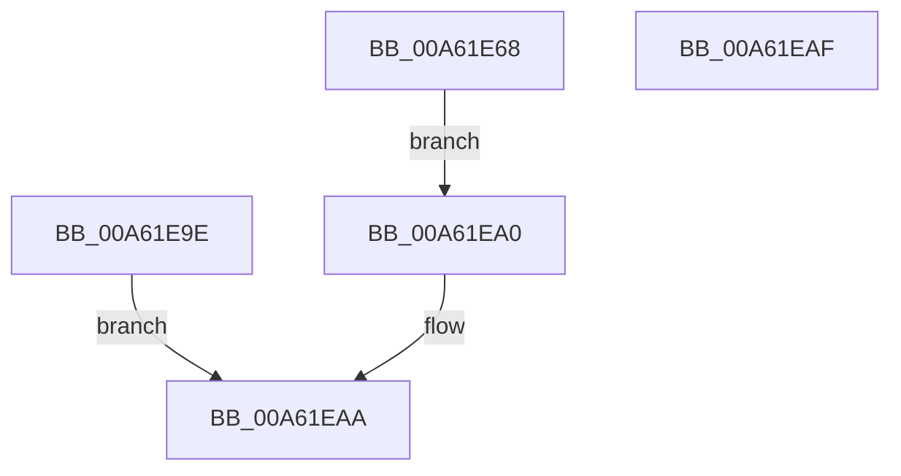

# AlpcpCaptureViewAttribute32

- RVA: `0x00A61E68`–`0x00A61EB0` (길이 `72` bytes)
- VA: `0x0000000140A61E68`
- 실행 섹션: `PAGE`
- PDB 이름 있음: `예`; PDB Function 태그: `아니요`
- unwind 정보 RVA: `0x000B32D0`
- 디코드: `22`개 명령, `72/72` bytes 표시
- 미해석 바이트: `0` (있으면 어셈블리에 `.byte`로 보존)

> 이 문서는 커널 이미지의 기계어와 PDB 기호를 분석해 생성했습니다. 4번과 5번은 함수 원형과 자료형을 바이너리 사용 방식에서 추정한 C 해석이며 원본 소스 복구 결과는 아닙니다.

## 1. Dependencies

- 직접 호출 지점: **1**; 고유 호출 대상: **1**
- 직접 호출자로 확인된 함수: **1**
- RIP 상대 이미지 참조: **0**

### Outgoing calls
- `0x00A61EA5` → [AlpcpCaptureViewAttributeInternal](../88/AlpcpCaptureViewAttributeInternal_function_00889C6C.md) (function, `0x00889C6C`)

### Direct callers
- [AlpcpCaptureAttributes](../88/AlpcpCaptureAttributes_function_0088CD20.md) at `0x0088D225`

### Static image references
- 디코드된 RIP-relative 메모리 참조가 없습니다.

## 2. Other-region calls and transfers

- 다른 실행 섹션으로 향하는 call: **0**
- 별도 외부 분기/꼬리 이동을 확인하지 못했습니다.

## 3. Assembly (complete function range)

```asm
00A61E68  4C 8B DC                        mov r11, rsp
00A61E6B  48 83 EC 48                     sub rsp, 0x48
00A61E6F  33 C0                           xor eax, eax
00A61E71  0F 57 C0                        xorps xmm0, xmm0
00A61E74  0F 11 44 24 20                  movups xmmword ptr [rsp + 0x20], xmm0
00A61E79  49 89 43 E8                     mov qword ptr [r11 - 0x18], rax
00A61E7D  89 44 24 38                     mov dword ptr [rsp + 0x38], eax
00A61E81  8B 02                           mov eax, dword ptr [rdx]
00A61E83  89 44 24 20                     mov dword ptr [rsp + 0x20], eax
00A61E87  8B 42 04                        mov eax, dword ptr [rdx + 4]
00A61E8A  49 89 43 E0                     mov qword ptr [r11 - 0x20], rax
00A61E8E  8B 42 08                        mov eax, dword ptr [rdx + 8]
00A61E91  49 89 43 E8                     mov qword ptr [r11 - 0x18], rax
00A61E95  8B 42 0C                        mov eax, dword ptr [rdx + 0xc]
00A61E98  49 89 43 F0                     mov qword ptr [r11 - 0x10], rax
00A61E9C  EB 02                           jmp 0x140a61ea0
00A61E9E  EB 0A                           jmp 0x140a61eaa
00A61EA0  48 8D 54 24 20                  lea rdx, [rsp + 0x20]
00A61EA5  E8 C2 7D E2 FF                  call 0x140889c6c
00A61EAA  48 83 C4 48                     add rsp, 0x48
00A61EAE  C3                              ret
00A61EAF  CC                              int3
```

## 4. C-style interpretation (structured pseudocode)

```c
__int64 __fastcall AlpcpCaptureViewAttribute32(__int64 a1, __int64 a2)
{
    __int64 result;
    __int64 v_rsp;
    unsigned int v_stack_m10;
    unsigned __int64 v_stack_m28;

    v_rsp = (v_rsp) - (72);
    result = 0;
    v_stack_m28 = v_xmm0;
    *(unsigned __int64 *)(v_rsp - 24) = 0;
    v_stack_m10 = 0;
    v_stack_m28 = (unsigned int)((unsigned int)(*(unsigned int *)(a2)));
    *(unsigned __int64 *)(v_rsp - 32) = (unsigned int)(*(unsigned int *)(a2 + 4));
    *(unsigned __int64 *)(v_rsp - 24) = (unsigned int)(*(unsigned int *)(a2 + 8));
    *(unsigned __int64 *)(v_rsp - 16) = (unsigned int)(*(unsigned int *)(a2 + 12));
    goto loc_00A61EA0;
loc_00A61EA0:
    result = AlpcpCaptureViewAttributeInternal(a1, v_stack_m28, a3, a4);
loc_00A61EAA:
    v_rsp = (v_rsp) + (72);
    return result;
}
```

## 5. (Beta) C Style

```c
int64_t AlpcpCaptureViewAttribute32(int64_t Arg1, void *Arg2)
{
    uint8_t *arg2 = (uint8_t *)Arg2;

    int64_t result;
    int64_t local_rsp;
    uint32_t v_stack_m10;
    uint64_t v_stack_m28;

    local_rsp = (local_rsp) - (72);
    result = 0;
    v_stack_m28 = v_xmm0;
    *(uint64_t *)(local_rsp - 0x18) = 0;
    v_stack_m10 = 0;
    v_stack_m28 = (uint32_t)((uint32_t)(*(uint32_t *)(arg2)));
    *(uint64_t *)(local_rsp - 0x20) = (uint32_t)(*(uint32_t *)(arg2 + 0x4));
    *(uint64_t *)(local_rsp - 0x18) = (uint32_t)(*(uint32_t *)(arg2 + 0x8));
    *(uint64_t *)(local_rsp - 0x10) = (uint32_t)(*(uint32_t *)(arg2 + 0xC));
    goto loc_00A61EA0;
loc_00A61EA0:
    result = AlpcpCaptureViewAttributeInternal(Arg1, v_stack_m28, a3, a4);
loc_00A61EAA:
    local_rsp = (local_rsp) + (72);
    return result;
}
```

### 관측된 메모리 오프셋

구조체 형식이 확인되지 않은 접근은 인자 기준의 오프셋으로만 기록했습니다.

| 기준 인자 | 오프셋 표현 | 폭 (bit) | 접근 |
|---|---:|---:|---|
| `Arg2` | `+ 0x0` | `32` | `R` |
| `Arg2` | `+ 0x4` | `32` | `R` |
| `Arg2` | `+ 0x8` | `32` | `R` |
| `Arg2` | `+ 0xC` | `32` | `R` |

## 6. Execution-region graph

[열기: 2D/3D 그래프와 함수 탐색 컨트롤 패널](../../../control-panel.html?section=page&rva=0x00A61E68&view=graph)

- 2D 그래프는 위에서 아래로 흐르고, 3D 그래프는 빈 공간을 드래그해 회전합니다. Shift+드래그는 이동, 휠은 확대·축소, 함수 노드 선택은 대상 보고서 이동입니다.

### Static fallback


