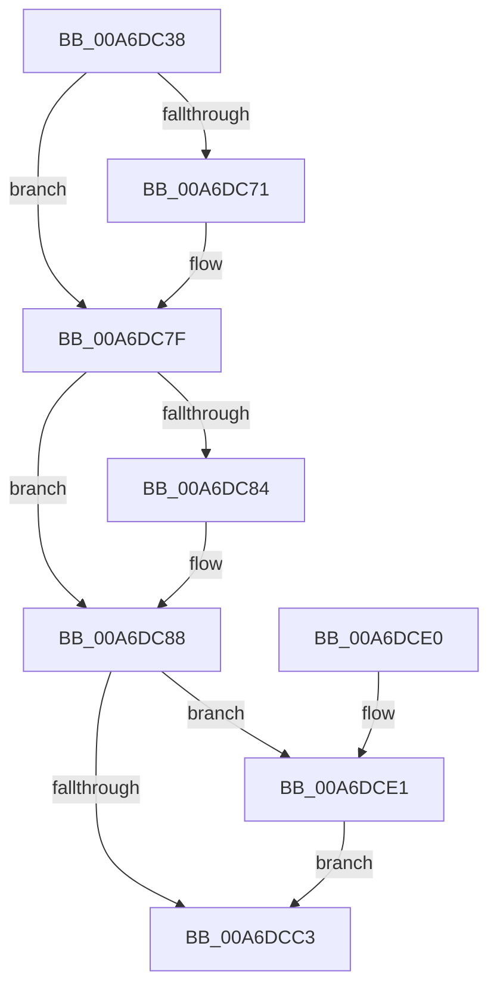

# AlpcpInsertMessageCanceledQueue

- RVA: `0x00A6DC38`–`0x00A6DCEB` (길이 `179` bytes)
- VA: `0x0000000140A6DC38`
- 실행 섹션: `PAGE`
- PDB 이름 있음: `예`; PDB Function 태그: `아니요`
- unwind 정보 RVA: `0x00073808`
- 디코드: `49`개 명령, `179/179` bytes 표시
- 미해석 바이트: `0` (있으면 어셈블리에 `.byte`로 보존)

> 이 문서는 커널 이미지의 기계어와 PDB 기호를 분석해 생성했습니다. 4번과 5번은 함수 원형과 자료형을 바이너리 사용 방식에서 추정한 C 해석이며 원본 소스 복구 결과는 아닙니다.

## 1. Dependencies

- 직접 호출 지점: **4**; 고유 호출 대상: **4**
- 직접 호출자로 확인된 함수: **3**
- RIP 상대 이미지 참조: **0**

### Outgoing calls
- `0x00A6DC61` → [KeAbPreAcquire](../../text/21/KeAbPreAcquire_function_00210230.md) (function, `0x00210230`)
- `0x00A6DC7A` → [ExfAcquirePushLockExclusiveEx](../../text/20/ExfAcquirePushLockExclusiveEx_function_0020FC90.md) (function, `0x0020FC90`)
- `0x00A6DCC6` → [KeAbPostRelease](../../text/2E/KeAbPostRelease_function_002E1600.md) (function, `0x002E1600`)
- `0x00A6DCE4` → [ExfTryToWakePushLock](../../text/26/ExfTryToWakePushLock_function_00265DD0.md) (function, `0x00265DD0`)

### Direct callers
- [AlpcpCancelMessage](../89/AlpcpCancelMessage_function_00894120.md) at `0x008945CE`
- [AlpcpDisconnectPort](../92/AlpcpDisconnectPort_function_00924A68.md) at `0x00924D41`
- [AlpcpReturnMessageOnInsufficientBuffer](../A2/AlpcpReturnMessageOnInsufficientBuffer_function_00A2EF7C.md) at `0x00A2F096`

### Static image references
- 디코드된 RIP-relative 메모리 참조가 없습니다.

## 2. Other-region calls and transfers

- 다른 실행 섹션으로 향하는 call: **4**
  - `0x00A6DC61` → [KeAbPreAcquire](../../text/21/KeAbPreAcquire_function_00210230.md) (`PAGE` → `.text`)
  - `0x00A6DC7A` → [ExfAcquirePushLockExclusiveEx](../../text/20/ExfAcquirePushLockExclusiveEx_function_0020FC90.md) (`PAGE` → `.text`)
  - `0x00A6DCC6` → [KeAbPostRelease](../../text/2E/KeAbPostRelease_function_002E1600.md) (`PAGE` → `.text`)
  - `0x00A6DCE4` → [ExfTryToWakePushLock](../../text/26/ExfTryToWakePushLock_function_00265DD0.md) (`PAGE` → `.text`)
- 별도 외부 분기/꼬리 이동을 확인하지 못했습니다.

## 3. Assembly (complete function range)

```asm
00A6DC38  48 89 5C 24 08                  mov qword ptr [rsp + 8], rbx
00A6DC3D  48 89 6C 24 10                  mov qword ptr [rsp + 0x10], rbp
00A6DC42  48 89 74 24 18                  mov qword ptr [rsp + 0x18], rsi
00A6DC47  57                              push rdi
00A6DC48  48 83 EC 20                     sub rsp, 0x20
00A6DC4C  48 8D 99 88 00 00 00            lea rbx, [rcx + 0x88]
00A6DC53  48 8B EA                        mov rbp, rdx
00A6DC56  48 8B F1                        mov rsi, rcx
00A6DC59  45 33 C0                        xor r8d, r8d
00A6DC5C  48 8B CB                        mov rcx, rbx
00A6DC5F  33 D2                           xor edx, edx
00A6DC61  E8 CA 25 7A FF                  call 0x140210230
00A6DC66  F0 48 0F BA 2B 00               lock bts qword ptr [rbx], 0
00A6DC6C  48 8B F8                        mov rdi, rax
00A6DC6F  73 0E                           jae 0x140a6dc7f
00A6DC71  4C 8B C3                        mov r8, rbx
00A6DC74  48 8B D0                        mov rdx, rax
00A6DC77  48 8B CB                        mov rcx, rbx
00A6DC7A  E8 11 20 7A FF                  call 0x14020fc90
00A6DC7F  48 85 FF                        test rdi, rdi
00A6DC82  74 04                           je 0x140a6dc88
00A6DC84  C6 47 0A 01                     mov byte ptr [rdi + 0xa], 1
00A6DC88  48 8D 8E 80 01 00 00            lea rcx, [rsi + 0x180]
00A6DC8F  48 8B 41 08                     mov rax, qword ptr [rcx + 8]
00A6DC93  48 8D 55 50                     lea rdx, [rbp + 0x50]
00A6DC97  48 89 42 08                     mov qword ptr [rdx + 8], rax
00A6DC9B  48 89 0A                        mov qword ptr [rdx], rcx
00A6DC9E  48 8B 41 08                     mov rax, qword ptr [rcx + 8]
00A6DCA2  48 89 10                        mov qword ptr [rax], rdx
00A6DCA5  48 89 51 08                     mov qword ptr [rcx + 8], rdx
00A6DCA9  0F BA 6D 28 11                  bts dword ptr [rbp + 0x28], 0x11
00A6DCAE  FF 86 D0 01 00 00               inc dword ptr [rsi + 0x1d0]
00A6DCB4  48 83 C8 FF                     or rax, 0xffffffffffffffff
00A6DCB8  F0 48 0F C1 03                  lock xadd qword ptr [rbx], rax
00A6DCBD  24 06                           and al, 6
00A6DCBF  3C 02                           cmp al, 2
00A6DCC1  74 1E                           je 0x140a6dce1
00A6DCC3  48 8B CB                        mov rcx, rbx
00A6DCC6  E8 35 39 87 FF                  call 0x1402e1600
00A6DCCB  48 8B 5C 24 30                  mov rbx, qword ptr [rsp + 0x30]
00A6DCD0  48 8B 6C 24 38                  mov rbp, qword ptr [rsp + 0x38]
00A6DCD5  48 8B 74 24 40                  mov rsi, qword ptr [rsp + 0x40]
00A6DCDA  48 83 C4 20                     add rsp, 0x20
00A6DCDE  5F                              pop rdi
00A6DCDF  C3                              ret
00A6DCE0  CC                              int3
00A6DCE1  48 8B CB                        mov rcx, rbx
00A6DCE4  E8 E7 80 7F FF                  call 0x140265dd0
00A6DCE9  EB D8                           jmp 0x140a6dcc3
```

## 4. C-style interpretation (structured pseudocode)

```c
__int64 __fastcall AlpcpInsertMessageCanceledQueue(__int64 a1, __int64 a2, int a3)
{
    __int64 result;
    __int64 v_rsp;
    unsigned __int64 v_stack_p10;
    unsigned __int64 v_stack_p18;
    unsigned __int64 v_stack_p8;

    v_stack_p8 = v_rbx;
    v_stack_p10 = v_rbp;
    v_stack_p18 = v_rsi;
    v_rsp = (v_rsp) - (32);
    a3 = 0;
    a2 = 0;
    result = KeAbPreAcquire(a1 + 136, a2, a3, a4);
    if (!(condition_is_above_or_equal)) {
        a3 = a1 + 136;
        a2 = result;
        a1 = a1 + 136;
        result = ExfAcquirePushLockExclusiveEx(a1, a2, a3, a4);
    }
    if (result != 0) {
        *(unsigned __int8 *)(result + 10) = 1;
    }
    *(unsigned __int64 *)(a2 + 80 + 8) = *(unsigned __int64 *)(a1 + 384 + 8);
    *(unsigned __int64 *)(a2 + 80) = a1 + 384;
    *(unsigned __int64 *)(*(unsigned __int64 *)(a1 + 384 + 8)) = a2 + 80;
    *(unsigned __int64 *)(a1 + 384 + 8) = a2 + 80;
    result = (*(unsigned __int64 *)(a1 + 384 + 8)) | (-1);
    result = (unsigned __int8)((result) & (6));
    if (((unsigned __int8)(result)) == 2) goto loc_00A6DCE1;
loc_00A6DCC3:
    result = KeAbPostRelease(a1 + 136, a2 + 80, a3, a4);
    v_rsp = (v_rsp) + (32);
    return result;
loc_00A6DCE1:
    result = ExfTryToWakePushLock(v_stack_p8, a2 + 80, a3, a4);
    goto loc_00A6DCC3;
}
```

## 5. (Beta) C Style

```c
int64_t AlpcpInsertMessageCanceledQueue(void *Arg1, void *Arg2, int32_t Arg3)
{
    uint8_t *arg1 = (uint8_t *)Arg1;
    uint8_t *arg2 = (uint8_t *)Arg2;

    int64_t result;
    int64_t local_rsp;
    uint64_t v_stack_p10;
    uint64_t v_stack_p18;
    uint64_t v_stack_p8;

    v_stack_p8 = local_rbx;
    v_stack_p10 = local_rbp;
    v_stack_p18 = local_rsi;
    local_rsp = (local_rsp) - (32);
    Arg3 = 0;
    Arg2 = 0;
    result = KeAbPreAcquire(Arg1 + 136, Arg2, Arg3, a4);
    if (!(condition_is_above_or_equal)) {
        Arg3 = Arg1 + 136;
        Arg2 = result;
        Arg1 = Arg1 + 136;
        result = ExfAcquirePushLockExclusiveEx(Arg1, Arg2, Arg3, a4);
    }
    if (result != 0) {
        *(uint8_t *)(result + 0xA) = 1;
    }
    *(uint64_t *)(arg2 + 0x50 + 0x8) = *(uint64_t *)(arg1 + 0x180 + 0x8);
    *(void **)(arg2 + 0x50) = Arg1 + 384;
    *(void **)(*(uint64_t *)(arg1 + 0x180 + 0x8)) = Arg2 + 80;
    *(void **)(arg1 + 0x180 + 0x8) = Arg2 + 80;
    result = (*(uint64_t *)(arg1 + 0x180 + 0x8)) | (-1);
    result = (uint8_t)((result) & (6));
    if (((uint8_t)(result)) == 2) goto loc_00A6DCE1;
loc_00A6DCC3:
    result = KeAbPostRelease(Arg1 + 136, Arg2 + 80, Arg3, a4);
    local_rsp = (local_rsp) + (32);
    return result;
loc_00A6DCE1:
    result = ExfTryToWakePushLock(v_stack_p8, Arg2 + 80, Arg3, a4);
    goto loc_00A6DCC3;
}
```

### 관측된 메모리 오프셋

구조체 형식이 확인되지 않은 접근은 인자 기준의 오프셋으로만 기록했습니다.

| 기준 인자 | 오프셋 표현 | 폭 (bit) | 접근 |
|---|---:|---:|---|
| `Arg1` | `+ 0x0` | `64` | `R/W` |
| `Arg1` | `+ 0x8` | `64` | `R` |
| `Arg1` | `+ 0x8` | `64` | `W` |
| `Arg1` | `+ 0x88` | `64` | `R` |
| `Arg1` | `+ 0x180` | `64` | `R` |
| `Arg1` | `+ 0x1D0` | `32` | `R/W` |
| `Arg2` | `+ 0x0` | `64` | `W` |
| `Arg2` | `+ 0x8` | `64` | `W` |
| `Arg2` | `+ 0x28` | `32` | `R/W` |
| `Arg2` | `+ 0x50` | `64` | `R` |

## 6. Execution-region graph

[열기: 2D/3D 그래프와 함수 탐색 컨트롤 패널](../../../control-panel.html?section=page&rva=0x00A6DC38&view=graph)

- 2D 그래프는 위에서 아래로 흐르고, 3D 그래프는 빈 공간을 드래그해 회전합니다. Shift+드래그는 이동, 휠은 확대·축소, 함수 노드 선택은 대상 보고서 이동입니다.

### Static fallback


