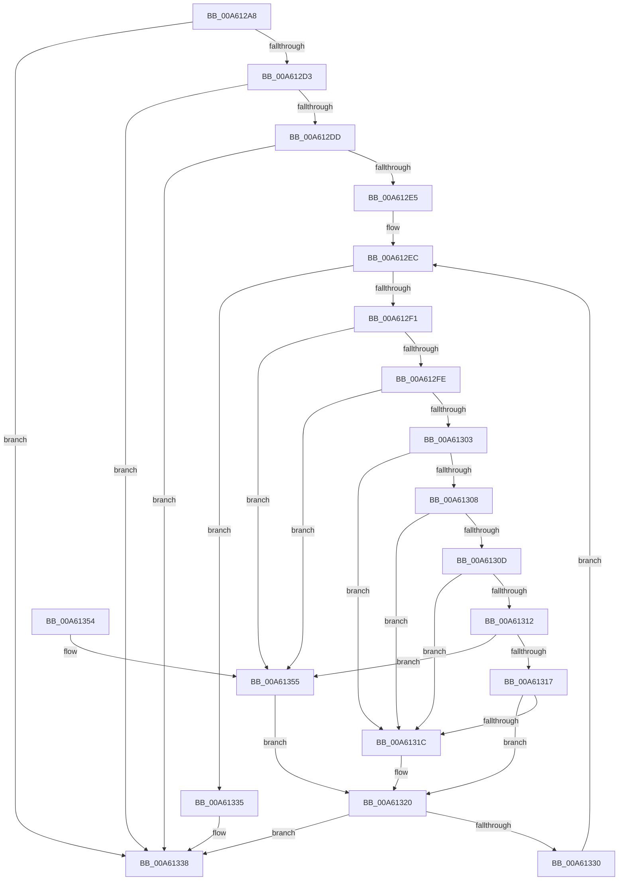

# AuthzBasepCompareSecurityAttribute

- RVA: `0x00A612A8`–`0x00A6135B` (길이 `179` bytes)
- VA: `0x0000000140A612A8`
- 실행 섹션: `PAGE`
- PDB 이름 있음: `예`; PDB Function 태그: `아니요`
- unwind 정보 RVA: `0x000B3154`
- 디코드: `61`개 명령, `179/179` bytes 표시
- 미해석 바이트: `0` (있으면 어셈블리에 `.byte`로 보존)

> 이 문서는 커널 이미지의 기계어와 PDB 기호를 분석해 생성했습니다. 4번과 5번은 함수 원형과 자료형을 바이너리 사용 방식에서 추정한 C 해석이며 원본 소스 복구 결과는 아닙니다.

## 1. Dependencies

- 직접 호출 지점: **1**; 고유 호출 대상: **1**
- 직접 호출자로 확인된 함수: **2**
- RIP 상대 이미지 참조: **0**

### Outgoing calls
- `0x00A61326` → [AuthzBasepFindSecurityAttributeValue](../../text/30/AuthzBasepFindSecurityAttributeValue_function_00302B2C.md) (function, `0x00302B2C`)

### Direct callers
- [AuthzBasepCompareSecurityAttributesInformation](../82/AuthzBasepCompareSecurityAttributesInformation_function_00821D94.md) at `0x00821DDA`
- [AuthzBasepCompareLegacySecurityAttributesInformation](../8F/AuthzBasepCompareLegacySecurityAttributesInformation_function_008F7374.md) at `0x008F73C8`

### Static image references
- 디코드된 RIP-relative 메모리 참조가 없습니다.

## 2. Other-region calls and transfers

- 다른 실행 섹션으로 향하는 call: **1**
  - `0x00A61326` → [AuthzBasepFindSecurityAttributeValue](../../text/30/AuthzBasepFindSecurityAttributeValue_function_00302B2C.md) (`PAGE` → `.text`)
- 별도 외부 분기/꼬리 이동을 확인하지 못했습니다.

## 3. Assembly (complete function range)

```asm
00A612A8  48 89 5C 24 08                  mov qword ptr [rsp + 8], rbx
00A612AD  48 89 6C 24 10                  mov qword ptr [rsp + 0x10], rbp
00A612B2  48 89 74 24 18                  mov qword ptr [rsp + 0x18], rsi
00A612B7  57                              push rdi
00A612B8  41 56                           push r14
00A612BA  41 57                           push r15
00A612BC  48 83 EC 20                     sub rsp, 0x20
00A612C0  8B 42 3C                        mov eax, dword ptr [rdx + 0x3c]
00A612C3  33 F6                           xor esi, esi
00A612C5  48 8B EA                        mov rbp, rdx
00A612C8  48 8B F9                        mov rdi, rcx
00A612CB  44 8B F6                        mov r14d, esi
00A612CE  39 41 3C                        cmp dword ptr [rcx + 0x3c], eax
00A612D1  75 65                           jne 0x140a61338
00A612D3  0F B7 42 30                     movzx eax, word ptr [rdx + 0x30]
00A612D7  66 39 41 30                     cmp word ptr [rcx + 0x30], ax
00A612DB  75 5B                           jne 0x140a61338
00A612DD  8B 42 34                        mov eax, dword ptr [rdx + 0x34]
00A612E0  39 41 34                        cmp dword ptr [rcx + 0x34], eax
00A612E3  75 53                           jne 0x140a61338
00A612E5  4C 8D 79 48                     lea r15, [rcx + 0x48]
00A612E9  49 8B 1F                        mov rbx, qword ptr [r15]
00A612EC  49 3B DF                        cmp rbx, r15
00A612EF  74 44                           je 0x140a61335
00A612F1  44 0F B7 47 30                  movzx r8d, word ptr [rdi + 0x30]
00A612F6  41 8B C8                        mov ecx, r8d
00A612F9  83 E9 01                        sub ecx, 1
00A612FC  74 57                           je 0x140a61355
00A612FE  83 E9 01                        sub ecx, 1
00A61301  74 52                           je 0x140a61355
00A61303  83 E9 01                        sub ecx, 1
00A61306  74 14                           je 0x140a6131c
00A61308  83 E9 01                        sub ecx, 1
00A6130B  74 0F                           je 0x140a6131c
00A6130D  83 E9 01                        sub ecx, 1
00A61310  74 0A                           je 0x140a6131c
00A61312  83 E9 01                        sub ecx, 1
00A61315  74 3E                           je 0x140a61355
00A61317  83 F9 0A                        cmp ecx, 0xa
00A6131A  75 04                           jne 0x140a61320
00A6131C  4C 8D 73 28                     lea r14, [rbx + 0x28]
00A61320  49 8B D6                        mov rdx, r14
00A61323  48 8B CD                        mov rcx, rbp
00A61326  E8 01 18 8A FF                  call 0x140302b2c
00A6132B  48 85 C0                        test rax, rax
00A6132E  74 08                           je 0x140a61338
00A61330  48 8B 1B                        mov rbx, qword ptr [rbx]
00A61333  EB B7                           jmp 0x140a612ec
00A61335  40 B6 01                        mov sil, 1
00A61338  48 8B 5C 24 40                  mov rbx, qword ptr [rsp + 0x40]
00A6133D  40 8A C6                        mov al, sil
00A61340  48 8B 74 24 50                  mov rsi, qword ptr [rsp + 0x50]
00A61345  48 8B 6C 24 48                  mov rbp, qword ptr [rsp + 0x48]
00A6134A  48 83 C4 20                     add rsp, 0x20
00A6134E  41 5F                           pop r15
00A61350  41 5E                           pop r14
00A61352  5F                              pop rdi
00A61353  C3                              ret
00A61354  CC                              int3
00A61355  4C 8B 73 28                     mov r14, qword ptr [rbx + 0x28]
00A61359  EB C5                           jmp 0x140a61320
```

## 4. C-style interpretation (structured pseudocode)

```c
__int64 __fastcall AuthzBasepCompareSecurityAttribute(__int64 a1, __int64 a2)
{
    __int64 result;
    __int64 v_r14;
    __int64 v_rsi;
    __int64 v_rsp;
    unsigned __int64 v_stack_p10;
    unsigned __int64 v_stack_p18;
    unsigned __int64 v_stack_p8;

    v_stack_p8 = v_rbx;
    v_stack_p10 = v_rbp;
    v_stack_p18 = v_rsi;
    v_rsp = (v_rsp) - (32);
    v_rsi = 0;
    if ((*(unsigned int *)(a1 + 60)) != ((unsigned int)((unsigned int)(*(unsigned int *)(a2 + 60))))) goto loc_00A61338;
    if ((*(unsigned __int16 *)(a1 + 48)) != ((unsigned __int16)(*(unsigned __int16 *)(a2 + 48)))) goto loc_00A61338;
    if ((*(unsigned int *)(a1 + 52)) != ((unsigned int)((unsigned int)(*(unsigned int *)(a2 + 52))))) goto loc_00A61338;
loc_00A612EC:
    if ((*(unsigned __int64 *)(a1 + 72)) == (a1 + 72)) goto loc_00A61335;
    a1 = (unsigned int)(((unsigned int)((unsigned int)(*(unsigned __int16 *)(a1 + 48)))) - (1));
    if (condition_is_equal) goto loc_00A61355;
    a1 = (unsigned int)((a1) - (1));
    if (condition_is_equal) goto loc_00A61355;
    a1 = (unsigned int)((a1) - (1));
    if (condition_is_equal) goto loc_00A6131C;
    a1 = (unsigned int)((a1) - (1));
    if (condition_is_equal) goto loc_00A6131C;
    a1 = (unsigned int)((a1) - (1));
    if (condition_is_equal) goto loc_00A6131C;
    a1 = (unsigned int)((a1) - (1));
    if (condition_is_equal) goto loc_00A61355;
    v_r14 = 0;
    if (((unsigned int)(a1)) == 10) {
        v_r14 = *(unsigned __int64 *)(a1 + 72) + 40;
    }
    result = AuthzBasepFindSecurityAttributeValue(a2, v_r14, *(unsigned __int16 *)(a1 + 48), a4);
    if (result == 0) goto loc_00A61338;
    goto loc_00A612EC;
loc_00A61335:
loc_00A61338:
    v_rsp = (v_rsp) + (32);
    return 1;
loc_00A61355:
    goto loc_00A61320;
}
```

## 5. (Beta) C Style

```c
int64_t AuthzBasepCompareSecurityAttribute(void *Arg1, void *Arg2)
{
    uint8_t *arg1 = (uint8_t *)Arg1;
    uint8_t *arg2 = (uint8_t *)Arg2;

    int64_t result;
    int64_t local_r14;
    int64_t local_rsi;
    int64_t local_rsp;
    uint64_t v_stack_p10;
    uint64_t v_stack_p18;
    uint64_t v_stack_p8;

    v_stack_p8 = local_rbx;
    v_stack_p10 = local_rbp;
    v_stack_p18 = local_rsi;
    local_rsp = (local_rsp) - (32);
    local_rsi = 0;
    if ((*(uint32_t *)(arg1 + 0x3C)) != ((uint32_t)((uint32_t)(*(uint32_t *)(arg2 + 0x3C))))) goto loc_00A61338;
    if ((*(uint16_t *)(arg1 + 0x30)) != ((uint16_t)(*(uint16_t *)(arg2 + 0x30)))) goto loc_00A61338;
    if ((*(uint32_t *)(arg1 + 0x34)) != ((uint32_t)((uint32_t)(*(uint32_t *)(arg2 + 0x34))))) goto loc_00A61338;
loc_00A612EC:
    if ((*(uint64_t *)(arg1 + 0x48)) == (Arg1 + 72)) goto loc_00A61335;
    Arg1 = (uint32_t)(((uint32_t)((uint32_t)(*(uint16_t *)(arg1 + 0x30)))) - (1));
    if (condition_is_equal) goto loc_00A61355;
    Arg1 = (uint32_t)((Arg1) - (1));
    if (condition_is_equal) goto loc_00A61355;
    Arg1 = (uint32_t)((Arg1) - (1));
    if (condition_is_equal) goto loc_00A6131C;
    Arg1 = (uint32_t)((Arg1) - (1));
    if (condition_is_equal) goto loc_00A6131C;
    Arg1 = (uint32_t)((Arg1) - (1));
    if (condition_is_equal) goto loc_00A6131C;
    Arg1 = (uint32_t)((Arg1) - (1));
    if (condition_is_equal) goto loc_00A61355;
    local_r14 = 0;
    if (((uint32_t)(Arg1)) == 10) {
        local_r14 = *(uint64_t *)(arg1 + 0x48) + 40;
    }
    result = AuthzBasepFindSecurityAttributeValue(Arg2, local_r14, *(uint16_t *)(arg1 + 0x30), a4);
    if (result == 0) goto loc_00A61338;
    goto loc_00A612EC;
loc_00A61335:
loc_00A61338:
    local_rsp = (local_rsp) + (32);
    return 1;
loc_00A61355:
    goto loc_00A61320;
}
```

### 관측된 메모리 오프셋

구조체 형식이 확인되지 않은 접근은 인자 기준의 오프셋으로만 기록했습니다.

| 기준 인자 | 오프셋 표현 | 폭 (bit) | 접근 |
|---|---:|---:|---|
| `Arg1` | `+ 0x0` | `64` | `R` |
| `Arg1` | `+ 0x30` | `16` | `R` |
| `Arg1` | `+ 0x34` | `32` | `R` |
| `Arg1` | `+ 0x3C` | `32` | `R` |
| `Arg1` | `+ 0x48` | `64` | `R` |
| `Arg2` | `+ 0x30` | `16` | `R` |
| `Arg2` | `+ 0x34` | `32` | `R` |
| `Arg2` | `+ 0x3C` | `32` | `R` |

## 6. Execution-region graph

[열기: 2D/3D 그래프와 함수 탐색 컨트롤 패널](../../../control-panel.html?section=page&rva=0x00A612A8&view=graph)

- 2D 그래프는 위에서 아래로 흐르고, 3D 그래프는 빈 공간을 드래그해 회전합니다. Shift+드래그는 이동, 휠은 확대·축소, 함수 노드 선택은 대상 보고서 이동입니다.

### Static fallback


