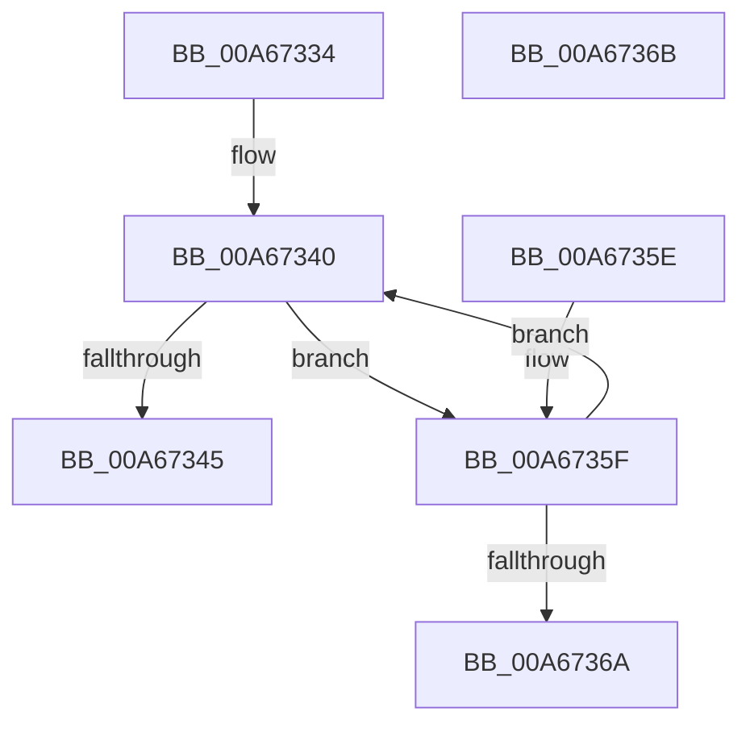

# CcTelemetryBucketizeLatency

- RVA: `0x00A67334`–`0x00A6736C` (길이 `56` bytes)
- VA: `0x0000000140A67334`
- 실행 섹션: `PAGE`
- PDB 이름 있음: `예`; PDB Function 태그: `아니요`
- unwind 정보 RVA: `0x000DB714`
- 디코드: `20`개 명령, `56/56` bytes 표시
- 미해석 바이트: `0` (있으면 어셈블리에 `.byte`로 보존)

> 이 문서는 커널 이미지의 기계어와 PDB 기호를 분석해 생성했습니다. 4번과 5번은 함수 원형과 자료형을 바이너리 사용 방식에서 추정한 C 해석이며 원본 소스 복구 결과는 아닙니다.

## 1. Dependencies

- 직접 호출 지점: **0**; 고유 호출 대상: **0**
- 직접 호출자로 확인된 함수: **6**
- RIP 상대 이미지 참조: **1**

### Outgoing calls
- 직접 디코드된 call 명령이 없습니다.

### Direct callers
- [CcCopyWriteEx](../../text/3C/CcCopyWriteEx_function_003CA4F0.md) at `0x003CA6BB`
- [CcCopyReadEx](../../text/45/CcCopyReadEx_function_0045E160.md) at `0x0045E460`
- [CcCompleteAsyncRead](../../text/45/CcCompleteAsyncRead_function_0045E7DC.md) at `0x0045EA9A`
- [CcCopyWriteEx$fin$0](../../text/6D/CcCopyWriteEx_fin_0_function_006D29CE.md) at `0x006D2A59`
- [CcCopyReadEx$fin$0](../../text/6D/CcCopyReadEx_fin_0_function_006D3230.md) at `0x006D32D2`
- [CcCompleteAsyncRead$fin$1](../../text/6D/CcCompleteAsyncRead_fin_1_function_006D3387.md) at `0x006D3456`

### Static image references
- `0x00A67337` → RVA `0x0001A8C0` (`.rdata`; read)

## 2. Other-region calls and transfers

- 다른 실행 섹션으로 향하는 call: **0**
- 별도 외부 분기/꼬리 이동을 확인하지 못했습니다.

## 3. Assembly (complete function range)

```asm
00A67334  4C 8B D2                        mov r10, rdx
00A67337  4C 8D 0D 82 35 5B FF            lea r9, [rip - 0xa4ca7e]
00A6733E  33 C0                           xor eax, eax
00A67340  49 3B 09                        cmp rcx, qword ptr [r9]
00A67343  77 1A                           ja 0x140a6735f
00A67345  8B D0                           mov edx, eax
00A67347  49 8B 04 C2                     mov rax, qword ptr [r10 + rax*8]
00A6734B  48 FF C0                        inc rax
00A6734E  49 89 04 D2                     mov qword ptr [r10 + rdx*8], rax
00A67352  49 8B 04 D0                     mov rax, qword ptr [r8 + rdx*8]
00A67356  48 03 C8                        add rcx, rax
00A67359  49 89 0C D0                     mov qword ptr [r8 + rdx*8], rcx
00A6735D  C3                              ret
00A6735E  CC                              int3
00A6735F  FF C0                           inc eax
00A67361  49 83 C1 08                     add r9, 8
00A67365  83 F8 0C                        cmp eax, 0xc
00A67368  72 D6                           jb 0x140a67340
00A6736A  C3                              ret
00A6736B  CC                              int3
```

## 4. C-style interpretation (structured pseudocode)

```c
__int64 __fastcall CcTelemetryBucketizeLatency(__int64 a1, __int64 a2, __int64 a3)
{
    __int64 result;

    result = 0;
loc_00A67340:
    if (a1 > (*(unsigned __int64 *)(v_rip - 10799742))) goto loc_00A6735F;
    result = (*(unsigned __int64 *)(a2 + result * 8)) + 1;
    *(unsigned __int64 *)(a2 + 0 * 8) = result;
    a1 = (a1) + (*(unsigned __int64 *)(a3 + 0 * 8));
    *(unsigned __int64 *)(a3 + 0 * 8) = a1;
    return *(unsigned __int64 *)(a3 + 0 * 8);
loc_00A6735F:
    result = (unsigned int)((*(unsigned __int64 *)(a3 + 0 * 8)) + 1);
    a4 = (v_rip - 10799742) + (8);
    if (((unsigned int)(result)) < 12) goto loc_00A67340;
    return result;
}
```

## 5. (Beta) C Style

```c
int64_t CcTelemetryBucketizeLatency(int64_t Arg1, void *Arg2, void *Arg3)
{
    uint8_t *arg2 = (uint8_t *)Arg2;
    uint8_t *arg3 = (uint8_t *)Arg3;

    int64_t result;

    result = 0;
loc_00A67340:
    if (Arg1 > (*(uint64_t *)(v_rip - 0xA4CA7E))) goto loc_00A6735F;
    result = (*(uint64_t *)(arg2 + result * 8)) + 1;
    *(uint64_t *)(arg2 + 0x0 * 8) = result;
    Arg1 = (Arg1) + (*(uint64_t *)(arg3 + 0x0 * 8));
    *(uint64_t *)(arg3 + 0x0 * 8) = Arg1;
    return *(uint64_t *)(arg3 + 0x0 * 8);
loc_00A6735F:
    result = (uint32_t)((*(uint64_t *)(arg3 + 0x0 * 8)) + 1);
    a4 = (v_rip - 10799742) + (8);
    if (((uint32_t)(result)) < 12) goto loc_00A67340;
    return result;
}
```

### 관측된 메모리 오프셋

구조체 형식이 확인되지 않은 접근은 인자 기준의 오프셋으로만 기록했습니다.

| 기준 인자 | 오프셋 표현 | 폭 (bit) | 접근 |
|---|---:|---:|---|
| `Arg2` | `+ 0x0 + rax*8` | `64` | `R` |
| `Arg2` | `+ 0x0 + rdx*8` | `64` | `W` |
| `Arg3` | `+ 0x0 + rdx*8` | `64` | `R` |
| `Arg3` | `+ 0x0 + rdx*8` | `64` | `W` |

## 6. Execution-region graph

[열기: 2D/3D 그래프와 함수 탐색 컨트롤 패널](../../../control-panel.html?section=page&rva=0x00A67334&view=graph)

- 2D 그래프는 위에서 아래로 흐르고, 3D 그래프는 빈 공간을 드래그해 회전합니다. Shift+드래그는 이동, 휠은 확대·축소, 함수 노드 선택은 대상 보고서 이동입니다.

### Static fallback


