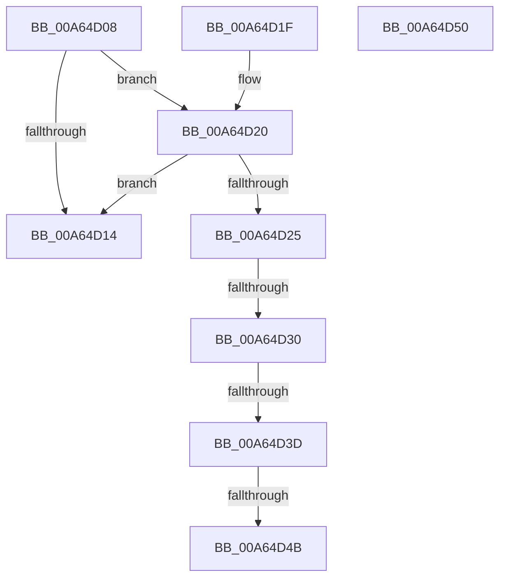

# CmpAddKeyHashToEntry

- RVA: `0x00A64D08`–`0x00A64D51` (길이 `73` bytes)
- VA: `0x0000000140A64D08`
- 실행 섹션: `PAGE`
- PDB 이름 있음: `예`; PDB Function 태그: `예`
- unwind 정보 RVA: `0x000DB714`
- 디코드: `23`개 명령, `73/73` bytes 표시
- 미해석 바이트: `0` (있으면 어셈블리에 `.byte`로 보존)

> 이 문서는 커널 이미지의 기계어와 PDB 기호를 분석해 생성했습니다. 4번과 5번은 함수 원형과 자료형을 바이너리 사용 방식에서 추정한 C 해석이며 원본 소스 복구 결과는 아닙니다.

## 1. Dependencies

- 직접 호출 지점: **0**; 고유 호출 대상: **0**
- 직접 호출자로 확인된 함수: **1**
- RIP 상대 이미지 참조: **0**

### Outgoing calls
- 직접 디코드된 call 명령이 없습니다.

### Direct callers
- [CmpInsertKeyHash](../7E/CmpInsertKeyHash_function_007EAE68.md) at `0x007EAEAC`

### Static image references
- 디코드된 RIP-relative 메모리 참조가 없습니다.

## 2. Other-region calls and transfers

- 다른 실행 섹션으로 향하는 call: **0**
- call이 아닌 외부 분기/꼬리 이동: **3**
  - `0x00A64D2A` → `0x00B3E694` (`tail-transfer`)
  - `0x00A64D37` → `0x00B3E694` (`tail-transfer`)
  - `0x00A64D45` → `0x00B3E694` (`tail-transfer`)

## 3. Assembly (complete function range)

```asm
00A64D08  4C 8B 52 10                     mov r10, qword ptr [rdx + 0x10]
00A64D0C  4D 8B CA                        mov r9, r10
00A64D0F  45 84 C0                        test r8b, r8b
00A64D12  74 0C                           je 0x140a64d20
00A64D14  4C 89 51 08                     mov qword ptr [rcx + 8], r10
00A64D18  33 C0                           xor eax, eax
00A64D1A  48 89 4A 10                     mov qword ptr [rdx + 0x10], rcx
00A64D1E  C3                              ret
00A64D1F  CC                              int3
00A64D20  4D 85 C9                        test r9, r9
00A64D23  74 EF                           je 0x140a64d14
00A64D25  41 8B 01                        mov eax, dword ptr [r9]
00A64D28  39 01                           cmp dword ptr [rcx], eax
00A64D2A  0F 85 64 99 0D 00               jne 0x140b3e694
00A64D30  41 8B 41 18                     mov eax, dword ptr [r9 + 0x18]
00A64D34  39 41 18                        cmp dword ptr [rcx + 0x18], eax
00A64D37  0F 85 57 99 0D 00               jne 0x140b3e694
00A64D3D  49 8B 41 10                     mov rax, qword ptr [r9 + 0x10]
00A64D41  48 39 41 10                     cmp qword ptr [rcx + 0x10], rax
00A64D45  0F 85 49 99 0D 00               jne 0x140b3e694
00A64D4B  49 8D 41 F0                     lea rax, [r9 - 0x10]
00A64D4F  C3                              ret
00A64D50  CC                              int3
```

## 4. C-style interpretation (structured pseudocode)

```c
__int64 __fastcall CmpAddKeyHashToEntry(__int64 a1, __int64 a2, unsigned __int8 a3)
{
    __int64 result;

    if (a3 == 0) goto loc_00A64D20;
loc_00A64D14:
    *(unsigned __int64 *)(a1 + 8) = *(unsigned __int64 *)(a2 + 16);
    result = 0;
    *(unsigned __int64 *)(a2 + 16) = a1;
    return result;
loc_00A64D20:
    if (*(unsigned __int64 *)(a2 + 16) == 0) goto loc_00A64D14;
    return *(unsigned __int64 *)(a2 + 16) - 16;
}
```

## 5. (Beta) C Style

```c
int64_t CmpAddKeyHashToEntry(void *Arg1, void *Arg2, uint8_t Arg3)
{
    uint8_t *arg1 = (uint8_t *)Arg1;
    uint8_t *arg2 = (uint8_t *)Arg2;

    int64_t result;

    if (Arg3 == 0) goto loc_00A64D20;
loc_00A64D14:
    *(uint64_t *)(arg1 + 0x8) = *(uint64_t *)(arg2 + 0x10);
    result = 0;
    *(void **)(arg2 + 0x10) = Arg1;
    return result;
loc_00A64D20:
    if (*(uint64_t *)(arg2 + 0x10) == 0) goto loc_00A64D14;
    return *(uint64_t *)(arg2 + 0x10) - 16;
}
```

### 관측된 메모리 오프셋

구조체 형식이 확인되지 않은 접근은 인자 기준의 오프셋으로만 기록했습니다.

| 기준 인자 | 오프셋 표현 | 폭 (bit) | 접근 |
|---|---:|---:|---|
| `Arg1` | `+ 0x0` | `32` | `R` |
| `Arg1` | `+ 0x8` | `64` | `W` |
| `Arg1` | `+ 0x10` | `64` | `R` |
| `Arg1` | `+ 0x18` | `32` | `R` |
| `Arg2` | `+ 0x10` | `64` | `R` |
| `Arg2` | `+ 0x10` | `64` | `W` |

## 6. Execution-region graph

[열기: 2D/3D 그래프와 함수 탐색 컨트롤 패널](../../../control-panel.html?section=page&rva=0x00A64D08&view=graph)

- 2D 그래프는 위에서 아래로 흐르고, 3D 그래프는 빈 공간을 드래그해 회전합니다. Shift+드래그는 이동, 휠은 확대·축소, 함수 노드 선택은 대상 보고서 이동입니다.

### Static fallback


