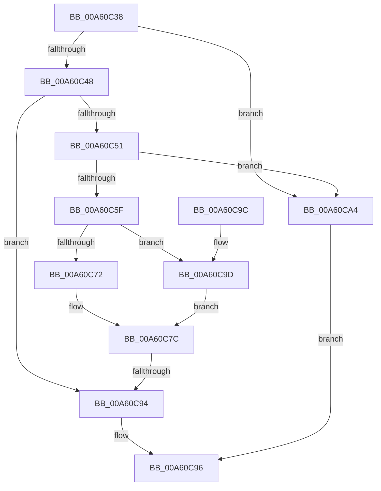

# CmpCanGrowHive

- RVA: `0x00A60C38`–`0x00A60CA8` (길이 `112` bytes)
- VA: `0x0000000140A60C38`
- 실행 섹션: `PAGE`
- PDB 이름 있음: `예`; PDB Function 태그: `예`
- unwind 정보 RVA: `0x0007FBDC`
- 디코드: `34`개 명령, `112/112` bytes 표시
- 미해석 바이트: `0` (있으면 어셈블리에 `.byte`로 보존)

> 이 문서는 커널 이미지의 기계어와 PDB 기호를 분석해 생성했습니다. 4번과 5번은 함수 원형과 자료형을 바이너리 사용 방식에서 추정한 C 해석이며 원본 소스 복구 결과는 아닙니다.

## 1. Dependencies

- 직접 호출 지점: **2**; 고유 호출 대상: **1**
- 직접 호출자로 확인된 함수: **1**
- RIP 상대 이미지 참조: **2**

### Outgoing calls
- `0x00A60C61` → [MmGetNumberOfPhysicalPages](../../text/46/MmGetNumberOfPhysicalPages_function_00467F80.md) (function, `0x00467F80`)
- `0x00A60C74` → [MmGetNumberOfPhysicalPages](../../text/46/MmGetNumberOfPhysicalPages_function_00467F80.md) (function, `0x00467F80`)

### Direct callers
- [HvpAddBin](../AF/HvpAddBin_function_00AF7D48.md) at `0x00AF7E60`

### Static image references
- `0x00A60C48` → RVA `0x00E09AE0` (`.data`; read)
- `0x00A60C57` → RVA `0x00EEFBA8` (`.data`; read)

## 2. Other-region calls and transfers

- 다른 실행 섹션으로 향하는 call: **2**
  - `0x00A60C61` → [MmGetNumberOfPhysicalPages](../../text/46/MmGetNumberOfPhysicalPages_function_00467F80.md) (`PAGE` → `.text`)
  - `0x00A60C74` → [MmGetNumberOfPhysicalPages](../../text/46/MmGetNumberOfPhysicalPages_function_00467F80.md) (`PAGE` → `.text`)
- call이 아닌 외부 분기/꼬리 이동: **1**
  - `0x00A60C8E` → [sub_00B3E246](../B3/Unknown_function_00B3E246.md) (`tail-transfer`)

## 3. Assembly (complete function range)

```asm
00A60C38  40 53                           push rbx
00A60C3A  48 83 EC 20                     sub rsp, 0x20
00A60C3E  8B DA                           mov ebx, edx
00A60C40  81 FA 00 E0 FF 7F               cmp edx, 0x7fffe000
00A60C46  77 5C                           ja 0x140a60ca4
00A60C48  48 3B 0D 91 8E 3A 00            cmp rcx, qword ptr [rip + 0x3a8e91]
00A60C4F  75 43                           jne 0x140a60c94
00A60C51  81 C3 00 10 00 00               add ebx, 0x1000
00A60C57  3B 1D 4B EF 48 00               cmp ebx, dword ptr [rip + 0x48ef4b]
00A60C5D  77 45                           ja 0x140a60ca4
00A60C5F  33 C9                           xor ecx, ecx
00A60C61  E8 1A 73 A0 FF                  call 0x140467f80
00A60C66  48 83 E0 FE                     and rax, 0xfffffffffffffffe
00A60C6A  48 3D 00 00 0C 00               cmp rax, 0xc0000
00A60C70  73 2B                           jae 0x140a60c9d
00A60C72  33 C9                           xor ecx, ecx
00A60C74  E8 07 73 A0 FF                  call 0x140467f80
00A60C79  48 D1 E8                        shr rax, 1
00A60C7C  8D 0C C0                        lea ecx, [rax + rax*8]
00A60C7F  B8 CD CC CC CC                  mov eax, 0xcccccccd
00A60C84  C1 E1 0C                        shl ecx, 0xc
00A60C87  F7 E1                           mul ecx
00A60C89  C1 EA 03                        shr edx, 3
00A60C8C  3B DA                           cmp ebx, edx
00A60C8E  0F 87 B2 D5 0D 00               ja 0x140b3e246
00A60C94  B0 01                           mov al, 1
00A60C96  48 83 C4 20                     add rsp, 0x20
00A60C9A  5B                              pop rbx
00A60C9B  C3                              ret
00A60C9C  CC                              int3
00A60C9D  B8 00 00 06 00                  mov eax, 0x60000
00A60CA2  EB D8                           jmp 0x140a60c7c
00A60CA4  32 C0                           xor al, al
00A60CA6  EB EE                           jmp 0x140a60c96
```

## 4. C-style interpretation (structured pseudocode)

```c
__int64 __fastcall CmpCanGrowHive(__int64 a1, int a2)
{
    __int64 result;
    __int64 v_rbx;
    __int64 v_rsp;

    v_rsp = (v_rsp) - (32);
    if (a2 > 0x7FFFE000ULL) goto loc_00A60CA4;
    if (a1 != (*(unsigned __int64 *)(v_rip + 3837585))) goto loc_00A60C94;
    v_rbx = (unsigned int)(((unsigned int)(a2)) + (0x1000ULL));
    if (((unsigned int)(v_rbx)) > (*(unsigned int *)(v_rip + 4779851))) goto loc_00A60CA4;
    a1 = 0;
    result = MmGetNumberOfPhysicalPages(a1, a2, a3, a4);
    result = (result) & (-2);
    if (result >= 0xC0000ULL) goto loc_00A60C9D;
    a1 = 0;
    result = MmGetNumberOfPhysicalPages(a1, a2, a3, a4);
    result = (result) >> (1);
loc_00A60C7C:
    a1 = (unsigned int)((result + result * 8) << (12));
    a2 = (unsigned int)((a2) >> (3));
loc_00A60C94:
loc_00A60C96:
    v_rsp = (v_rsp) + (32);
    return 1;
loc_00A60C9D:
    goto loc_00A60C7C;
loc_00A60CA4:
    result = 0;
    goto loc_00A60C96;
}
```

## 5. (Beta) C Style

```c
int64_t CmpCanGrowHive(int64_t Arg1, int32_t Arg2)
{
    int64_t result;
    int64_t local_rbx;
    int64_t local_rsp;

    local_rsp = (local_rsp) - (32);
    if (Arg2 > 0x7FFFE000ULL) goto loc_00A60CA4;
    if (Arg1 != (*(uint64_t *)(v_rip + 0x3A8E91))) goto loc_00A60C94;
    local_rbx = (uint32_t)(((uint32_t)(Arg2)) + (0x1000ULL));
    if (((uint32_t)(local_rbx)) > (*(uint32_t *)(v_rip + 0x48EF4B))) goto loc_00A60CA4;
    Arg1 = 0;
    result = MmGetNumberOfPhysicalPages(Arg1, Arg2, a3, a4);
    result = (result) & (-2);
    if (result >= 0xC0000ULL) goto loc_00A60C9D;
    Arg1 = 0;
    result = MmGetNumberOfPhysicalPages(Arg1, Arg2, a3, a4);
    result = (result) >> (1);
loc_00A60C7C:
    Arg1 = (uint32_t)((result + result * 8) << (12));
    Arg2 = (uint32_t)((Arg2) >> (3));
loc_00A60C94:
loc_00A60C96:
    local_rsp = (local_rsp) + (32);
    return 1;
loc_00A60C9D:
    goto loc_00A60C7C;
loc_00A60CA4:
    result = 0;
    goto loc_00A60C96;
}
```

## 6. Execution-region graph

[열기: 2D/3D 그래프와 함수 탐색 컨트롤 패널](../../../control-panel.html?section=page&rva=0x00A60C38&view=graph)

- 2D 그래프는 위에서 아래로 흐르고, 3D 그래프는 빈 공간을 드래그해 회전합니다. Shift+드래그는 이동, 휠은 확대·축소, 함수 노드 선택은 대상 보고서 이동입니다.

### Static fallback


