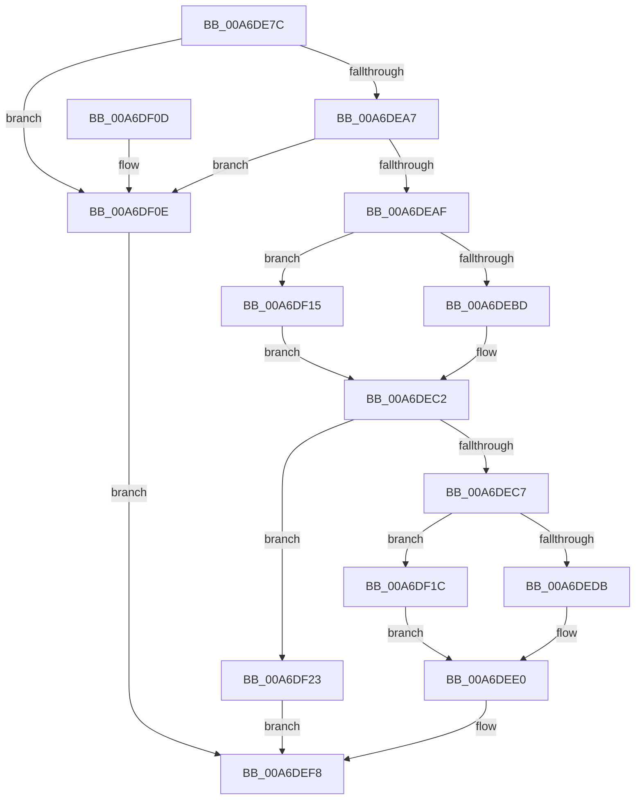

# CmpCheckKeyAccess

- RVA: `0x00A6DE7C`–`0x00A6DF2A` (길이 `174` bytes)
- VA: `0x0000000140A6DE7C`
- 실행 섹션: `PAGE`
- PDB 이름 있음: `예`; PDB Function 태그: `아니요`
- unwind 정보 RVA: `0x000B4938`
- 디코드: `51`개 명령, `174/174` bytes 표시
- 미해석 바이트: `0` (있으면 어셈블리에 `.byte`로 보존)

> 이 문서는 커널 이미지의 기계어와 PDB 기호를 분석해 생성했습니다. 4번과 5번은 함수 원형과 자료형을 바이너리 사용 방식에서 추정한 C 해석이며 원본 소스 복구 결과는 아닙니다.

## 1. Dependencies

- 직접 호출 지점: **5**; 고유 호출 대상: **5**
- 직접 호출자로 확인된 함수: **2**
- RIP 상대 이미지 참조: **0**

### Outgoing calls
- `0x00A6DEBD` → [HvpGetCellFlat](../85/HvpGetCellFlat_function_00854C60.md) (function, `0x00854C60`)
- `0x00A6DEDB` → [HvpReleaseCellPaged](../85/HvpReleaseCellPaged_function_00855F40.md) (function, `0x00855F40`)
- `0x00A6DEF3` → [CmpCheckSecurityCellAccess](../94/CmpCheckSecurityCellAccess_function_009470C0.md) (function, `0x009470C0`)
- `0x00A6DF15` → [HvpGetCellPaged](../85/HvpGetCellPaged_function_00854CB0.md) (function, `0x00854CB0`)
- `0x00A6DF1C` → [HvpReleaseCellFlat](../85/HvpReleaseCellFlat_function_0085CC20.md) (function, `0x0085CC20`)

### Direct callers
- [CmRestoreKey](../7D/CmRestoreKey_function_007DCF04.md) at `0x007DD34F`
- [CmRestoreKey](../7D/CmRestoreKey_function_007DCF04.md) at `0x007DD373`
- [CmpDoAccessCheckOnSubtree](../../pagecmrc/BC/CmpDoAccessCheckOnSubtree_function_00BC9CD0.md) at `0x00BC9D82`

### Static image references
- 디코드된 RIP-relative 메모리 참조가 없습니다.

## 2. Other-region calls and transfers

- 다른 실행 섹션으로 향하는 call: **0**
- 별도 외부 분기/꼬리 이동을 확인하지 못했습니다.

## 3. Assembly (complete function range)

```asm
00A6DE7C  48 8B C4                        mov rax, rsp
00A6DE7F  48 89 58 10                     mov qword ptr [rax + 0x10], rbx
00A6DE83  48 89 68 18                     mov qword ptr [rax + 0x18], rbp
00A6DE87  48 89 70 20                     mov qword ptr [rax + 0x20], rsi
00A6DE8B  57                              push rdi
00A6DE8C  48 83 EC 30                     sub rsp, 0x30
00A6DE90  83 48 08 FF                     or dword ptr [rax + 8], 0xffffffff
00A6DE94  33 FF                           xor edi, edi
00A6DE96  89 78 0C                        mov dword ptr [rax + 0xc], edi
00A6DE99  41 8B F1                        mov esi, r9d
00A6DE9C  41 8A E8                        mov bpl, r8b
00A6DE9F  48 8B D9                        mov rbx, rcx
00A6DEA2  48 85 C9                        test rcx, rcx
00A6DEA5  74 67                           je 0x140a6df0e
00A6DEA7  8D 42 FF                        lea eax, [rdx - 1]
00A6DEAA  83 F8 FD                        cmp eax, -3
00A6DEAD  77 5F                           ja 0x140a6df0e
00A6DEAF  F6 81 8C 00 00 00 01            test byte ptr [rcx + 0x8c], 1
00A6DEB6  4C 8D 44 24 40                  lea r8, [rsp + 0x40]
00A6DEBB  74 58                           je 0x140a6df15
00A6DEBD  E8 9E 6D DE FF                  call 0x140854c60
00A6DEC2  48 85 C0                        test rax, rax
00A6DEC5  74 5C                           je 0x140a6df23
00A6DEC7  F6 83 8C 00 00 00 01            test byte ptr [rbx + 0x8c], 1
00A6DECE  48 8D 54 24 40                  lea rdx, [rsp + 0x40]
00A6DED3  8B 78 2C                        mov edi, dword ptr [rax + 0x2c]
00A6DED6  48 8B CB                        mov rcx, rbx
00A6DED9  75 41                           jne 0x140a6df1c
00A6DEDB  E8 60 80 DE FF                  call 0x140855f40
00A6DEE0  8A 44 24 60                     mov al, byte ptr [rsp + 0x60]
00A6DEE4  44 8B CE                        mov r9d, esi
00A6DEE7  44 8A C5                        mov r8b, bpl
00A6DEEA  88 44 24 20                     mov byte ptr [rsp + 0x20], al
00A6DEEE  8B D7                           mov edx, edi
00A6DEF0  48 8B CB                        mov rcx, rbx
00A6DEF3  E8 C8 91 ED FF                  call 0x1409470c0
00A6DEF8  48 8B 5C 24 48                  mov rbx, qword ptr [rsp + 0x48]
00A6DEFD  48 8B 6C 24 50                  mov rbp, qword ptr [rsp + 0x50]
00A6DF02  48 8B 74 24 58                  mov rsi, qword ptr [rsp + 0x58]
00A6DF07  48 83 C4 30                     add rsp, 0x30
00A6DF0B  5F                              pop rdi
00A6DF0C  C3                              ret
00A6DF0D  CC                              int3
00A6DF0E  B8 7C 01 00 C0                  mov eax, 0xc000017c
00A6DF13  EB E3                           jmp 0x140a6def8
00A6DF15  E8 96 6D DE FF                  call 0x140854cb0
00A6DF1A  EB A6                           jmp 0x140a6dec2
00A6DF1C  E8 FF EC DE FF                  call 0x14085cc20
00A6DF21  EB BD                           jmp 0x140a6dee0
00A6DF23  B8 9A 00 00 C0                  mov eax, 0xc000009a
00A6DF28  EB CE                           jmp 0x140a6def8
```

## 4. C-style interpretation (structured pseudocode)

```c
__int64 __fastcall CmpCheckKeyAccess(__int64 a1, __int64 a2, unsigned __int8 a3, int a4, unsigned __int8 a5)
{
    __int64 result;
    __int64 v_rdi;
    __int64 v_rsp;
    unsigned __int8 v_stack_m18;
    unsigned __int64 v_stack_p10;
    unsigned __int64 v_stack_p18;
    unsigned __int64 v_stack_p20;
    unsigned __int64 v_stack_p8;

    *(unsigned __int64 *)(v_rsp + 16) = v_rbx;
    *(unsigned __int64 *)(v_rsp + 24) = v_rbp;
    *(unsigned __int64 *)(v_rsp + 32) = v_rsi;
    v_rsp = (v_rsp) - (48);
    v_rdi = 0;
    *(unsigned int *)(v_rsp + 12) = 0;
    if (a1 == 0) goto loc_00A6DF0E;
    if (((unsigned int)(a2 - 1)) > -3) goto loc_00A6DF0E;
    if (((*(unsigned __int8 *)(a1 + 140)) & (1)) == 0) goto loc_00A6DF15;
    result = HvpGetCellFlat(a1, a2, v_stack_p8, a4);
loc_00A6DEC2:
    if (result == 0) goto loc_00A6DF23;
    if (((*(unsigned __int8 *)(a1 + 140)) & (1)) != 0) goto loc_00A6DF1C;
    result = HvpReleaseCellPaged(a1, v_stack_p8, v_stack_p8, a4);
loc_00A6DEE0:
    v_stack_m18 = a5;
    result = CmpCheckSecurityCellAccess(a1, (unsigned int)((unsigned int)((unsigned int)(*(unsigned int *)(result + 44)))), a3, (unsigned int)((unsigned int)((unsigned int)(a4))));
loc_00A6DEF8:
    v_rsp = (v_rsp) + (48);
    return result;
loc_00A6DF0E:
    goto loc_00A6DEF8;
loc_00A6DF15:
    result = HvpGetCellPaged(a1, (unsigned int)((unsigned int)((unsigned int)(*(unsigned int *)(result + 44)))), a3, (unsigned int)((unsigned int)((unsigned int)(a4))));
    goto loc_00A6DEC2;
loc_00A6DF1C:
    result = HvpReleaseCellFlat(a1, (unsigned int)((unsigned int)((unsigned int)(*(unsigned int *)(result + 44)))), a3, (unsigned int)((unsigned int)((unsigned int)(a4))));
    goto loc_00A6DEE0;
loc_00A6DF23:
    goto loc_00A6DEF8;
}
```

## 5. (Beta) C Style

```c
int64_t CmpCheckKeyAccess(void *Arg1, void *Arg2, uint8_t Arg3, int32_t Arg4, uint8_t Arg5)
{
    uint8_t *arg1 = (uint8_t *)Arg1;
    uint8_t *arg2 = (uint8_t *)Arg2;

    int64_t result;
    int64_t local_rdi;
    int64_t local_rsp;
    uint8_t v_stack_m18;
    uint64_t v_stack_p10;
    uint64_t v_stack_p18;
    uint64_t v_stack_p20;
    uint64_t v_stack_p8;

    *(uint64_t *)(local_rsp + 0x10) = local_rbx;
    *(uint64_t *)(local_rsp + 0x18) = local_rbp;
    *(uint64_t *)(local_rsp + 0x20) = local_rsi;
    local_rsp = (local_rsp) - (48);
    local_rdi = 0;
    *(uint32_t *)(local_rsp + 0xC) = 0;
    if (Arg1 == NULL) goto loc_00A6DF0E;
    if (((uint32_t)(Arg2 - 1)) > -3) goto loc_00A6DF0E;
    if (((*(uint8_t *)(arg1 + 0x8C)) & (1)) == 0) goto loc_00A6DF15;
    result = HvpGetCellFlat(Arg1, Arg2, v_stack_p8, Arg4);
loc_00A6DEC2:
    if (result == 0) goto loc_00A6DF23;
    if (((*(uint8_t *)(arg1 + 0x8C)) & (1)) != 0) goto loc_00A6DF1C;
    result = HvpReleaseCellPaged(Arg1, v_stack_p8, v_stack_p8, Arg4);
loc_00A6DEE0:
    v_stack_m18 = Arg5;
    result = CmpCheckSecurityCellAccess(Arg1, (uint32_t)((uint32_t)((uint32_t)(*(uint32_t *)(result + 0x2C)))), Arg3, (uint32_t)((uint32_t)((uint32_t)(Arg4))));
loc_00A6DEF8:
    local_rsp = (local_rsp) + (48);
    return result;
loc_00A6DF0E:
    goto loc_00A6DEF8;
loc_00A6DF15:
    result = HvpGetCellPaged(Arg1, (uint32_t)((uint32_t)((uint32_t)(*(uint32_t *)(result + 0x2C)))), Arg3, (uint32_t)((uint32_t)((uint32_t)(Arg4))));
    goto loc_00A6DEC2;
loc_00A6DF1C:
    result = HvpReleaseCellFlat(Arg1, (uint32_t)((uint32_t)((uint32_t)(*(uint32_t *)(result + 0x2C)))), Arg3, (uint32_t)((uint32_t)((uint32_t)(Arg4))));
    goto loc_00A6DEE0;
loc_00A6DF23:
    goto loc_00A6DEF8;
}
```

### 관측된 메모리 오프셋

구조체 형식이 확인되지 않은 접근은 인자 기준의 오프셋으로만 기록했습니다.

| 기준 인자 | 오프셋 표현 | 폭 (bit) | 접근 |
|---|---:|---:|---|
| `Arg1` | `+ 0x8C` | `8` | `R` |
| `Arg2` | `- 0x1` | `32` | `R` |

## 6. Execution-region graph

[열기: 2D/3D 그래프와 함수 탐색 컨트롤 패널](../../../control-panel.html?section=page&rva=0x00A6DE7C&view=graph)

- 2D 그래프는 위에서 아래로 흐르고, 3D 그래프는 빈 공간을 드래그해 회전합니다. Shift+드래그는 이동, 휠은 확대·축소, 함수 노드 선택은 대상 보고서 이동입니다.

### Static fallback


