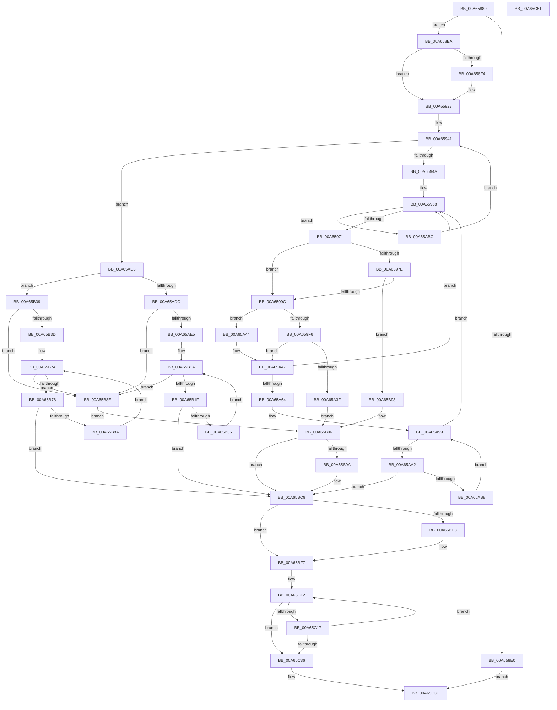

# CmpDoFileWrite

- RVA: `0x00A65880`–`0x00A65C52` (길이 `978` bytes)
- VA: `0x0000000140A65880`
- 실행 섹션: `PAGE`
- PDB 이름 있음: `예`; PDB Function 태그: `아니요`
- unwind 정보 RVA: `0x000B391C`
- 디코드: `250`개 명령, `978/978` bytes 표시
- 미해석 바이트: `0` (있으면 어셈블리에 `.byte`로 보존)

> 이 문서는 커널 이미지의 기계어와 PDB 기호를 분석해 생성했습니다. 4번과 5번은 함수 원형과 자료형을 바이너리 사용 방식에서 추정한 C 해석이며 원본 소스 복구 결과는 아닙니다.

## 1. Dependencies

- 직접 호출 지점: **18**; 고유 호출 대상: **11**
- 직접 호출자로 확인된 함수: **2**
- RIP 상대 이미지 참조: **0**

### Outgoing calls
- `0x00A658D3` → [CmpAllocatePool](../../text/3C/CmpAllocatePool_function_003CD504.md) (function, `0x003CD504`)
- `0x00A658FF` → [CmpSetIoPriorityThread](../../text/4B/CmpSetIoPriorityThread_function_004B8298.md) (function, `0x004B8298`)
- `0x00A65916` → [CmpSetPriorityThread](../../text/4B/CmpSetPriorityThread_function_004BC818.md) (function, `0x004BC818`)
- `0x00A65932` → [CmpSetRespectIoPriorityThread](../../text/49/CmpSetRespectIoPriorityThread_function_004939E4.md) (function, `0x004939E4`)
- `0x00A6598D` → [CmpCreateEvent](../87/CmpCreateEvent_function_0087B638.md) (function, `0x0087B638`)
- `0x00A659ED` → [ZwWriteFile](../../text/6A/ZwWriteFile_function_006AD1D0.md) (function, `0x006AD1D0`)
- `0x00A65A31` → [ZwWriteFile](../../text/6A/ZwWriteFile_function_006AD1D0.md) (function, `0x006AD1D0`)
- `0x00A65A8E` → [KeWaitForMultipleObjects](../../text/20/KeWaitForMultipleObjects_function_0020D110.md) (function, `0x0020D110`)
- `0x00A65AD3` → [Feature_Servicing_WaitForOutstandingWritesToComplete__private_IsEnabledDeviceUsageNoInline](../../text/4F/Feature_Servicing_WaitForOutstandingWritesToComplete__private_IsEnabledDeviceUsageNoInline_function_004F5EDC.md) (function, `0x004F5EDC`)
- `0x00A65B0F` → [KeWaitForMultipleObjects](../../text/20/KeWaitForMultipleObjects_function_0020D110.md) (function, `0x0020D110`)
- `0x00A65B67` → [KeWaitForMultipleObjects](../../text/20/KeWaitForMultipleObjects_function_0020D110.md) (function, `0x0020D110`)
- `0x00A65BC4` → [KeWaitForMultipleObjects](../../text/20/KeWaitForMultipleObjects_function_0020D110.md) (function, `0x0020D110`)
- `0x00A65BE0` → [CmpSetIoPriorityThread](../../text/4B/CmpSetIoPriorityThread_function_004B8298.md) (function, `0x004B8298`)
- `0x00A65BF2` → [CmpSetPriorityThread](../../text/4B/CmpSetPriorityThread_function_004BC818.md) (function, `0x004BC818`)
- `0x00A65C07` → [CmpSetRespectIoPriorityThread](../../text/49/CmpSetRespectIoPriorityThread_function_004939E4.md) (function, `0x004939E4`)
- `0x00A65C1E` → [ObfDereferenceObject](../../text/2F/ObfDereferenceObject_function_002F9350.md) (function, `0x002F9350`)
- `0x00A65C26` → [ZwClose](../../text/6A/ZwClose_function_006AD2B0.md) (function, `0x006AD2B0`)
- `0x00A65C39` → [CmSiFreeMemory](../../text/47/CmSiFreeMemory_function_00475D80.md) (function, `0x00475D80`)

### Direct callers
- [CmpWriteOffsetArrayToFile](../7E/CmpWriteOffsetArrayToFile_function_007EC82C.md) at `0x007EC883`
- [CmpFileWrite](CmpFileWrite_function_00A65840.md) at `0x00A6586F`

### Static image references
- 디코드된 RIP-relative 메모리 참조가 없습니다.

## 2. Other-region calls and transfers

- 다른 실행 섹션으로 향하는 call: **17**
  - `0x00A658D3` → [CmpAllocatePool](../../text/3C/CmpAllocatePool_function_003CD504.md) (`PAGE` → `.text`)
  - `0x00A658FF` → [CmpSetIoPriorityThread](../../text/4B/CmpSetIoPriorityThread_function_004B8298.md) (`PAGE` → `.text`)
  - `0x00A65916` → [CmpSetPriorityThread](../../text/4B/CmpSetPriorityThread_function_004BC818.md) (`PAGE` → `.text`)
  - `0x00A65932` → [CmpSetRespectIoPriorityThread](../../text/49/CmpSetRespectIoPriorityThread_function_004939E4.md) (`PAGE` → `.text`)
  - `0x00A659ED` → [ZwWriteFile](../../text/6A/ZwWriteFile_function_006AD1D0.md) (`PAGE` → `.text`)
  - `0x00A65A31` → [ZwWriteFile](../../text/6A/ZwWriteFile_function_006AD1D0.md) (`PAGE` → `.text`)
  - `0x00A65A8E` → [KeWaitForMultipleObjects](../../text/20/KeWaitForMultipleObjects_function_0020D110.md) (`PAGE` → `.text`)
  - `0x00A65AD3` → [Feature_Servicing_WaitForOutstandingWritesToComplete__private_IsEnabledDeviceUsageNoInline](../../text/4F/Feature_Servicing_WaitForOutstandingWritesToComplete__private_IsEnabledDeviceUsageNoInline_function_004F5EDC.md) (`PAGE` → `.text`)
  - `0x00A65B0F` → [KeWaitForMultipleObjects](../../text/20/KeWaitForMultipleObjects_function_0020D110.md) (`PAGE` → `.text`)
  - `0x00A65B67` → [KeWaitForMultipleObjects](../../text/20/KeWaitForMultipleObjects_function_0020D110.md) (`PAGE` → `.text`)
  - `0x00A65BC4` → [KeWaitForMultipleObjects](../../text/20/KeWaitForMultipleObjects_function_0020D110.md) (`PAGE` → `.text`)
  - `0x00A65BE0` → [CmpSetIoPriorityThread](../../text/4B/CmpSetIoPriorityThread_function_004B8298.md) (`PAGE` → `.text`)
  - `0x00A65BF2` → [CmpSetPriorityThread](../../text/4B/CmpSetPriorityThread_function_004BC818.md) (`PAGE` → `.text`)
  - `0x00A65C07` → [CmpSetRespectIoPriorityThread](../../text/49/CmpSetRespectIoPriorityThread_function_004939E4.md) (`PAGE` → `.text`)
  - `0x00A65C1E` → [ObfDereferenceObject](../../text/2F/ObfDereferenceObject_function_002F9350.md) (`PAGE` → `.text`)
  - `0x00A65C26` → [ZwClose](../../text/6A/ZwClose_function_006AD2B0.md) (`PAGE` → `.text`)
  - `0x00A65C39` → [CmSiFreeMemory](../../text/47/CmSiFreeMemory_function_00475D80.md) (`PAGE` → `.text`)
- 별도 외부 분기/꼬리 이동을 확인하지 못했습니다.

## 3. Assembly (complete function range)

```asm
00A65880  48 8B C4                        mov rax, rsp
00A65883  44 89 48 20                     mov dword ptr [rax + 0x20], r9d
00A65887  4C 89 40 18                     mov qword ptr [rax + 0x18], r8
00A6588B  89 50 10                        mov dword ptr [rax + 0x10], edx
00A6588E  48 89 48 08                     mov qword ptr [rax + 8], rcx
00A65892  53                              push rbx
00A65893  55                              push rbp
00A65894  56                              push rsi
00A65895  57                              push rdi
00A65896  41 54                           push r12
00A65898  41 55                           push r13
00A6589A  41 56                           push r14
00A6589C  41 57                           push r15
00A6589E  48 83 EC 78                     sub rsp, 0x78
00A658A2  45 33 FF                        xor r15d, r15d
00A658A5  49 8B F8                        mov rdi, r8
00A658A8  BA 00 14 00 00                  mov edx, 0x1400
00A658AD  4C 89 78 A0                     mov qword ptr [rax - 0x60], r15
00A658B1  41 B8 43 4D 62 77               mov r8d, 0x77624d43
00A658B7  44 88 BC 24 C8 00 00 00         mov byte ptr [rsp + 0xc8], r15b
00A658BF  41 8B E9                        mov ebp, r9d
00A658C2  44 89 7C 24 54                  mov dword ptr [rsp + 0x54], r15d
00A658C7  41 8D 4F 40                     lea ecx, [r15 + 0x40]
00A658CB  44 89 7C 24 50                  mov dword ptr [rsp + 0x50], r15d
00A658D0  41 8B F7                        mov esi, r15d
00A658D3  E8 2C 7C 96 FF                  call 0x1403cd504
00A658D8  48 8B D8                        mov rbx, rax
00A658DB  48 85 C0                        test rax, rax
00A658DE  75 0A                           jne 0x140a658ea
00A658E0  BF 9A 00 00 C0                  mov edi, 0xc000009a
00A658E5  E9 54 03 00 00                  jmp 0x140a65c3e
00A658EA  F6 84 24 E0 00 00 00 01         test byte ptr [rsp + 0xe0], 1
00A658F2  74 33                           je 0x140a65927
00A658F4  65 48 8B 0C 25 88 01 00 00      mov rcx, qword ptr gs:[0x188]
00A658FD  33 D2                           xor edx, edx
00A658FF  E8 94 29 A5 FF                  call 0x1404b8298
00A65904  65 48 8B 0C 25 88 01 00 00      mov rcx, qword ptr gs:[0x188]
00A6590D  BA 04 00 00 00                  mov edx, 4
00A65912  89 44 24 50                     mov dword ptr [rsp + 0x50], eax
00A65916  E8 FD 6E A5 FF                  call 0x1404bc818
00A6591B  89 44 24 54                     mov dword ptr [rsp + 0x54], eax
00A6591F  C6 84 24 C8 00 00 00 01         mov byte ptr [rsp + 0xc8], 1
00A65927  65 48 8B 0C 25 88 01 00 00      mov rcx, qword ptr gs:[0x188]
00A65930  B2 01                           mov dl, 1
00A65932  E8 AD E0 A2 FF                  call 0x1404939e4
00A65937  88 84 24 E8 00 00 00            mov byte ptr [rsp + 0xe8], al
00A6593E  45 8B E7                        mov r12d, r15d
00A65941  44 3B E5                        cmp r12d, ebp
00A65944  0F 83 89 01 00 00               jae 0x140a65ad3
00A6594A  41 8B CC                        mov ecx, r12d
00A6594D  48 8D 14 49                     lea rdx, [rcx + rcx*2]
00A65951  8B 0C D7                        mov ecx, dword ptr [rdi + rdx*8]
00A65954  48 8B 44 D7 08                  mov rax, qword ptr [rdi + rdx*8 + 8]
00A65959  44 8B 74 D7 10                  mov r14d, dword ptr [rdi + rdx*8 + 0x10]
00A6595E  48 89 4C 24 58                  mov qword ptr [rsp + 0x58], rcx
00A65963  48 89 44 24 60                  mov qword ptr [rsp + 0x60], rax
00A65968  45 85 F6                        test r14d, r14d
00A6596B  0F 84 4B 01 00 00               je 0x140a65abc
00A65971  44 8B EE                        mov r13d, esi
00A65974  4E 8D 3C EB                     lea r15, [rbx + r13*8]
00A65978  49 83 3F 00                     cmp qword ptr [r15], 0
00A6597C  75 1E                           jne 0x140a6599c
00A6597E  4D 8D 87 00 02 00 00            lea r8, [r15 + 0x200]
00A65985  49 8B D7                        mov rdx, r15
00A65988  B9 01 00 00 00                  mov ecx, 1
00A6598D  E8 A6 5C E1 FF                  call 0x14087b638
00A65992  8B F8                           mov edi, eax
00A65994  85 C0                           test eax, eax
00A65996  0F 88 F7 01 00 00               js 0x140a65b93
00A6599C  49 8B 17                        mov rdx, qword ptr [r15]
00A6599F  49 8D BD 00 01 00 00            lea rdi, [r13 + 0x100]
00A659A6  4C 8B 6C 24 60                  mov r13, qword ptr [rsp + 0x60]
00A659AB  48 8D 44 24 58                  lea rax, [rsp + 0x58]
00A659B0  4C 8B BC 24 C0 00 00 00         mov r15, qword ptr [rsp + 0xc0]
00A659B8  BD 00 00 10 00                  mov ebp, 0x100000
00A659BD  44 3B F5                        cmp r14d, ebp
00A659C0  49 8B CF                        mov rcx, r15
00A659C3  41 0F 42 EE                     cmovb ebp, r14d
00A659C7  48 83 64 24 40 00               and qword ptr [rsp + 0x40], 0
00A659CD  48 89 44 24 38                  mov qword ptr [rsp + 0x38], rax
00A659D2  45 33 C9                        xor r9d, r9d
00A659D5  89 6C 24 30                     mov dword ptr [rsp + 0x30], ebp
00A659D9  45 33 C0                        xor r8d, r8d
00A659DC  48 C1 E7 04                     shl rdi, 4
00A659E0  48 03 FB                        add rdi, rbx
00A659E3  4C 89 6C 24 28                  mov qword ptr [rsp + 0x28], r13
00A659E8  48 89 7C 24 20                  mov qword ptr [rsp + 0x20], rdi
00A659ED  E8 DE 77 C4 FF                  call 0x1406ad1d0
00A659F2  85 C0                           test eax, eax
00A659F4  79 4E                           jns 0x140a65a44
00A659F6  B8 00 00 01 00                  mov eax, 0x10000
00A659FB  8B D6                           mov edx, esi
00A659FD  44 3B F0                        cmp r14d, eax
00A65A00  8B E8                           mov ebp, eax
00A65A02  48 8D 44 24 58                  lea rax, [rsp + 0x58]
00A65A07  49 8B CF                        mov rcx, r15
00A65A0A  41 0F 42 EE                     cmovb ebp, r14d
00A65A0E  48 83 64 24 40 00               and qword ptr [rsp + 0x40], 0
00A65A14  48 8B 14 D3                     mov rdx, qword ptr [rbx + rdx*8]
00A65A18  45 33 C9                        xor r9d, r9d
00A65A1B  48 89 44 24 38                  mov qword ptr [rsp + 0x38], rax
00A65A20  45 33 C0                        xor r8d, r8d
00A65A23  89 6C 24 30                     mov dword ptr [rsp + 0x30], ebp
00A65A27  4C 89 6C 24 28                  mov qword ptr [rsp + 0x28], r13
00A65A2C  48 89 7C 24 20                  mov qword ptr [rsp + 0x20], rdi
00A65A31  E8 9A 77 C4 FF                  call 0x1406ad1d0
00A65A36  45 33 FF                        xor r15d, r15d
00A65A39  8B F8                           mov edi, eax
00A65A3B  85 C0                           test eax, eax
00A65A3D  79 08                           jns 0x140a65a47
00A65A3F  E9 52 01 00 00                  jmp 0x140a65b96
00A65A44  45 33 FF                        xor r15d, r15d
00A65A47  8B C5                           mov eax, ebp
00A65A49  FF C6                           inc esi
00A65A4B  48 01 44 24 58                  add qword ptr [rsp + 0x58], rax
00A65A50  4C 03 E8                        add r13, rax
00A65A53  44 2B F5                        sub r14d, ebp
00A65A56  4C 89 6C 24 60                  mov qword ptr [rsp + 0x60], r13
00A65A5B  83 FE 40                        cmp esi, 0x40
00A65A5E  0F 85 04 FF FF FF               jne 0x140a65968
00A65A64  48 8D 83 00 04 00 00            lea rax, [rbx + 0x400]
00A65A6B  45 33 C9                        xor r9d, r9d
00A65A6E  48 89 44 24 38                  mov qword ptr [rsp + 0x38], rax
00A65A73  48 8D 93 00 02 00 00            lea rdx, [rbx + 0x200]
00A65A7A  4C 89 7C 24 30                  mov qword ptr [rsp + 0x30], r15
00A65A7F  45 33 C0                        xor r8d, r8d
00A65A82  44 88 7C 24 28                  mov byte ptr [rsp + 0x28], r15b
00A65A87  8B CE                           mov ecx, esi
00A65A89  44 88 7C 24 20                  mov byte ptr [rsp + 0x20], r15b
00A65A8E  E8 7D 76 7A FF                  call 0x14020d110
00A65A93  41 8B CF                        mov ecx, r15d
00A65A96  41 8B F7                        mov esi, r15d
00A65A99  83 F9 40                        cmp ecx, 0x40
00A65A9C  0F 83 C6 FE FF FF               jae 0x140a65968
00A65AA2  8B C1                           mov eax, ecx
00A65AA4  48 05 00 01 00 00               add rax, 0x100
00A65AAA  48 03 C0                        add rax, rax
00A65AAD  8B 3C C3                        mov edi, dword ptr [rbx + rax*8]
00A65AB0  85 FF                           test edi, edi
00A65AB2  0F 88 11 01 00 00               js 0x140a65bc9
00A65AB8  FF C1                           inc ecx
00A65ABA  EB DD                           jmp 0x140a65a99
00A65ABC  48 8B BC 24 D0 00 00 00         mov rdi, qword ptr [rsp + 0xd0]
00A65AC4  41 FF C4                        inc r12d
00A65AC7  8B AC 24 D8 00 00 00            mov ebp, dword ptr [rsp + 0xd8]
00A65ACE  E9 6E FE FF FF                  jmp 0x140a65941
00A65AD3  E8 04 04 A9 FF                  call 0x1404f5edc
00A65AD8  85 C0                           test eax, eax
00A65ADA  75 5D                           jne 0x140a65b39
00A65ADC  83 FE 40                        cmp esi, 0x40
00A65ADF  0F 85 A9 00 00 00               jne 0x140a65b8e
00A65AE5  48 8D 83 00 04 00 00            lea rax, [rbx + 0x400]
00A65AEC  45 33 C9                        xor r9d, r9d
00A65AEF  48 89 44 24 38                  mov qword ptr [rsp + 0x38], rax
00A65AF4  48 8D 93 00 02 00 00            lea rdx, [rbx + 0x200]
00A65AFB  4C 89 7C 24 30                  mov qword ptr [rsp + 0x30], r15
00A65B00  45 33 C0                        xor r8d, r8d
00A65B03  44 88 7C 24 28                  mov byte ptr [rsp + 0x28], r15b
00A65B08  8B CE                           mov ecx, esi
00A65B0A  44 88 7C 24 20                  mov byte ptr [rsp + 0x20], r15b
00A65B0F  E8 FC 75 7A FF                  call 0x14020d110
00A65B14  41 8B CF                        mov ecx, r15d
00A65B17  41 8B F7                        mov esi, r15d
00A65B1A  83 F9 40                        cmp ecx, 0x40
00A65B1D  73 6F                           jae 0x140a65b8e
00A65B1F  8B C1                           mov eax, ecx
00A65B21  48 05 00 01 00 00               add rax, 0x100
00A65B27  48 03 C0                        add rax, rax
00A65B2A  8B 3C C3                        mov edi, dword ptr [rbx + rax*8]
00A65B2D  85 FF                           test edi, edi
00A65B2F  0F 88 94 00 00 00               js 0x140a65bc9
00A65B35  FF C1                           inc ecx
00A65B37  EB E1                           jmp 0x140a65b1a
00A65B39  85 F6                           test esi, esi
00A65B3B  74 51                           je 0x140a65b8e
00A65B3D  48 8D 83 00 04 00 00            lea rax, [rbx + 0x400]
00A65B44  45 33 C9                        xor r9d, r9d
00A65B47  48 89 44 24 38                  mov qword ptr [rsp + 0x38], rax
00A65B4C  48 8D 93 00 02 00 00            lea rdx, [rbx + 0x200]
00A65B53  4C 89 7C 24 30                  mov qword ptr [rsp + 0x30], r15
00A65B58  45 33 C0                        xor r8d, r8d
00A65B5B  44 88 7C 24 28                  mov byte ptr [rsp + 0x28], r15b
00A65B60  8B CE                           mov ecx, esi
00A65B62  44 88 7C 24 20                  mov byte ptr [rsp + 0x20], r15b
00A65B67  E8 A4 75 7A FF                  call 0x14020d110
00A65B6C  8B D6                           mov edx, esi
00A65B6E  41 8B CF                        mov ecx, r15d
00A65B71  41 8B F7                        mov esi, r15d
00A65B74  3B CA                           cmp ecx, edx
00A65B76  73 16                           jae 0x140a65b8e
00A65B78  8B C1                           mov eax, ecx
00A65B7A  48 05 00 01 00 00               add rax, 0x100
00A65B80  48 03 C0                        add rax, rax
00A65B83  8B 3C C3                        mov edi, dword ptr [rbx + rax*8]
00A65B86  85 FF                           test edi, edi
00A65B88  78 3F                           js 0x140a65bc9
00A65B8A  FF C1                           inc ecx
00A65B8C  EB E6                           jmp 0x140a65b74
00A65B8E  41 8B FF                        mov edi, r15d
00A65B91  EB 03                           jmp 0x140a65b96
00A65B93  45 33 FF                        xor r15d, r15d
00A65B96  85 F6                           test esi, esi
00A65B98  74 2F                           je 0x140a65bc9
00A65B9A  48 8D 83 00 04 00 00            lea rax, [rbx + 0x400]
00A65BA1  45 33 C9                        xor r9d, r9d
00A65BA4  48 89 44 24 38                  mov qword ptr [rsp + 0x38], rax
00A65BA9  48 8D 93 00 02 00 00            lea rdx, [rbx + 0x200]
00A65BB0  4C 89 7C 24 30                  mov qword ptr [rsp + 0x30], r15
00A65BB5  45 33 C0                        xor r8d, r8d
00A65BB8  44 88 7C 24 28                  mov byte ptr [rsp + 0x28], r15b
00A65BBD  8B CE                           mov ecx, esi
00A65BBF  44 88 7C 24 20                  mov byte ptr [rsp + 0x20], r15b
00A65BC4  E8 47 75 7A FF                  call 0x14020d110
00A65BC9  44 38 BC 24 C8 00 00 00         cmp byte ptr [rsp + 0xc8], r15b
00A65BD1  74 24                           je 0x140a65bf7
00A65BD3  65 48 8B 0C 25 88 01 00 00      mov rcx, qword ptr gs:[0x188]
00A65BDC  8B 54 24 50                     mov edx, dword ptr [rsp + 0x50]
00A65BE0  E8 B3 26 A5 FF                  call 0x1404b8298
00A65BE5  65 48 8B 0C 25 88 01 00 00      mov rcx, qword ptr gs:[0x188]
00A65BEE  8B 54 24 54                     mov edx, dword ptr [rsp + 0x54]
00A65BF2  E8 21 6C A5 FF                  call 0x1404bc818
00A65BF7  65 48 8B 0C 25 88 01 00 00      mov rcx, qword ptr gs:[0x188]
00A65C00  8A 94 24 E8 00 00 00            mov dl, byte ptr [rsp + 0xe8]
00A65C07  E8 D8 DD A2 FF                  call 0x1404939e4
00A65C0C  41 8B EF                        mov ebp, r15d
00A65C0F  48 8B F3                        mov rsi, rbx
00A65C12  4C 39 3E                        cmp qword ptr [rsi], r15
00A65C15  74 1F                           je 0x140a65c36
00A65C17  48 8B 8E 00 02 00 00            mov rcx, qword ptr [rsi + 0x200]
00A65C1E  E8 2D 37 89 FF                  call 0x1402f9350
00A65C23  48 8B 0E                        mov rcx, qword ptr [rsi]
00A65C26  E8 85 76 C4 FF                  call 0x1406ad2b0
00A65C2B  FF C5                           inc ebp
00A65C2D  48 83 C6 08                     add rsi, 8
00A65C31  83 FD 40                        cmp ebp, 0x40
00A65C34  72 DC                           jb 0x140a65c12
00A65C36  48 8B CB                        mov rcx, rbx
00A65C39  E8 42 01 A1 FF                  call 0x140475d80
00A65C3E  8B C7                           mov eax, edi
00A65C40  48 83 C4 78                     add rsp, 0x78
00A65C44  41 5F                           pop r15
00A65C46  41 5E                           pop r14
00A65C48  41 5D                           pop r13
00A65C4A  41 5C                           pop r12
00A65C4C  5F                              pop rdi
00A65C4D  5E                              pop rsi
00A65C4E  5D                              pop rbp
00A65C4F  5B                              pop rbx
00A65C50  C3                              ret
00A65C51  CC                              int3
```

## 4. C-style interpretation (structured pseudocode)

```c
__int64 __fastcall CmpDoFileWrite(__int64 a1, int a2, __int64 a3, int a4, unsigned __int8 a5, unsigned __int8 a6)
{
    __int64 result;
    __int64 v_r12;
    __int64 v_r13;
    __int64 v_r14;
    __int64 v_r15;
    __int64 v_rbp;
    __int64 v_rdi;
    __int64 v_rsi;
    __int64 v_rsp;
    unsigned __int64 v_stack_m58;
    unsigned __int64 v_stack_m60;
    unsigned int v_stack_m64;
    unsigned int v_stack_m68;
    unsigned __int64 v_stack_m78;
    unsigned __int64 v_stack_m80;
    unsigned int v_stack_m88;
    unsigned __int64 v_stack_m90;
    unsigned __int64 v_stack_m98;
    unsigned __int8 v_stack_p10;
    unsigned __int64 v_stack_p18;
    unsigned int v_stack_p20;
    unsigned __int8 v_stack_p30;
    unsigned __int64 v_stack_p8;

    *(unsigned int *)(v_rsp + 32) = a4;
    *(unsigned __int64 *)(v_rsp + 24) = a3;
    *(unsigned int *)(v_rsp + 16) = a2;
    *(unsigned __int64 *)(v_rsp + 8) = a1;
    v_rsp = (v_rsp) - (120);
    v_r15 = 0;
    *(unsigned __int64 *)(v_rsp - 96) = 0;
    v_stack_p10 = 0;
    v_stack_m64 = 0;
    v_stack_m68 = 0;
    result = CmpAllocatePool(v_r15 + 64, (unsigned int)(0x1400ULL), (unsigned int)(0x77624D43ULL), a4);
    if (result != 0) goto loc_00A658EA;
    goto loc_00A65C3E;
loc_00A658EA:
    if (((a5) & (1)) != 0) {
        a1 = *(unsigned __int64 *)(gs_base + (0 + 392));
        a2 = 0;
        result = CmpSetIoPriorityThread(a1, a2, (unsigned int)(0x77624D43ULL), a4);
        a1 = *(unsigned __int64 *)(gs_base + (0 + 392));
        a2 = 4;
        v_stack_m68 = (unsigned int)(result);
        result = CmpSetPriorityThread(a1, a2, (unsigned int)(0x77624D43ULL), a4);
        v_stack_m64 = (unsigned int)(result);
        v_stack_p10 = 1;
    }
    result = CmpSetRespectIoPriorityThread(*(unsigned __int64 *)(gs_base + (0 + 392)), 1, (unsigned int)(0x77624D43ULL), a4);
    v_stack_p30 = (unsigned __int8)(result);
loc_00A65941:
    if (0 >= ((unsigned int)((unsigned int)(a4)))) goto loc_00A65AD3;
    v_stack_m60 = (unsigned int)(*(unsigned int *)((unsigned int)(0xC000009AULL) + 0 + 0 * 2 * 8));
    v_stack_m58 = *(unsigned __int64 *)((unsigned int)(0xC000009AULL) + 0 + 0 * 2 * 8 + 8);
loc_00A65968:
    if ((unsigned int)((unsigned int)(*(unsigned int *)((unsigned int)(0xC000009AULL) + 0 + 0 * 2 * 8 + 16))) == 0) goto loc_00A65ABC;
    if ((*(unsigned __int64 *)(result + 0 * 8)) != 0) goto loc_00A6599C;
    result = CmpCreateEvent(1, result + 0 * 8, result + 0 * 8 + 512, a4);
    if (sign_flag) goto loc_00A65B93;
loc_00A6599C:
    v_rbp = (unsigned int)(0x100000ULL);
    if (((unsigned int)((unsigned int)(*(unsigned int *)((unsigned int)(0xC000009AULL) + 0 + 0 * 2 * 8 + 16)))) < ((unsigned int)((unsigned int)(0x100000ULL)))) { v_rbp = (unsigned int)((unsigned int)(*(unsigned int *)((unsigned int)(0xC000009AULL) + 0 + 0 * 2 * 8 + 16))); }
    v_stack_m80 = v_stack_m60;
    a4 = 0;
    v_stack_m88 = (unsigned int)(v_rbp);
    a3 = 0;
    v_rdi = (0 + 256) << (4);
    v_rdi = (v_rdi) + (result);
    v_stack_m90 = v_stack_m58;
    v_stack_m98 = v_rdi;
    result = ZwWriteFile(v_stack_p8, *(unsigned __int64 *)(result + 0 * 8), a3, a4);
    if (!sign_flag) goto loc_00A65A44;
    v_rbp = (unsigned int)((unsigned int)((unsigned int)(0x10000ULL)));
    if (((unsigned int)((unsigned int)(*(unsigned int *)((unsigned int)(0xC000009AULL) + 0 + 0 * 2 * 8 + 16)))) < ((unsigned int)((unsigned int)(0x10000ULL)))) { v_rbp = (unsigned int)((unsigned int)(*(unsigned int *)((unsigned int)(0xC000009AULL) + 0 + 0 * 2 * 8 + 16))); }
    a4 = 0;
    v_stack_m80 = v_stack_m60;
    a3 = 0;
    v_stack_m88 = (unsigned int)(v_rbp);
    v_stack_m90 = v_stack_m58;
    v_stack_m98 = v_rdi;
    result = ZwWriteFile(v_stack_p8, *(unsigned __int64 *)(result + 0 * 8), a3, a4);
    v_r15 = 0;
    if (!sign_flag) goto loc_00A65A47;
    goto loc_00A65B96;
loc_00A65A44:
    v_r15 = 0;
loc_00A65A47:
    v_rsi = (unsigned int)((0) + 1);
    v_r13 = (v_stack_m58) + ((unsigned int)((unsigned int)(v_rbp)));
    v_r14 = (unsigned int)(((unsigned int)(*(unsigned int *)((unsigned int)(0xC000009AULL) + 0 + 0 * 2 * 8 + 16))) - ((unsigned int)(v_rbp)));
    v_stack_m58 = v_r13;
    if (((unsigned int)(v_rsi)) != 64) goto loc_00A65968;
    a4 = 0;
    v_stack_m80 = result + 1024;
    v_stack_m88 = 0;
    a3 = 0;
    v_stack_m90 = 0;
    v_stack_m98 = 0;
    result = KeWaitForMultipleObjects((unsigned int)((unsigned int)(v_rsi)), result + 512, a3, a4);
loc_00A65A99:
    if (0 >= 64) goto loc_00A65968;
    result = (0) + (256);
    result = (result) + (result);
    if (sign_flag) goto loc_00A65BC9;
    a1 = (unsigned int)((0) + 1);
    goto loc_00A65A99;
loc_00A65ABC:
    v_r12 = (unsigned int)((0) + 1);
    goto loc_00A65941;
loc_00A65AD3:
    result = Feature_Servicing_WaitForOutstandingWritesToComplete__private_IsEnabledDeviceUsageNoInline(a1, result + 512, a3, a4);
    if ((unsigned int)(result) != 0) goto loc_00A65B39;
    if (0 != 64) goto loc_00A65B8E;
    a4 = 0;
    v_stack_m80 = result + 1024;
    v_stack_m88 = 0;
    a3 = 0;
    v_stack_m90 = 0;
    v_stack_m98 = 0;
    result = KeWaitForMultipleObjects(0, result + 512, a3, a4);
loc_00A65B1A:
    if (0 >= 64) goto loc_00A65B8E;
    result = (0) + (256);
    result = (result) + (result);
    if (sign_flag) goto loc_00A65BC9;
    a1 = (unsigned int)((0) + 1);
    goto loc_00A65B1A;
loc_00A65B39:
    if (0 == 0) goto loc_00A65B8E;
    a4 = 0;
    v_stack_m80 = result + 1024;
    v_stack_m88 = 0;
    a3 = 0;
    v_stack_m90 = 0;
    v_stack_m98 = 0;
    result = KeWaitForMultipleObjects(0, result + 512, a3, a4);
loc_00A65B74:
    if (0 >= 0) goto loc_00A65B8E;
    result = (0) + (256);
    result = (result) + (result);
    if (sign_flag) goto loc_00A65BC9;
    a1 = (unsigned int)((0) + 1);
    goto loc_00A65B74;
loc_00A65B8E:
    goto loc_00A65B96;
loc_00A65B93:
    v_r15 = 0;
loc_00A65B96:
    if (0 != 0) {
        result = result + 1024;
        a4 = 0;
        v_stack_m80 = result;
        a2 = result + 512;
        v_stack_m88 = 0;
        a3 = 0;
        v_stack_m90 = 0;
        a1 = 0;
        v_stack_m98 = 0;
        result = KeWaitForMultipleObjects(a1, a2, a3, a4);
    }
    if (v_stack_p10 != 0) {
        a1 = *(unsigned __int64 *)(gs_base + (0 + 392));
        a2 = v_stack_m68;
        result = CmpSetIoPriorityThread(a1, a2, a3, a4);
        a1 = *(unsigned __int64 *)(gs_base + (0 + 392));
        a2 = v_stack_m64;
        result = CmpSetPriorityThread(a1, a2, a3, a4);
    }
    result = CmpSetRespectIoPriorityThread(*(unsigned __int64 *)(gs_base + (0 + 392)), a6, a3, a4);
loc_00A65C12:
    if ((*(unsigned __int64 *)(result)) == 0) goto loc_00A65C36;
    result = ObfDereferenceObject(*(unsigned __int64 *)(result + 512), a6, a3, a4);
    result = ZwClose(*(unsigned __int64 *)(result), a6, a3, a4);
    v_rbp = (unsigned int)((0) + 1);
    v_rsi = (result) + (8);
    if (((unsigned int)(v_rbp)) < 64) goto loc_00A65C12;
loc_00A65C36:
    result = CmSiFreeMemory(result, a6, a3, a4);
loc_00A65C3E:
    v_rsp = (v_rsp) + (120);
    return 0;
}
```

## 5. (Beta) C Style

```c
int64_t CmpDoFileWrite(int64_t Arg1, int32_t Arg2, int64_t Arg3, int32_t Arg4, uint8_t Arg5, uint8_t Arg6)
{
    int64_t result;
    int64_t local_r12;
    int64_t local_r13;
    int64_t local_r14;
    int64_t local_r15;
    int64_t local_rbp;
    int64_t local_rdi;
    int64_t local_rsi;
    int64_t local_rsp;
    uint64_t v_stack_m58;
    uint64_t v_stack_m60;
    uint32_t v_stack_m64;
    uint32_t v_stack_m68;
    uint64_t v_stack_m78;
    uint64_t v_stack_m80;
    uint32_t v_stack_m88;
    uint64_t v_stack_m90;
    uint64_t v_stack_m98;
    uint8_t v_stack_p10;
    uint64_t v_stack_p18;
    uint32_t v_stack_p20;
    uint8_t v_stack_p30;
    uint64_t v_stack_p8;

    *(uint32_t *)(local_rsp + 0x20) = Arg4;
    *(uint64_t *)(local_rsp + 0x18) = Arg3;
    *(uint32_t *)(local_rsp + 0x10) = Arg2;
    *(uint64_t *)(local_rsp + 0x8) = Arg1;
    local_rsp = (local_rsp) - (120);
    local_r15 = 0;
    *(uint64_t *)(local_rsp - 0x60) = 0;
    v_stack_p10 = 0;
    v_stack_m64 = 0;
    v_stack_m68 = 0;
    result = CmpAllocatePool(local_r15 + 64, (uint32_t)(0x1400ULL), (uint32_t)(0x77624D43ULL), Arg4);
    if (result != 0) goto loc_00A658EA;
    goto loc_00A65C3E;
loc_00A658EA:
    if (((Arg5) & (1)) != 0) {
        Arg1 = *(uint64_t *)(gs_base + (0 + 0x188));
        Arg2 = 0;
        result = CmpSetIoPriorityThread(Arg1, Arg2, (uint32_t)(0x77624D43ULL), Arg4);
        Arg1 = *(uint64_t *)(gs_base + (0 + 0x188));
        Arg2 = 4;
        v_stack_m68 = (uint32_t)(result);
        result = CmpSetPriorityThread(Arg1, Arg2, (uint32_t)(0x77624D43ULL), Arg4);
        v_stack_m64 = (uint32_t)(result);
        v_stack_p10 = 1;
    }
    result = CmpSetRespectIoPriorityThread(*(uint64_t *)(gs_base + (0 + 0x188)), 1, (uint32_t)(0x77624D43ULL), Arg4);
    v_stack_p30 = (uint8_t)(result);
loc_00A65941:
    if (0 >= ((uint32_t)((uint32_t)(Arg4)))) goto loc_00A65AD3;
    v_stack_m60 = (uint32_t)(*(uint32_t *)((uint32_t)(0xC000009AULL) + 0x0 + 0x0 * 2 * 8));
    v_stack_m58 = *(uint64_t *)((uint32_t)(0xC000009AULL) + 0x0 + 0x0 * 2 * 8 + 0x8);
loc_00A65968:
    if ((uint32_t)((uint32_t)(*(uint32_t *)((uint32_t)(0xC000009AULL) + 0x0 + 0x0 * 2 * 8 + 0x10))) == 0) goto loc_00A65ABC;
    if ((*(uint64_t *)(result + 0x0 * 8)) != 0) goto loc_00A6599C;
    result = CmpCreateEvent(1, result + 0 * 8, result + 0 * 8 + 512, Arg4);
    if (sign_flag) goto loc_00A65B93;
loc_00A6599C:
    local_rbp = (uint32_t)(0x100000ULL);
    if (((uint32_t)((uint32_t)(*(uint32_t *)((uint32_t)(0xC000009AULL) + 0x0 + 0x0 * 2 * 8 + 0x10)))) < ((uint32_t)((uint32_t)(0x100000ULL)))) { local_rbp = (uint32_t)((uint32_t)(*(uint32_t *)((uint32_t)(0xC000009AULL) + 0x0 + 0x0 * 2 * 8 + 0x10))); }
    v_stack_m80 = v_stack_m60;
    Arg4 = 0;
    v_stack_m88 = (uint32_t)(local_rbp);
    Arg3 = 0;
    local_rdi = (0 + 256) << (4);
    local_rdi = (local_rdi) + (result);
    v_stack_m90 = v_stack_m58;
    v_stack_m98 = local_rdi;
    result = ZwWriteFile(v_stack_p8, *(uint64_t *)(result + 0x0 * 8), Arg3, Arg4);
    if (!sign_flag) goto loc_00A65A44;
    local_rbp = (uint32_t)((uint32_t)((uint32_t)(0x10000ULL)));
    if (((uint32_t)((uint32_t)(*(uint32_t *)((uint32_t)(0xC000009AULL) + 0x0 + 0x0 * 2 * 8 + 0x10)))) < ((uint32_t)((uint32_t)(0x10000ULL)))) { local_rbp = (uint32_t)((uint32_t)(*(uint32_t *)((uint32_t)(0xC000009AULL) + 0x0 + 0x0 * 2 * 8 + 0x10))); }
    Arg4 = 0;
    v_stack_m80 = v_stack_m60;
    Arg3 = 0;
    v_stack_m88 = (uint32_t)(local_rbp);
    v_stack_m90 = v_stack_m58;
    v_stack_m98 = local_rdi;
    result = ZwWriteFile(v_stack_p8, *(uint64_t *)(result + 0x0 * 8), Arg3, Arg4);
    local_r15 = 0;
    if (!sign_flag) goto loc_00A65A47;
    goto loc_00A65B96;
loc_00A65A44:
    local_r15 = 0;
loc_00A65A47:
    local_rsi = (uint32_t)((0) + 1);
    local_r13 = (v_stack_m58) + ((uint32_t)((uint32_t)(local_rbp)));
    local_r14 = (uint32_t)(((uint32_t)(*(uint32_t *)((uint32_t)(0xC000009AULL) + 0x0 + 0x0 * 2 * 8 + 0x10))) - ((uint32_t)(local_rbp)));
    v_stack_m58 = local_r13;
    if (((uint32_t)(local_rsi)) != 64) goto loc_00A65968;
    Arg4 = 0;
    v_stack_m80 = result + 1024;
    v_stack_m88 = 0;
    Arg3 = 0;
    v_stack_m90 = 0;
    v_stack_m98 = 0;
    result = KeWaitForMultipleObjects((uint32_t)((uint32_t)(local_rsi)), result + 512, Arg3, Arg4);
loc_00A65A99:
    if (0 >= 64) goto loc_00A65968;
    result = (0) + (256);
    result = (result) + (result);
    if (sign_flag) goto loc_00A65BC9;
    Arg1 = (uint32_t)((0) + 1);
    goto loc_00A65A99;
loc_00A65ABC:
    local_r12 = (uint32_t)((0) + 1);
    goto loc_00A65941;
loc_00A65AD3:
    result = Feature_Servicing_WaitForOutstandingWritesToComplete__private_IsEnabledDeviceUsageNoInline(Arg1, result + 512, Arg3, Arg4);
    if ((uint32_t)(result) != 0) goto loc_00A65B39;
    if (0 != 64) goto loc_00A65B8E;
    Arg4 = 0;
    v_stack_m80 = result + 1024;
    v_stack_m88 = 0;
    Arg3 = 0;
    v_stack_m90 = 0;
    v_stack_m98 = 0;
    result = KeWaitForMultipleObjects(0, result + 512, Arg3, Arg4);
loc_00A65B1A:
    if (0 >= 64) goto loc_00A65B8E;
    result = (0) + (256);
    result = (result) + (result);
    if (sign_flag) goto loc_00A65BC9;
    Arg1 = (uint32_t)((0) + 1);
    goto loc_00A65B1A;
loc_00A65B39:
    if (0 == 0) goto loc_00A65B8E;
    Arg4 = 0;
    v_stack_m80 = result + 1024;
    v_stack_m88 = 0;
    Arg3 = 0;
    v_stack_m90 = 0;
    v_stack_m98 = 0;
    result = KeWaitForMultipleObjects(0, result + 512, Arg3, Arg4);
loc_00A65B74:
    if (0 >= 0) goto loc_00A65B8E;
    result = (0) + (256);
    result = (result) + (result);
    if (sign_flag) goto loc_00A65BC9;
    Arg1 = (uint32_t)((0) + 1);
    goto loc_00A65B74;
loc_00A65B8E:
    goto loc_00A65B96;
loc_00A65B93:
    local_r15 = 0;
loc_00A65B96:
    if (0 != 0) {
        result = result + 1024;
        Arg4 = 0;
        v_stack_m80 = result;
        Arg2 = result + 512;
        v_stack_m88 = 0;
        Arg3 = 0;
        v_stack_m90 = 0;
        Arg1 = 0;
        v_stack_m98 = 0;
        result = KeWaitForMultipleObjects(Arg1, Arg2, Arg3, Arg4);
    }
    if (v_stack_p10 != 0) {
        Arg1 = *(uint64_t *)(gs_base + (0 + 0x188));
        Arg2 = v_stack_m68;
        result = CmpSetIoPriorityThread(Arg1, Arg2, Arg3, Arg4);
        Arg1 = *(uint64_t *)(gs_base + (0 + 0x188));
        Arg2 = v_stack_m64;
        result = CmpSetPriorityThread(Arg1, Arg2, Arg3, Arg4);
    }
    result = CmpSetRespectIoPriorityThread(*(uint64_t *)(gs_base + (0 + 0x188)), Arg6, Arg3, Arg4);
loc_00A65C12:
    if ((*(uint64_t *)(result)) == 0) goto loc_00A65C36;
    result = ObfDereferenceObject(*(uint64_t *)(result + 0x200), Arg6, Arg3, Arg4);
    result = ZwClose(*(uint64_t *)(result), Arg6, Arg3, Arg4);
    local_rbp = (uint32_t)((0) + 1);
    local_rsi = (result) + (8);
    if (((uint32_t)(local_rbp)) < 64) goto loc_00A65C12;
loc_00A65C36:
    result = CmSiFreeMemory(result, Arg6, Arg3, Arg4);
loc_00A65C3E:
    local_rsp = (local_rsp) + (120);
    return 0;
}
```

## 6. Execution-region graph

[열기: 2D/3D 그래프와 함수 탐색 컨트롤 패널](../../../control-panel.html?section=page&rva=0x00A65880&view=graph)

- 2D 그래프는 위에서 아래로 흐르고, 3D 그래프는 빈 공간을 드래그해 회전합니다. Shift+드래그는 이동, 휠은 확대·축소, 함수 노드 선택은 대상 보고서 이동입니다.

### Static fallback


