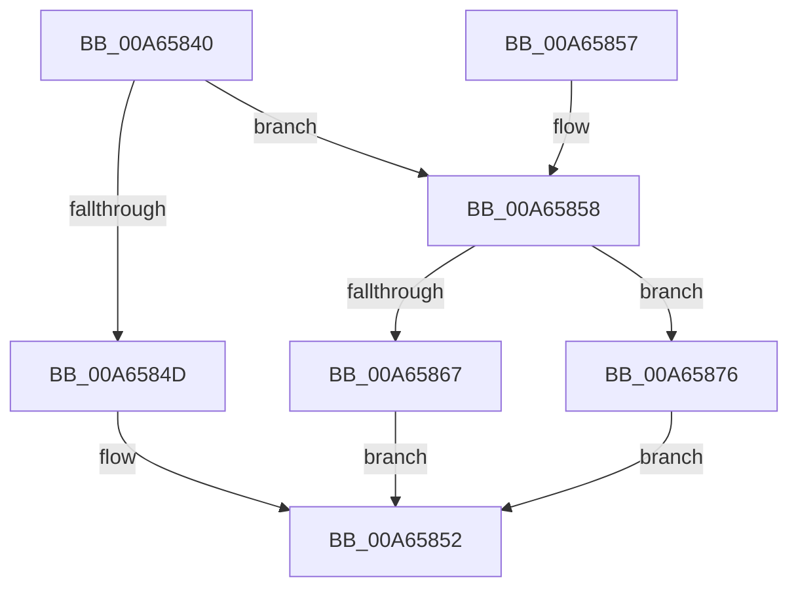

# CmpFileWrite

- RVA: `0x00A65840`–`0x00A6587A` (길이 `58` bytes)
- VA: `0x0000000140A65840`
- 실행 섹션: `PAGE`
- PDB 이름 있음: `예`; PDB Function 태그: `아니요`
- unwind 정보 RVA: `0x00065B0C`
- 디코드: `17`개 명령, `58/58` bytes 표시
- 미해석 바이트: `0` (있으면 어셈블리에 `.byte`로 보존)

> 이 문서는 커널 이미지의 기계어와 PDB 기호를 분석해 생성했습니다. 4번과 5번은 함수 원형과 자료형을 바이너리 사용 방식에서 추정한 C 해석이며 원본 소스 복구 결과는 아닙니다.

## 1. Dependencies

- 직접 호출 지점: **1**; 고유 호출 대상: **1**
- 직접 호출자로 확인된 함수: **1**
- RIP 상대 이미지 참조: **1**

### Outgoing calls
- `0x00A6586F` → [CmpDoFileWrite](CmpDoFileWrite_function_00A65880.md) (function, `0x00A65880`)

### Direct callers
- [CmpSaveKeyByFileCopy](../7D/CmpSaveKeyByFileCopy_function_007DEFC0.md) at `0x007DF090`
- [CmpSaveKeyByFileCopy](../7D/CmpSaveKeyByFileCopy_function_007DEFC0.md) at `0x007DF106`
- [CmpSaveKeyByFileCopy](../7D/CmpSaveKeyByFileCopy_function_007DEFC0.md) at `0x007DF170`

### Static image references
- `0x00A65844` → RVA `0x00FD8001` (`PAGEDATA`; read)

## 2. Other-region calls and transfers

- 다른 실행 섹션으로 향하는 call: **0**
- 별도 외부 분기/꼬리 이동을 확인하지 못했습니다.

## 3. Assembly (complete function range)

```asm
00A65840  48 83 EC 38                     sub rsp, 0x38
00A65844  80 3D B6 27 57 00 00            cmp byte ptr [rip + 0x5727b6], 0
00A6584B  74 0B                           je 0x140a65858
00A6584D  B8 01 00 00 C0                  mov eax, 0xc0000001
00A65852  48 83 C4 38                     add rsp, 0x38
00A65856  C3                              ret
00A65857  CC                              int3
00A65858  8B C2                           mov eax, edx
00A6585A  48 8B 8C C1 08 06 00 00         mov rcx, qword ptr [rcx + rax*8 + 0x608]
00A65862  48 85 C9                        test rcx, rcx
00A65865  74 0F                           je 0x140a65876
00A65867  8B 44 24 60                     mov eax, dword ptr [rsp + 0x60]
00A6586B  89 44 24 20                     mov dword ptr [rsp + 0x20], eax
00A6586F  E8 0C 00 00 00                  call 0x140a65880
00A65874  EB DC                           jmp 0x140a65852
00A65876  33 C0                           xor eax, eax
00A65878  EB D8                           jmp 0x140a65852
```

## 4. C-style interpretation (structured pseudocode)

```c
__int64 __fastcall CmpFileWrite(__int64 a1, int a2, __int64 a3, __int64 a4, unsigned int a5)
{
    __int64 result;
    __int64 v_rsp;
    unsigned int v_stack_p20;

    v_rsp = (v_rsp) - (56);
    if ((*(unsigned __int8 *)(v_rip + 5711798)) == 0) goto loc_00A65858;
loc_00A65852:
    v_rsp = (v_rsp) + (56);
    return (unsigned int)(0xC0000001ULL);
loc_00A65858:
    if (*(unsigned __int64 *)(a1 + (unsigned int)(a2) * 8 + 1544) == 0) goto loc_00A65876;
    v_stack_p20 = (unsigned int)((unsigned int)(a5));
    result = CmpDoFileWrite(*(unsigned __int64 *)(a1 + (unsigned int)(a2) * 8 + 1544), a2, a3, a4);
    goto loc_00A65852;
loc_00A65876:
    result = 0;
    goto loc_00A65852;
}
```

## 5. (Beta) C Style

```c
int64_t CmpFileWrite(void *Arg1, int32_t Arg2, int64_t Arg3, int64_t Arg4, uint32_t Arg5)
{
    uint8_t *arg1 = (uint8_t *)Arg1;

    int64_t result;
    int64_t local_rsp;
    uint32_t v_stack_p20;

    local_rsp = (local_rsp) - (56);
    if ((*(uint8_t *)(v_rip + 0x5727B6)) == 0) goto loc_00A65858;
loc_00A65852:
    local_rsp = (local_rsp) + (56);
    return (uint32_t)(0xC0000001ULL);
loc_00A65858:
    if (*(uint64_t *)(arg1 + (uint32_t)(Arg2) * 8 + 0x608) == 0) goto loc_00A65876;
    v_stack_p20 = (uint32_t)((uint32_t)(Arg5));
    result = CmpDoFileWrite(*(uint64_t *)(arg1 + (uint32_t)(Arg2) * 8 + 0x608), Arg2, Arg3, Arg4);
    goto loc_00A65852;
loc_00A65876:
    result = 0;
    goto loc_00A65852;
}
```

### 관측된 메모리 오프셋

구조체 형식이 확인되지 않은 접근은 인자 기준의 오프셋으로만 기록했습니다.

| 기준 인자 | 오프셋 표현 | 폭 (bit) | 접근 |
|---|---:|---:|---|
| `Arg1` | `+ 0x608 + rax*8` | `64` | `R` |

## 6. Execution-region graph

[열기: 2D/3D 그래프와 함수 탐색 컨트롤 패널](../../../control-panel.html?section=page&rva=0x00A65840&view=graph)

- 2D 그래프는 위에서 아래로 흐르고, 3D 그래프는 빈 공간을 드래그해 회전합니다. Shift+드래그는 이동, 휠은 확대·축소, 함수 노드 선택은 대상 보고서 이동입니다.

### Static fallback


