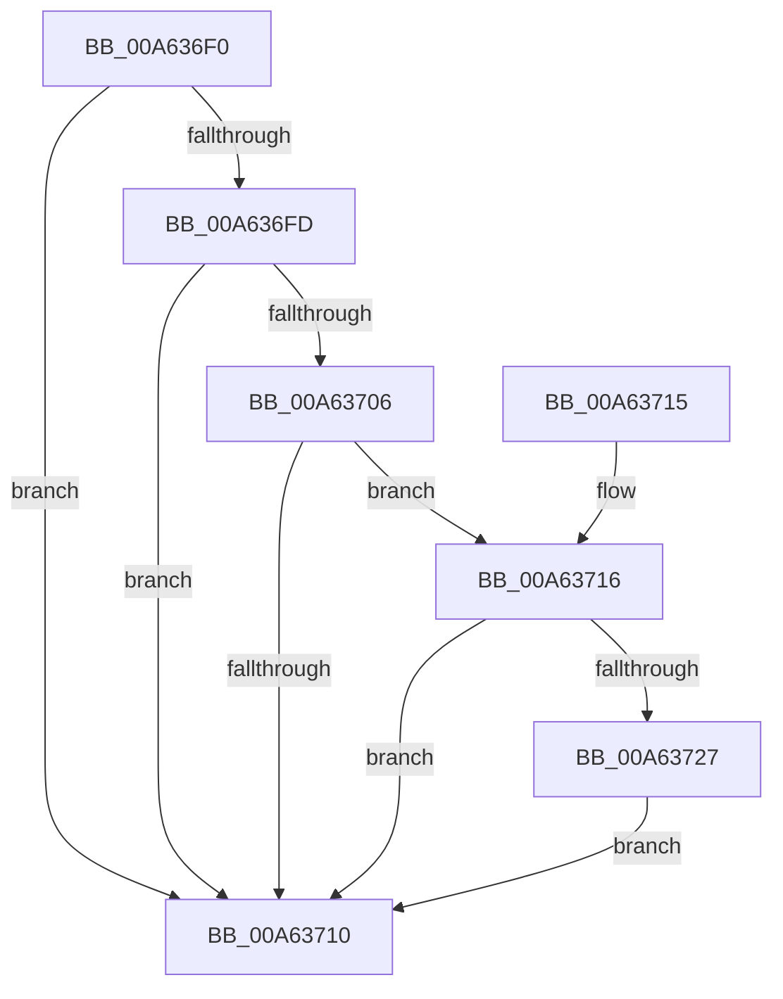

# CmpForceFlushForCoalescing

- RVA: `0x00A636F0`–`0x00A63735` (길이 `69` bytes)
- VA: `0x0000000140A636F0`
- 실행 섹션: `PAGE`
- PDB 이름 있음: `예`; PDB Function 태그: `아니요`
- unwind 정보 RVA: `0x0006E680`
- 디코드: `18`개 명령, `69/69` bytes 표시
- 미해석 바이트: `0` (있으면 어셈블리에 `.byte`로 보존)

> 이 문서는 커널 이미지의 기계어와 PDB 기호를 분석해 생성했습니다. 4번과 5번은 함수 원형과 자료형을 바이너리 사용 방식에서 추정한 C 해석이며 원본 소스 복구 결과는 아닙니다.

## 1. Dependencies

- 직접 호출 지점: **1**; 고유 호출 대상: **1**
- 직접 호출자로 확인된 함수: **2**
- RIP 상대 이미지 참조: **4**

### Outgoing calls
- `0x00A6372E` → [ExQueueWorkItem](../../text/2F/ExQueueWorkItem_function_002F9520.md) (function, `0x002F9520`)

### Direct callers
- [CmpCoalescingCallback](../../text/4B/CmpCoalescingCallback_function_004B7820.md) at `0x004B7856`
- [sub_00859517](../85/Unknown_function_00859517.md) at `0x008595CF`

### Static image references
- `0x00A636F4` → RVA `0x00FD8001` (`PAGEDATA`; read)
- `0x00A636FD` → RVA `0x00EEFBD4` (`.data`; read)
- `0x00A63706` → RVA `0x00EF7AA8` (`.data`; read)
- `0x00A63727` → RVA `0x00EF7AC0` (`.data`; read)

## 2. Other-region calls and transfers

- 다른 실행 섹션으로 향하는 call: **1**
  - `0x00A6372E` → [ExQueueWorkItem](../../text/2F/ExQueueWorkItem_function_002F9520.md) (`PAGE` → `.text`)
- 별도 외부 분기/꼬리 이동을 확인하지 못했습니다.

## 3. Assembly (complete function range)

```asm
00A636F0  48 83 EC 28                     sub rsp, 0x28
00A636F4  80 3D 06 49 57 00 00            cmp byte ptr [rip + 0x574906], 0
00A636FB  75 13                           jne 0x140a63710
00A636FD  80 3D D0 C4 48 00 00            cmp byte ptr [rip + 0x48c4d0], 0
00A63704  74 0A                           je 0x140a63710
00A63706  8B 05 9C 43 49 00               mov eax, dword ptr [rip + 0x49439c]
00A6370C  85 C0                           test eax, eax
00A6370E  74 06                           je 0x140a63716
00A63710  48 83 C4 28                     add rsp, 0x28
00A63714  C3                              ret
00A63715  CC                              int3
00A63716  BA 01 00 00 00                  mov edx, 1
00A6371B  33 C0                           xor eax, eax
00A6371D  F0 0F B1 15 83 43 49 00         lock cmpxchg dword ptr [rip + 0x494383], edx
00A63725  75 E9                           jne 0x140a63710
00A63727  48 8D 0D 92 43 49 00            lea rcx, [rip + 0x494392]
00A6372E  E8 ED 5D 89 FF                  call 0x1402f9520
00A63733  EB DB                           jmp 0x140a63710
```

## 4. C-style interpretation (structured pseudocode)

```c
__int64 __fastcall CmpForceFlushForCoalescing(void)
{
    __int64 result;
    __int64 v_rsp;

    v_rsp = (v_rsp) - (40);
    if ((*(unsigned __int8 *)(v_rip + 5720326)) != 0) goto loc_00A63710;
    if ((*(unsigned __int8 *)(v_rip + 4768976)) == 0) goto loc_00A63710;
    if ((unsigned int)((unsigned int)(*(unsigned int *)(v_rip + 4801436))) == 0) goto loc_00A63716;
loc_00A63710:
    v_rsp = (v_rsp) + (40);
    return (unsigned int)(*(unsigned int *)(v_rip + 4801436));
loc_00A63716:
    result = 0;
    if (condition_is_not_equal) goto loc_00A63710;
    result = ExQueueWorkItem(v_rip + 4801426, 1, a3, a4);
    goto loc_00A63710;
}
```

## 5. (Beta) C Style

```c
void CmpForceFlushForCoalescing(void)
{
    int64_t result;
    int64_t local_rsp;

    local_rsp = (local_rsp) - (40);
    if ((*(uint8_t *)(v_rip + 0x574906)) != 0) goto loc_00A63710;
    if ((*(uint8_t *)(v_rip + 0x48C4D0)) == 0) goto loc_00A63710;
    if ((uint32_t)((uint32_t)(*(uint32_t *)(v_rip + 0x49439C))) == 0) goto loc_00A63716;
loc_00A63710:
    local_rsp = (local_rsp) + (40);
    return (uint32_t)(*(uint32_t *)(v_rip + 0x49439C));
loc_00A63716:
    result = 0;
    if (condition_is_not_equal) goto loc_00A63710;
    result = ExQueueWorkItem(v_rip + 4801426, 1, a3, a4);
    goto loc_00A63710;
}
```

## 6. Execution-region graph

[열기: 2D/3D 그래프와 함수 탐색 컨트롤 패널](../../../control-panel.html?section=page&rva=0x00A636F0&view=graph)

- 2D 그래프는 위에서 아래로 흐르고, 3D 그래프는 빈 공간을 드래그해 회전합니다. Shift+드래그는 이동, 휠은 확대·축소, 함수 노드 선택은 대상 보고서 이동입니다.

### Static fallback


