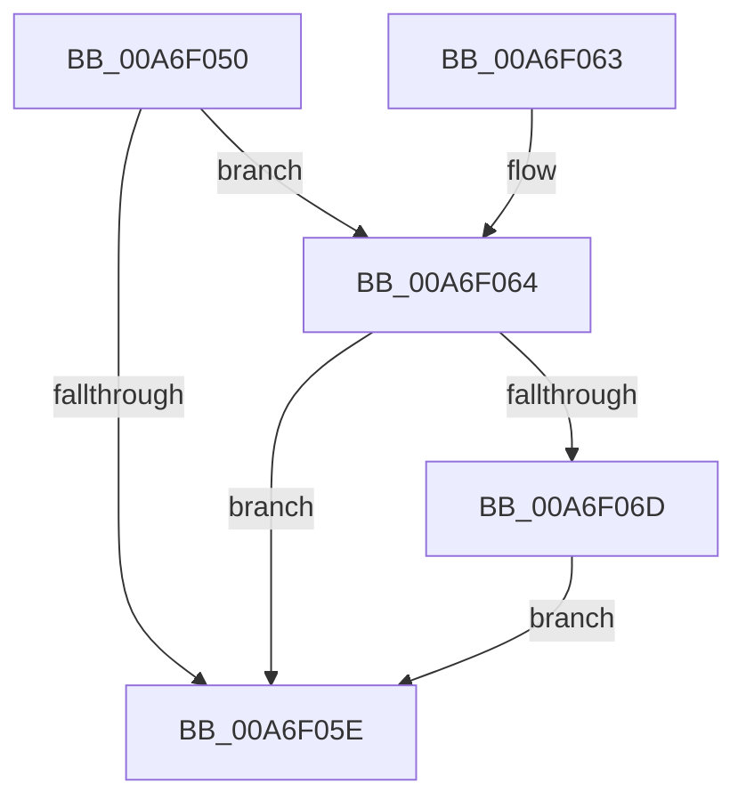

# CmpIssueNewDirtyCallback

- RVA: `0x00A6F050`–`0x00A6F07D` (길이 `45` bytes)
- VA: `0x0000000140A6F050`
- 실행 섹션: `PAGE`
- PDB 이름 있음: `예`; PDB Function 태그: `아니요`
- unwind 정보 RVA: `0x0005E0D8`
- 디코드: `13`개 명령, `45/45` bytes 표시
- 미해석 바이트: `0` (있으면 어셈블리에 `.byte`로 보존)

> 이 문서는 커널 이미지의 기계어와 PDB 기호를 분석해 생성했습니다. 4번과 5번은 함수 원형과 자료형을 바이너리 사용 방식에서 추정한 C 해석이며 원본 소스 복구 결과는 아닙니다.

## 1. Dependencies

- 직접 호출 지점: **1**; 고유 호출 대상: **1**
- 직접 호출자로 확인된 함수: **2**
- RIP 상대 이미지 참조: **3**

### Outgoing calls
- `0x00A6F076` → [PoIssueCoalescingNotification](../../text/44/PoIssueCoalescingNotification_function_0044D670.md) (function, `0x0044D670`)

### Direct callers
- [sub_00859517](../85/Unknown_function_00859517.md) at `0x008595B3`
- [HvMarkBaseBlockDirty](../87/HvMarkBaseBlockDirty_function_0087BD04.md) at `0x0087BD2A`

### Static image references
- `0x00A6F054` → RVA `0x00E0ECC0` (`.data`; read)
- `0x00A6F064` → RVA `0x00EEFBDC` (`.data`; read)
- `0x00A6F06D` → RVA `0x00EF7AA0` (`.data`; read)

## 2. Other-region calls and transfers

- 다른 실행 섹션으로 향하는 call: **1**
  - `0x00A6F076` → [PoIssueCoalescingNotification](../../text/44/PoIssueCoalescingNotification_function_0044D670.md) (`PAGE` → `.text`)
- 별도 외부 분기/꼬리 이동을 확인하지 못했습니다.

## 3. Assembly (complete function range)

```asm
00A6F050  48 83 EC 28                     sub rsp, 0x28
00A6F054  8B 05 66 FC 39 00               mov eax, dword ptr [rip + 0x39fc66]
00A6F05A  A8 08                           test al, 8
00A6F05C  75 06                           jne 0x140a6f064
00A6F05E  48 83 C4 28                     add rsp, 0x28
00A6F062  C3                              ret
00A6F063  CC                              int3
00A6F064  80 3D 71 0B 48 00 00            cmp byte ptr [rip + 0x480b71], 0
00A6F06B  74 F1                           je 0x140a6f05e
00A6F06D  48 8B 0D 2C 8A 48 00            mov rcx, qword ptr [rip + 0x488a2c]
00A6F074  33 D2                           xor edx, edx
00A6F076  E8 F5 E5 9D FF                  call 0x14044d670
00A6F07B  EB E1                           jmp 0x140a6f05e
```

## 4. C-style interpretation (structured pseudocode)

```c
__int64 __fastcall CmpIssueNewDirtyCallback(__int64 a1, int a2)
{
    __int64 result;
    __int64 v_rsp;

    v_rsp = (v_rsp) - (40);
    if ((((unsigned __int8)((unsigned int)(*(unsigned int *)(v_rip + 3800166)))) & (8)) != 0) goto loc_00A6F064;
loc_00A6F05E:
    v_rsp = (v_rsp) + (40);
    return (unsigned int)(*(unsigned int *)(v_rip + 3800166));
loc_00A6F064:
    if ((*(unsigned __int8 *)(v_rip + 4721521)) == 0) goto loc_00A6F05E;
    a2 = 0;
    result = PoIssueCoalescingNotification(*(unsigned __int64 *)(v_rip + 4753964), a2, a3, a4);
    goto loc_00A6F05E;
}
```

## 5. (Beta) C Style

```c
int64_t CmpIssueNewDirtyCallback(int64_t Arg1, int32_t Arg2)
{
    int64_t result;
    int64_t local_rsp;

    local_rsp = (local_rsp) - (40);
    if ((((uint8_t)((uint32_t)(*(uint32_t *)(v_rip + 0x39FC66)))) & (8)) != 0) goto loc_00A6F064;
loc_00A6F05E:
    local_rsp = (local_rsp) + (40);
    return (uint32_t)(*(uint32_t *)(v_rip + 0x39FC66));
loc_00A6F064:
    if ((*(uint8_t *)(v_rip + 0x480B71)) == 0) goto loc_00A6F05E;
    Arg2 = 0;
    result = PoIssueCoalescingNotification(*(uint64_t *)(v_rip + 0x488A2C), Arg2, a3, a4);
    goto loc_00A6F05E;
}
```

## 6. Execution-region graph

[열기: 2D/3D 그래프와 함수 탐색 컨트롤 패널](../../../control-panel.html?section=page&rva=0x00A6F050&view=graph)

- 2D 그래프는 위에서 아래로 흐르고, 3D 그래프는 빈 공간을 드래그해 회전합니다. Shift+드래그는 이동, 휠은 확대·축소, 함수 노드 선택은 대상 보고서 이동입니다.

### Static fallback


