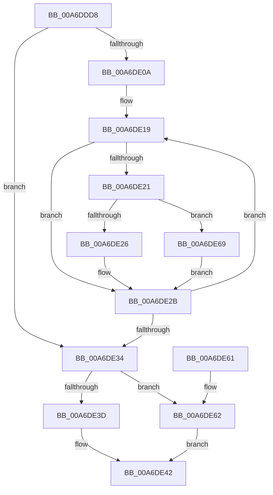

# CmpKeyEnumStackFreeResumeContext

- RVA: `0x00A6DDD8`–`0x00A6DE73` (길이 `155` bytes)
- VA: `0x0000000140A6DDD8`
- 실행 섹션: `PAGE`
- PDB 이름 있음: `예`; PDB Function 태그: `아니요`
- unwind 정보 RVA: `0x000ADAB8`
- 디코드: `48`개 명령, `155/155` bytes 표시
- 미해석 바이트: `0` (있으면 어셈블리에 `.byte`로 보존)

> 이 문서는 커널 이미지의 기계어와 PDB 기호를 분석해 생성했습니다. 4번과 5번은 함수 원형과 자료형을 바이너리 사용 방식에서 추정한 C 해석이며 원본 소스 복구 결과는 아닙니다.

## 1. Dependencies

- 직접 호출 지점: **4**; 고유 호출 대상: **3**
- 직접 호출자로 확인된 함수: **2**
- RIP 상대 이미지 참조: **0**

### Outgoing calls
- `0x00A6DE26` → [CmpDereferenceKeyControlBlock](../85/CmpDereferenceKeyControlBlock_function_00851310.md) (function, `0x00851310`)
- `0x00A6DE3D` → [CmSiFreeMemory](../../text/47/CmSiFreeMemory_function_00475D80.md) (function, `0x00475D80`)
- `0x00A6DE62` → [CmSiFreeMemory](../../text/47/CmSiFreeMemory_function_00475D80.md) (function, `0x00475D80`)
- `0x00A6DE6C` → [CmpDelayDerefKeyControlBlock](../84/CmpDelayDerefKeyControlBlock_function_0084FA50.md) (function, `0x0084FA50`)

### Direct callers
- [CmpEnumerateLayeredKey](../94/CmpEnumerateLayeredKey_function_00945E58.md) at `0x00946479`
- [CmpFlushNotifiesOnKeyBodyList](../9B/CmpFlushNotifiesOnKeyBodyList_function_009B3594.md) at `0x009B368B`
- [CmpFlushNotifiesOnKeyBodyList](../9B/CmpFlushNotifiesOnKeyBodyList_function_009B3594.md) at `0x009B369B`

### Static image references
- 디코드된 RIP-relative 메모리 참조가 없습니다.

## 2. Other-region calls and transfers

- 다른 실행 섹션으로 향하는 call: **2**
  - `0x00A6DE3D` → [CmSiFreeMemory](../../text/47/CmSiFreeMemory_function_00475D80.md) (`PAGE` → `.text`)
  - `0x00A6DE62` → [CmSiFreeMemory](../../text/47/CmSiFreeMemory_function_00475D80.md) (`PAGE` → `.text`)
- 별도 외부 분기/꼬리 이동을 확인하지 못했습니다.

## 3. Assembly (complete function range)

```asm
00A6DDD8  48 8B C4                        mov rax, rsp
00A6DDDB  48 89 58 08                     mov qword ptr [rax + 8], rbx
00A6DDDF  48 89 68 10                     mov qword ptr [rax + 0x10], rbp
00A6DDE3  48 89 70 18                     mov qword ptr [rax + 0x18], rsi
00A6DDE7  48 89 78 20                     mov qword ptr [rax + 0x20], rdi
00A6DDEB  41 54                           push r12
00A6DDED  41 56                           push r14
00A6DDEF  41 57                           push r15
00A6DDF1  48 83 EC 20                     sub rsp, 0x20
00A6DDF5  0F B7 01                        movzx eax, word ptr [rcx]
00A6DDF8  45 33 FF                        xor r15d, r15d
00A6DDFB  41 8A E8                        mov bpl, r8b
00A6DDFE  4C 8B F2                        mov r14, rdx
00A6DE01  48 8B D9                        mov rbx, rcx
00A6DE04  66 44 3B F8                     cmp r15w, ax
00A6DE08  7F 2A                           jg 0x140a6de34
00A6DE0A  45 8D 67 01                     lea r12d, [r15 + 1]
00A6DE0E  66 41 03 C4                     add ax, r12w
00A6DE12  48 8D 79 10                     lea rdi, [rcx + 0x10]
00A6DE16  0F B7 F0                        movzx esi, ax
00A6DE19  48 8B 0F                        mov rcx, qword ptr [rdi]
00A6DE1C  48 85 C9                        test rcx, rcx
00A6DE1F  74 0A                           je 0x140a6de2b
00A6DE21  40 84 ED                        test bpl, bpl
00A6DE24  75 43                           jne 0x140a6de69
00A6DE26  E8 E5 34 DE FF                  call 0x140851310
00A6DE2B  48 83 C7 18                     add rdi, 0x18
00A6DE2F  49 2B F4                        sub rsi, r12
00A6DE32  75 E5                           jne 0x140a6de19
00A6DE34  48 8B CB                        mov rcx, rbx
00A6DE37  44 38 7B 02                     cmp byte ptr [rbx + 2], r15b
00A6DE3B  75 25                           jne 0x140a6de62
00A6DE3D  E8 3E 7F A0 FF                  call 0x140475d80
00A6DE42  48 8B 5C 24 40                  mov rbx, qword ptr [rsp + 0x40]
00A6DE47  48 8B 6C 24 48                  mov rbp, qword ptr [rsp + 0x48]
00A6DE4C  48 8B 74 24 50                  mov rsi, qword ptr [rsp + 0x50]
00A6DE51  48 8B 7C 24 58                  mov rdi, qword ptr [rsp + 0x58]
00A6DE56  48 83 C4 20                     add rsp, 0x20
00A6DE5A  41 5F                           pop r15
00A6DE5C  41 5E                           pop r14
00A6DE5E  41 5C                           pop r12
00A6DE60  C3                              ret
00A6DE61  CC                              int3
00A6DE62  E8 19 7F A0 FF                  call 0x140475d80
00A6DE67  EB D9                           jmp 0x140a6de42
00A6DE69  49 8B D6                        mov rdx, r14
00A6DE6C  E8 DF 1B DE FF                  call 0x14084fa50
00A6DE71  EB B8                           jmp 0x140a6de2b
```

## 4. C-style interpretation (structured pseudocode)

```c
__int64 __fastcall CmpKeyEnumStackFreeResumeContext(__int64 a1, __int64 a2, unsigned __int8 a3)
{
    __int64 result;
    __int64 v_r15;
    __int64 v_rdi;
    __int64 v_rsi;
    __int64 v_rsp;
    unsigned __int64 v_stack_p10;
    unsigned __int64 v_stack_p18;
    unsigned __int64 v_stack_p20;
    unsigned __int64 v_stack_p8;

    *(unsigned __int64 *)(v_rsp + 8) = v_rbx;
    *(unsigned __int64 *)(v_rsp + 16) = v_rbp;
    *(unsigned __int64 *)(v_rsp + 24) = v_rsi;
    *(unsigned __int64 *)(v_rsp + 32) = v_rdi;
    v_rsp = (v_rsp) - (32);
    v_r15 = 0;
    if (0 > ((unsigned __int16)(*(unsigned __int16 *)(a1)))) goto loc_00A6DE34;
    result = (unsigned __int16)((*(unsigned __int16 *)(a1)) + ((unsigned __int16)(v_r15 + 1)));
loc_00A6DE19:
    if (*(unsigned __int64 *)(a1 + 16) == 0) goto loc_00A6DE2B;
    if (a3 != 0) goto loc_00A6DE69;
    result = CmpDereferenceKeyControlBlock(*(unsigned __int64 *)(a1 + 16), a2, a3, a4);
loc_00A6DE2B:
    v_rdi = (a1 + 16) + (24);
    v_rsi = ((unsigned __int16)(result)) - (v_r15 + 1);
    if (condition_is_not_equal) goto loc_00A6DE19;
loc_00A6DE34:
    if ((*(unsigned __int8 *)(a1 + 2)) != 0) goto loc_00A6DE62;
    result = CmSiFreeMemory(a1, a2, a3, a4);
loc_00A6DE42:
    v_rsp = (v_rsp) + (32);
    return result;
loc_00A6DE62:
    result = CmSiFreeMemory(a1, a2, a3, a4);
    goto loc_00A6DE42;
loc_00A6DE69:
    result = CmpDelayDerefKeyControlBlock(a1, a2, a3, a4);
    goto loc_00A6DE2B;
}
```

## 5. (Beta) C Style

```c
int64_t CmpKeyEnumStackFreeResumeContext(void *Arg1, int64_t Arg2, uint8_t Arg3)
{
    uint8_t *arg1 = (uint8_t *)Arg1;

    int64_t result;
    int64_t local_r15;
    int64_t local_rdi;
    int64_t local_rsi;
    int64_t local_rsp;
    uint64_t v_stack_p10;
    uint64_t v_stack_p18;
    uint64_t v_stack_p20;
    uint64_t v_stack_p8;

    *(uint64_t *)(local_rsp + 0x8) = local_rbx;
    *(uint64_t *)(local_rsp + 0x10) = local_rbp;
    *(uint64_t *)(local_rsp + 0x18) = local_rsi;
    *(uint64_t *)(local_rsp + 0x20) = local_rdi;
    local_rsp = (local_rsp) - (32);
    local_r15 = 0;
    if (0 > ((uint16_t)(*(uint16_t *)(arg1)))) goto loc_00A6DE34;
    result = (uint16_t)((*(uint16_t *)(arg1)) + ((uint16_t)(local_r15 + 1)));
loc_00A6DE19:
    if (*(uint64_t *)(arg1 + 0x10) == 0) goto loc_00A6DE2B;
    if (Arg3 != 0) goto loc_00A6DE69;
    result = CmpDereferenceKeyControlBlock(*(uint64_t *)(arg1 + 0x10), Arg2, Arg3, a4);
loc_00A6DE2B:
    local_rdi = (Arg1 + 16) + (24);
    local_rsi = ((uint16_t)(result)) - (local_r15 + 1);
    if (condition_is_not_equal) goto loc_00A6DE19;
loc_00A6DE34:
    if ((*(uint8_t *)(arg1 + 0x2)) != 0) goto loc_00A6DE62;
    result = CmSiFreeMemory(Arg1, Arg2, Arg3, a4);
loc_00A6DE42:
    local_rsp = (local_rsp) + (32);
    return result;
loc_00A6DE62:
    result = CmSiFreeMemory(Arg1, Arg2, Arg3, a4);
    goto loc_00A6DE42;
loc_00A6DE69:
    result = CmpDelayDerefKeyControlBlock(Arg1, Arg2, Arg3, a4);
    goto loc_00A6DE2B;
}
```

### 관측된 메모리 오프셋

구조체 형식이 확인되지 않은 접근은 인자 기준의 오프셋으로만 기록했습니다.

| 기준 인자 | 오프셋 표현 | 폭 (bit) | 접근 |
|---|---:|---:|---|
| `Arg1` | `+ 0x0` | `16` | `R` |
| `Arg1` | `+ 0x0` | `64` | `R` |
| `Arg1` | `+ 0x2` | `8` | `R` |
| `Arg1` | `+ 0x10` | `64` | `R` |

## 6. Execution-region graph

[열기: 2D/3D 그래프와 함수 탐색 컨트롤 패널](../../../control-panel.html?section=page&rva=0x00A6DDD8&view=graph)

- 2D 그래프는 위에서 아래로 흐르고, 3D 그래프는 빈 공간을 드래그해 회전합니다. Shift+드래그는 이동, 휠은 확대·축소, 함수 노드 선택은 대상 보고서 이동입니다.

### Static fallback


