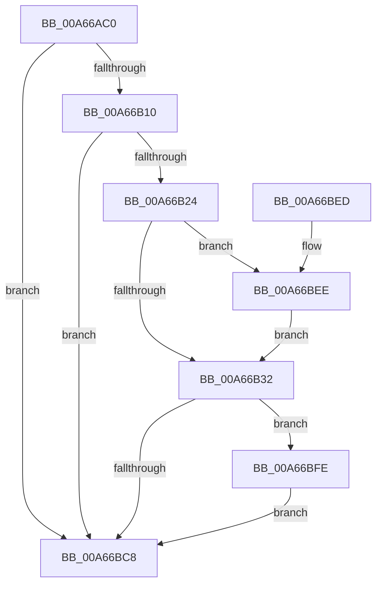

# CmpPublishEventForPcaResolver

- RVA: `0x00A66AC0`–`0x00A66C09` (길이 `329` bytes)
- VA: `0x0000000140A66AC0`
- 실행 섹션: `PAGE`
- PDB 이름 있음: `예`; PDB Function 태그: `아니요`
- unwind 정보 RVA: `0x000B3A70`
- 디코드: `81`개 명령, `329/329` bytes 표시
- 미해석 바이트: `0` (있으면 어셈블리에 `.byte`로 보존)

> 이 문서는 커널 이미지의 기계어와 PDB 기호를 분석해 생성했습니다. 4번과 5번은 함수 원형과 자료형을 바이너리 사용 방식에서 추정한 C 해석이며 원본 소스 복구 결과는 아닙니다.

## 1. Dependencies

- 직접 호출 지점: **6**; 고유 호출 대상: **6**
- 직접 호출자로 확인된 함수: **1**
- RIP 상대 이미지 참조: **3**

### Outgoing calls
- `0x00A66B17` → [EtwEventEnabled](../../text/39/EtwEventEnabled_function_00392450.md) (function, `0x00392450`)
- `0x00A66B32` → [PsGetCurrentThreadProcess](../../text/47/PsGetCurrentThreadProcess_function_0047C7E0.md) (function, `0x0047C7E0`)
- `0x00A66BBF` → [EtwWrite](../../text/41/EtwWrite_function_0041C720.md) (function, `0x0041C720`)
- `0x00A66BCF` → [_security_check_cookie](../../text/6A/_security_check_cookie_function_006AC640.md) (function, `0x006AC640`)
- `0x00A66BF2` → [CmpAttachToRegistryProcess](../../pagecmrc/BC/CmpAttachToRegistryProcess_function_00BC98E0.md) (function, `0x00BC98E0`)
- `0x00A66C02` → [CmpDetachFromRegistryProcess](../../pagecmrc/BC/CmpDetachFromRegistryProcess_function_00BC9920.md) (function, `0x00BC9920`)

### Direct callers
- [CmpDoParseKey](../85/CmpDoParseKey_function_0085F750.md) at `0x00860B9E`

### Static image references
- `0x00A66ADB` → RVA `0x00E0A740` (`.data`; read)
- `0x00A66AEF` → RVA `0x00EFF850` (`.data`; read)
- `0x00A66B10` → RVA `0x0001A868` (`.rdata`; read)

## 2. Other-region calls and transfers

- 다른 실행 섹션으로 향하는 call: **6**
  - `0x00A66B17` → [EtwEventEnabled](../../text/39/EtwEventEnabled_function_00392450.md) (`PAGE` → `.text`)
  - `0x00A66B32` → [PsGetCurrentThreadProcess](../../text/47/PsGetCurrentThreadProcess_function_0047C7E0.md) (`PAGE` → `.text`)
  - `0x00A66BBF` → [EtwWrite](../../text/41/EtwWrite_function_0041C720.md) (`PAGE` → `.text`)
  - `0x00A66BCF` → [_security_check_cookie](../../text/6A/_security_check_cookie_function_006AC640.md) (`PAGE` → `.text`)
  - `0x00A66BF2` → [CmpAttachToRegistryProcess](../../pagecmrc/BC/CmpAttachToRegistryProcess_function_00BC98E0.md) (`PAGE` → `PAGECMRC`)
  - `0x00A66C02` → [CmpDetachFromRegistryProcess](../../pagecmrc/BC/CmpDetachFromRegistryProcess_function_00BC9920.md) (`PAGE` → `PAGECMRC`)
- 별도 외부 분기/꼬리 이동을 확인하지 못했습니다.

## 3. Assembly (complete function range)

```asm
00A66AC0  48 8B C4                        mov rax, rsp
00A66AC3  48 89 58 08                     mov qword ptr [rax + 8], rbx
00A66AC7  48 89 70 10                     mov qword ptr [rax + 0x10], rsi
00A66ACB  48 89 78 18                     mov qword ptr [rax + 0x18], rdi
00A66ACF  55                              push rbp
00A66AD0  48 8D 68 A1                     lea rbp, [rax - 0x5f]
00A66AD4  48 81 EC C0 00 00 00            sub rsp, 0xc0
00A66ADB  48 8B 05 5E 3C 3A 00            mov rax, qword ptr [rip + 0x3a3c5e]
00A66AE2  48 33 C4                        xor rax, rsp
00A66AE5  48 89 45 47                     mov qword ptr [rbp + 0x47], rax
00A66AE9  0F 57 C0                        xorps xmm0, xmm0
00A66AEC  48 8B F9                        mov rdi, rcx
00A66AEF  48 8B 0D 5A 8D 49 00            mov rcx, qword ptr [rip + 0x498d5a]
00A66AF6  32 DB                           xor bl, bl
00A66AF8  48 8B F2                        mov rsi, rdx
00A66AFB  0F 11 45 CF                     movups xmmword ptr [rbp - 0x31], xmm0
00A66AFF  0F 11 45 DF                     movups xmmword ptr [rbp - 0x21], xmm0
00A66B03  0F 11 45 EF                     movups xmmword ptr [rbp - 0x11], xmm0
00A66B07  48 85 C9                        test rcx, rcx
00A66B0A  0F 84 B8 00 00 00               je 0x140a66bc8
00A66B10  48 8D 15 51 3D 5B FF            lea rdx, [rip - 0xa4c2af]
00A66B17  E8 34 B9 92 FF                  call 0x140392450
00A66B1C  84 C0                           test al, al
00A66B1E  0F 84 A4 00 00 00               je 0x140a66bc8
00A66B24  8B 87 A0 00 00 00               mov eax, dword ptr [rdi + 0xa0]
00A66B2A  A8 01                           test al, 1
00A66B2C  0F 84 BC 00 00 00               je 0x140a66bee
00A66B32  E8 A9 5C A1 FF                  call 0x14047c7e0
00A66B37  44 0F B7 06                     movzx r8d, word ptr [rsi]
00A66B3B  41 B9 02 00 00 00               mov r9d, 2
00A66B41  48 8B 90 50 03 00 00            mov rdx, qword ptr [rax + 0x350]
00A66B48  0F B7 02                        movzx eax, word ptr [rdx]
00A66B4B  83 65 13 00                     and dword ptr [rbp + 0x13], 0
00A66B4F  66 D1 E8                        shr ax, 1
00A66B52  66 89 45 C7                     mov word ptr [rbp - 0x39], ax
00A66B56  41 0F B7 C0                     movzx eax, r8w
00A66B5A  66 D1 E8                        shr ax, 1
00A66B5D  66 89 45 CB                     mov word ptr [rbp - 0x35], ax
00A66B61  48 8D 45 C7                     lea rax, [rbp - 0x39]
00A66B65  48 89 45 07                     mov qword ptr [rbp + 7], rax
00A66B69  44 89 4D 0F                     mov dword ptr [rbp + 0xf], r9d
00A66B6D  48 8B 42 08                     mov rax, qword ptr [rdx + 8]
00A66B71  0F B7 0A                        movzx ecx, word ptr [rdx]
00A66B74  48 8D 15 ED 3C 5B FF            lea rdx, [rip - 0xa4c313]
00A66B7B  83 65 23 00                     and dword ptr [rbp + 0x23], 0
00A66B7F  83 65 33 00                     and dword ptr [rbp + 0x33], 0
00A66B83  83 65 43 00                     and dword ptr [rbp + 0x43], 0
00A66B87  48 89 45 17                     mov qword ptr [rbp + 0x17], rax
00A66B8B  48 8D 45 CB                     lea rax, [rbp - 0x35]
00A66B8F  48 89 45 27                     mov qword ptr [rbp + 0x27], rax
00A66B93  48 8B 46 08                     mov rax, qword ptr [rsi + 8]
00A66B97  48 89 45 37                     mov qword ptr [rbp + 0x37], rax
00A66B9B  48 8D 45 07                     lea rax, [rbp + 7]
00A66B9F  89 4D 1F                        mov dword ptr [rbp + 0x1f], ecx
00A66BA2  48 8B 0D A7 8C 49 00            mov rcx, qword ptr [rip + 0x498ca7]
00A66BA9  44 89 4D 2F                     mov dword ptr [rbp + 0x2f], r9d
00A66BAD  41 B9 04 00 00 00               mov r9d, 4
00A66BB3  44 89 45 3F                     mov dword ptr [rbp + 0x3f], r8d
00A66BB7  45 33 C0                        xor r8d, r8d
00A66BBA  48 89 44 24 20                  mov qword ptr [rsp + 0x20], rax
00A66BBF  E8 5C 5B 9B FF                  call 0x14041c720
00A66BC4  84 DB                           test bl, bl
00A66BC6  75 36                           jne 0x140a66bfe
00A66BC8  48 8B 4D 47                     mov rcx, qword ptr [rbp + 0x47]
00A66BCC  48 33 CC                        xor rcx, rsp
00A66BCF  E8 6C 5A C4 FF                  call 0x1406ac640
00A66BD4  4C 8D 9C 24 C0 00 00 00         lea r11, [rsp + 0xc0]
00A66BDC  49 8B 5B 10                     mov rbx, qword ptr [r11 + 0x10]
00A66BE0  49 8B 73 18                     mov rsi, qword ptr [r11 + 0x18]
00A66BE4  49 8B 7B 20                     mov rdi, qword ptr [r11 + 0x20]
00A66BE8  49 8B E3                        mov rsp, r11
00A66BEB  5D                              pop rbp
00A66BEC  C3                              ret
00A66BED  CC                              int3
00A66BEE  48 8D 4D CF                     lea rcx, [rbp - 0x31]
00A66BF2  E8 E9 2C 16 00                  call 0x140bc98e0
00A66BF7  B3 01                           mov bl, 1
00A66BF9  E9 34 FF FF FF                  jmp 0x140a66b32
00A66BFE  48 8D 4D CF                     lea rcx, [rbp - 0x31]
00A66C02  E8 19 2D 16 00                  call 0x140bc9920
00A66C07  EB BF                           jmp 0x140a66bc8
```

## 4. C-style interpretation (structured pseudocode)

```c
__int64 __fastcall CmpPublishEventForPcaResolver(__int64 a1, __int64 a2)
{
    __int64 result;
    __int64 v_rbx;
    __int64 v_rsp;
    unsigned __int64 v_stack_m8;
    unsigned __int64 v_stack_mA8;

    *(unsigned __int64 *)(v_rsp + 8) = v_rbx;
    *(unsigned __int64 *)(v_rsp + 16) = v_rsi;
    *(unsigned __int64 *)(v_rsp + 24) = v_rdi;
    v_rsp = (v_rsp) - (192);
    result = (*(unsigned __int64 *)(v_rip + 3816542)) ^ (v_rsp);
    *(unsigned __int64 *)(v_rsp - 95 + 71) = result;
    v_rbx = 0;
    *(unsigned __int64 *)(v_rsp - 95 - 49) = v_xmm0;
    *(unsigned __int64 *)(v_rsp - 95 - 33) = v_xmm0;
    *(unsigned __int64 *)(v_rsp - 95 - 17) = v_xmm0;
    if (*(unsigned __int64 *)(v_rip + 4820314) == 0) goto loc_00A66BC8;
    result = EtwEventEnabled(*(unsigned __int64 *)(v_rip + 4820314), v_rip - 10797743, a3, a4);
    if ((unsigned __int8)(result) == 0) goto loc_00A66BC8;
    if ((((unsigned __int8)((unsigned int)(*(unsigned int *)(a1 + 160)))) & (1)) == 0) goto loc_00A66BEE;
loc_00A66B32:
    result = PsGetCurrentThreadProcess(*(unsigned __int64 *)(v_rip + 4820314), v_rip - 10797743, a3, a4);
    result = (unsigned __int16)((*(unsigned __int16 *)(*(unsigned __int64 *)(result + 848))) >> (1));
    *(unsigned __int16 *)(v_rsp - 95 - 57) = (unsigned __int16)(result);
    result = (unsigned __int16)(((unsigned __int16)(*(unsigned __int16 *)(a2))) >> (1));
    *(unsigned __int16 *)(v_rsp - 95 - 53) = (unsigned __int16)(result);
    *(unsigned __int64 *)(v_rsp - 95 + 7) = v_rsp - 95 - 57;
    *(unsigned int *)(v_rsp - 95 + 15) = 2;
    *(unsigned __int64 *)(v_rsp - 95 + 23) = *(unsigned __int64 *)(*(unsigned __int64 *)(result + 848) + 8);
    *(unsigned __int64 *)(v_rsp - 95 + 39) = v_rsp - 95 - 53;
    *(unsigned __int64 *)(v_rsp - 95 + 55) = *(unsigned __int64 *)(a2 + 8);
    *(unsigned int *)(v_rsp - 95 + 31) = (unsigned int)(*(unsigned __int16 *)(*(unsigned __int64 *)(result + 848)));
    *(unsigned int *)(v_rsp - 95 + 47) = 2;
    *(unsigned int *)(v_rsp - 95 + 63) = (unsigned int)(*(unsigned __int16 *)(a2));
    a3 = 0;
    v_stack_mA8 = v_rsp - 95 + 7;
    result = EtwWrite(*(unsigned __int64 *)(v_rip + 4820135), v_rip - 10797843, a3, 4);
    if (0 != 0) goto loc_00A66BFE;
loc_00A66BC8:
    a1 = (*(unsigned __int64 *)(v_rsp - 95 + 71)) ^ (v_rsp);
    result = _security_check_cookie(a1, v_rip - 10797843, a3, 4);
    return result;
loc_00A66BEE:
    result = CmpAttachToRegistryProcess(v_rsp - 95 - 49, v_rip - 10797843, a3, 4);
    goto loc_00A66B32;
loc_00A66BFE:
    result = CmpDetachFromRegistryProcess(v_rsp - 95 - 49, v_rip - 10797843, a3, 4);
    goto loc_00A66BC8;
}
```

## 5. (Beta) C Style

```c
int64_t CmpPublishEventForPcaResolver(void *Arg1, void *Arg2)
{
    uint8_t *arg1 = (uint8_t *)Arg1;
    uint8_t *arg2 = (uint8_t *)Arg2;

    int64_t result;
    int64_t local_rbx;
    int64_t local_rsp;
    uint64_t v_stack_m8;
    uint64_t v_stack_mA8;

    *(uint64_t *)(local_rsp + 0x8) = local_rbx;
    *(uint64_t *)(local_rsp + 0x10) = local_rsi;
    *(uint64_t *)(local_rsp + 0x18) = local_rdi;
    local_rsp = (local_rsp) - (192);
    result = (*(uint64_t *)(v_rip + 0x3A3C5E)) ^ (local_rsp);
    *(uint64_t *)(local_rsp - 0x5F + 0x47) = result;
    local_rbx = 0;
    *(uint64_t *)(local_rsp - 0x5F - 0x31) = v_xmm0;
    *(uint64_t *)(local_rsp - 0x5F - 0x21) = v_xmm0;
    *(uint64_t *)(local_rsp - 0x5F - 0x11) = v_xmm0;
    if (*(uint64_t *)(v_rip + 0x498D5A) == 0) goto loc_00A66BC8;
    result = EtwEventEnabled(*(uint64_t *)(v_rip + 0x498D5A), v_rip - 10797743, a3, a4);
    if ((uint8_t)(result) == 0) goto loc_00A66BC8;
    if ((((uint8_t)((uint32_t)(*(uint32_t *)(arg1 + 0xA0)))) & (1)) == 0) goto loc_00A66BEE;
loc_00A66B32:
    result = PsGetCurrentThreadProcess(*(uint64_t *)(v_rip + 0x498D5A), v_rip - 10797743, a3, a4);
    result = (uint16_t)((*(uint16_t *)(*(uint64_t *)(result + 0x350))) >> (1));
    *(uint16_t *)(local_rsp - 0x5F - 0x39) = (uint16_t)(result);
    result = (uint16_t)(((uint16_t)(*(uint16_t *)(arg2))) >> (1));
    *(uint16_t *)(local_rsp - 0x5F - 0x35) = (uint16_t)(result);
    *(uint64_t *)(local_rsp - 0x5F + 0x7) = local_rsp - 95 - 57;
    *(uint32_t *)(local_rsp - 0x5F + 0xF) = 2;
    *(uint64_t *)(local_rsp - 0x5F + 0x17) = *(uint64_t *)(*(uint64_t *)(result + 0x350) + 0x8);
    *(uint64_t *)(local_rsp - 0x5F + 0x27) = local_rsp - 95 - 53;
    *(uint64_t *)(local_rsp - 0x5F + 0x37) = *(uint64_t *)(arg2 + 0x8);
    *(uint32_t *)(local_rsp - 0x5F + 0x1F) = (uint32_t)(*(uint16_t *)(*(uint64_t *)(result + 0x350)));
    *(uint32_t *)(local_rsp - 0x5F + 0x2F) = 2;
    *(uint32_t *)(local_rsp - 0x5F + 0x3F) = (uint32_t)(*(uint16_t *)(arg2));
    a3 = 0;
    v_stack_mA8 = local_rsp - 95 + 7;
    result = EtwWrite(*(uint64_t *)(v_rip + 0x498CA7), v_rip - 10797843, a3, 4);
    if (0 != 0) goto loc_00A66BFE;
loc_00A66BC8:
    Arg1 = (*(uint64_t *)(local_rsp - 0x5F + 0x47)) ^ (local_rsp);
    result = _security_check_cookie(Arg1, v_rip - 10797843, a3, 4);
    return result;
loc_00A66BEE:
    result = CmpAttachToRegistryProcess(local_rsp - 95 - 49, v_rip - 10797843, a3, 4);
    goto loc_00A66B32;
loc_00A66BFE:
    result = CmpDetachFromRegistryProcess(local_rsp - 95 - 49, v_rip - 10797843, a3, 4);
    goto loc_00A66BC8;
}
```

### 관측된 메모리 오프셋

구조체 형식이 확인되지 않은 접근은 인자 기준의 오프셋으로만 기록했습니다.

| 기준 인자 | 오프셋 표현 | 폭 (bit) | 접근 |
|---|---:|---:|---|
| `Arg1` | `+ 0xA0` | `32` | `R` |
| `Arg2` | `+ 0x0` | `16` | `R` |
| `Arg2` | `+ 0x8` | `64` | `R` |

## 6. Execution-region graph

[열기: 2D/3D 그래프와 함수 탐색 컨트롤 패널](../../../control-panel.html?section=page&rva=0x00A66AC0&view=graph)

- 2D 그래프는 위에서 아래로 흐르고, 3D 그래프는 빈 공간을 드래그해 회전합니다. Shift+드래그는 이동, 휠은 확대·축소, 함수 노드 선택은 대상 보고서 이동입니다.

### Static fallback


