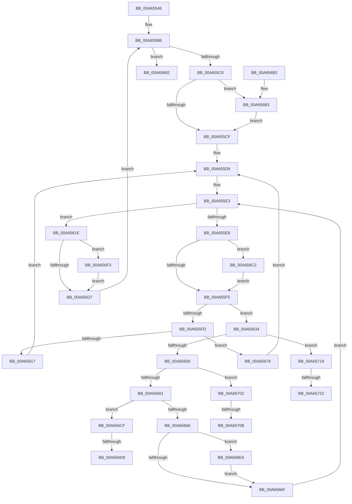

# CmpSearchKeyControlBlockTreeEx

- RVA: `0x00A65548`–`0x00A65730` (길이 `488` bytes)
- VA: `0x0000000140A65548`
- 실행 섹션: `PAGE`
- PDB 이름 있음: `예`; PDB Function 태그: `예`
- unwind 정보 RVA: `0x000B38CC`
- 디코드: `129`개 명령, `488/488` bytes 표시
- 미해석 바이트: `0` (있으면 어셈블리에 `.byte`로 보존)

> 이 문서는 커널 이미지의 기계어와 PDB 기호를 분석해 생성했습니다. 4번과 5번은 함수 원형과 자료형을 바이너리 사용 방식에서 추정한 C 해석이며 원본 소스 복구 결과는 아닙니다.

## 1. Dependencies

- 직접 호출 지점: **15**; 고유 호출 대상: **11**
- 직접 호출자로 확인된 함수: **2**
- RIP 상대 이미지 참조: **1**

### Outgoing calls
- `0x00A655AD` → [CmpAttachToRegistryProcess](../../pagecmrc/BC/CmpAttachToRegistryProcess_function_00BC98E0.md) (function, `0x00BC98E0`)
- `0x00A655FD` → [CmpRemoveFromDelayedClose](../86/CmpRemoveFromDelayedClose_function_00862350.md) (function, `0x00862350`)
- `0x00A6560A` → [CmpCleanUpKcbCacheWithLock](../86/CmpCleanUpKcbCacheWithLock_function_00861F20.md) (function, `0x00861F20`)
- `0x00A65617` → [CmpDecommisssionKcb](../86/CmpDecommisssionKcb_function_00862750.md) (function, `0x00862750`)
- `0x00A6564A` → [guard_dispatch_icall](../../text/6B/guard_dispatch_icall_function_006BAAD0.md) (function, `0x006BAAD0`)
- `0x00A65678` → [CmpUnlockKcb](../../pagecmrc/BC/CmpUnlockKcb_function_00BC92C0.md) (function, `0x00BC92C0`)
- `0x00A65687` → [CmpDetachFromRegistryProcess](../../pagecmrc/BC/CmpDetachFromRegistryProcess_function_00BC9920.md) (function, `0x00BC9920`)
- `0x00A65699` → [_security_check_cookie](../../text/6A/_security_check_cookie_function_006AC640.md) (function, `0x006AC640`)
- `0x00A656B8` → [CmpLockHashEntryByIndexExclusive](../7F/CmpLockHashEntryByIndexExclusive_function_007F1290.md) (function, `0x007F1290`)
- `0x00A656C5` → [CmpLockKcbExclusive](../86/CmpLockKcbExclusive_function_00861EB0.md) (function, `0x00861EB0`)
- `0x00A656DB` → [CmpUnlockKcb](../../pagecmrc/BC/CmpUnlockKcb_function_00BC92C0.md) (function, `0x00BC92C0`)
- `0x00A656E9` → [CmpUnlockKcb](../../pagecmrc/BC/CmpUnlockKcb_function_00BC92C0.md) (function, `0x00BC92C0`)
- `0x00A656F8` → [CmpUnlockHashEntryByIndex](../86/CmpUnlockHashEntryByIndex_function_00862460.md) (function, `0x00862460`)
- `0x00A6570E` → [CmpUnlockKcb](../../pagecmrc/BC/CmpUnlockKcb_function_00BC92C0.md) (function, `0x00BC92C0`)
- `0x00A65725` → [CmpUnlockKcb](../../pagecmrc/BC/CmpUnlockKcb_function_00BC92C0.md) (function, `0x00BC92C0`)

### Direct callers
- [CmpRefreshHive](../7D/CmpRefreshHive_function_007DEAD0.md) at `0x007DEECB`
- [CmKeyBodyReplicateToVirtual](../84/CmKeyBodyReplicateToVirtual_function_00843FE4.md) at `0x0084422D`

### Static image references
- `0x00A6555C` → RVA `0x00E0A740` (`.data`; read)

## 2. Other-region calls and transfers

- 다른 실행 섹션으로 향하는 call: **9**
  - `0x00A655AD` → [CmpAttachToRegistryProcess](../../pagecmrc/BC/CmpAttachToRegistryProcess_function_00BC98E0.md) (`PAGE` → `PAGECMRC`)
  - `0x00A6564A` → [guard_dispatch_icall](../../text/6B/guard_dispatch_icall_function_006BAAD0.md) (`PAGE` → `.text`)
  - `0x00A65678` → [CmpUnlockKcb](../../pagecmrc/BC/CmpUnlockKcb_function_00BC92C0.md) (`PAGE` → `PAGECMRC`)
  - `0x00A65687` → [CmpDetachFromRegistryProcess](../../pagecmrc/BC/CmpDetachFromRegistryProcess_function_00BC9920.md) (`PAGE` → `PAGECMRC`)
  - `0x00A65699` → [_security_check_cookie](../../text/6A/_security_check_cookie_function_006AC640.md) (`PAGE` → `.text`)
  - `0x00A656DB` → [CmpUnlockKcb](../../pagecmrc/BC/CmpUnlockKcb_function_00BC92C0.md) (`PAGE` → `PAGECMRC`)
  - `0x00A656E9` → [CmpUnlockKcb](../../pagecmrc/BC/CmpUnlockKcb_function_00BC92C0.md) (`PAGE` → `PAGECMRC`)
  - `0x00A6570E` → [CmpUnlockKcb](../../pagecmrc/BC/CmpUnlockKcb_function_00BC92C0.md) (`PAGE` → `PAGECMRC`)
  - `0x00A65725` → [CmpUnlockKcb](../../pagecmrc/BC/CmpUnlockKcb_function_00BC92C0.md) (`PAGE` → `PAGECMRC`)
- call이 아닌 외부 분기/꼬리 이동: **6**
  - `0x00A656D2` → [sub_00B3E6EA](../B3/Unknown_function_00B3E6EA.md) (`tail-transfer`)
  - `0x00A656E1` → [sub_00B3E6EA](../B3/Unknown_function_00B3E6EA.md) (`tail-transfer`)
  - `0x00A65705` → [sub_00B3E6EA + 0xB](../B3/Unknown_function_00B3E6EA.md) (`tail-transfer`)
  - `0x00A65714` → [sub_00B3E6EA + 0xB](../B3/Unknown_function_00B3E6EA.md) (`tail-transfer`)
  - `0x00A6571C` → [sub_00B3E6EA + 0x9](../B3/Unknown_function_00B3E6EA.md) (`tail-transfer`)
  - `0x00A6572B` → [sub_00B3E6EA + 0x9](../B3/Unknown_function_00B3E6EA.md) (`tail-transfer`)

## 3. Assembly (complete function range)

```asm
00A65548  40 53                           push rbx
00A6554A  55                              push rbp
00A6554B  56                              push rsi
00A6554C  57                              push rdi
00A6554D  41 54                           push r12
00A6554F  41 55                           push r13
00A65551  41 56                           push r14
00A65553  41 57                           push r15
00A65555  48 81 EC 98 00 00 00            sub rsp, 0x98
00A6555C  48 8B 05 DD 51 3A 00            mov rax, qword ptr [rip + 0x3a51dd]
00A65563  48 33 C4                        xor rax, rsp
00A65566  48 89 84 24 88 00 00 00         mov qword ptr [rsp + 0x88], rax
00A6556E  4C 8B B2 70 06 00 00            mov r14, qword ptr [rdx + 0x670]
00A65575  0F 57 C0                        xorps xmm0, xmm0
00A65578  8B BA 78 06 00 00               mov edi, dword ptr [rdx + 0x678]
00A6557E  4C 8B FA                        mov r15, rdx
00A65581  48 89 4C 24 48                  mov qword ptr [rsp + 0x48], rcx
00A65586  48 8D 4C 24 58                  lea rcx, [rsp + 0x58]
00A6558B  4C 89 74 24 50                  mov qword ptr [rsp + 0x50], r14
00A65590  0F 11 44 24 58                  movups xmmword ptr [rsp + 0x58], xmm0
00A65595  4C 89 4C 24 40                  mov qword ptr [rsp + 0x40], r9
00A6559A  0F 11 44 24 68                  movups xmmword ptr [rsp + 0x68], xmm0
00A6559F  4C 89 44 24 38                  mov qword ptr [rsp + 0x38], r8
00A655A4  0F 11 44 24 78                  movups xmmword ptr [rsp + 0x78], xmm0
00A655A9  89 7C 24 30                     mov dword ptr [rsp + 0x30], edi
00A655AD  E8 2E 43 16 00                  call 0x140bc98e0
00A655B2  40 8A B4 24 00 01 00 00         mov sil, byte ptr [rsp + 0x100]
00A655BA  33 DB                           xor ebx, ebx
00A655BC  8B EB                           mov ebp, ebx
00A655BE  3B EF                           cmp ebp, edi
00A655C0  0F 83 BC 00 00 00               jae 0x140a65682
00A655C6  40 84 F6                        test sil, sil
00A655C9  0F 85 E4 00 00 00               jne 0x140a656b3
00A655CF  8B C5                           mov eax, ebp
00A655D1  48 8D 0C 40                     lea rcx, [rax + rax*2]
00A655D5  4D 8D 24 CE                     lea r12, [r14 + rcx*8]
00A655D9  4D 8B 74 24 10                  mov r14, qword ptr [r12 + 0x10]
00A655DE  4D 8D 6C 24 10                  lea r13, [r12 + 0x10]
00A655E3  4D 85 F6                        test r14, r14
00A655E6  74 36                           je 0x140a6561e
00A655E8  49 8D 7E F0                     lea rdi, [r14 - 0x10]
00A655EC  40 84 F6                        test sil, sil
00A655EF  0F 85 CD 00 00 00               jne 0x140a656c2
00A655F5  48 8B CF                        mov rcx, rdi
00A655F8  48 39 1F                        cmp qword ptr [rdi], rbx
00A655FB  75 37                           jne 0x140a65634
00A655FD  E8 4E CD DF FF                  call 0x140862350
00A65602  48 8B 54 24 38                  mov rdx, qword ptr [rsp + 0x38]
00A65607  48 8B CF                        mov rcx, rdi
00A6560A  E8 11 C9 DF FF                  call 0x140861f20
00A6560F  48 8B CF                        mov rcx, rdi
00A65612  40 84 F6                        test sil, sil
00A65615  75 61                           jne 0x140a65678
00A65617  E8 34 D1 DF FF                  call 0x140862750
00A6561C  EB BB                           jmp 0x140a655d9
00A6561E  40 84 F6                        test sil, sil
00A65621  0F 85 CC 00 00 00               jne 0x140a656f3
00A65627  8B 7C 24 30                     mov edi, dword ptr [rsp + 0x30]
00A6562B  FF C5                           inc ebp
00A6562D  4C 8B 74 24 50                  mov r14, qword ptr [rsp + 0x50]
00A65632  EB 8A                           jmp 0x140a655be
00A65634  4C 8B 4C 24 40                  mov r9, qword ptr [rsp + 0x40]
00A65639  49 8B D7                        mov rdx, r15
00A6563C  4C 8B 44 24 38                  mov r8, qword ptr [rsp + 0x38]
00A65641  48 8B 44 24 48                  mov rax, qword ptr [rsp + 0x48]
00A65646  4C 8B 77 18                     mov r14, qword ptr [rdi + 0x18]
00A6564A  E8 81 54 C5 FF                  call 0x1406baad0
00A6564F  83 F8 01                        cmp eax, 1
00A65652  0F 84 C1 00 00 00               je 0x140a65719
00A65658  83 F8 03                        cmp eax, 3
00A6565B  0F 84 A1 00 00 00               je 0x140a65702
00A65661  83 F8 02                        cmp eax, 2
00A65664  74 69                           je 0x140a656cf
00A65666  4C 8D 6F 18                     lea r13, [rdi + 0x18]
00A6566A  40 84 F6                        test sil, sil
00A6566D  75 77                           jne 0x140a656e6
00A6566F  4C 8B 77 18                     mov r14, qword ptr [rdi + 0x18]
00A65673  E9 6B FF FF FF                  jmp 0x140a655e3
00A65678  E8 43 3C 16 00                  call 0x140bc92c0
00A6567D  E9 57 FF FF FF                  jmp 0x140a655d9
00A65682  48 8D 4C 24 58                  lea rcx, [rsp + 0x58]
00A65687  E8 94 42 16 00                  call 0x140bc9920
00A6568C  B0 01                           mov al, 1
00A6568E  48 8B 8C 24 88 00 00 00         mov rcx, qword ptr [rsp + 0x88]
00A65696  48 33 CC                        xor rcx, rsp
00A65699  E8 A2 6F C4 FF                  call 0x1406ac640
00A6569E  48 81 C4 98 00 00 00            add rsp, 0x98
00A656A5  41 5F                           pop r15
00A656A7  41 5E                           pop r14
00A656A9  41 5D                           pop r13
00A656AB  41 5C                           pop r12
00A656AD  5F                              pop rdi
00A656AE  5E                              pop rsi
00A656AF  5D                              pop rbp
00A656B0  5B                              pop rbx
00A656B1  C3                              ret
00A656B2  CC                              int3
00A656B3  8B D5                           mov edx, ebp
00A656B5  49 8B CF                        mov rcx, r15
00A656B8  E8 D3 BB D8 FF                  call 0x1407f1290
00A656BD  E9 0D FF FF FF                  jmp 0x140a655cf
00A656C2  48 8B CF                        mov rcx, rdi
00A656C5  E8 E6 C7 DF FF                  call 0x140861eb0
00A656CA  E9 26 FF FF FF                  jmp 0x140a655f5
00A656CF  40 84 F6                        test sil, sil
00A656D2  0F 84 12 90 0D 00               je 0x140b3e6ea
00A656D8  48 8B CF                        mov rcx, rdi
00A656DB  E8 E0 3B 16 00                  call 0x140bc92c0
00A656E0  90                              nop
00A656E1  E9 04 90 0D 00                  jmp 0x140b3e6ea
00A656E6  48 8B CF                        mov rcx, rdi
00A656E9  E8 D2 3B 16 00                  call 0x140bc92c0
00A656EE  E9 7C FF FF FF                  jmp 0x140a6566f
00A656F3  8B D5                           mov edx, ebp
00A656F5  49 8B CF                        mov rcx, r15
00A656F8  E8 63 CD DF FF                  call 0x140862460
00A656FD  E9 25 FF FF FF                  jmp 0x140a65627
00A65702  40 84 F6                        test sil, sil
00A65705  0F 84 EA 8F 0D 00               je 0x140b3e6f5
00A6570B  48 8B CF                        mov rcx, rdi
00A6570E  E8 AD 3B 16 00                  call 0x140bc92c0
00A65713  90                              nop
00A65714  E9 DC 8F 0D 00                  jmp 0x140b3e6f5
00A65719  40 84 F6                        test sil, sil
00A6571C  0F 84 D1 8F 0D 00               je 0x140b3e6f3
00A65722  48 8B CF                        mov rcx, rdi
00A65725  E8 96 3B 16 00                  call 0x140bc92c0
00A6572A  90                              nop
00A6572B  E9 C3 8F 0D 00                  jmp 0x140b3e6f3
```

## 4. C-style interpretation (structured pseudocode)

```c
__int64 __fastcall CmpSearchKeyControlBlockTreeEx(__int64 a1, __int64 a2, __int64 a3, __int64 a4, unsigned __int8 a5)
{
    __int64 result;
    __int64 v_rbp;
    __int64 v_rbx;
    __int64 v_rsp;
    unsigned __int64 v_stack_m50;
    unsigned __int64 v_stack_m60;
    unsigned __int64 v_stack_m70;
    unsigned __int64 v_stack_m80;
    unsigned __int64 v_stack_m88;
    unsigned __int64 v_stack_m90;
    unsigned __int64 v_stack_m98;
    unsigned __int64 v_stack_mA0;
    unsigned int v_stack_mA8;

    v_rsp = (v_rsp) - (152);
    result = (*(unsigned __int64 *)(v_rip + 3822045)) ^ (v_rsp);
    v_stack_m50 = result;
    v_stack_m90 = a1;
    v_stack_m88 = *(unsigned __int64 *)(a2 + 1648);
    v_stack_m80 = v_xmm0;
    v_stack_m98 = a4;
    v_stack_m70 = v_xmm0;
    v_stack_mA0 = a3;
    v_stack_m60 = v_xmm0;
    v_stack_mA8 = (unsigned int)((unsigned int)(*(unsigned int *)(a2 + 1656)));
    result = CmpAttachToRegistryProcess(v_stack_m80, a2, a3, a4);
    v_rbx = 0;
loc_00A655BE:
    if (0 >= ((unsigned int)((unsigned int)(*(unsigned int *)(a2 + 1656))))) goto loc_00A65682;
    if (a5 != 0) goto loc_00A656B3;
loc_00A655CF:
loc_00A655D9:
loc_00A655E3:
    if (*(unsigned __int64 *)(*(unsigned __int64 *)(a2 + 1648) + 0 + 0 * 2 * 8 + 16) == 0) goto loc_00A6561E;
    if (a5 != 0) goto loc_00A656C2;
loc_00A655F5:
    if ((*(unsigned __int64 *)(*(unsigned __int64 *)(*(unsigned __int64 *)(a2 + 1648) + 0 + 0 * 2 * 8 + 16) - 16)) != 0) goto loc_00A65634;
    result = CmpRemoveFromDelayedClose(*(unsigned __int64 *)(*(unsigned __int64 *)(a2 + 1648) + 0 + 0 * 2 * 8 + 16) - 16, a2, a3, a4);
    result = CmpCleanUpKcbCacheWithLock(*(unsigned __int64 *)(*(unsigned __int64 *)(a2 + 1648) + 0 + 0 * 2 * 8 + 16) - 16, v_stack_mA0, a3, a4);
    if (a5 != 0) goto loc_00A65678;
    result = CmpDecommisssionKcb(*(unsigned __int64 *)(*(unsigned __int64 *)(a2 + 1648) + 0 + 0 * 2 * 8 + 16) - 16, v_stack_mA0, a3, a4);
    goto loc_00A655D9;
loc_00A6561E:
    if (a5 != 0) goto loc_00A656F3;
loc_00A65627:
    v_rbp = (unsigned int)((0) + 1);
    goto loc_00A655BE;
loc_00A65634:
    result = guard_dispatch_icall(*(unsigned __int64 *)(*(unsigned __int64 *)(a2 + 1648) + 0 + 0 * 2 * 8 + 16) - 16, a2, v_stack_mA0, v_stack_m98);
    if (((unsigned int)(result)) == 1) goto loc_00A65719;
    if (((unsigned int)(result)) == 3) goto loc_00A65702;
    if (((unsigned int)(result)) == 2) goto loc_00A656CF;
    if (a5 != 0) goto loc_00A656E6;
loc_00A6566F:
    goto loc_00A655E3;
loc_00A65678:
    result = CmpUnlockKcb(*(unsigned __int64 *)(*(unsigned __int64 *)(a2 + 1648) + 0 + 0 * 2 * 8 + 16) - 16, a2, v_stack_mA0, v_stack_m98);
    goto loc_00A655D9;
loc_00A65682:
    result = CmpDetachFromRegistryProcess(v_stack_m80, a2, v_stack_mA0, v_stack_m98);
    a1 = (v_stack_m50) ^ (v_rsp);
    result = _security_check_cookie(a1, a2, v_stack_mA0, v_stack_m98);
    v_rsp = (v_rsp) + (152);
    return result;
loc_00A656B3:
    result = CmpLockHashEntryByIndexExclusive(a2, (unsigned int)((unsigned int)(v_rbp)), v_stack_mA0, v_stack_m98);
    goto loc_00A655CF;
loc_00A656C2:
    result = CmpLockKcbExclusive((unsigned int)(v_stack_mA8), (unsigned int)((unsigned int)(v_rbp)), v_stack_mA0, v_stack_m98);
    goto loc_00A655F5;
loc_00A656CF:
    result = CmpUnlockKcb((unsigned int)(v_stack_mA8), (unsigned int)((unsigned int)(v_rbp)), v_stack_mA0, v_stack_m98);
loc_00A656E6:
    result = CmpUnlockKcb((unsigned int)(v_stack_mA8), (unsigned int)((unsigned int)(v_rbp)), v_stack_mA0, v_stack_m98);
    goto loc_00A6566F;
loc_00A656F3:
    result = CmpUnlockHashEntryByIndex(a2, (unsigned int)((unsigned int)(v_rbp)), v_stack_mA0, v_stack_m98);
    goto loc_00A65627;
loc_00A65702:
    result = CmpUnlockKcb((unsigned int)(v_stack_mA8), (unsigned int)((unsigned int)(v_rbp)), v_stack_mA0, v_stack_m98);
loc_00A65719:
    result = CmpUnlockKcb((unsigned int)(v_stack_mA8), (unsigned int)((unsigned int)(v_rbp)), v_stack_mA0, v_stack_m98);
}
```

## 5. (Beta) C Style

```c
int64_t CmpSearchKeyControlBlockTreeEx(int64_t Arg1, void *Arg2, int64_t Arg3, int64_t Arg4, uint8_t Arg5)
{
    uint8_t *arg2 = (uint8_t *)Arg2;

    int64_t result;
    int64_t local_rbp;
    int64_t local_rbx;
    int64_t local_rsp;
    uint64_t v_stack_m50;
    uint64_t v_stack_m60;
    uint64_t v_stack_m70;
    uint64_t v_stack_m80;
    uint64_t v_stack_m88;
    uint64_t v_stack_m90;
    uint64_t v_stack_m98;
    uint64_t v_stack_mA0;
    uint32_t v_stack_mA8;

    local_rsp = (local_rsp) - (152);
    result = (*(uint64_t *)(v_rip + 0x3A51DD)) ^ (local_rsp);
    v_stack_m50 = result;
    v_stack_m90 = Arg1;
    v_stack_m88 = *(uint64_t *)(arg2 + 0x670);
    v_stack_m80 = v_xmm0;
    v_stack_m98 = Arg4;
    v_stack_m70 = v_xmm0;
    v_stack_mA0 = Arg3;
    v_stack_m60 = v_xmm0;
    v_stack_mA8 = (uint32_t)((uint32_t)(*(uint32_t *)(arg2 + 0x678)));
    result = CmpAttachToRegistryProcess(v_stack_m80, Arg2, Arg3, Arg4);
    local_rbx = 0;
loc_00A655BE:
    if (0 >= ((uint32_t)((uint32_t)(*(uint32_t *)(arg2 + 0x678))))) goto loc_00A65682;
    if (Arg5 != 0) goto loc_00A656B3;
loc_00A655CF:
loc_00A655D9:
loc_00A655E3:
    if (*(uint64_t *)(*(uint64_t *)(arg2 + 0x670) + 0x0 + 0x0 * 2 * 8 + 0x10) == 0) goto loc_00A6561E;
    if (Arg5 != 0) goto loc_00A656C2;
loc_00A655F5:
    if ((*(uint64_t *)(*(uint64_t *)(*(uint64_t *)(arg2 + 0x670) + 0x0 + 0x0 * 2 * 8 + 0x10) - 0x10)) != 0) goto loc_00A65634;
    result = CmpRemoveFromDelayedClose(*(uint64_t *)(*(uint64_t *)(arg2 + 0x670) + 0x0 + 0x0 * 2 * 8 + 0x10) - 16, Arg2, Arg3, Arg4);
    result = CmpCleanUpKcbCacheWithLock(*(uint64_t *)(*(uint64_t *)(arg2 + 0x670) + 0x0 + 0x0 * 2 * 8 + 0x10) - 16, v_stack_mA0, Arg3, Arg4);
    if (Arg5 != 0) goto loc_00A65678;
    result = CmpDecommisssionKcb(*(uint64_t *)(*(uint64_t *)(arg2 + 0x670) + 0x0 + 0x0 * 2 * 8 + 0x10) - 16, v_stack_mA0, Arg3, Arg4);
    goto loc_00A655D9;
loc_00A6561E:
    if (Arg5 != 0) goto loc_00A656F3;
loc_00A65627:
    local_rbp = (uint32_t)((0) + 1);
    goto loc_00A655BE;
loc_00A65634:
    result = guard_dispatch_icall(*(uint64_t *)(*(uint64_t *)(arg2 + 0x670) + 0x0 + 0x0 * 2 * 8 + 0x10) - 16, Arg2, v_stack_mA0, v_stack_m98);
    if (((uint32_t)(result)) == 1) goto loc_00A65719;
    if (((uint32_t)(result)) == 3) goto loc_00A65702;
    if (((uint32_t)(result)) == 2) goto loc_00A656CF;
    if (Arg5 != 0) goto loc_00A656E6;
loc_00A6566F:
    goto loc_00A655E3;
loc_00A65678:
    result = CmpUnlockKcb(*(uint64_t *)(*(uint64_t *)(arg2 + 0x670) + 0x0 + 0x0 * 2 * 8 + 0x10) - 16, Arg2, v_stack_mA0, v_stack_m98);
    goto loc_00A655D9;
loc_00A65682:
    result = CmpDetachFromRegistryProcess(v_stack_m80, Arg2, v_stack_mA0, v_stack_m98);
    Arg1 = (v_stack_m50) ^ (local_rsp);
    result = _security_check_cookie(Arg1, Arg2, v_stack_mA0, v_stack_m98);
    local_rsp = (local_rsp) + (152);
    return result;
loc_00A656B3:
    result = CmpLockHashEntryByIndexExclusive(Arg2, (uint32_t)((uint32_t)(local_rbp)), v_stack_mA0, v_stack_m98);
    goto loc_00A655CF;
loc_00A656C2:
    result = CmpLockKcbExclusive((uint32_t)(v_stack_mA8), (uint32_t)((uint32_t)(local_rbp)), v_stack_mA0, v_stack_m98);
    goto loc_00A655F5;
loc_00A656CF:
    result = CmpUnlockKcb((uint32_t)(v_stack_mA8), (uint32_t)((uint32_t)(local_rbp)), v_stack_mA0, v_stack_m98);
loc_00A656E6:
    result = CmpUnlockKcb((uint32_t)(v_stack_mA8), (uint32_t)((uint32_t)(local_rbp)), v_stack_mA0, v_stack_m98);
    goto loc_00A6566F;
loc_00A656F3:
    result = CmpUnlockHashEntryByIndex(Arg2, (uint32_t)((uint32_t)(local_rbp)), v_stack_mA0, v_stack_m98);
    goto loc_00A65627;
loc_00A65702:
    result = CmpUnlockKcb((uint32_t)(v_stack_mA8), (uint32_t)((uint32_t)(local_rbp)), v_stack_mA0, v_stack_m98);
loc_00A65719:
    result = CmpUnlockKcb((uint32_t)(v_stack_mA8), (uint32_t)((uint32_t)(local_rbp)), v_stack_mA0, v_stack_m98);
}
```

### 관측된 메모리 오프셋

구조체 형식이 확인되지 않은 접근은 인자 기준의 오프셋으로만 기록했습니다.

| 기준 인자 | 오프셋 표현 | 폭 (bit) | 접근 |
|---|---:|---:|---|
| `Arg2` | `+ 0x670` | `64` | `R` |
| `Arg2` | `+ 0x678` | `32` | `R` |

## 6. Execution-region graph

[열기: 2D/3D 그래프와 함수 탐색 컨트롤 패널](../../../control-panel.html?section=page&rva=0x00A65548&view=graph)

- 2D 그래프는 위에서 아래로 흐르고, 3D 그래프는 빈 공간을 드래그해 회전합니다. Shift+드래그는 이동, 휠은 확대·축소, 함수 노드 선택은 대상 보고서 이동입니다.

### Static fallback


