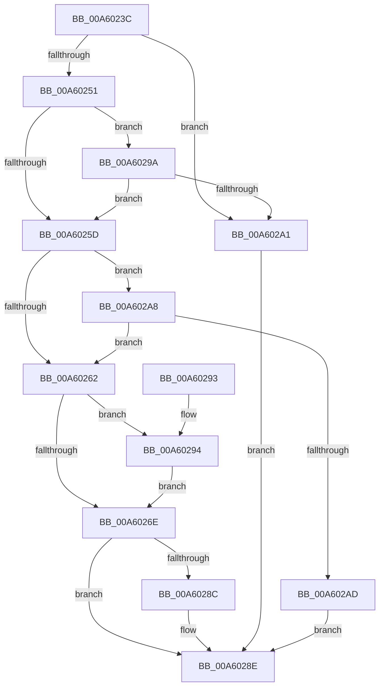

# CmpTransSearchAddTransFromRm

- RVA: `0x00A6023C`–`0x00A602B4` (길이 `120` bytes)
- VA: `0x0000000140A6023C`
- 실행 섹션: `PAGE`
- PDB 이름 있음: `예`; PDB Function 태그: `아니요`
- unwind 정보 RVA: `0x000B2F3C`
- 디코드: `37`개 명령, `120/120` bytes 표시
- 미해석 바이트: `0` (있으면 어셈블리에 `.byte`로 보존)

> 이 문서는 커널 이미지의 기계어와 PDB 기호를 분석해 생성했습니다. 4번과 5번은 함수 원형과 자료형을 바이너리 사용 방식에서 추정한 C 해석이며 원본 소스 복구 결과는 아닙니다.

## 1. Dependencies

- 직접 호출 지점: **1**; 고유 호출 대상: **1**
- 직접 호출자로 확인된 함수: **4**
- RIP 상대 이미지 참조: **2**

### Outgoing calls
- `0x00A60283` → [CmpTransSearchAddTrans](../87/CmpTransSearchAddTrans_function_008743FC.md) (function, `0x008743FC`)

### Direct callers
- [CmpRecoverEnlistment](../7F/CmpRecoverEnlistment_function_007F0014.md) at `0x007F0082`
- [CmpRmAnalysisPhase](../7F/CmpRmAnalysisPhase_function_007F0568.md) at `0x007F0657`
- [CmpRmReDoPhase](../7F/CmpRmReDoPhase_function_007F0794.md) at `0x007F084C`
- [CmpDoParseKey](../85/CmpDoParseKey_function_0085F750.md) at `0x00860AF1`
- [CmpDoParseKey](../85/CmpDoParseKey_function_0085F750.md) at `0x00861453`

### Static image references
- `0x00A60251` → RVA `0x00EEFC78` (`.data`; read)
- `0x00A60262` → RVA `0x00E09AE0` (`.data`; read)

## 2. Other-region calls and transfers

- 다른 실행 섹션으로 향하는 call: **0**
- 별도 외부 분기/꼬리 이동을 확인하지 못했습니다.

## 3. Assembly (complete function range)

```asm
00A6023C  48 83 EC 38                     sub rsp, 0x38
00A60240  4D 8B D0                        mov r10, r8
00A60243  4C 8B C1                        mov r8, rcx
00A60246  45 8B D9                        mov r11d, r9d
00A60249  48 8B C2                        mov rax, rdx
00A6024C  48 85 C9                        test rcx, rcx
00A6024F  74 50                           je 0x140a602a1
00A60251  48 8B 0D 20 FA 48 00            mov rcx, qword ptr [rip + 0x48fa20]
00A60258  4C 3B C1                        cmp r8, rcx
00A6025B  75 3D                           jne 0x140a6029a
00A6025D  48 85 C0                        test rax, rax
00A60260  74 46                           je 0x140a602a8
00A60262  4C 8B 0D 77 98 3A 00            mov r9, qword ptr [rip + 0x3a9877]
00A60269  4C 3B C1                        cmp r8, rcx
00A6026C  75 26                           jne 0x140a60294
00A6026E  48 8B 4C 24 60                  mov rcx, qword ptr [rsp + 0x60]
00A60273  49 8B D2                        mov rdx, r10
00A60276  48 89 4C 24 28                  mov qword ptr [rsp + 0x28], rcx
00A6027B  48 8B C8                        mov rcx, rax
00A6027E  44 89 5C 24 20                  mov dword ptr [rsp + 0x20], r11d
00A60283  E8 74 41 E1 FF                  call 0x1408743fc
00A60288  85 C0                           test eax, eax
00A6028A  78 02                           js 0x140a6028e
00A6028C  33 C0                           xor eax, eax
00A6028E  48 83 C4 38                     add rsp, 0x38
00A60292  C3                              ret
00A60293  CC                              int3
00A60294  4D 8B 48 50                     mov r9, qword ptr [r8 + 0x50]
00A60298  EB D4                           jmp 0x140a6026e
00A6029A  49 83 78 50 00                  cmp qword ptr [r8 + 0x50], 0
00A6029F  75 BC                           jne 0x140a6025d
00A602A1  B8 05 00 19 C0                  mov eax, 0xc0190005
00A602A6  EB E6                           jmp 0x140a6028e
00A602A8  4D 85 D2                        test r10, r10
00A602AB  75 B5                           jne 0x140a60262
00A602AD  B8 02 00 19 C0                  mov eax, 0xc0190002
00A602B2  EB DA                           jmp 0x140a6028e
```

## 4. C-style interpretation (structured pseudocode)

```c
__int64 __fastcall CmpTransSearchAddTransFromRm(__int64 a1, __int64 a2, __int64 a3, int a4, __int64 a5)
{
    __int64 result;
    __int64 v_rsp;
    unsigned __int64 v_stack_m10;
    unsigned int v_stack_m18;

    v_rsp = (v_rsp) - (56);
    if (a1 == 0) goto loc_00A602A1;
    if (a1 != (*(unsigned __int64 *)(v_rip + 4782624))) goto loc_00A6029A;
loc_00A6025D:
    if (a2 == 0) goto loc_00A602A8;
loc_00A60262:
    if (a1 != (*(unsigned __int64 *)(v_rip + 4782624))) goto loc_00A60294;
loc_00A6026E:
    v_stack_m10 = a5;
    v_stack_m18 = (unsigned int)((unsigned int)(a4));
    result = CmpTransSearchAddTrans(a2, a3, a1, *(unsigned __int64 *)(v_rip + 3840119));
    if (!(sign_flag)) {
        result = 0;
    }
    v_rsp = (v_rsp) + (56);
    return result;
loc_00A60294:
    goto loc_00A6026E;
loc_00A6029A:
    if ((*(unsigned __int64 *)(a1 + 80)) != 0) goto loc_00A6025D;
loc_00A602A1:
    goto loc_00A6028E;
loc_00A602A8:
    if (a3 != 0) goto loc_00A60262;
    goto loc_00A6028E;
}
```

## 5. (Beta) C Style

```c
int64_t CmpTransSearchAddTransFromRm(int64_t Arg1, int64_t Arg2, int64_t Arg3, int32_t Arg4, int64_t Arg5)
{
    int64_t result;
    int64_t local_rsp;
    uint64_t v_stack_m10;
    uint32_t v_stack_m18;

    local_rsp = (local_rsp) - (56);
    if (Arg1 == 0) goto loc_00A602A1;
    if (Arg1 != (*(uint64_t *)(v_rip + 0x48FA20))) goto loc_00A6029A;
loc_00A6025D:
    if (Arg2 == 0) goto loc_00A602A8;
loc_00A60262:
    if (Arg1 != (*(uint64_t *)(v_rip + 0x48FA20))) goto loc_00A60294;
loc_00A6026E:
    v_stack_m10 = Arg5;
    v_stack_m18 = (uint32_t)((uint32_t)(Arg4));
    result = CmpTransSearchAddTrans(Arg2, Arg3, Arg1, *(uint64_t *)(v_rip + 0x3A9877));
    if (!(sign_flag)) {
        result = 0;
    }
    local_rsp = (local_rsp) + (56);
    return result;
loc_00A60294:
    goto loc_00A6026E;
loc_00A6029A:
    if ((*(uint64_t *)(Arg1 + 0x50)) != 0) goto loc_00A6025D;
loc_00A602A1:
    goto loc_00A6028E;
loc_00A602A8:
    if (Arg3 != 0) goto loc_00A60262;
    goto loc_00A6028E;
}
```

## 6. Execution-region graph

[열기: 2D/3D 그래프와 함수 탐색 컨트롤 패널](../../../control-panel.html?section=page&rva=0x00A6023C&view=graph)

- 2D 그래프는 위에서 아래로 흐르고, 3D 그래프는 빈 공간을 드래그해 회전합니다. Shift+드래그는 이동, 휠은 확대·축소, 함수 노드 선택은 대상 보고서 이동입니다.

### Static fallback


