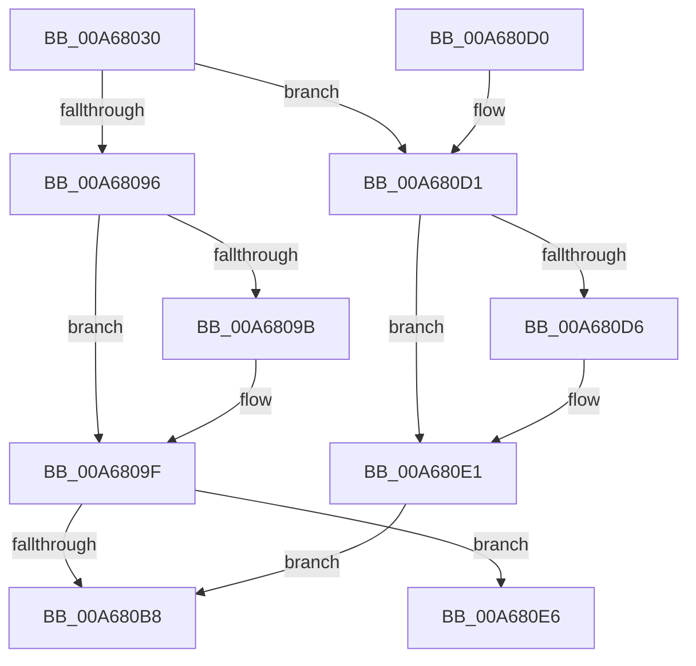

# CmpTryToLockHashEntryExclusive

- RVA: `0x00A68030`–`0x00A68101` (길이 `209` bytes)
- VA: `0x0000000140A68030`
- 실행 섹션: `PAGE`
- PDB 이름 있음: `예`; PDB Function 태그: `아니요`
- unwind 정보 RVA: `0x000B3DA0`
- 디코드: `59`개 명령, `209/209` bytes 표시
- 미해석 바이트: `0` (있으면 어셈블리에 `.byte`로 보존)

> 이 문서는 커널 이미지의 기계어와 PDB 기호를 분석해 생성했습니다. 4번과 5번은 함수 원형과 자료형을 바이너리 사용 방식에서 추정한 C 해석이며 원본 소스 복구 결과는 아닙니다.

## 1. Dependencies

- 직접 호출 지점: **4**; 고유 호출 대상: **4**
- 직접 호출자로 확인된 함수: **1**
- RIP 상대 이미지 참조: **0**

### Outgoing calls
- `0x00A68089` → [KeAbPreAcquire](../../text/21/KeAbPreAcquire_function_00210230.md) (function, `0x00210230`)
- `0x00A680AF` → [CmpReferenceHive](../84/CmpReferenceHive_function_0084FCF0.md) (function, `0x0084FCF0`)
- `0x00A680DC` → [KeAbPostReleaseEx](../../text/26/KeAbPostReleaseEx_function_00262210.md) (function, `0x00262210`)
- `0x00A680FB` → [KeBugCheckEx](../../text/4F/KeBugCheckEx_function_004FD660.md) (function, `0x004FD660`)

### Direct callers
- [CmpDoParseKey](../85/CmpDoParseKey_function_0085F750.md) at `0x00861482`

### Static image references
- 디코드된 RIP-relative 메모리 참조가 없습니다.

## 2. Other-region calls and transfers

- 다른 실행 섹션으로 향하는 call: **3**
  - `0x00A68089` → [KeAbPreAcquire](../../text/21/KeAbPreAcquire_function_00210230.md) (`PAGE` → `.text`)
  - `0x00A680DC` → [KeAbPostReleaseEx](../../text/26/KeAbPostReleaseEx_function_00262210.md) (`PAGE` → `.text`)
  - `0x00A680FB` → [KeBugCheckEx](../../text/4F/KeBugCheckEx_function_004FD660.md) (`PAGE` → `.text`)
- 별도 외부 분기/꼬리 이동을 확인하지 못했습니다.

## 3. Assembly (complete function range)

```asm
00A68030  48 89 5C 24 08                  mov qword ptr [rsp + 8], rbx
00A68035  48 89 6C 24 10                  mov qword ptr [rsp + 0x10], rbp
00A6803A  48 89 74 24 18                  mov qword ptr [rsp + 0x18], rsi
00A6803F  57                              push rdi
00A68040  48 83 EC 30                     sub rsp, 0x30
00A68044  8B C2                           mov eax, edx
00A68046  8B DA                           mov ebx, edx
00A68048  C1 E8 09                        shr eax, 9
00A6804B  48 8B E9                        mov rbp, rcx
00A6804E  33 C2                           xor eax, edx
00A68050  BF 01 00 00 00                  mov edi, 1
00A68055  69 C0 A3 8A 01 00               imul eax, eax, 0x18aa3
00A6805B  8B D0                           mov edx, eax
00A6805D  44 8B C0                        mov r8d, eax
00A68060  8B 81 78 06 00 00               mov eax, dword ptr [rcx + 0x678]
00A68066  49 C1 E8 09                     shr r8, 9
00A6806A  2B C7                           sub eax, edi
00A6806C  4C 33 C2                        xor r8, rdx
00A6806F  33 D2                           xor edx, edx
00A68071  4C 23 C0                        and r8, rax
00A68074  48 8B 85 70 06 00 00            mov rax, qword ptr [rbp + 0x670]
00A6807B  4B 8D 0C 40                     lea rcx, [r8 + r8*2]
00A6807F  44 8B C7                        mov r8d, edi
00A68082  48 8D 34 C8                     lea rsi, [rax + rcx*8]
00A68086  48 8B CE                        mov rcx, rsi
00A68089  E8 A2 81 7A FF                  call 0x140210230
00A6808E  F0 48 0F BA 2E 00               lock bts qword ptr [rsi], 0
00A68094  72 3B                           jb 0x140a680d1
00A68096  48 85 C0                        test rax, rax
00A68099  74 04                           je 0x140a6809f
00A6809B  40 88 78 0A                     mov byte ptr [rax + 0xa], dil
00A6809F  65 48 8B 04 25 88 01 00 00      mov rax, qword ptr gs:[0x188]
00A680A8  48 8B CD                        mov rcx, rbp
00A680AB  48 89 46 08                     mov qword ptr [rsi + 8], rax
00A680AF  E8 3C 7C DE FF                  call 0x14084fcf0
00A680B4  84 C0                           test al, al
00A680B6  74 2E                           je 0x140a680e6
00A680B8  48 8B 5C 24 40                  mov rbx, qword ptr [rsp + 0x40]
00A680BD  40 8A C7                        mov al, dil
00A680C0  48 8B 6C 24 48                  mov rbp, qword ptr [rsp + 0x48]
00A680C5  48 8B 74 24 50                  mov rsi, qword ptr [rsp + 0x50]
00A680CA  48 83 C4 30                     add rsp, 0x30
00A680CE  5F                              pop rdi
00A680CF  C3                              ret
00A680D0  CC                              int3
00A680D1  48 85 C0                        test rax, rax
00A680D4  74 0B                           je 0x140a680e1
00A680D6  48 8B D0                        mov rdx, rax
00A680D9  48 8B CE                        mov rcx, rsi
00A680DC  E8 2F A1 7F FF                  call 0x140262210
00A680E1  40 32 FF                        xor dil, dil
00A680E4  EB D2                           jmp 0x140a680b8
00A680E6  41 B9 0D 00 00 00               mov r9d, 0xd
00A680EC  48 89 5C 24 20                  mov qword ptr [rsp + 0x20], rbx
00A680F1  4C 8B C5                        mov r8, rbp
00A680F4  41 8D 51 0A                     lea edx, [r9 + 0xa]
00A680F8  8D 4A 3A                        lea ecx, [rdx + 0x3a]
00A680FB  E8 60 55 A9 FF                  call 0x1404fd660
00A68100  CC                              int3
```

## 4. C-style interpretation (structured pseudocode)

```c
__int64 __fastcall CmpTryToLockHashEntryExclusive(__int64 a1, int a2)
{
    __int64 result;
    __int64 v_rdi;
    __int64 v_rsp;
    unsigned __int64 v_stack_p10;
    unsigned __int64 v_stack_p18;
    unsigned __int64 v_stack_p20;
    unsigned __int64 v_stack_p8;

    v_stack_p8 = v_rbx;
    v_stack_p10 = v_rbp;
    v_stack_p18 = v_rsi;
    v_rsp = (v_rsp) - (48);
    result = (unsigned int)(((unsigned int)(a2)) >> (9));
    result = (unsigned int)((result) ^ (a2));
    result = (unsigned int)((result) * ((unsigned int)(result)));
    a3 = ((unsigned int)((unsigned int)(result))) >> (9);
    result = (unsigned int)(((unsigned int)(*(unsigned int *)(a1 + 1656))) - (1));
    a3 = (a3) ^ ((unsigned int)((unsigned int)(result)));
    a2 = 0;
    a3 = (a3) & (result);
    result = KeAbPreAcquire(*(unsigned __int64 *)(a1 + 1648) + a3 + a3 * 2 * 8, a2, 1, a4);
    if (condition_is_below) goto loc_00A680D1;
    if (result != 0) {
        *(unsigned __int8 *)(result + 10) = 1;
    }
    *(unsigned __int64 *)(*(unsigned __int64 *)(a1 + 1648) + a3 + a3 * 2 * 8 + 8) = *(unsigned __int64 *)(gs_base + (0 + 392));
    result = CmpReferenceHive(a1, a2, 1, a4);
    if ((unsigned __int8)(result) == 0) goto loc_00A680E6;
loc_00A680B8:
    v_rsp = (v_rsp) + (48);
    return 1;
loc_00A680D1:
    result = 1;
    if (1 != 0) {
        a2 = 1;
        a1 = v_stack_p18;
        result = KeAbPostReleaseEx(a1, a2, 1, a4);
    }
    v_rdi = 0;
    goto loc_00A680B8;
loc_00A680E6:
    v_stack_p20 = v_stack_p8;
    result = KeBugCheckEx(13 + 10 + 58, 13 + 10, v_stack_p10, 13);
    return result;
}
```

## 5. (Beta) C Style

```c
int64_t CmpTryToLockHashEntryExclusive(void *Arg1, int32_t Arg2)
{
    uint8_t *arg1 = (uint8_t *)Arg1;

    int64_t result;
    int64_t local_rdi;
    int64_t local_rsp;
    uint64_t v_stack_p10;
    uint64_t v_stack_p18;
    uint64_t v_stack_p20;
    uint64_t v_stack_p8;

    v_stack_p8 = local_rbx;
    v_stack_p10 = local_rbp;
    v_stack_p18 = local_rsi;
    local_rsp = (local_rsp) - (48);
    result = (uint32_t)(((uint32_t)(Arg2)) >> (9));
    result = (uint32_t)((result) ^ (Arg2));
    result = (uint32_t)((result) * ((uint32_t)(result)));
    a3 = ((uint32_t)((uint32_t)(result))) >> (9);
    result = (uint32_t)(((uint32_t)(*(uint32_t *)(arg1 + 0x678))) - (1));
    a3 = (a3) ^ ((uint32_t)((uint32_t)(result)));
    Arg2 = 0;
    a3 = (a3) & (result);
    result = KeAbPreAcquire(*(uint64_t *)(arg1 + 0x670) + a3 + a3 * 2 * 8, Arg2, 1, a4);
    if (condition_is_below) goto loc_00A680D1;
    if (result != 0) {
        *(uint8_t *)(result + 0xA) = 1;
    }
    *(uint64_t *)(*(uint64_t *)(arg1 + 0x670) + a3 + a3 * 2 * 8 + 0x8) = *(uint64_t *)(gs_base + (0 + 0x188));
    result = CmpReferenceHive(Arg1, Arg2, 1, a4);
    if ((uint8_t)(result) == 0) goto loc_00A680E6;
loc_00A680B8:
    local_rsp = (local_rsp) + (48);
    return 1;
loc_00A680D1:
    result = 1;
    if (1 != 0) {
        Arg2 = 1;
        Arg1 = v_stack_p18;
        result = KeAbPostReleaseEx(Arg1, Arg2, 1, a4);
    }
    local_rdi = 0;
    goto loc_00A680B8;
loc_00A680E6:
    v_stack_p20 = v_stack_p8;
    result = KeBugCheckEx(13 + 10 + 58, 13 + 10, v_stack_p10, 13);
    return result;
}
```

### 관측된 메모리 오프셋

구조체 형식이 확인되지 않은 접근은 인자 기준의 오프셋으로만 기록했습니다.

| 기준 인자 | 오프셋 표현 | 폭 (bit) | 접근 |
|---|---:|---:|---|
| `Arg1` | `+ 0x670` | `64` | `R` |
| `Arg1` | `+ 0x678` | `32` | `R` |

## 6. Execution-region graph

[열기: 2D/3D 그래프와 함수 탐색 컨트롤 패널](../../../control-panel.html?section=page&rva=0x00A68030&view=graph)

- 2D 그래프는 위에서 아래로 흐르고, 3D 그래프는 빈 공간을 드래그해 회전합니다. Shift+드래그는 이동, 휠은 확대·축소, 함수 노드 선택은 대상 보고서 이동입니다.

### Static fallback


