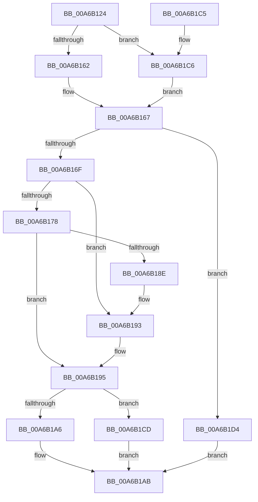

# CmpUpdateHiveRootCellFlags

- RVA: `0x00A6B124`–`0x00A6B1DB` (길이 `183` bytes)
- VA: `0x0000000140A6B124`
- 실행 섹션: `PAGE`
- PDB 이름 있음: `예`; PDB Function 태그: `아니요`
- unwind 정보 RVA: `0x00090A68`
- 디코드: `55`개 명령, `183/183` bytes 표시
- 미해석 바이트: `0` (있으면 어셈블리에 `.byte`로 보존)

> 이 문서는 커널 이미지의 기계어와 PDB 기호를 분석해 생성했습니다. 4번과 5번은 함수 원형과 자료형을 바이너리 사용 방식에서 추정한 C 해석이며 원본 소스 복구 결과는 아닙니다.

## 1. Dependencies

- 직접 호출 지점: **8**; 고유 호출 대상: **8**
- 직접 호출자로 확인된 함수: **1**
- RIP 상대 이미지 참조: **0**

### Outgoing calls
- `0x00A6B142` → [HvpGetCellContextInitialize](../85/HvpGetCellContextInitialize_function_00855F10.md) (function, `0x00855F10`)
- `0x00A6B14A` → [HvLockHiveFlusherShared](../84/HvLockHiveFlusherShared_function_0084F95C.md) (function, `0x0084F95C`)
- `0x00A6B162` → [HvpGetCellFlat](../85/HvpGetCellFlat_function_00854C60.md) (function, `0x00854C60`)
- `0x00A6B183` → [HvpMarkCellDirty](../85/HvpMarkCellDirty_function_00858080.md) (function, `0x00858080`)
- `0x00A6B1A6` → [HvpReleaseCellPaged](../85/HvpReleaseCellPaged_function_00855F40.md) (function, `0x00855F40`)
- `0x00A6B1AE` → [HvUnlockHiveFlusherShared](../84/HvUnlockHiveFlusherShared_function_00848738.md) (function, `0x00848738`)
- `0x00A6B1C6` → [HvpGetCellPaged](../85/HvpGetCellPaged_function_00854CB0.md) (function, `0x00854CB0`)
- `0x00A6B1CD` → [HvpReleaseCellFlat](../85/HvpReleaseCellFlat_function_0085CC20.md) (function, `0x0085CC20`)

### Direct callers
- [CmpDoParseKey](../85/CmpDoParseKey_function_0085F750.md) at `0x00861AF1`

### Static image references
- 디코드된 RIP-relative 메모리 참조가 없습니다.

## 2. Other-region calls and transfers

- 다른 실행 섹션으로 향하는 call: **0**
- 별도 외부 분기/꼬리 이동을 확인하지 못했습니다.

## 3. Assembly (complete function range)

```asm
00A6B124  48 8B C4                        mov rax, rsp
00A6B127  48 89 58 10                     mov qword ptr [rax + 0x10], rbx
00A6B12B  48 89 70 18                     mov qword ptr [rax + 0x18], rsi
00A6B12F  57                              push rdi
00A6B130  48 83 EC 20                     sub rsp, 0x20
00A6B134  48 83 60 08 00                  and qword ptr [rax + 8], 0
00A6B139  48 8B D9                        mov rbx, rcx
00A6B13C  48 8D 48 08                     lea rcx, [rax + 8]
00A6B140  8B F2                           mov esi, edx
00A6B142  E8 C9 AD DE FF                  call 0x140855f10
00A6B147  48 8B CB                        mov rcx, rbx
00A6B14A  E8 0D 48 DE FF                  call 0x14084f95c
00A6B14F  F6 83 8C 00 00 00 01            test byte ptr [rbx + 0x8c], 1
00A6B156  4C 8D 44 24 30                  lea r8, [rsp + 0x30]
00A6B15B  8B D6                           mov edx, esi
00A6B15D  48 8B CB                        mov rcx, rbx
00A6B160  74 64                           je 0x140a6b1c6
00A6B162  E8 F9 9A DE FF                  call 0x140854c60
00A6B167  48 8B F8                        mov rdi, rax
00A6B16A  48 85 C0                        test rax, rax
00A6B16D  74 65                           je 0x140a6b1d4
00A6B16F  8A 40 02                        mov al, byte ptr [rax + 2]
00A6B172  24 0C                           and al, 0xc
00A6B174  3C 0C                           cmp al, 0xc
00A6B176  74 1B                           je 0x140a6b193
00A6B178  45 33 C9                        xor r9d, r9d
00A6B17B  45 33 C0                        xor r8d, r8d
00A6B17E  8B D6                           mov edx, esi
00A6B180  48 8B CB                        mov rcx, rbx
00A6B183  E8 F8 CE DE FF                  call 0x140858080
00A6B188  8B F0                           mov esi, eax
00A6B18A  85 C0                           test eax, eax
00A6B18C  78 07                           js 0x140a6b195
00A6B18E  66 83 4F 02 0C                  or word ptr [rdi + 2], 0xc
00A6B193  33 F6                           xor esi, esi
00A6B195  F6 83 8C 00 00 00 01            test byte ptr [rbx + 0x8c], 1
00A6B19C  48 8D 54 24 30                  lea rdx, [rsp + 0x30]
00A6B1A1  48 8B CB                        mov rcx, rbx
00A6B1A4  75 27                           jne 0x140a6b1cd
00A6B1A6  E8 95 AD DE FF                  call 0x140855f40
00A6B1AB  48 8B CB                        mov rcx, rbx
00A6B1AE  E8 85 D5 DD FF                  call 0x140848738
00A6B1B3  48 8B 5C 24 38                  mov rbx, qword ptr [rsp + 0x38]
00A6B1B8  8B C6                           mov eax, esi
00A6B1BA  48 8B 74 24 40                  mov rsi, qword ptr [rsp + 0x40]
00A6B1BF  48 83 C4 20                     add rsp, 0x20
00A6B1C3  5F                              pop rdi
00A6B1C4  C3                              ret
00A6B1C5  CC                              int3
00A6B1C6  E8 E5 9A DE FF                  call 0x140854cb0
00A6B1CB  EB 9A                           jmp 0x140a6b167
00A6B1CD  E8 4E 1A DF FF                  call 0x14085cc20
00A6B1D2  EB D7                           jmp 0x140a6b1ab
00A6B1D4  BE 9A 00 00 C0                  mov esi, 0xc000009a
00A6B1D9  EB D0                           jmp 0x140a6b1ab
```

## 4. C-style interpretation (structured pseudocode)

```c
__int64 __fastcall CmpUpdateHiveRootCellFlags(__int64 a1, int a2, __int64 a3, int a4)
{
    __int64 result;
    __int64 v_rsi;
    __int64 v_rsp;
    unsigned __int64 v_stack_p10;
    unsigned __int64 v_stack_p18;
    unsigned __int64 v_stack_p8;

    *(unsigned __int64 *)(v_rsp + 16) = v_rbx;
    *(unsigned __int64 *)(v_rsp + 24) = v_rsi;
    v_rsp = (v_rsp) - (32);
    result = HvpGetCellContextInitialize(v_rsp + 8, a2, a3, a4);
    result = HvLockHiveFlusherShared(a1, a2, a3, a4);
    if (((*(unsigned __int8 *)(a1 + 140)) & (1)) == 0) goto loc_00A6B1C6;
    result = HvpGetCellFlat(a1, (unsigned int)((unsigned int)((unsigned int)(a2))), v_stack_p8, a4);
loc_00A6B167:
    if (result == 0) goto loc_00A6B1D4;
    result = (unsigned __int8)((*(unsigned __int8 *)(result + 2)) & (12));
    if (((unsigned __int8)(result)) == 12) goto loc_00A6B193;
    a4 = 0;
    a3 = 0;
    result = HvpMarkCellDirty(a1, (unsigned int)((unsigned int)((unsigned int)(a2))), a3, a4);
    if (sign_flag) goto loc_00A6B195;
loc_00A6B193:
    v_rsi = 0;
loc_00A6B195:
    if (((*(unsigned __int8 *)(a1 + 140)) & (1)) != 0) goto loc_00A6B1CD;
    result = HvpReleaseCellPaged(a1, v_stack_p8, a3, a4);
loc_00A6B1AB:
    result = HvUnlockHiveFlusherShared(a1, v_stack_p8, a3, a4);
    v_rsp = (v_rsp) + (32);
    return 0;
loc_00A6B1C6:
    result = HvpGetCellPaged(a1, v_stack_p8, a3, a4);
    goto loc_00A6B167;
loc_00A6B1CD:
    result = HvpReleaseCellFlat(a1, v_stack_p8, a3, a4);
    goto loc_00A6B1AB;
loc_00A6B1D4:
    goto loc_00A6B1AB;
}
```

## 5. (Beta) C Style

```c
int64_t CmpUpdateHiveRootCellFlags(void *Arg1, int32_t Arg2, int64_t Arg3, int32_t Arg4)
{
    uint8_t *arg1 = (uint8_t *)Arg1;

    int64_t result;
    int64_t local_rsi;
    int64_t local_rsp;
    uint64_t v_stack_p10;
    uint64_t v_stack_p18;
    uint64_t v_stack_p8;

    *(uint64_t *)(local_rsp + 0x10) = local_rbx;
    *(uint64_t *)(local_rsp + 0x18) = local_rsi;
    local_rsp = (local_rsp) - (32);
    result = HvpGetCellContextInitialize(local_rsp + 8, Arg2, Arg3, Arg4);
    result = HvLockHiveFlusherShared(Arg1, Arg2, Arg3, Arg4);
    if (((*(uint8_t *)(arg1 + 0x8C)) & (1)) == 0) goto loc_00A6B1C6;
    result = HvpGetCellFlat(Arg1, (uint32_t)((uint32_t)((uint32_t)(Arg2))), v_stack_p8, Arg4);
loc_00A6B167:
    if (result == 0) goto loc_00A6B1D4;
    result = (uint8_t)((*(uint8_t *)(result + 0x2)) & (12));
    if (((uint8_t)(result)) == 12) goto loc_00A6B193;
    Arg4 = 0;
    Arg3 = 0;
    result = HvpMarkCellDirty(Arg1, (uint32_t)((uint32_t)((uint32_t)(Arg2))), Arg3, Arg4);
    if (sign_flag) goto loc_00A6B195;
loc_00A6B193:
    local_rsi = 0;
loc_00A6B195:
    if (((*(uint8_t *)(arg1 + 0x8C)) & (1)) != 0) goto loc_00A6B1CD;
    result = HvpReleaseCellPaged(Arg1, v_stack_p8, Arg3, Arg4);
loc_00A6B1AB:
    result = HvUnlockHiveFlusherShared(Arg1, v_stack_p8, Arg3, Arg4);
    local_rsp = (local_rsp) + (32);
    return 0;
loc_00A6B1C6:
    result = HvpGetCellPaged(Arg1, v_stack_p8, Arg3, Arg4);
    goto loc_00A6B167;
loc_00A6B1CD:
    result = HvpReleaseCellFlat(Arg1, v_stack_p8, Arg3, Arg4);
    goto loc_00A6B1AB;
loc_00A6B1D4:
    goto loc_00A6B1AB;
}
```

### 관측된 메모리 오프셋

구조체 형식이 확인되지 않은 접근은 인자 기준의 오프셋으로만 기록했습니다.

| 기준 인자 | 오프셋 표현 | 폭 (bit) | 접근 |
|---|---:|---:|---|
| `Arg1` | `+ 0x8C` | `8` | `R` |

## 6. Execution-region graph

[열기: 2D/3D 그래프와 함수 탐색 컨트롤 패널](../../../control-panel.html?section=page&rva=0x00A6B124&view=graph)

- 2D 그래프는 위에서 아래로 흐르고, 3D 그래프는 빈 공간을 드래그해 회전합니다. Shift+드래그는 이동, 휠은 확대·축소, 함수 노드 선택은 대상 보고서 이동입니다.

### Static fallback


