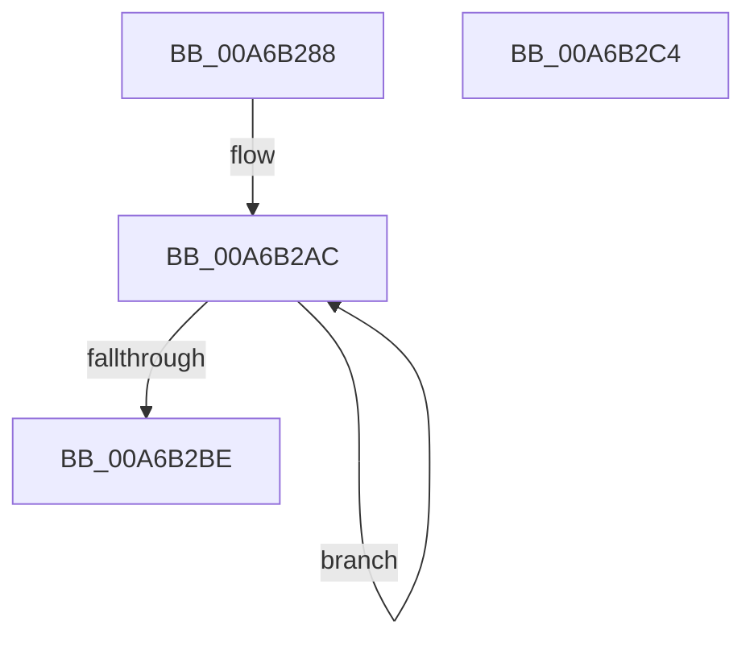

# CmpValueEnumStackInitialize

- RVA: `0x00A6B288`–`0x00A6B2C5` (길이 `61` bytes)
- VA: `0x0000000140A6B288`
- 실행 섹션: `PAGE`
- PDB 이름 있음: `예`; PDB Function 태그: `아니요`
- unwind 정보 RVA: `0x0005CF00`
- 디코드: `19`개 명령, `61/61` bytes 표시
- 미해석 바이트: `0` (있으면 어셈블리에 `.byte`로 보존)

> 이 문서는 커널 이미지의 기계어와 PDB 기호를 분석해 생성했습니다. 4번과 5번은 함수 원형과 자료형을 바이너리 사용 방식에서 추정한 C 해석이며 원본 소스 복구 결과는 아닙니다.

## 1. Dependencies

- 직접 호출 지점: **2**; 고유 호출 대상: **2**
- 직접 호출자로 확인된 함수: **1**
- RIP 상대 이미지 참조: **0**

### Outgoing calls
- `0x00A6B29B` → [memset](../../text/6C/memset_function_006C6C40.md) (function, `0x006C6C40`)
- `0x00A6B2AF` → [CmpValueEnumStackEntryInitialize](../../text/49/CmpValueEnumStackEntryInitialize_function_0049D4C4.md) (function, `0x0049D4C4`)

### Direct callers
- [CmpGetValueCountForKeyNodeStack](../../text/46/CmpGetValueCountForKeyNodeStack_function_0046B118.md) at `0x0046B174`

### Static image references
- 디코드된 RIP-relative 메모리 참조가 없습니다.

## 2. Other-region calls and transfers

- 다른 실행 섹션으로 향하는 call: **2**
  - `0x00A6B29B` → [memset](../../text/6C/memset_function_006C6C40.md) (`PAGE` → `.text`)
  - `0x00A6B2AF` → [CmpValueEnumStackEntryInitialize](../../text/49/CmpValueEnumStackEntryInitialize_function_0049D4C4.md) (`PAGE` → `.text`)
- 별도 외부 분기/꼬리 이동을 확인하지 못했습니다.

## 3. Assembly (complete function range)

```asm
00A6B288  40 53                           push rbx
00A6B28A  48 83 EC 20                     sub rsp, 0x20
00A6B28E  33 D2                           xor edx, edx
00A6B290  48 8B D9                        mov rbx, rcx
00A6B293  48 83 C1 04                     add rcx, 4
00A6B297  44 8D 42 54                     lea r8d, [rdx + 0x54]
00A6B29B  E8 A0 B9 C5 FF                  call 0x1406c6c40
00A6B2A0  83 0B FF                        or dword ptr [rbx], 0xffffffff
00A6B2A3  BA 02 00 00 00                  mov edx, 2
00A6B2A8  48 83 C3 10                     add rbx, 0x10
00A6B2AC  48 8B CB                        mov rcx, rbx
00A6B2AF  E8 10 22 A3 FF                  call 0x14049d4c4
00A6B2B4  48 83 C3 20                     add rbx, 0x20
00A6B2B8  48 83 EA 01                     sub rdx, 1
00A6B2BC  75 EE                           jne 0x140a6b2ac
00A6B2BE  48 83 C4 20                     add rsp, 0x20
00A6B2C2  5B                              pop rbx
00A6B2C3  C3                              ret
00A6B2C4  CC                              int3
```

## 4. C-style interpretation (structured pseudocode)

```c
__int64 __fastcall CmpValueEnumStackInitialize(__int64 a1, int a2)
{
    __int64 result;
    __int64 v_rbx;
    __int64 v_rsp;

    v_rsp = (v_rsp) - (32);
    a2 = 0;
    a1 = (a1) + (4);
    result = memset(a1, a2, a2 + 84, a4);
    v_rbx = (a1) + (16);
loc_00A6B2AC:
    result = CmpValueEnumStackEntryInitialize(v_rbx, 2, a2 + 84, a4);
    v_rbx = (v_rbx) + (32);
    a2 = (2) - (1);
    if (condition_is_not_equal) goto loc_00A6B2AC;
    v_rsp = (v_rsp) + (32);
    return result;
}
```

## 5. (Beta) C Style

```c
int64_t CmpValueEnumStackInitialize(void *Arg1, int32_t Arg2)
{
    uint8_t *arg1 = (uint8_t *)Arg1;

    int64_t result;
    int64_t local_rbx;
    int64_t local_rsp;

    local_rsp = (local_rsp) - (32);
    Arg2 = 0;
    Arg1 = (Arg1) + (4);
    result = memset(Arg1, Arg2, Arg2 + 84, a4);
    local_rbx = (Arg1) + (16);
loc_00A6B2AC:
    result = CmpValueEnumStackEntryInitialize(local_rbx, 2, Arg2 + 84, a4);
    local_rbx = (local_rbx) + (32);
    Arg2 = (2) - (1);
    if (condition_is_not_equal) goto loc_00A6B2AC;
    local_rsp = (local_rsp) + (32);
    return result;
}
```

### 관측된 메모리 오프셋

구조체 형식이 확인되지 않은 접근은 인자 기준의 오프셋으로만 기록했습니다.

| 기준 인자 | 오프셋 표현 | 폭 (bit) | 접근 |
|---|---:|---:|---|
| `Arg1` | `+ 0x0` | `32` | `R/W` |

## 6. Execution-region graph

[열기: 2D/3D 그래프와 함수 탐색 컨트롤 패널](../../../control-panel.html?section=page&rva=0x00A6B288&view=graph)

- 2D 그래프는 위에서 아래로 흐르고, 3D 그래프는 빈 공간을 드래그해 회전합니다. Shift+드래그는 이동, 휠은 확대·축소, 함수 노드 선택은 대상 보고서 이동입니다.

### Static fallback


