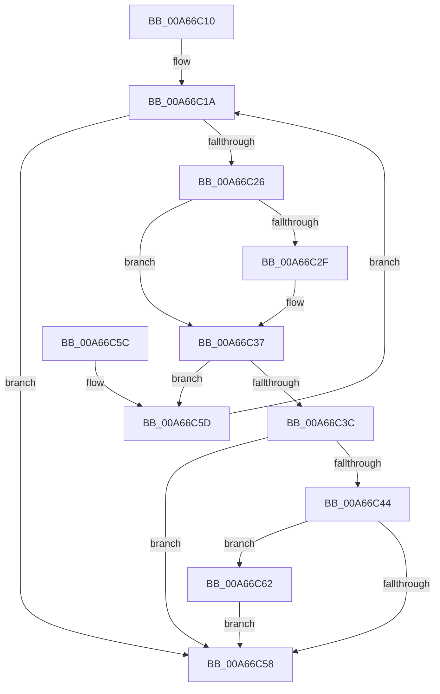

# CmpVolumeManagerGetContextForGuidUnsafe

- RVA: `0x00A66C10`–`0x00A66C6B` (길이 `91` bytes)
- VA: `0x0000000140A66C10`
- 실행 섹션: `PAGE`
- PDB 이름 있음: `예`; PDB Function 태그: `아니요`
- unwind 정보 RVA: `0x000DB714`
- 디코드: `28`개 명령, `91/91` bytes 표시
- 미해석 바이트: `0` (있으면 어셈블리에 `.byte`로 보존)

> 이 문서는 커널 이미지의 기계어와 PDB 기호를 분석해 생성했습니다. 4번과 5번은 함수 원형과 자료형을 바이너리 사용 방식에서 추정한 C 해석이며 원본 소스 복구 결과는 아닙니다.

## 1. Dependencies

- 직접 호출 지점: **0**; 고유 호출 대상: **0**
- 직접 호출자로 확인된 함수: **1**
- RIP 상대 이미지 참조: **1**

### Outgoing calls
- 직접 디코드된 call 명령이 없습니다.

### Direct callers
- [CmpVolumeManagerGetContextForFile](../95/CmpVolumeManagerGetContextForFile_function_009525A8.md) at `0x0095265D`
- [CmpVolumeManagerGetContextForFile](../95/CmpVolumeManagerGetContextForFile_function_009525A8.md) at `0x00952718`

### Static image references
- `0x00A66C10` → RVA `0x00FDA420` (`PAGEDATA`; read)

## 2. Other-region calls and transfers

- 다른 실행 섹션으로 향하는 call: **0**
- 별도 외부 분기/꼬리 이동을 확인하지 못했습니다.

## 3. Assembly (complete function range)

```asm
00A66C10  4C 8B 05 09 38 57 00            mov r8, qword ptr [rip + 0x573809]
00A66C17  45 33 C9                        xor r9d, r9d
00A66C1A  48 8D 05 FF 37 57 00            lea rax, [rip + 0x5737ff]
00A66C21  4C 3B C0                        cmp r8, rax
00A66C24  74 32                           je 0x140a66c58
00A66C26  49 8B 48 20                     mov rcx, qword ptr [r8 + 0x20]
00A66C2A  48 2B 0A                        sub rcx, qword ptr [rdx]
00A66C2D  75 08                           jne 0x140a66c37
00A66C2F  49 8B 48 28                     mov rcx, qword ptr [r8 + 0x28]
00A66C33  48 2B 4A 08                     sub rcx, qword ptr [rdx + 8]
00A66C37  48 85 C9                        test rcx, rcx
00A66C3A  75 21                           jne 0x140a66c5d
00A66C3C  4D 8B C8                        mov r9, r8
00A66C3F  4D 85 C0                        test r8, r8
00A66C42  74 14                           je 0x140a66c58
00A66C44  B9 01 00 00 00                  mov ecx, 1
00A66C49  F0 49 0F C1 48 18               lock xadd qword ptr [r8 + 0x18], rcx
00A66C4F  48 FF C1                        inc rcx
00A66C52  48 83 F9 01                     cmp rcx, 1
00A66C56  7E 0A                           jle 0x140a66c62
00A66C58  49 8B C1                        mov rax, r9
00A66C5B  C3                              ret
00A66C5C  CC                              int3
00A66C5D  4D 8B 00                        mov r8, qword ptr [r8]
00A66C60  EB B8                           jmp 0x140a66c1a
00A66C62  B9 0E 00 00 00                  mov ecx, 0xe
00A66C67  CD 29                           int 0x29
00A66C69  EB ED                           jmp 0x140a66c58
```

## 4. C-style interpretation (structured pseudocode)

```c
__int64 __fastcall CmpVolumeManagerGetContextForGuidUnsafe(__int64 a1, __int64 a2, __int64 a3, int a4)
{
    a4 = 0;
loc_00A66C1A:
    if ((*(unsigned __int64 *)(v_rip + 5715977)) == (v_rip + 5715967)) goto loc_00A66C58;
    a1 = (*(unsigned __int64 *)(*(unsigned __int64 *)(v_rip + 5715977) + 32)) - (*(unsigned __int64 *)(a2));
    if (!(condition_is_not_equal)) {
        a1 = *(unsigned __int64 *)(*(unsigned __int64 *)(v_rip + 5715977) + 40);
        a1 = (a1) - (*(unsigned __int64 *)(a2 + 8));
    }
    if (a1 != 0) goto loc_00A66C5D;
    if (*(unsigned __int64 *)(v_rip + 5715977) == 0) goto loc_00A66C58;
    a1 = (1) + 1;
    if (a1 <= 1) goto loc_00A66C62;
loc_00A66C58:
    return *(unsigned __int64 *)(v_rip + 5715977);
loc_00A66C5D:
    goto loc_00A66C1A;
loc_00A66C62:
    goto loc_00A66C58;
}
```

## 5. (Beta) C Style

```c
int64_t CmpVolumeManagerGetContextForGuidUnsafe(int64_t Arg1, void *Arg2, int64_t Arg3, int32_t Arg4)
{
    uint8_t *arg2 = (uint8_t *)Arg2;

    Arg4 = 0;
loc_00A66C1A:
    if ((*(uint64_t *)(v_rip + 0x573809)) == (v_rip + 5715967)) goto loc_00A66C58;
    Arg1 = (*(uint64_t *)(*(uint64_t *)(v_rip + 0x573809) + 0x20)) - (*(uint64_t *)(arg2));
    if (!(condition_is_not_equal)) {
        Arg1 = *(uint64_t *)(*(uint64_t *)(v_rip + 0x573809) + 0x28);
        Arg1 = (Arg1) - (*(uint64_t *)(arg2 + 0x8));
    }
    if (Arg1 != 0) goto loc_00A66C5D;
    if (*(uint64_t *)(v_rip + 0x573809) == 0) goto loc_00A66C58;
    Arg1 = (1) + 1;
    if (Arg1 <= 1) goto loc_00A66C62;
loc_00A66C58:
    return *(uint64_t *)(v_rip + 0x573809);
loc_00A66C5D:
    goto loc_00A66C1A;
loc_00A66C62:
    goto loc_00A66C58;
}
```

### 관측된 메모리 오프셋

구조체 형식이 확인되지 않은 접근은 인자 기준의 오프셋으로만 기록했습니다.

| 기준 인자 | 오프셋 표현 | 폭 (bit) | 접근 |
|---|---:|---:|---|
| `Arg2` | `+ 0x0` | `64` | `R` |
| `Arg2` | `+ 0x8` | `64` | `R` |

## 6. Execution-region graph

[열기: 2D/3D 그래프와 함수 탐색 컨트롤 패널](../../../control-panel.html?section=page&rva=0x00A66C10&view=graph)

- 2D 그래프는 위에서 아래로 흐르고, 3D 그래프는 빈 공간을 드래그해 회전합니다. Shift+드래그는 이동, 휠은 확대·축소, 함수 노드 선택은 대상 보고서 이동입니다.

### Static fallback


