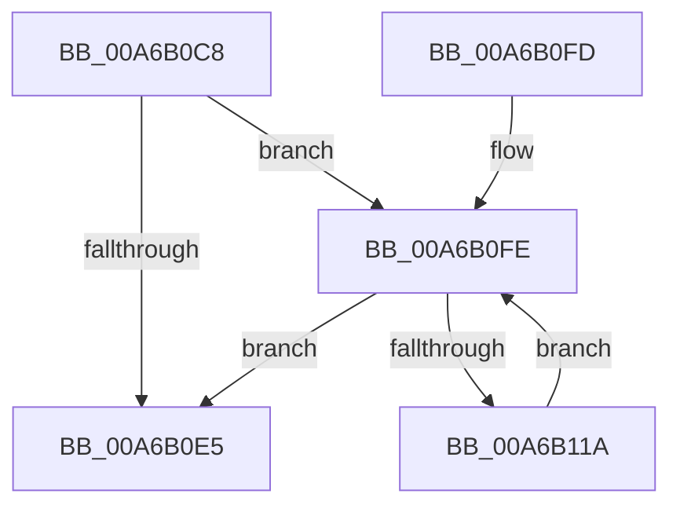

# CmpWakeWriteQueueWaiters

- RVA: `0x00A6B0C8`–`0x00A6B11C` (길이 `84` bytes)
- VA: `0x0000000140A6B0C8`
- 실행 섹션: `PAGE`
- PDB 이름 있음: `예`; PDB Function 태그: `아니요`
- unwind 정보 RVA: `0x00088CDC`
- 디코드: `27`개 명령, `84/84` bytes 표시
- 미해석 바이트: `0` (있으면 어셈블리에 `.byte`로 보존)

> 이 문서는 커널 이미지의 기계어와 PDB 기호를 분석해 생성했습니다. 4번과 5번은 함수 원형과 자료형을 바이너리 사용 방식에서 추정한 C 해석이며 원본 소스 복구 결과는 아닙니다.

## 1. Dependencies

- 직접 호출 지점: **2**; 고유 호출 대상: **2**
- 직접 호출자로 확인된 함수: **2**
- RIP 상대 이미지 참조: **0**

### Outgoing calls
- `0x00A6B0E8` → [KeAbPostRelease](../../text/2E/KeAbPostRelease_function_002E1600.md) (function, `0x002E1600`)
- `0x00A6B10D` → [KeSetEvent](../../text/33/KeSetEvent_function_0033F310.md) (function, `0x0033F310`)

### Direct callers
- [CmpFinishBeingActiveFlusherAndReconciler](../7E/CmpFinishBeingActiveFlusherAndReconciler_function_007E7EB0.md) at `0x007E7F18`
- [CmpFinishBeingActiveFlusherAndReconciler](../7E/CmpFinishBeingActiveFlusherAndReconciler_function_007E7EB0.md) at `0x007E7F26`
- [CmpFlushHive](../9B/CmpFlushHive_function_009B3DC0.md) at `0x009B3FCE`
- [CmpFlushHive](../9B/CmpFlushHive_function_009B3DC0.md) at `0x009B4452`
- [CmpFlushHive](../9B/CmpFlushHive_function_009B3DC0.md) at `0x009B47F7`

### Static image references
- 디코드된 RIP-relative 메모리 참조가 없습니다.

## 2. Other-region calls and transfers

- 다른 실행 섹션으로 향하는 call: **2**
  - `0x00A6B0E8` → [KeAbPostRelease](../../text/2E/KeAbPostRelease_function_002E1600.md) (`PAGE` → `.text`)
  - `0x00A6B10D` → [KeSetEvent](../../text/33/KeSetEvent_function_0033F310.md) (`PAGE` → `.text`)
- 별도 외부 분기/꼬리 이동을 확인하지 못했습니다.

## 3. Assembly (complete function range)

```asm
00A6B0C8  48 89 5C 24 08                  mov qword ptr [rsp + 8], rbx
00A6B0CD  48 89 74 24 10                  mov qword ptr [rsp + 0x10], rsi
00A6B0D2  57                              push rdi
00A6B0D3  48 83 EC 20                     sub rsp, 0x20
00A6B0D7  41 8B F0                        mov esi, r8d
00A6B0DA  48 8B C2                        mov rax, rdx
00A6B0DD  48 8B F9                        mov rdi, rcx
00A6B0E0  48 85 D2                        test rdx, rdx
00A6B0E3  75 19                           jne 0x140a6b0fe
00A6B0E5  48 8B CF                        mov rcx, rdi
00A6B0E8  E8 13 65 87 FF                  call 0x1402e1600
00A6B0ED  48 8B 5C 24 30                  mov rbx, qword ptr [rsp + 0x30]
00A6B0F2  48 8B 74 24 38                  mov rsi, qword ptr [rsp + 0x38]
00A6B0F7  48 83 C4 20                     add rsp, 0x20
00A6B0FB  5F                              pop rdi
00A6B0FC  C3                              ret
00A6B0FD  CC                              int3
00A6B0FE  48 8B 58 20                     mov rbx, qword ptr [rax + 0x20]
00A6B102  45 33 C0                        xor r8d, r8d
00A6B105  33 D2                           xor edx, edx
00A6B107  89 70 18                        mov dword ptr [rax + 0x18], esi
00A6B10A  48 8B C8                        mov rcx, rax
00A6B10D  E8 FE 41 8D FF                  call 0x14033f310
00A6B112  48 8B C3                        mov rax, rbx
00A6B115  48 85 DB                        test rbx, rbx
00A6B118  74 CB                           je 0x140a6b0e5
00A6B11A  EB E2                           jmp 0x140a6b0fe
```

## 4. C-style interpretation (structured pseudocode)

```c
__int64 __fastcall CmpWakeWriteQueueWaiters(__int64 a1, __int64 a2, int a3)
{
    __int64 result;
    __int64 v_rsp;
    unsigned __int64 v_stack_p10;
    unsigned __int64 v_stack_p8;

    v_stack_p8 = v_rbx;
    v_stack_p10 = v_rsi;
    v_rsp = (v_rsp) - (32);
    if (a2 != 0) goto loc_00A6B0FE;
loc_00A6B0E5:
    result = KeAbPostRelease(a1, a2, a3, a4);
    v_rsp = (v_rsp) + (32);
    return result;
loc_00A6B0FE:
    a3 = 0;
    a2 = 0;
    *(unsigned int *)(result + 24) = (unsigned int)(v_stack_p10);
    result = KeSetEvent(result, a2, a3, a4);
    if (*(unsigned __int64 *)(result + 32) == 0) goto loc_00A6B0E5;
    goto loc_00A6B0FE;
}
```

## 5. (Beta) C Style

```c
int64_t CmpWakeWriteQueueWaiters(int64_t Arg1, int64_t Arg2, int32_t Arg3)
{
    int64_t result;
    int64_t local_rsp;
    uint64_t v_stack_p10;
    uint64_t v_stack_p8;

    v_stack_p8 = local_rbx;
    v_stack_p10 = local_rsi;
    local_rsp = (local_rsp) - (32);
    if (Arg2 != 0) goto loc_00A6B0FE;
loc_00A6B0E5:
    result = KeAbPostRelease(Arg1, Arg2, Arg3, a4);
    local_rsp = (local_rsp) + (32);
    return result;
loc_00A6B0FE:
    Arg3 = 0;
    Arg2 = 0;
    *(uint32_t *)(result + 0x18) = (uint32_t)(v_stack_p10);
    result = KeSetEvent(result, Arg2, Arg3, a4);
    if (*(uint64_t *)(result + 0x20) == 0) goto loc_00A6B0E5;
    goto loc_00A6B0FE;
}
```

## 6. Execution-region graph

[열기: 2D/3D 그래프와 함수 탐색 컨트롤 패널](../../../control-panel.html?section=page&rva=0x00A6B0C8&view=graph)

- 2D 그래프는 위에서 아래로 흐르고, 3D 그래프는 빈 공간을 드래그해 회전합니다. Shift+드래그는 이동, 휠은 확대·축소, 함수 노드 선택은 대상 보고서 이동입니다.

### Static fallback


