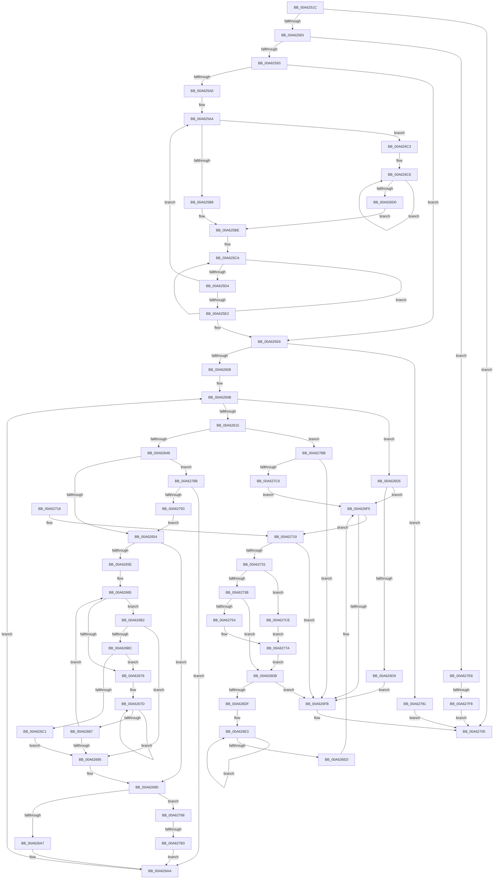

# DrvDbSetDeviceIdDriverInfMatches

- RVA: `0x00A6251C`–`0x00A62800` (길이 `740` bytes)
- VA: `0x0000000140A6251C`
- 실행 섹션: `PAGE`
- PDB 이름 있음: `예`; PDB Function 태그: `예`
- unwind 정보 RVA: `0x000B3380`
- 디코드: `214`개 명령, `740/740` bytes 표시
- 미해석 바이트: `0` (있으면 어셈블리에 `.byte`로 보존)

> 이 문서는 커널 이미지의 기계어와 PDB 기호를 분석해 생성했습니다. 4번과 5번은 함수 원형과 자료형을 바이너리 사용 방식에서 추정한 C 해석이며 원본 소스 복구 결과는 아닙니다.

## 1. Dependencies

- 직접 호출 지점: **11**; 고유 호출 대상: **11**
- 직접 호출자로 확인된 함수: **1**
- RIP 상대 이미지 참조: **0**

### Outgoing calls
- `0x00A62574` → [RegRtlQueryInfoKey](../99/RegRtlQueryInfoKey_function_0099463C.md) (function, `0x0099463C`)
- `0x00A625AA` → [wcschr](../../text/50/wcschr_function_00501A60.md) (function, `0x00501A60`)
- `0x00A625F7` → [ExAllocatePool2](../../poolcode/B8/ExAllocatePool2_function_00B820F0.md) (function, `0x00B820F0`)
- `0x00A62639` → [RegRtlEnumValue](../99/RegRtlEnumValue_function_0099369C.md) (function, `0x0099369C`)
- `0x00A6266E` → [wcsncmp](../../text/50/wcsncmp_function_00501CA0.md) (function, `0x00501CA0`)
- `0x00A62700` → [ExFreePoolWithTag](../../poolcode/B8/ExFreePoolWithTag_function_00B82870.md) (function, `0x00B82870`)
- `0x00A62726` → [DrvDbSplitDeviceIdDriverInfMatch](DrvDbSplitDeviceIdDriverInfMatch_function_00A62808.md) (function, `0x00A62808`)
- `0x00A62749` → [RtlInitUnicodeStringEx](../../text/46/RtlInitUnicodeStringEx_function_00463960.md) (function, `0x00463960`)
- `0x00A62775` → [ZwSetValueKey](../../text/6A/ZwSetValueKey_function_006ADCD0.md) (function, `0x006ADCD0`)
- `0x00A6279E` → [PnpCtxRegDeleteValue](../8F/PnpCtxRegDeleteValue_function_008FE5E0.md) (function, `0x008FE5E0`)
- `0x00A627E1` → [PnpCtxRegSetValue](../99/PnpCtxRegSetValue_function_00991B8C.md) (function, `0x00991B8C`)

### Direct callers
- [sub_00B23350](../B2/Unknown_function_00B23350.md) at `0x00B233A2`

### Static image references
- 디코드된 RIP-relative 메모리 참조가 없습니다.

## 2. Other-region calls and transfers

- 다른 실행 섹션으로 향하는 call: **6**
  - `0x00A625AA` → [wcschr](../../text/50/wcschr_function_00501A60.md) (`PAGE` → `.text`)
  - `0x00A625F7` → [ExAllocatePool2](../../poolcode/B8/ExAllocatePool2_function_00B820F0.md) (`PAGE` → `POOLCODE`)
  - `0x00A6266E` → [wcsncmp](../../text/50/wcsncmp_function_00501CA0.md) (`PAGE` → `.text`)
  - `0x00A62700` → [ExFreePoolWithTag](../../poolcode/B8/ExFreePoolWithTag_function_00B82870.md) (`PAGE` → `POOLCODE`)
  - `0x00A62749` → [RtlInitUnicodeStringEx](../../text/46/RtlInitUnicodeStringEx_function_00463960.md) (`PAGE` → `.text`)
  - `0x00A62775` → [ZwSetValueKey](../../text/6A/ZwSetValueKey_function_006ADCD0.md) (`PAGE` → `.text`)
- call이 아닌 외부 분기/꼬리 이동: **2**
  - `0x00A627AD` → [sub_00B3E2D0](../B3/Unknown_function_00B3E2D0.md) (`tail-transfer`)
  - `0x00A627F2` → [sub_00B3E2D0 + 0xD](../B3/Unknown_function_00B3E2D0.md) (`tail-transfer`)

## 3. Assembly (complete function range)

```asm
00A6251C  48 8B C4                        mov rax, rsp
00A6251F  44 89 48 20                     mov dword ptr [rax + 0x20], r9d
00A62523  4C 89 40 18                     mov qword ptr [rax + 0x18], r8
00A62527  48 89 50 10                     mov qword ptr [rax + 0x10], rdx
00A6252B  48 89 48 08                     mov qword ptr [rax + 8], rcx
00A6252F  55                              push rbp
00A62530  53                              push rbx
00A62531  56                              push rsi
00A62532  57                              push rdi
00A62533  41 54                           push r12
00A62535  41 55                           push r13
00A62537  41 56                           push r14
00A62539  41 57                           push r15
00A6253B  48 8B EC                        mov rbp, rsp
00A6253E  48 83 EC 68                     sub rsp, 0x68
00A62542  45 33 F6                        xor r14d, r14d
00A62545  4C 8D 4D D8                     lea r9, [rbp - 0x28]
00A62549  4C 89 70 80                     mov qword ptr [rax - 0x80], r14
00A6254D  4C 8B EA                        mov r13, rdx
00A62550  48 8D 45 60                     lea rax, [rbp + 0x60]
00A62554  44 89 75 D8                     mov dword ptr [rbp - 0x28], r14d
00A62558  49 8B F0                        mov rsi, r8
00A6255B  48 89 44 24 20                  mov qword ptr [rsp + 0x20], rax
00A62560  45 33 C0                        xor r8d, r8d
00A62563  44 89 75 60                     mov dword ptr [rbp + 0x60], r14d
00A62567  33 D2                           xor edx, edx
00A62569  44 89 75 DC                     mov dword ptr [rbp - 0x24], r14d
00A6256D  49 8B CD                        mov rcx, r13
00A62570  44 89 75 48                     mov dword ptr [rbp + 0x48], r14d
00A62574  E8 C3 20 F3 FF                  call 0x14099463c
00A62579  8B D8                           mov ebx, eax
00A6257B  85 C0                           test eax, eax
00A6257D  0F 88 82 01 00 00               js 0x140a62705
00A62583  44 8B 65 60                     mov r12d, dword ptr [rbp + 0x60]
00A62587  41 FF C4                        inc r12d
00A6258A  48 85 F6                        test rsi, rsi
00A6258D  0F 84 55 02 00 00               je 0x140a627e8
00A62593  49 83 CF FF                     or r15, 0xffffffffffffffff
00A62597  48 8B FE                        mov rdi, rsi
00A6259A  66 44 39 36                     cmp word ptr [rsi], r14w
00A6259E  74 46                           je 0x140a625e6
00A625A0  45 8D 6E 5C                     lea r13d, [r14 + 0x5c]
00A625A4  41 8B D5                        mov edx, r13d
00A625A7  48 8B CF                        mov rcx, rdi
00A625AA  E8 B1 F4 A9 FF                  call 0x140501a60
00A625AF  48 85 C0                        test rax, rax
00A625B2  0F 84 0B 01 00 00               je 0x140a626c3
00A625B8  48 2B C7                        sub rax, rdi
00A625BB  48 D1 F8                        sar rax, 1
00A625BE  FF C0                           inc eax
00A625C0  41 3B C4                        cmp eax, r12d
00A625C3  44 0F 47 E0                     cmova r12d, eax
00A625C7  49 8B C7                        mov rax, r15
00A625CA  48 FF C0                        inc rax
00A625CD  66 44 39 34 47                  cmp word ptr [rdi + rax*2], r14w
00A625D2  75 F6                           jne 0x140a625ca
00A625D4  48 8D 3C 47                     lea rdi, [rdi + rax*2]
00A625D8  48 83 C7 02                     add rdi, 2
00A625DC  66 44 39 37                     cmp word ptr [rdi], r14w
00A625E0  75 C2                           jne 0x140a625a4
00A625E2  4C 8B 6D 50                     mov r13, qword ptr [rbp + 0x50]
00A625E6  41 8B D4                        mov edx, r12d
00A625E9  B9 00 01 00 00                  mov ecx, 0x100
00A625EE  48 03 D2                        add rdx, rdx
00A625F1  41 B8 50 44 44 42               mov r8d, 0x42444450
00A625F7  E8 F4 FA 11 00                  call 0x140b820f0
00A625FC  48 8B F8                        mov rdi, rax
00A625FF  48 85 C0                        test rax, rax
00A62602  0F 84 79 01 00 00               je 0x140a62781
00A62608  45 8B FE                        mov r15d, r14d
00A6260B  44 3B 7D D8                     cmp r15d, dword ptr [rbp - 0x28]
00A6260F  0F 83 C0 00 00 00               jae 0x140a626d5
00A62615  4C 89 74 24 30                  mov qword ptr [rsp + 0x30], r14
00A6261A  48 8D 45 DC                     lea rax, [rbp - 0x24]
00A6261E  4C 89 74 24 28                  mov qword ptr [rsp + 0x28], r14
00A62623  4C 8D 4D 60                     lea r9, [rbp + 0x60]
00A62627  4C 8B C7                        mov r8, rdi
00A6262A  48 89 44 24 20                  mov qword ptr [rsp + 0x20], rax
00A6262F  41 8B D7                        mov edx, r15d
00A62632  44 89 65 60                     mov dword ptr [rbp + 0x60], r12d
00A62636  49 8B CD                        mov rcx, r13
00A62639  E8 5E 10 F3 FF                  call 0x14099369c
00A6263E  8B D8                           mov ebx, eax
00A62640  85 C0                           test eax, eax
00A62642  0F 88 73 01 00 00               js 0x140a627bb
00A62648  8B 45 DC                        mov eax, dword ptr [rbp - 0x24]
00A6264B  83 F8 03                        cmp eax, 3
00A6264E  0F 85 37 01 00 00               jne 0x140a6278b
00A62654  33 C9                           xor ecx, ecx
00A62656  4C 8B F6                        mov r14, rsi
00A62659  66 39 0E                        cmp word ptr [rsi], cx
00A6265C  74 3F                           je 0x140a6269d
00A6265E  44 8B 6D 60                     mov r13d, dword ptr [rbp + 0x60]
00A62662  8D 71 5C                        lea esi, [rcx + 0x5c]
00A62665  4D 8B C5                        mov r8, r13
00A62668  48 8B D7                        mov rdx, rdi
00A6266B  49 8B CE                        mov rcx, r14
00A6266E  E8 2D F6 A9 FF                  call 0x140501ca0
00A62673  33 C9                           xor ecx, ecx
00A62675  85 C0                           test eax, eax
00A62677  74 39                           je 0x140a626b2
00A62679  48 83 C8 FF                     or rax, 0xffffffffffffffff
00A6267D  48 FF C0                        inc rax
00A62680  66 41 39 0C 46                  cmp word ptr [r14 + rax*2], cx
00A62685  75 F6                           jne 0x140a6267d
00A62687  4D 8D 34 46                     lea r14, [r14 + rax*2]
00A6268B  49 83 C6 02                     add r14, 2
00A6268F  66 41 39 0E                     cmp word ptr [r14], cx
00A62693  75 D0                           jne 0x140a62665
00A62695  48 8B 75 58                     mov rsi, qword ptr [rbp + 0x58]
00A62699  4C 8B 6D 50                     mov r13, qword ptr [rbp + 0x50]
00A6269D  66 41 39 0E                     cmp word ptr [r14], cx
00A626A1  0F 84 F1 00 00 00               je 0x140a62798
00A626A7  45 33 F6                        xor r14d, r14d
00A626AA  41 FF C7                        inc r15d
00A626AD  E9 59 FF FF FF                  jmp 0x140a6260b
00A626B2  43 0F B7 04 6E                  movzx eax, word ptr [r14 + r13*2]
00A626B7  66 3B C6                        cmp ax, si
00A626BA  74 D9                           je 0x140a62695
00A626BC  66 85 C0                        test ax, ax
00A626BF  75 B8                           jne 0x140a62679
00A626C1  EB D2                           jmp 0x140a62695
00A626C3  49 8B C7                        mov rax, r15
00A626C6  48 FF C0                        inc rax
00A626C9  66 44 39 34 47                  cmp word ptr [rdi + rax*2], r14w
00A626CE  75 F6                           jne 0x140a626c6
00A626D0  E9 E9 FE FF FF                  jmp 0x140a625be
00A626D5  85 DB                           test ebx, ebx
00A626D7  79 1C                           jns 0x140a626f5
00A626D9  EB 20                           jmp 0x140a626fb
00A626DB  85 DB                           test ebx, ebx
00A626DD  78 1C                           js 0x140a626fb
00A626DF  48 83 C8 FF                     or rax, 0xffffffffffffffff
00A626E3  48 FF C0                        inc rax
00A626E6  66 44 39 34 46                  cmp word ptr [rsi + rax*2], r14w
00A626EB  75 F6                           jne 0x140a626e3
00A626ED  48 8D 34 46                     lea rsi, [rsi + rax*2]
00A626F1  48 83 C6 02                     add rsi, 2
00A626F5  66 44 39 36                     cmp word ptr [rsi], r14w
00A626F9  75 1E                           jne 0x140a62719
00A626FB  33 D2                           xor edx, edx
00A626FD  48 8B CF                        mov rcx, rdi
00A62700  E8 6B 01 12 00                  call 0x140b82870
00A62705  8B C3                           mov eax, ebx
00A62707  48 83 C4 68                     add rsp, 0x68
00A6270B  41 5F                           pop r15
00A6270D  41 5E                           pop r14
00A6270F  41 5D                           pop r13
00A62711  41 5C                           pop r12
00A62713  5F                              pop rdi
00A62714  5E                              pop rsi
00A62715  5B                              pop rbx
00A62716  5D                              pop rbp
00A62717  C3                              ret
00A62718  CC                              int3
00A62719  4C 8D 4D 48                     lea r9, [rbp + 0x48]
00A6271D  45 8B C4                        mov r8d, r12d
00A62720  48 8B D7                        mov rdx, rdi
00A62723  48 8B CE                        mov rcx, rsi
00A62726  E8 DD 00 00 00                  call 0x140a62808
00A6272B  8B D8                           mov ebx, eax
00A6272D  85 C0                           test eax, eax
00A6272F  78 CA                           js 0x140a626fb
00A62731  44 38 75 48                     cmp byte ptr [rbp + 0x48], r14b
00A62735  0F 84 93 00 00 00               je 0x140a627ce
00A6273B  0F 57 C0                        xorps xmm0, xmm0
00A6273E  48 8D 4D E0                     lea rcx, [rbp - 0x20]
00A62742  48 8B D7                        mov rdx, rdi
00A62745  0F 11 45 E0                     movups xmmword ptr [rbp - 0x20], xmm0
00A62749  E8 12 12 A0 FF                  call 0x140463960
00A6274E  8B D8                           mov ebx, eax
00A62750  85 C0                           test eax, eax
00A62752  78 87                           js 0x140a626db
00A62754  48 8D 45 48                     lea rax, [rbp + 0x48]
00A62758  C7 44 24 28 04 00 00 00         mov dword ptr [rsp + 0x28], 4
00A62760  41 B9 03 00 00 00               mov r9d, 3
00A62766  48 89 44 24 20                  mov qword ptr [rsp + 0x20], rax
00A6276B  45 33 C0                        xor r8d, r8d
00A6276E  48 8D 55 E0                     lea rdx, [rbp - 0x20]
00A62772  49 8B CD                        mov rcx, r13
00A62775  E8 56 B5 C4 FF                  call 0x1406adcd0
00A6277A  8B D8                           mov ebx, eax
00A6277C  E9 5A FF FF FF                  jmp 0x140a626db
00A62781  BB 17 00 00 C0                  mov ebx, 0xc0000017
00A62786  E9 7A FF FF FF                  jmp 0x140a62705
00A6278B  85 C0                           test eax, eax
00A6278D  0F 85 17 FF FF FF               jne 0x140a626aa
00A62793  E9 BC FE FF FF                  jmp 0x140a62654
00A62798  4C 8B C7                        mov r8, rdi
00A6279B  49 8B D5                        mov rdx, r13
00A6279E  E8 3D BE E9 FF                  call 0x1408fe5e0
00A627A3  45 33 F6                        xor r14d, r14d
00A627A6  8B D8                           mov ebx, eax
00A627A8  3D 34 00 00 C0                  cmp eax, 0xc0000034
00A627AD  0F 85 1D BB 0D 00               jne 0x140b3e2d0
00A627B3  41 8B DE                        mov ebx, r14d
00A627B6  E9 EF FE FF FF                  jmp 0x140a626aa
00A627BB  3D 1A 00 00 80                  cmp eax, 0x8000001a
00A627C0  0F 85 35 FF FF FF               jne 0x140a626fb
00A627C6  41 8B DE                        mov ebx, r14d
00A627C9  E9 27 FF FF FF                  jmp 0x140a626f5
00A627CE  44 89 74 24 28                  mov dword ptr [rsp + 0x28], r14d
00A627D3  45 33 C9                        xor r9d, r9d
00A627D6  4C 8B C7                        mov r8, rdi
00A627D9  4C 89 74 24 20                  mov qword ptr [rsp + 0x20], r14
00A627DE  49 8B D5                        mov rdx, r13
00A627E1  E8 A6 F3 F2 FF                  call 0x140991b8c
00A627E6  EB 92                           jmp 0x140a6277a
00A627E8  44 8B 75 D8                     mov r14d, dword ptr [rbp - 0x28]
00A627EC  45 33 FF                        xor r15d, r15d
00A627EF  45 85 F6                        test r14d, r14d
00A627F2  0F 85 E5 BA 0D 00               jne 0x140b3e2dd
00A627F8  41 8B DF                        mov ebx, r15d
00A627FB  E9 05 FF FF FF                  jmp 0x140a62705
```

## 4. C-style interpretation (structured pseudocode)

```c
__int64 __fastcall DrvDbSetDeviceIdDriverInfMatches(__int64 a1, __int64 a2, __int64 a3, int a4)
{
    __int64 result;
    __int64 v_r12;
    __int64 v_r14;
    __int64 v_r15;
    __int64 v_rdi;
    __int64 v_rsi;
    __int64 v_rsp;
    unsigned __int64 v_stack_m60;
    unsigned int v_stack_m64;
    unsigned __int64 v_stack_m68;
    unsigned __int64 v_stack_m78;
    unsigned __int64 v_stack_m80;
    unsigned __int64 v_stack_m88;
    unsigned __int64 v_stack_p10;
    unsigned __int64 v_stack_p18;
    unsigned __int64 v_stack_p20;
    unsigned int v_stack_p28;
    unsigned int v_stack_p8;

    *(unsigned int *)(v_rsp + 32) = a4;
    *(unsigned __int64 *)(v_rsp + 24) = a3;
    *(unsigned __int64 *)(v_rsp + 16) = a2;
    *(unsigned __int64 *)(v_rsp + 8) = a1;
    v_rsp = (v_rsp) - (104);
    v_r14 = 0;
    *(unsigned __int64 *)(v_rsp - 128) = 0;
    v_stack_m68 = 0;
    v_stack_m88 = v_stack_p20;
    a3 = 0;
    v_stack_p20 = 0;
    a2 = 0;
    v_stack_m64 = 0;
    v_stack_p8 = 0;
    result = RegRtlQueryInfoKey(0, a2, a3, v_stack_m68);
    if (sign_flag) goto loc_00A62705;
    v_r12 = (unsigned int)(((unsigned int)(v_stack_p20)) + 1);
    if (0 == 0) goto loc_00A627E8;
    v_r15 = (v_r15) | (-1);
    if ((*(unsigned __int16 *)(a3)) == 0) goto loc_00A625E6;
loc_00A625A4:
    result = wcschr(0, (unsigned int)((unsigned int)(v_r14 + 92)), a3, v_stack_m68);
    if (result == 0) goto loc_00A626C3;
    result = (result) - (0);
    result = (result) >> (1);
loc_00A625BE:
    result = (unsigned int)((result) + 1);
    if (((unsigned int)(result)) > ((unsigned int)(v_r12))) { v_r12 = (unsigned int)(result); }
loc_00A625CA:
    result = (v_r15) + 1;
    if ((*(unsigned __int16 *)(0 + result * 2)) != 0) goto loc_00A625CA;
    v_rdi = (0 + result * 2) + (2);
    if ((*(unsigned __int16 *)(v_rdi)) != 0) goto loc_00A625A4;
loc_00A625E6:
    a2 = ((unsigned int)((unsigned int)(v_r12))) + ((unsigned int)((unsigned int)(v_r12)));
    result = ExAllocatePool2(256, a2, (unsigned int)(0x42444450ULL), v_stack_m68);
    if (result == 0) goto loc_00A62781;
loc_00A6260B:
    if (0 >= v_stack_m68) goto loc_00A626D5;
    v_stack_m78 = 0;
    v_stack_m80 = 0;
    v_stack_m88 = v_stack_m64;
    v_stack_p20 = (unsigned int)(v_r12);
    result = RegRtlEnumValue(v_stack_p10, 0, result, v_stack_p20);
    if (sign_flag) goto loc_00A627BB;
    if (((unsigned int)((unsigned int)(v_stack_m64))) != 3) goto loc_00A6278B;
loc_00A62654:
    a1 = 0;
    if ((*(unsigned __int16 *)(a3)) == 0) goto loc_00A6269D;
loc_00A62665:
    result = wcsncmp(0, result, (unsigned int)(v_stack_p20), v_stack_p20);
    a1 = 0;
    if ((unsigned int)(result) == 0) goto loc_00A626B2;
loc_00A62679:
    result = (result) | (-1);
loc_00A6267D:
    result = (result) + 1;
    if ((*(unsigned __int16 *)(0 + result * 2)) != 0) goto loc_00A6267D;
    v_r14 = (0 + result * 2) + (2);
    if ((*(unsigned __int16 *)(v_r14)) != 0) goto loc_00A62665;
loc_00A62695:
loc_00A6269D:
    if ((*(unsigned __int16 *)(v_r14)) == 0) goto loc_00A62798;
    v_r14 = 0;
loc_00A626AA:
    v_r15 = (unsigned int)((0) + 1);
    goto loc_00A6260B;
loc_00A626B2:
    if (((unsigned __int16)(*(unsigned __int16 *)(v_r14 + v_stack_p10 * 2))) == ((unsigned __int16)(v_stack_p18))) goto loc_00A62695;
    if ((unsigned __int16)(*(unsigned __int16 *)(v_r14 + v_stack_p10 * 2)) != 0) goto loc_00A62679;
    goto loc_00A62695;
loc_00A626C3:
loc_00A626C6:
    result = (v_r15) + 1;
    if ((*(unsigned __int16 *)(result + result * 2)) != 0) goto loc_00A626C6;
    goto loc_00A625BE;
loc_00A626D5:
    if (!sign_flag) goto loc_00A626F5;
    goto loc_00A626FB;
loc_00A626DB:
    if (sign_flag) goto loc_00A626FB;
    result = (result) | (-1);
loc_00A626E3:
    result = (result) + 1;
    if ((*(unsigned __int16 *)(v_stack_p18 + result * 2)) != 0) goto loc_00A626E3;
    v_rsi = (v_stack_p18 + result * 2) + (2);
loc_00A626F5:
    if ((*(unsigned __int16 *)(v_rsi)) != 0) goto loc_00A62719;
loc_00A626FB:
    a2 = 0;
    result = ExFreePoolWithTag(result, a2, (unsigned int)(v_stack_p20), v_stack_p20);
loc_00A62705:
    v_rsp = (v_rsp) + (104);
    return (unsigned int)((unsigned int)((unsigned int)((unsigned int)(result))));
loc_00A62719:
    result = DrvDbSplitDeviceIdDriverInfMatch(v_rsi, result, (unsigned int)((unsigned int)(v_r12)), v_stack_p8);
    if (sign_flag) goto loc_00A626FB;
    if (v_stack_p8 == 0) goto loc_00A627CE;
    v_stack_m60 = v_xmm0;
    result = RtlInitUnicodeStringEx(v_stack_m60, result, (unsigned int)((unsigned int)(v_r12)), v_stack_p8);
    if (sign_flag) goto loc_00A626DB;
    v_stack_p28 = 4;
    v_stack_p20 = v_stack_p8;
    a3 = 0;
    result = ZwSetValueKey(v_stack_p10, v_stack_m60, a3, 3);
loc_00A6277A:
    goto loc_00A626DB;
loc_00A62781:
    goto loc_00A62705;
loc_00A6278B:
    if ((unsigned int)(result) != 0) goto loc_00A626AA;
    goto loc_00A62654;
loc_00A62798:
    result = PnpCtxRegDeleteValue(v_stack_p10, v_stack_p10, result, 3);
    v_r14 = 0;
    goto loc_00A626AA;
loc_00A627BB:
    if (((unsigned int)(result)) != 0x8000001AULL) goto loc_00A626FB;
    goto loc_00A626F5;
loc_00A627CE:
    v_stack_p28 = 0;
    a4 = 0;
    v_stack_p20 = 0;
    result = PnpCtxRegSetValue(v_stack_p10, v_stack_p10, result, a4);
    goto loc_00A6277A;
loc_00A627E8:
    v_r15 = 0;
    goto loc_00A62705;
}
```

## 5. (Beta) C Style

```c
int64_t DrvDbSetDeviceIdDriverInfMatches(int64_t Arg1, int64_t Arg2, int64_t Arg3, int32_t Arg4)
{
    int64_t result;
    int64_t local_r12;
    int64_t local_r14;
    int64_t local_r15;
    int64_t local_rdi;
    int64_t local_rsi;
    int64_t local_rsp;
    uint64_t v_stack_m60;
    uint32_t v_stack_m64;
    uint64_t v_stack_m68;
    uint64_t v_stack_m78;
    uint64_t v_stack_m80;
    uint64_t v_stack_m88;
    uint64_t v_stack_p10;
    uint64_t v_stack_p18;
    uint64_t v_stack_p20;
    uint32_t v_stack_p28;
    uint32_t v_stack_p8;

    *(uint32_t *)(local_rsp + 0x20) = Arg4;
    *(uint64_t *)(local_rsp + 0x18) = Arg3;
    *(uint64_t *)(local_rsp + 0x10) = Arg2;
    *(uint64_t *)(local_rsp + 0x8) = Arg1;
    local_rsp = (local_rsp) - (104);
    local_r14 = 0;
    *(uint64_t *)(local_rsp - 0x80) = 0;
    v_stack_m68 = 0;
    v_stack_m88 = v_stack_p20;
    Arg3 = 0;
    v_stack_p20 = 0;
    Arg2 = 0;
    v_stack_m64 = 0;
    v_stack_p8 = 0;
    result = RegRtlQueryInfoKey(0, Arg2, Arg3, v_stack_m68);
    if (sign_flag) goto loc_00A62705;
    local_r12 = (uint32_t)(((uint32_t)(v_stack_p20)) + 1);
    if (0 == 0) goto loc_00A627E8;
    local_r15 = (local_r15) | (-1);
    if ((*(uint16_t *)(Arg3)) == 0) goto loc_00A625E6;
loc_00A625A4:
    result = wcschr(0, (uint32_t)((uint32_t)(local_r14 + 92)), Arg3, v_stack_m68);
    if (result == 0) goto loc_00A626C3;
    result = (result) - (0);
    result = (result) >> (1);
loc_00A625BE:
    result = (uint32_t)((result) + 1);
    if (((uint32_t)(result)) > ((uint32_t)(local_r12))) { local_r12 = (uint32_t)(result); }
loc_00A625CA:
    result = (local_r15) + 1;
    if ((*(uint16_t *)(0 + result * 2)) != 0) goto loc_00A625CA;
    local_rdi = (0 + result * 2) + (2);
    if ((*(uint16_t *)(local_rdi)) != 0) goto loc_00A625A4;
loc_00A625E6:
    Arg2 = ((uint32_t)((uint32_t)(local_r12))) + ((uint32_t)((uint32_t)(local_r12)));
    result = ExAllocatePool2(256, Arg2, (uint32_t)(0x42444450ULL), v_stack_m68);
    if (result == 0) goto loc_00A62781;
loc_00A6260B:
    if (0 >= v_stack_m68) goto loc_00A626D5;
    v_stack_m78 = 0;
    v_stack_m80 = 0;
    v_stack_m88 = v_stack_m64;
    v_stack_p20 = (uint32_t)(local_r12);
    result = RegRtlEnumValue(v_stack_p10, 0, result, v_stack_p20);
    if (sign_flag) goto loc_00A627BB;
    if (((uint32_t)((uint32_t)(v_stack_m64))) != 3) goto loc_00A6278B;
loc_00A62654:
    Arg1 = 0;
    if ((*(uint16_t *)(Arg3)) == 0) goto loc_00A6269D;
loc_00A62665:
    result = wcsncmp(0, result, (uint32_t)(v_stack_p20), v_stack_p20);
    Arg1 = 0;
    if ((uint32_t)(result) == 0) goto loc_00A626B2;
loc_00A62679:
    result = (result) | (-1);
loc_00A6267D:
    result = (result) + 1;
    if ((*(uint16_t *)(0 + result * 2)) != 0) goto loc_00A6267D;
    local_r14 = (0 + result * 2) + (2);
    if ((*(uint16_t *)(local_r14)) != 0) goto loc_00A62665;
loc_00A62695:
loc_00A6269D:
    if ((*(uint16_t *)(local_r14)) == 0) goto loc_00A62798;
    local_r14 = 0;
loc_00A626AA:
    local_r15 = (uint32_t)((0) + 1);
    goto loc_00A6260B;
loc_00A626B2:
    if (((uint16_t)(*(uint16_t *)(local_r14 + v_stack_p10 * 2))) == ((uint16_t)(v_stack_p18))) goto loc_00A62695;
    if ((uint16_t)(*(uint16_t *)(local_r14 + v_stack_p10 * 2)) != 0) goto loc_00A62679;
    goto loc_00A62695;
loc_00A626C3:
loc_00A626C6:
    result = (local_r15) + 1;
    if ((*(uint16_t *)(result + result * 2)) != 0) goto loc_00A626C6;
    goto loc_00A625BE;
loc_00A626D5:
    if (!sign_flag) goto loc_00A626F5;
    goto loc_00A626FB;
loc_00A626DB:
    if (sign_flag) goto loc_00A626FB;
    result = (result) | (-1);
loc_00A626E3:
    result = (result) + 1;
    if ((*(uint16_t *)(v_stack_p18 + result * 2)) != 0) goto loc_00A626E3;
    local_rsi = (v_stack_p18 + result * 2) + (2);
loc_00A626F5:
    if ((*(uint16_t *)(local_rsi)) != 0) goto loc_00A62719;
loc_00A626FB:
    Arg2 = 0;
    result = ExFreePoolWithTag(result, Arg2, (uint32_t)(v_stack_p20), v_stack_p20);
loc_00A62705:
    local_rsp = (local_rsp) + (104);
    return (uint32_t)((uint32_t)((uint32_t)((uint32_t)(result))));
loc_00A62719:
    result = DrvDbSplitDeviceIdDriverInfMatch(local_rsi, result, (uint32_t)((uint32_t)(local_r12)), v_stack_p8);
    if (sign_flag) goto loc_00A626FB;
    if (v_stack_p8 == 0) goto loc_00A627CE;
    v_stack_m60 = v_xmm0;
    result = RtlInitUnicodeStringEx(v_stack_m60, result, (uint32_t)((uint32_t)(local_r12)), v_stack_p8);
    if (sign_flag) goto loc_00A626DB;
    v_stack_p28 = 4;
    v_stack_p20 = v_stack_p8;
    Arg3 = 0;
    result = ZwSetValueKey(v_stack_p10, v_stack_m60, Arg3, 3);
loc_00A6277A:
    goto loc_00A626DB;
loc_00A62781:
    goto loc_00A62705;
loc_00A6278B:
    if ((uint32_t)(result) != 0) goto loc_00A626AA;
    goto loc_00A62654;
loc_00A62798:
    result = PnpCtxRegDeleteValue(v_stack_p10, v_stack_p10, result, 3);
    local_r14 = 0;
    goto loc_00A626AA;
loc_00A627BB:
    if (((uint32_t)(result)) != 0x8000001AULL) goto loc_00A626FB;
    goto loc_00A626F5;
loc_00A627CE:
    v_stack_p28 = 0;
    Arg4 = 0;
    v_stack_p20 = 0;
    result = PnpCtxRegSetValue(v_stack_p10, v_stack_p10, result, Arg4);
    goto loc_00A6277A;
loc_00A627E8:
    local_r15 = 0;
    goto loc_00A62705;
}
```

## 6. Execution-region graph

[열기: 2D/3D 그래프와 함수 탐색 컨트롤 패널](../../../control-panel.html?section=page&rva=0x00A6251C&view=graph)

- 2D 그래프는 위에서 아래로 흐르고, 3D 그래프는 빈 공간을 드래그해 회전합니다. Shift+드래그는 이동, 휠은 확대·축소, 함수 노드 선택은 대상 보고서 이동입니다.

### Static fallback


