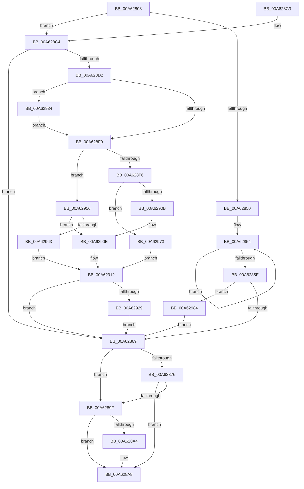

# DrvDbSplitDeviceIdDriverInfMatch

- RVA: `0x00A62808`–`0x00A62991` (길이 `393` bytes)
- VA: `0x0000000140A62808`
- 실행 섹션: `PAGE`
- PDB 이름 있음: `예`; PDB Function 태그: `아니요`
- unwind 정보 RVA: `0x000B33AC`
- 디코드: `119`개 명령, `393/393` bytes 표시
- 미해석 바이트: `0` (있으면 어셈블리에 `.byte`로 보존)

> 이 문서는 커널 이미지의 기계어와 PDB 기호를 분석해 생성했습니다. 4번과 5번은 함수 원형과 자료형을 바이너리 사용 방식에서 추정한 C 해석이며 원본 소스 복구 결과는 아닙니다.

## 1. Dependencies

- 직접 호출 지점: **6**; 고유 호출 대상: **3**
- 직접 호출자로 확인된 함수: **2**
- RIP 상대 이미지 참조: **0**

### Outgoing calls
- `0x00A62840` → [wcschr](../../text/50/wcschr_function_00501A60.md) (function, `0x00501A60`)
- `0x00A62893` → [RtlStringCchCopyNExW](../../text/43/RtlStringCchCopyNExW_function_00437CB0.md) (function, `0x00437CB0`)
- `0x00A628E0` → [wcschr](../../text/50/wcschr_function_00501A60.md) (function, `0x00501A60`)
- `0x00A628FF` → [wcstol](../../text/50/wcstol_function_00502434.md) (function, `0x00502434`)
- `0x00A62942` → [wcstol](../../text/50/wcstol_function_00502434.md) (function, `0x00502434`)
- `0x00A62969` → [wcstol](../../text/50/wcstol_function_00502434.md) (function, `0x00502434`)

### Direct callers
- [PiDevCfgFindDeviceDriver](../97/PiDevCfgFindDeviceDriver_function_0097602C.md) at `0x009762CE`
- [DrvDbSetDeviceIdDriverInfMatches](DrvDbSetDeviceIdDriverInfMatches_function_00A6251C.md) at `0x00A62726`

### Static image references
- 디코드된 RIP-relative 메모리 참조가 없습니다.

## 2. Other-region calls and transfers

- 다른 실행 섹션으로 향하는 call: **6**
  - `0x00A62840` → [wcschr](../../text/50/wcschr_function_00501A60.md) (`PAGE` → `.text`)
  - `0x00A62893` → [RtlStringCchCopyNExW](../../text/43/RtlStringCchCopyNExW_function_00437CB0.md) (`PAGE` → `.text`)
  - `0x00A628E0` → [wcschr](../../text/50/wcschr_function_00501A60.md) (`PAGE` → `.text`)
  - `0x00A628FF` → [wcstol](../../text/50/wcstol_function_00502434.md) (`PAGE` → `.text`)
  - `0x00A62942` → [wcstol](../../text/50/wcstol_function_00502434.md) (`PAGE` → `.text`)
  - `0x00A62969` → [wcstol](../../text/50/wcstol_function_00502434.md) (`PAGE` → `.text`)
- 별도 외부 분기/꼬리 이동을 확인하지 못했습니다.

## 3. Assembly (complete function range)

```asm
00A62808  48 89 5C 24 08                  mov qword ptr [rsp + 8], rbx
00A6280D  44 89 44 24 18                  mov dword ptr [rsp + 0x18], r8d
00A62812  48 89 54 24 10                  mov qword ptr [rsp + 0x10], rdx
00A62817  55                              push rbp
00A62818  56                              push rsi
00A62819  57                              push rdi
00A6281A  41 54                           push r12
00A6281C  41 55                           push r13
00A6281E  41 56                           push r14
00A62820  41 57                           push r15
00A62822  48 83 EC 40                     sub rsp, 0x40
00A62826  45 33 E4                        xor r12d, r12d
00A62829  49 8B D9                        mov rbx, r9
00A6282C  41 8B E8                        mov ebp, r8d
00A6282F  4C 8B F9                        mov r15, rcx
00A62832  41 BD FF 00 00 00               mov r13d, 0xff
00A62838  45 8D 74 24 5C                  lea r14d, [r12 + 0x5c]
00A6283D  41 8B D6                        mov edx, r14d
00A62840  E8 1B F2 A9 FF                  call 0x140501a60
00A62845  45 33 C0                        xor r8d, r8d
00A62848  48 8B F8                        mov rdi, rax
00A6284B  48 85 C0                        test rax, rax
00A6284E  75 74                           jne 0x140a628c4
00A62850  48 83 C8 FF                     or rax, 0xffffffffffffffff
00A62854  48 FF C0                        inc rax
00A62857  66 45 39 04 47                  cmp word ptr [r15 + rax*2], r8w
00A6285C  75 F6                           jne 0x140a62854
00A6285E  8B F0                           mov esi, eax
00A62860  48 85 DB                        test rbx, rbx
00A62863  0F 85 1B 01 00 00               jne 0x140a62984
00A62869  48 8B 84 24 88 00 00 00         mov rax, qword ptr [rsp + 0x88]
00A62871  48 85 C0                        test rax, rax
00A62874  74 29                           je 0x140a6289f
00A62876  C7 44 24 30 00 09 00 00         mov dword ptr [rsp + 0x30], 0x900
00A6287E  48 8B C8                        mov rcx, rax
00A62881  4C 89 44 24 28                  mov qword ptr [rsp + 0x28], r8
00A62886  4C 89 44 24 20                  mov qword ptr [rsp + 0x20], r8
00A6288B  4D 8B C7                        mov r8, r15
00A6288E  44 8B CE                        mov r9d, esi
00A62891  8B D5                           mov edx, ebp
00A62893  E8 18 54 9D FF                  call 0x140437cb0
00A62898  44 8B E0                        mov r12d, eax
00A6289B  85 C0                           test eax, eax
00A6289D  78 09                           js 0x140a628a8
00A6289F  48 85 DB                        test rbx, rbx
00A628A2  74 04                           je 0x140a628a8
00A628A4  44 88 6B 01                     mov byte ptr [rbx + 1], r13b
00A628A8  48 8B 9C 24 80 00 00 00         mov rbx, qword ptr [rsp + 0x80]
00A628B0  41 8B C4                        mov eax, r12d
00A628B3  48 83 C4 40                     add rsp, 0x40
00A628B7  41 5F                           pop r15
00A628B9  41 5E                           pop r14
00A628BB  41 5D                           pop r13
00A628BD  41 5C                           pop r12
00A628BF  5F                              pop rdi
00A628C0  5E                              pop rsi
00A628C1  5D                              pop rbp
00A628C2  C3                              ret
00A628C3  CC                              int3
00A628C4  48 8B F7                        mov rsi, rdi
00A628C7  49 2B F7                        sub rsi, r15
00A628CA  48 D1 FE                        sar rsi, 1
00A628CD  48 85 DB                        test rbx, rbx
00A628D0  74 97                           je 0x140a62869
00A628D2  BD 02 00 00 00                  mov ebp, 2
00A628D7  41 8B D6                        mov edx, r14d
00A628DA  48 03 FD                        add rdi, rbp
00A628DD  48 8B CF                        mov rcx, rdi
00A628E0  E8 7B F1 A9 FF                  call 0x140501a60
00A628E5  45 33 C0                        xor r8d, r8d
00A628E8  4C 8B F0                        mov r14, rax
00A628EB  48 85 C0                        test rax, rax
00A628EE  75 44                           jne 0x140a62934
00A628F0  66 83 3F 2A                     cmp word ptr [rdi], 0x2a
00A628F4  74 60                           je 0x140a62956
00A628F6  33 D2                           xor edx, edx
00A628F8  48 8B CF                        mov rcx, rdi
00A628FB  44 8D 42 10                     lea r8d, [rdx + 0x10]
00A628FF  E8 30 FB A9 FF                  call 0x140502434
00A62904  45 33 C0                        xor r8d, r8d
00A62907  85 C0                           test eax, eax
00A62909  75 68                           jne 0x140a62973
00A6290B  C6 03 01                        mov byte ptr [rbx], 1
00A6290E  41 0F B7 C0                     movzx eax, r8w
00A62912  66 89 04 2B                     mov word ptr [rbx + rbp], ax
00A62916  48 8B CB                        mov rcx, rbx
00A62919  8B AC 24 90 00 00 00            mov ebp, dword ptr [rsp + 0x90]
00A62920  4D 85 F6                        test r14, r14
00A62923  0F 84 40 FF FF FF               je 0x140a62869
00A62929  66 41 C7 06 5C 00               mov word ptr [r14], 0x5c
00A6292F  E9 35 FF FF FF                  jmp 0x140a62869
00A62934  33 D2                           xor edx, edx
00A62936  66 44 89 00                     mov word ptr [rax], r8w
00A6293A  48 8D 48 02                     lea rcx, [rax + 2]
00A6293E  44 8D 42 10                     lea r8d, [rdx + 0x10]
00A62942  E8 ED FA A9 FF                  call 0x140502434
00A62947  41 3B C5                        cmp eax, r13d
00A6294A  41 0F 47 C5                     cmova eax, r13d
00A6294E  45 33 C0                        xor r8d, r8d
00A62951  44 8B E8                        mov r13d, eax
00A62954  EB 9A                           jmp 0x140a628f0
00A62956  48 8D 4F 02                     lea rcx, [rdi + 2]
00A6295A  C6 03 03                        mov byte ptr [rbx], 3
00A6295D  66 44 39 01                     cmp word ptr [rcx], r8w
00A62961  74 AB                           je 0x140a6290e
00A62963  33 D2                           xor edx, edx
00A62965  44 8D 42 10                     lea r8d, [rdx + 0x10]
00A62969  E8 C6 FA A9 FF                  call 0x140502434
00A6296E  45 33 C0                        xor r8d, r8d
00A62971  EB 9F                           jmp 0x140a62912
00A62973  FF C8                           dec eax
00A62975  40 88 2B                        mov byte ptr [rbx], bpl
00A62978  B9 FF FF 00 00                  mov ecx, 0xffff
00A6297D  3B C1                           cmp eax, ecx
00A6297F  0F 47 C1                        cmova eax, ecx
00A62982  EB 8E                           jmp 0x140a62912
00A62984  44 88 03                        mov byte ptr [rbx], r8b
00A62987  66 44 89 43 02                  mov word ptr [rbx + 2], r8w
00A6298C  E9 D8 FE FF FF                  jmp 0x140a62869
```

## 4. C-style interpretation (structured pseudocode)

```c
__int64 __fastcall DrvDbSplitDeviceIdDriverInfMatch(__int64 a1, __int64 a2, int a3, __int64 a4)
{
    __int64 result;
    __int64 v_r12;
    __int64 v_rdi;
    __int64 v_rsi;
    __int64 v_rsp;
    unsigned int v_stack_m48;
    unsigned __int64 v_stack_m50;
    unsigned __int64 v_stack_m58;
    unsigned __int64 v_stack_p10;
    unsigned int v_stack_p18;
    unsigned __int64 v_stack_p8;
    unsigned int v_stack_p90;

    v_stack_p8 = v_rbx;
    v_stack_p18 = a3;
    v_stack_p10 = a2;
    v_rsp = (v_rsp) - (64);
    v_r12 = 0;
    result = wcschr(a1, (unsigned int)((unsigned int)(v_r12 + 92)), a3, a4);
    a3 = 0;
    if (result != 0) goto loc_00A628C4;
    result = (result) | (-1);
loc_00A62854:
    result = (result) + 1;
    if ((*(unsigned __int16 *)(a1 + result * 2)) != 0) goto loc_00A62854;
    if (a4 != 0) goto loc_00A62984;
loc_00A62869:
    if (v_stack_p10 == 0) goto loc_00A6289F;
    v_stack_m48 = 0x900ULL;
    v_stack_m50 = 0;
    v_stack_m58 = 0;
    result = RtlStringCchCopyNExW(v_stack_p10, (unsigned int)((unsigned int)((unsigned int)(a3))), a1, (unsigned int)((unsigned int)((unsigned int)((unsigned int)(result)))));
    if (sign_flag) goto loc_00A628A8;
loc_00A6289F:
    if (a4 != 0) {
        *(unsigned __int8 *)(a4 + 1) = 255;
    }
    v_rsp = (v_rsp) + (64);
    return (unsigned int)((unsigned int)((unsigned int)((unsigned int)(result))));
loc_00A628C4:
    v_rsi = (result) - (a1);
    v_rsi = (v_rsi) >> (1);
    if (v_stack_p8 == 0) goto loc_00A62869;
    v_rdi = (result) + (2);
    result = wcschr(v_rdi, (unsigned int)((unsigned int)(v_r12 + 92)), a1, (unsigned int)((unsigned int)((unsigned int)((unsigned int)(result)))));
    a3 = 0;
    if (result != 0) goto loc_00A62934;
loc_00A628F0:
    if ((*(unsigned __int16 *)(v_rdi)) == 42) goto loc_00A62956;
    a2 = 0;
    result = wcstol(v_rdi, a2, a2 + 16, (unsigned int)((unsigned int)((unsigned int)((unsigned int)(result)))));
    a3 = 0;
    if ((unsigned int)(result) != 0) goto loc_00A62973;
    *(unsigned __int8 *)(v_stack_p8) = 1;
loc_00A6290E:
loc_00A62912:
    *(unsigned __int16 *)(v_stack_p8 + 2 * 1) = 0;
    if (result == 0) goto loc_00A62869;
    *(unsigned __int16 *)(result) = 92;
    goto loc_00A62869;
loc_00A62934:
    a2 = 0;
    *(unsigned __int16 *)(0) = 0;
    result = wcstol(0 + 2, a2, a2 + 16, (unsigned int)((unsigned int)((unsigned int)((unsigned int)(result)))));
    if (((unsigned int)(result)) > 255) { result = 255; }
    a3 = 0;
    goto loc_00A628F0;
loc_00A62956:
    *(unsigned __int8 *)(v_stack_p8) = 3;
    if ((*(unsigned __int16 *)(v_rdi + 2)) == 0) goto loc_00A6290E;
    a2 = 0;
    result = wcstol(v_rdi + 2, a2, a2 + 16, (unsigned int)((unsigned int)((unsigned int)((unsigned int)(result)))));
    a3 = 0;
    goto loc_00A62912;
loc_00A62973:
    result = (unsigned int)((result) - 1);
    *(unsigned __int8 *)(v_stack_p8) = (unsigned __int8)((unsigned int)(v_stack_p90));
    if (((unsigned int)(result)) > ((unsigned int)((unsigned int)(0xFFFFULL)))) { result = (unsigned int)((unsigned int)(0xFFFFULL)); }
    goto loc_00A62912;
loc_00A62984:
    *(unsigned __int8 *)(v_stack_p8) = 0;
    *(unsigned __int16 *)(v_stack_p8 + 2) = 0;
    goto loc_00A62869;
}
```

## 5. (Beta) C Style

```c
int64_t DrvDbSplitDeviceIdDriverInfMatch(void *Arg1, int64_t Arg2, int32_t Arg3, int64_t Arg4)
{
    uint8_t *arg1 = (uint8_t *)Arg1;

    int64_t result;
    int64_t local_r12;
    int64_t local_rdi;
    int64_t local_rsi;
    int64_t local_rsp;
    uint32_t v_stack_m48;
    uint64_t v_stack_m50;
    uint64_t v_stack_m58;
    uint64_t v_stack_p10;
    uint32_t v_stack_p18;
    uint64_t v_stack_p8;
    uint32_t v_stack_p90;

    v_stack_p8 = local_rbx;
    v_stack_p18 = Arg3;
    v_stack_p10 = Arg2;
    local_rsp = (local_rsp) - (64);
    local_r12 = 0;
    result = wcschr(Arg1, (uint32_t)((uint32_t)(local_r12 + 92)), Arg3, Arg4);
    Arg3 = 0;
    if (result != 0) goto loc_00A628C4;
    result = (result) | (-1);
loc_00A62854:
    result = (result) + 1;
    if ((*(uint16_t *)(arg1 + result * 2)) != 0) goto loc_00A62854;
    if (Arg4 != 0) goto loc_00A62984;
loc_00A62869:
    if (v_stack_p10 == 0) goto loc_00A6289F;
    v_stack_m48 = 0x900ULL;
    v_stack_m50 = 0;
    v_stack_m58 = 0;
    result = RtlStringCchCopyNExW(v_stack_p10, (uint32_t)((uint32_t)((uint32_t)(Arg3))), Arg1, (uint32_t)((uint32_t)((uint32_t)((uint32_t)(result)))));
    if (sign_flag) goto loc_00A628A8;
loc_00A6289F:
    if (Arg4 != 0) {
        *(uint8_t *)(Arg4 + 0x1) = 255;
    }
    local_rsp = (local_rsp) + (64);
    return (uint32_t)((uint32_t)((uint32_t)((uint32_t)(result))));
loc_00A628C4:
    local_rsi = (result) - (Arg1);
    local_rsi = (local_rsi) >> (1);
    if (v_stack_p8 == 0) goto loc_00A62869;
    local_rdi = (result) + (2);
    result = wcschr(local_rdi, (uint32_t)((uint32_t)(local_r12 + 92)), Arg1, (uint32_t)((uint32_t)((uint32_t)((uint32_t)(result)))));
    Arg3 = 0;
    if (result != 0) goto loc_00A62934;
loc_00A628F0:
    if ((*(uint16_t *)(local_rdi)) == 42) goto loc_00A62956;
    Arg2 = 0;
    result = wcstol(local_rdi, Arg2, Arg2 + 16, (uint32_t)((uint32_t)((uint32_t)((uint32_t)(result)))));
    Arg3 = 0;
    if ((uint32_t)(result) != 0) goto loc_00A62973;
    *(uint8_t *)(v_stack_p8) = 1;
loc_00A6290E:
loc_00A62912:
    *(uint16_t *)(v_stack_p8 + 0x2 * 1) = 0;
    if (result == 0) goto loc_00A62869;
    *(uint16_t *)(result) = 92;
    goto loc_00A62869;
loc_00A62934:
    Arg2 = 0;
    *(uint16_t *)(0) = 0;
    result = wcstol(0 + 2, Arg2, Arg2 + 16, (uint32_t)((uint32_t)((uint32_t)((uint32_t)(result)))));
    if (((uint32_t)(result)) > 255) { result = 255; }
    Arg3 = 0;
    goto loc_00A628F0;
loc_00A62956:
    *(uint8_t *)(v_stack_p8) = 3;
    if ((*(uint16_t *)(local_rdi + 0x2)) == 0) goto loc_00A6290E;
    Arg2 = 0;
    result = wcstol(local_rdi + 2, Arg2, Arg2 + 16, (uint32_t)((uint32_t)((uint32_t)((uint32_t)(result)))));
    Arg3 = 0;
    goto loc_00A62912;
loc_00A62973:
    result = (uint32_t)((result) - 1);
    *(uint8_t *)(v_stack_p8) = (uint8_t)((uint32_t)(v_stack_p90));
    if (((uint32_t)(result)) > ((uint32_t)((uint32_t)(0xFFFFULL)))) { result = (uint32_t)((uint32_t)(0xFFFFULL)); }
    goto loc_00A62912;
loc_00A62984:
    *(uint8_t *)(v_stack_p8) = 0;
    *(uint16_t *)(v_stack_p8 + 0x2) = 0;
    goto loc_00A62869;
}
```

### 관측된 메모리 오프셋

구조체 형식이 확인되지 않은 접근은 인자 기준의 오프셋으로만 기록했습니다.

| 기준 인자 | 오프셋 표현 | 폭 (bit) | 접근 |
|---|---:|---:|---|
| `Arg1` | `+ 0x0 + rax*2` | `16` | `R` |

## 6. Execution-region graph

[열기: 2D/3D 그래프와 함수 탐색 컨트롤 패널](../../../control-panel.html?section=page&rva=0x00A62808&view=graph)

- 2D 그래프는 위에서 아래로 흐르고, 3D 그래프는 빈 공간을 드래그해 회전합니다. Shift+드래그는 이동, 휠은 확대·축소, 함수 노드 선택은 대상 보고서 이동입니다.

### Static fallback


