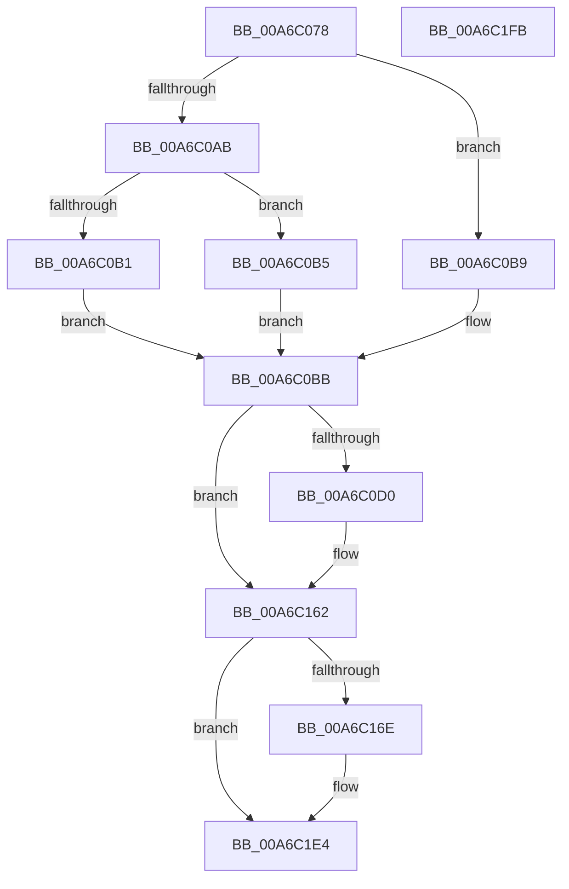

# EtwTraceTimeZoneInformationRefresh

- RVA: `0x00A6C078`–`0x00A6C1FC` (길이 `388` bytes)
- VA: `0x0000000140A6C078`
- 실행 섹션: `PAGE`
- PDB 이름 있음: `예`; PDB Function 태그: `아니요`
- unwind 정보 RVA: `0x000B43E4`
- 디코드: `98`개 명령, `388/388` bytes 표시
- 미해석 바이트: `0` (있으면 어셈블리에 `.byte`로 보존)

> 이 문서는 커널 이미지의 기계어와 PDB 기호를 분석해 생성했습니다. 4번과 5번은 함수 원형과 자료형을 바이너리 사용 방식에서 추정한 C 해석이며 원본 소스 복구 결과는 아닙니다.

## 1. Dependencies

- 직접 호출 지점: **3**; 고유 호출 대상: **3**
- 직접 호출자로 확인된 함수: **1**
- RIP 상대 이미지 참조: **5**

### Outgoing calls
- `0x00A6C15D` → [tlgWriteTransfer_EtwWriteTransfer](../../text/42/tlgWriteTransfer_EtwWriteTransfer_function_004260E0.md) (function, `0x004260E0`)
- `0x00A6C1DF` → [EtwWrite](../../text/41/EtwWrite_function_0041C720.md) (function, `0x0041C720`)
- `0x00A6C1EB` → [_security_check_cookie](../../text/6A/_security_check_cookie_function_006AC640.md) (function, `0x006AC640`)

### Direct callers
- [ExpRefreshTimeZoneInformation](ExpRefreshTimeZoneInformation_function_00A6B46C.md) at `0x00A6B610`
- [ExpRefreshTimeZoneInformation](ExpRefreshTimeZoneInformation_function_00A6B46C.md) at `0x00A6BB0D`

### Static image references
- `0x00A6C097` → RVA `0x00E0A740` (`.data`; read)
- `0x00A6C0BB` → RVA `0x00E09168` (`.data`; read)
- `0x00A6C127` → RVA `0x0005402F` (`.rdata`; read)
- `0x00A6C162` → RVA `0x00EFFA28` (`.data`; read)
- `0x00A6C17C` → RVA `0x00021530` (`.rdata`; read)

## 2. Other-region calls and transfers

- 다른 실행 섹션으로 향하는 call: **3**
  - `0x00A6C15D` → [tlgWriteTransfer_EtwWriteTransfer](../../text/42/tlgWriteTransfer_EtwWriteTransfer_function_004260E0.md) (`PAGE` → `.text`)
  - `0x00A6C1DF` → [EtwWrite](../../text/41/EtwWrite_function_0041C720.md) (`PAGE` → `.text`)
  - `0x00A6C1EB` → [_security_check_cookie](../../text/6A/_security_check_cookie_function_006AC640.md) (`PAGE` → `.text`)
- 별도 외부 분기/꼬리 이동을 확인하지 못했습니다.

## 3. Assembly (complete function range)

```asm
00A6C078  48 8B C4                        mov rax, rsp
00A6C07B  44 88 48 20                     mov byte ptr [rax + 0x20], r9b
00A6C07F  44 89 40 18                     mov dword ptr [rax + 0x18], r8d
00A6C083  89 50 10                        mov dword ptr [rax + 0x10], edx
00A6C086  89 48 08                        mov dword ptr [rax + 8], ecx
00A6C089  55                              push rbp
00A6C08A  56                              push rsi
00A6C08B  57                              push rdi
00A6C08C  48 8D 68 D8                     lea rbp, [rax - 0x28]
00A6C090  48 81 EC 10 01 00 00            sub rsp, 0x110
00A6C097  48 8B 05 A2 E6 39 00            mov rax, qword ptr [rip + 0x39e6a2]
00A6C09E  48 33 C4                        xor rax, rsp
00A6C0A1  48 89 45 00                     mov qword ptr [rbp], rax
00A6C0A5  41 83 E8 01                     sub r8d, 1
00A6C0A9  74 0E                           je 0x140a6c0b9
00A6C0AB  41 83 F8 01                     cmp r8d, 1
00A6C0AF  74 04                           je 0x140a6c0b5
00A6C0B1  B0 55                           mov al, 0x55
00A6C0B3  EB 06                           jmp 0x140a6c0bb
00A6C0B5  B0 44                           mov al, 0x44
00A6C0B7  EB 02                           jmp 0x140a6c0bb
00A6C0B9  B0 53                           mov al, 0x53
00A6C0BB  83 3D A6 D0 39 00 05            cmp dword ptr [rip + 0x39d0a6], 5
00A6C0C2  BF 04 00 00 00                  mov edi, 4
00A6C0C7  8D 77 FD                        lea esi, [rdi - 3]
00A6C0CA  0F 86 92 00 00 00               jbe 0x140a6c162
00A6C0D0  83 65 BC 00                     and dword ptr [rbp - 0x44], 0
00A6C0D4  45 33 C0                        xor r8d, r8d
00A6C0D7  83 65 CC 00                     and dword ptr [rbp - 0x34], 0
00A6C0DB  83 65 DC 00                     and dword ptr [rbp - 0x24], 0
00A6C0DF  83 65 EC 00                     and dword ptr [rbp - 0x14], 0
00A6C0E3  83 65 FC 00                     and dword ptr [rbp - 4], 0
00A6C0E7  88 44 24 30                     mov byte ptr [rsp + 0x30], al
00A6C0EB  48 8D 44 24 30                  lea rax, [rsp + 0x30]
00A6C0F0  48 89 45 D0                     mov qword ptr [rbp - 0x30], rax
00A6C0F4  48 8D 44 24 31                  lea rax, [rsp + 0x31]
00A6C0F9  48 89 45 E0                     mov qword ptr [rbp - 0x20], rax
00A6C0FD  8A 45 50                        mov al, byte ptr [rbp + 0x50]
00A6C100  89 4C 24 34                     mov dword ptr [rsp + 0x34], ecx
00A6C104  48 8D 4C 24 34                  lea rcx, [rsp + 0x34]
00A6C109  88 44 24 32                     mov byte ptr [rsp + 0x32], al
00A6C10D  48 8D 44 24 32                  lea rax, [rsp + 0x32]
00A6C112  48 89 4D B0                     mov qword ptr [rbp - 0x50], rcx
00A6C116  48 8D 4C 24 38                  lea rcx, [rsp + 0x38]
00A6C11B  48 89 45 F0                     mov qword ptr [rbp - 0x10], rax
00A6C11F  48 8D 45 90                     lea rax, [rbp - 0x70]
00A6C123  89 54 24 38                     mov dword ptr [rsp + 0x38], edx
00A6C127  48 8D 15 01 7F 5E FF            lea rdx, [rip - 0xa180ff]
00A6C12E  48 89 4D C0                     mov qword ptr [rbp - 0x40], rcx
00A6C132  48 8D 0D 2F D0 39 00            lea rcx, [rip + 0x39d02f]
00A6C139  44 88 4C 24 31                  mov byte ptr [rsp + 0x31], r9b
00A6C13E  45 33 C9                        xor r9d, r9d
00A6C141  48 89 44 24 28                  mov qword ptr [rsp + 0x28], rax
00A6C146  C7 44 24 20 07 00 00 00         mov dword ptr [rsp + 0x20], 7
00A6C14E  89 7D B8                        mov dword ptr [rbp - 0x48], edi
00A6C151  89 7D C8                        mov dword ptr [rbp - 0x38], edi
00A6C154  89 75 D8                        mov dword ptr [rbp - 0x28], esi
00A6C157  89 75 E8                        mov dword ptr [rbp - 0x18], esi
00A6C15A  89 75 F8                        mov dword ptr [rbp - 8], esi
00A6C15D  E8 7E 9F 9B FF                  call 0x1404260e0
00A6C162  48 8B 0D BF 38 49 00            mov rcx, qword ptr [rip + 0x4938bf]
00A6C169  48 85 C9                        test rcx, rcx
00A6C16C  74 76                           je 0x140a6c1e4
00A6C16E  83 64 24 4C 00                  and dword ptr [rsp + 0x4c], 0
00A6C173  48 8D 45 30                     lea rax, [rbp + 0x30]
00A6C177  83 64 24 5C 00                  and dword ptr [rsp + 0x5c], 0
00A6C17C  48 8D 15 AD 53 5B FF            lea rdx, [rip - 0xa4ac53]
00A6C183  83 64 24 6C 00                  and dword ptr [rsp + 0x6c], 0
00A6C188  41 B9 05 00 00 00               mov r9d, 5
00A6C18E  83 64 24 7C 00                  and dword ptr [rsp + 0x7c], 0
00A6C193  45 33 C0                        xor r8d, r8d
00A6C196  83 65 8C 00                     and dword ptr [rbp - 0x74], 0
00A6C19A  48 89 44 24 40                  mov qword ptr [rsp + 0x40], rax
00A6C19F  48 8D 45 38                     lea rax, [rbp + 0x38]
00A6C1A3  48 89 44 24 50                  mov qword ptr [rsp + 0x50], rax
00A6C1A8  48 8D 45 40                     lea rax, [rbp + 0x40]
00A6C1AC  48 89 44 24 60                  mov qword ptr [rsp + 0x60], rax
00A6C1B1  48 8D 45 48                     lea rax, [rbp + 0x48]
00A6C1B5  48 89 44 24 70                  mov qword ptr [rsp + 0x70], rax
00A6C1BA  48 8D 45 50                     lea rax, [rbp + 0x50]
00A6C1BE  48 89 45 80                     mov qword ptr [rbp - 0x80], rax
00A6C1C2  48 8D 44 24 40                  lea rax, [rsp + 0x40]
00A6C1C7  48 89 44 24 20                  mov qword ptr [rsp + 0x20], rax
00A6C1CC  89 7C 24 48                     mov dword ptr [rsp + 0x48], edi
00A6C1D0  89 7C 24 58                     mov dword ptr [rsp + 0x58], edi
00A6C1D4  89 7C 24 68                     mov dword ptr [rsp + 0x68], edi
00A6C1D8  89 74 24 78                     mov dword ptr [rsp + 0x78], esi
00A6C1DC  89 75 88                        mov dword ptr [rbp - 0x78], esi
00A6C1DF  E8 3C 05 9B FF                  call 0x14041c720
00A6C1E4  48 8B 4D 00                     mov rcx, qword ptr [rbp]
00A6C1E8  48 33 CC                        xor rcx, rsp
00A6C1EB  E8 50 04 C4 FF                  call 0x1406ac640
00A6C1F0  48 81 C4 10 01 00 00            add rsp, 0x110
00A6C1F7  5F                              pop rdi
00A6C1F8  5E                              pop rsi
00A6C1F9  5D                              pop rbp
00A6C1FA  C3                              ret
00A6C1FB  CC                              int3
```

## 4. C-style interpretation (structured pseudocode)

```c
__int64 __fastcall EtwTraceTimeZoneInformationRefresh(int a1, int a2, int a3, int a4)
{
    __int64 result;
    __int64 v_rsp;
    unsigned __int64 v_stack_m100;
    unsigned int v_stack_m108;
    unsigned int v_stack_mAC;
    unsigned int v_stack_mB0;
    unsigned __int64 v_stack_mB8;
    unsigned int v_stack_mBC;
    unsigned int v_stack_mC0;
    unsigned __int64 v_stack_mC8;
    unsigned int v_stack_mCC;
    unsigned int v_stack_mD0;
    unsigned __int64 v_stack_mD8;
    unsigned int v_stack_mDC;
    unsigned int v_stack_mE0;
    unsigned __int64 v_stack_mE8;
    unsigned __int64 v_stack_mF0;
    unsigned int v_stack_mF4;
    unsigned __int8 v_stack_mF6;
    unsigned __int64 v_stack_mF7;
    unsigned __int8 v_stack_mF8;

    *(unsigned __int8 *)(v_rsp + 32) = (unsigned __int8)(a4);
    *(unsigned int *)(v_rsp + 24) = a3;
    *(unsigned int *)(v_rsp + 16) = a2;
    *(unsigned int *)(v_rsp + 8) = a1;
    v_rsp = (v_rsp) - (272);
    result = (*(unsigned __int64 *)(v_rip + 3794594)) ^ (v_rsp);
    *(unsigned __int64 *)(v_rsp - 40) = result;
    a3 = (unsigned int)((a3) - (1));
    if (condition_is_equal) goto loc_00A6C0B9;
    if (a3 == 1) goto loc_00A6C0B5;
    goto loc_00A6C0BB;
loc_00A6C0B5:
    goto loc_00A6C0BB;
loc_00A6C0B9:
loc_00A6C0BB:
    result = 83;
    if ((*(unsigned int *)(v_rip + 3788966)) >= = 5) {
        a3 = 0;
        v_stack_mF8 = 83;
        result = v_stack_mF8;
        *(unsigned __int64 *)(v_rsp - 40 - 48) = result;
        result = v_stack_mF7;
        *(unsigned __int64 *)(v_rsp - 40 - 32) = result;
        result = *(unsigned __int8 *)(v_rsp - 40 + 80);
        v_stack_mF4 = a1;
        a1 = v_stack_mF4;
        v_stack_mF6 = (unsigned __int8)(result);
        result = v_stack_mF6;
        *(unsigned __int64 *)(v_rsp - 40 - 80) = a1;
        a1 = v_stack_mF0;
        *(unsigned __int64 *)(v_rsp - 40 - 16) = result;
        result = v_rsp - 40 - 112;
        v_stack_mF0 = a2;
        a2 = v_rip - 10584319;
        *(unsigned __int64 *)(v_rsp - 40 - 64) = a1;
        a1 = v_rip + 3788847;
        v_stack_mF7 = (unsigned __int8)(a4);
        a4 = 0;
        v_stack_m100 = result;
        v_stack_m108 = 7;
        *(unsigned int *)(v_rsp - 40 - 72) = 4;
        *(unsigned int *)(v_rsp - 40 - 56) = 4;
        *(unsigned int *)(v_rsp - 40 - 40) = (unsigned int)(4 - 3);
        *(unsigned int *)(v_rsp - 40 - 24) = (unsigned int)(4 - 3);
        *(unsigned int *)(v_rsp - 40 - 8) = (unsigned int)(4 - 3);
        result = tlgWriteTransfer_EtwWriteTransfer(a1, a2, a3, a4);
    }
    if (*(unsigned __int64 *)(v_rip + 4798655) != 0) {
        result = v_rsp - 40 + 48;
        a2 = v_rip - 10792019;
        a4 = 5;
        a3 = 0;
        v_stack_mE8 = result;
        result = v_rsp - 40 + 56;
        v_stack_mD8 = result;
        result = v_rsp - 40 + 64;
        v_stack_mC8 = result;
        result = v_rsp - 40 + 72;
        v_stack_mB8 = result;
        result = v_rsp - 40 + 80;
        *(unsigned __int64 *)(v_rsp - 40 - 128) = result;
        result = v_stack_mE8;
        v_stack_m108 = result;
        v_stack_mE0 = 4;
        v_stack_mD0 = 4;
        v_stack_mC0 = 4;
        v_stack_mB0 = (unsigned int)(4 - 3);
        *(unsigned int *)(v_rsp - 40 - 120) = (unsigned int)(4 - 3);
        result = EtwWrite(*(unsigned __int64 *)(v_rip + 4798655), a2, a3, a4);
    }
    a1 = (*(unsigned __int64 *)(v_rsp - 40)) ^ (v_rsp);
    result = _security_check_cookie(a1, a2, a3, a4);
    v_rsp = (v_rsp) + (272);
    return result;
}
```

## 5. (Beta) C Style

```c
int64_t EtwTraceTimeZoneInformationRefresh(int32_t Arg1, int32_t Arg2, int32_t Arg3, int32_t Arg4)
{
    int64_t result;
    int64_t local_rsp;
    uint64_t v_stack_m100;
    uint32_t v_stack_m108;
    uint32_t v_stack_mAC;
    uint32_t v_stack_mB0;
    uint64_t v_stack_mB8;
    uint32_t v_stack_mBC;
    uint32_t v_stack_mC0;
    uint64_t v_stack_mC8;
    uint32_t v_stack_mCC;
    uint32_t v_stack_mD0;
    uint64_t v_stack_mD8;
    uint32_t v_stack_mDC;
    uint32_t v_stack_mE0;
    uint64_t v_stack_mE8;
    uint64_t v_stack_mF0;
    uint32_t v_stack_mF4;
    uint8_t v_stack_mF6;
    uint64_t v_stack_mF7;
    uint8_t v_stack_mF8;

    *(uint8_t *)(local_rsp + 0x20) = (uint8_t)(Arg4);
    *(uint32_t *)(local_rsp + 0x18) = Arg3;
    *(uint32_t *)(local_rsp + 0x10) = Arg2;
    *(uint32_t *)(local_rsp + 0x8) = Arg1;
    local_rsp = (local_rsp) - (272);
    result = (*(uint64_t *)(v_rip + 0x39E6A2)) ^ (local_rsp);
    *(uint64_t *)(local_rsp - 0x28) = result;
    Arg3 = (uint32_t)((Arg3) - (1));
    if (condition_is_equal) goto loc_00A6C0B9;
    if (Arg3 == 1) goto loc_00A6C0B5;
    goto loc_00A6C0BB;
loc_00A6C0B5:
    goto loc_00A6C0BB;
loc_00A6C0B9:
loc_00A6C0BB:
    result = 83;
    if ((*(uint32_t *)(v_rip + 0x39D0A6)) >= = 5) {
        Arg3 = 0;
        v_stack_mF8 = 83;
        result = v_stack_mF8;
        *(uint64_t *)(local_rsp - 0x28 - 0x30) = result;
        result = v_stack_mF7;
        *(uint64_t *)(local_rsp - 0x28 - 0x20) = result;
        result = *(uint8_t *)(local_rsp - 0x28 + 0x50);
        v_stack_mF4 = Arg1;
        Arg1 = v_stack_mF4;
        v_stack_mF6 = (uint8_t)(result);
        result = v_stack_mF6;
        *(uint64_t *)(local_rsp - 0x28 - 0x50) = Arg1;
        Arg1 = v_stack_mF0;
        *(uint64_t *)(local_rsp - 0x28 - 0x10) = result;
        result = local_rsp - 40 - 112;
        v_stack_mF0 = Arg2;
        Arg2 = v_rip - 10584319;
        *(uint64_t *)(local_rsp - 0x28 - 0x40) = Arg1;
        Arg1 = v_rip + 3788847;
        v_stack_mF7 = (uint8_t)(Arg4);
        Arg4 = 0;
        v_stack_m100 = result;
        v_stack_m108 = 7;
        *(uint32_t *)(local_rsp - 0x28 - 0x48) = 4;
        *(uint32_t *)(local_rsp - 0x28 - 0x38) = 4;
        *(uint32_t *)(local_rsp - 0x28 - 0x28) = (uint32_t)(4 - 3);
        *(uint32_t *)(local_rsp - 0x28 - 0x18) = (uint32_t)(4 - 3);
        *(uint32_t *)(local_rsp - 0x28 - 0x8) = (uint32_t)(4 - 3);
        result = tlgWriteTransfer_EtwWriteTransfer(Arg1, Arg2, Arg3, Arg4);
    }
    if (*(uint64_t *)(v_rip + 0x4938BF) != 0) {
        result = local_rsp - 40 + 48;
        Arg2 = v_rip - 10792019;
        Arg4 = 5;
        Arg3 = 0;
        v_stack_mE8 = result;
        result = local_rsp - 40 + 56;
        v_stack_mD8 = result;
        result = local_rsp - 40 + 64;
        v_stack_mC8 = result;
        result = local_rsp - 40 + 72;
        v_stack_mB8 = result;
        result = local_rsp - 40 + 80;
        *(uint64_t *)(local_rsp - 0x28 - 0x80) = result;
        result = v_stack_mE8;
        v_stack_m108 = result;
        v_stack_mE0 = 4;
        v_stack_mD0 = 4;
        v_stack_mC0 = 4;
        v_stack_mB0 = (uint32_t)(4 - 3);
        *(uint32_t *)(local_rsp - 0x28 - 0x78) = (uint32_t)(4 - 3);
        result = EtwWrite(*(uint64_t *)(v_rip + 0x4938BF), Arg2, Arg3, Arg4);
    }
    Arg1 = (*(uint64_t *)(local_rsp - 0x28)) ^ (local_rsp);
    result = _security_check_cookie(Arg1, Arg2, Arg3, Arg4);
    local_rsp = (local_rsp) + (272);
    return result;
}
```

## 6. Execution-region graph

[열기: 2D/3D 그래프와 함수 탐색 컨트롤 패널](../../../control-panel.html?section=page&rva=0x00A6C078&view=graph)

- 2D 그래프는 위에서 아래로 흐르고, 3D 그래프는 빈 공간을 드래그해 회전합니다. Shift+드래그는 이동, 휠은 확대·축소, 함수 노드 선택은 대상 보고서 이동입니다.

### Static fallback


