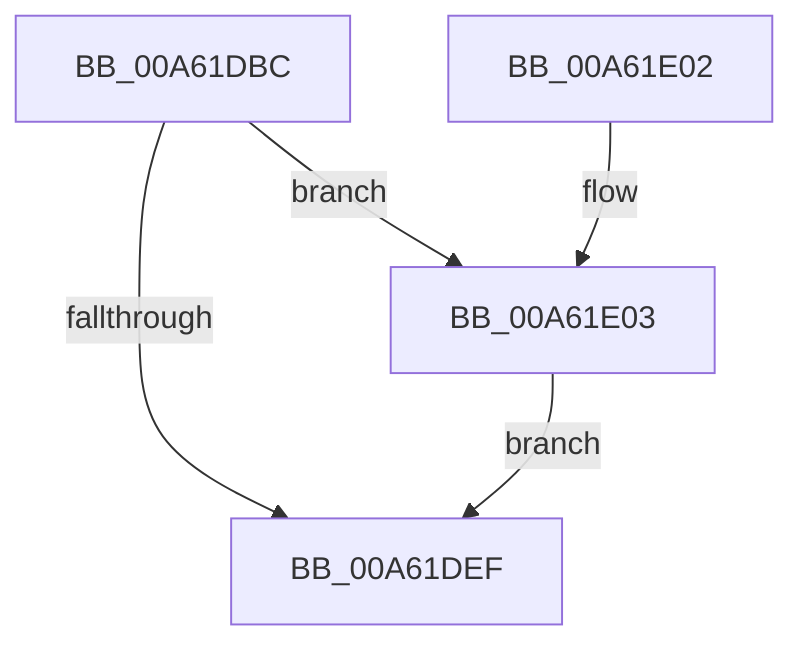

# EtwTraceWorkingSetInSwapStoreFail

- RVA: `0x00A61DBC`–`0x00A61E60` (길이 `164` bytes)
- VA: `0x0000000140A61DBC`
- 실행 섹션: `PAGE`
- PDB 이름 있음: `예`; PDB Function 태그: `아니요`
- unwind 정보 RVA: `0x000B32BC`
- 디코드: `40`개 명령, `164/164` bytes 표시
- 미해석 바이트: `0` (있으면 어셈블리에 `.byte`로 보존)

> 이 문서는 커널 이미지의 기계어와 PDB 기호를 분석해 생성했습니다. 4번과 5번은 함수 원형과 자료형을 바이너리 사용 방식에서 추정한 C 해석이며 원본 소스 복구 결과는 아닙니다.

## 1. Dependencies

- 직접 호출 지점: **4**; 고유 호출 대상: **4**
- 직접 호출자로 확인된 함수: **1**
- RIP 상대 이미지 참조: **3**

### Outgoing calls
- `0x00A61DE6` → [EtwProviderEnabled](../../text/3B/EtwProviderEnabled_function_003BA250.md) (function, `0x003BA250`)
- `0x00A61DF7` → [_security_check_cookie](../../text/6A/_security_check_cookie_function_006AC640.md) (function, `0x006AC640`)
- `0x00A61E06` → [PsGetProcessId](../../text/43/PsGetProcessId_function_0043D910.md) (function, `0x0043D910`)
- `0x00A61E59` → [EtwWrite](../../text/41/EtwWrite_function_0041C720.md) (function, `0x0041C720`)

### Direct callers
- [MiInSwapStoreWorker](MiInSwapStoreWorker_function_00A61C60.md) at `0x00A61CCB`

### Static image references
- `0x00A61DC5` → RVA `0x00E0A740` (`.data`; read)
- `0x00A61DD9` → RVA `0x00EFF848` (`.data`; read)
- `0x00A61E10` → RVA `0x0001A810` (`.rdata`; read)

## 2. Other-region calls and transfers

- 다른 실행 섹션으로 향하는 call: **4**
  - `0x00A61DE6` → [EtwProviderEnabled](../../text/3B/EtwProviderEnabled_function_003BA250.md) (`PAGE` → `.text`)
  - `0x00A61DF7` → [_security_check_cookie](../../text/6A/_security_check_cookie_function_006AC640.md) (`PAGE` → `.text`)
  - `0x00A61E06` → [PsGetProcessId](../../text/43/PsGetProcessId_function_0043D910.md) (`PAGE` → `.text`)
  - `0x00A61E59` → [EtwWrite](../../text/41/EtwWrite_function_0041C720.md) (`PAGE` → `.text`)
- 별도 외부 분기/꼬리 이동을 확인하지 못했습니다.

## 3. Assembly (complete function range)

```asm
00A61DBC  89 54 24 10                     mov dword ptr [rsp + 0x10], edx
00A61DC0  53                              push rbx
00A61DC1  48 83 EC 60                     sub rsp, 0x60
00A61DC5  48 8B 05 74 89 3A 00            mov rax, qword ptr [rip + 0x3a8974]
00A61DCC  48 33 C4                        xor rax, rsp
00A61DCF  48 89 44 24 58                  mov qword ptr [rsp + 0x58], rax
00A61DD4  48 8B D9                        mov rbx, rcx
00A61DD7  33 D2                           xor edx, edx
00A61DD9  48 8B 0D 68 DA 49 00            mov rcx, qword ptr [rip + 0x49da68]
00A61DE0  41 B8 80 00 00 00               mov r8d, 0x80
00A61DE6  E8 65 84 95 FF                  call 0x1403ba250
00A61DEB  84 C0                           test al, al
00A61DED  75 14                           jne 0x140a61e03
00A61DEF  48 8B 4C 24 58                  mov rcx, qword ptr [rsp + 0x58]
00A61DF4  48 33 CC                        xor rcx, rsp
00A61DF7  E8 44 A8 C4 FF                  call 0x1406ac640
00A61DFC  48 83 C4 60                     add rsp, 0x60
00A61E00  5B                              pop rbx
00A61E01  C3                              ret
00A61E02  CC                              int3
00A61E03  48 8B CB                        mov rcx, rbx
00A61E06  E8 05 BB 9D FF                  call 0x14043d910
00A61E0B  83 64 24 44 00                  and dword ptr [rsp + 0x44], 0
00A61E10  48 8D 15 F9 89 5B FF            lea rdx, [rip - 0xa47607]
00A61E17  83 64 24 54 00                  and dword ptr [rsp + 0x54], 0
00A61E1C  B9 04 00 00 00                  mov ecx, 4
00A61E21  89 44 24 30                     mov dword ptr [rsp + 0x30], eax
00A61E25  45 33 C0                        xor r8d, r8d
00A61E28  48 8D 44 24 30                  lea rax, [rsp + 0x30]
00A61E2D  89 4C 24 40                     mov dword ptr [rsp + 0x40], ecx
00A61E31  48 89 44 24 38                  mov qword ptr [rsp + 0x38], rax
00A61E36  48 8D 44 24 78                  lea rax, [rsp + 0x78]
00A61E3B  48 89 44 24 48                  mov qword ptr [rsp + 0x48], rax
00A61E40  44 8D 49 FE                     lea r9d, [rcx - 2]
00A61E44  48 8D 44 24 38                  lea rax, [rsp + 0x38]
00A61E49  89 4C 24 50                     mov dword ptr [rsp + 0x50], ecx
00A61E4D  48 8B 0D F4 D9 49 00            mov rcx, qword ptr [rip + 0x49d9f4]
00A61E54  48 89 44 24 20                  mov qword ptr [rsp + 0x20], rax
00A61E59  E8 C2 A8 9B FF                  call 0x14041c720
00A61E5E  EB 8F                           jmp 0x140a61def
```

## 4. C-style interpretation (structured pseudocode)

```c
__int64 __fastcall EtwTraceWorkingSetInSwapStoreFail(__int64 a1, int a2)
{
    __int64 result;
    __int64 v_rsp;
    unsigned __int64 v_stack_m10;
    unsigned int v_stack_p10;
    unsigned __int64 v_stack_p20;
    unsigned int v_stack_p30;
    unsigned __int64 v_stack_p38;
    unsigned int v_stack_p40;
    unsigned int v_stack_p44;
    unsigned __int64 v_stack_p48;
    unsigned int v_stack_p50;
    unsigned int v_stack_p54;
    unsigned __int64 v_stack_p78;

    v_stack_p10 = a2;
    v_rsp = (v_rsp) - (96);
    result = (*(unsigned __int64 *)(v_rip + 3836276)) ^ (v_rsp);
    v_stack_m10 = result;
    a2 = 0;
    result = EtwProviderEnabled(*(unsigned __int64 *)(v_rip + 4840040), a2, 128, a4);
    if ((unsigned __int8)(result) != 0) goto loc_00A61E03;
loc_00A61DEF:
    a1 = (v_stack_m10) ^ (v_rsp);
    result = _security_check_cookie(a1, a2, 128, a4);
    v_rsp = (v_rsp) + (96);
    return result;
loc_00A61E03:
    result = PsGetProcessId(a1, a2, 128, a4);
    v_stack_p30 = (unsigned int)(result);
    a3 = 0;
    v_stack_p40 = 4;
    v_stack_p38 = v_stack_p30;
    v_stack_p48 = v_stack_p78;
    v_stack_p50 = 4;
    v_stack_p20 = v_stack_p38;
    result = EtwWrite(*(unsigned __int64 *)(v_rip + 4839924), v_rip - 10778119, a3, 4 - 2);
    goto loc_00A61DEF;
}
```

## 5. (Beta) C Style

```c
int64_t EtwTraceWorkingSetInSwapStoreFail(int64_t Arg1, int32_t Arg2)
{
    int64_t result;
    int64_t local_rsp;
    uint64_t v_stack_m10;
    uint32_t v_stack_p10;
    uint64_t v_stack_p20;
    uint32_t v_stack_p30;
    uint64_t v_stack_p38;
    uint32_t v_stack_p40;
    uint32_t v_stack_p44;
    uint64_t v_stack_p48;
    uint32_t v_stack_p50;
    uint32_t v_stack_p54;
    uint64_t v_stack_p78;

    v_stack_p10 = Arg2;
    local_rsp = (local_rsp) - (96);
    result = (*(uint64_t *)(v_rip + 0x3A8974)) ^ (local_rsp);
    v_stack_m10 = result;
    Arg2 = 0;
    result = EtwProviderEnabled(*(uint64_t *)(v_rip + 0x49DA68), Arg2, 128, a4);
    if ((uint8_t)(result) != 0) goto loc_00A61E03;
loc_00A61DEF:
    Arg1 = (v_stack_m10) ^ (local_rsp);
    result = _security_check_cookie(Arg1, Arg2, 128, a4);
    local_rsp = (local_rsp) + (96);
    return result;
loc_00A61E03:
    result = PsGetProcessId(Arg1, Arg2, 128, a4);
    v_stack_p30 = (uint32_t)(result);
    a3 = 0;
    v_stack_p40 = 4;
    v_stack_p38 = v_stack_p30;
    v_stack_p48 = v_stack_p78;
    v_stack_p50 = 4;
    v_stack_p20 = v_stack_p38;
    result = EtwWrite(*(uint64_t *)(v_rip + 0x49D9F4), v_rip - 10778119, a3, 4 - 2);
    goto loc_00A61DEF;
}
```

## 6. Execution-region graph

[열기: 2D/3D 그래프와 함수 탐색 컨트롤 패널](../../../control-panel.html?section=page&rva=0x00A61DBC&view=graph)

- 2D 그래프는 위에서 아래로 흐르고, 3D 그래프는 빈 공간을 드래그해 회전합니다. Shift+드래그는 이동, 휠은 확대·축소, 함수 노드 선택은 대상 보고서 이동입니다.

### Static fallback


