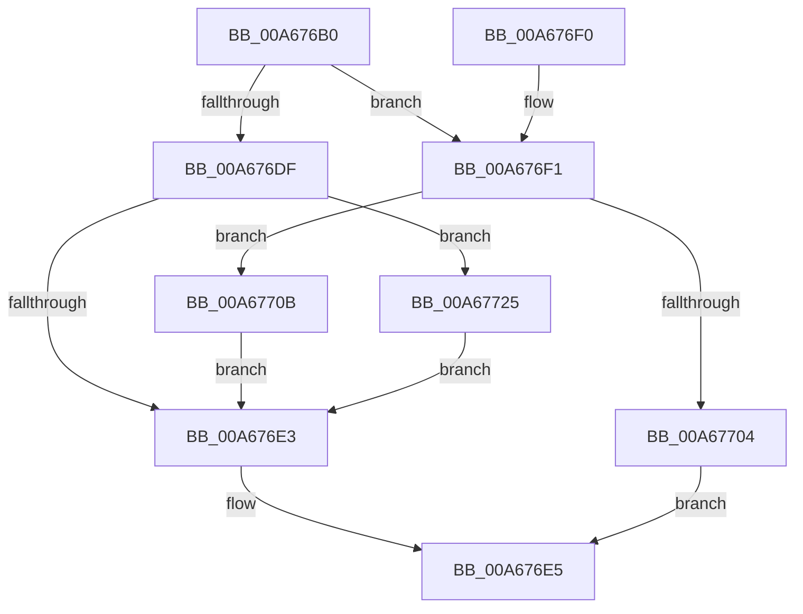

# EtwpCheckForPoolTagFilterExtension

- RVA: `0x00A676B0`–`0x00A67740` (길이 `144` bytes)
- VA: `0x0000000140A676B0`
- 실행 섹션: `PAGE`
- PDB 이름 있음: `예`; PDB Function 태그: `아니요`
- unwind 정보 RVA: `0x000B3C8C`
- 디코드: `40`개 명령, `144/144` bytes 표시
- 미해석 바이트: `0` (있으면 어셈블리에 `.byte`로 보존)

> 이 문서는 커널 이미지의 기계어와 PDB 기호를 분석해 생성했습니다. 4번과 5번은 함수 원형과 자료형을 바이너리 사용 방식에서 추정한 C 해석이며 원본 소스 복구 결과는 아닙니다.

## 1. Dependencies

- 직접 호출 지점: **2**; 고유 호출 대상: **2**
- 직접 호출자로 확인된 함수: **2**
- RIP 상대 이미지 참조: **1**

### Outgoing calls
- `0x00A676D2` → [EtwpGetFlagExtension](EtwpGetFlagExtension_function_00A67748.md) (function, `0x00A67748`)
- `0x00A6771E` → [EtwpUpdateTagFilter](../7B/EtwpUpdateTagFilter_function_007B7D04.md) (function, `0x007B7D04`)

### Direct callers
- [EtwpStartLogger](../A9/EtwpStartLogger_function_00A99D80.md) at `0x00A9AD63`
- [EtwpUpdateTrace](../AB/EtwpUpdateTrace_function_00ABCC7C.md) at `0x00ABCF87`

### Static image references
- `0x00A6770F` → RVA `0x00EFF940` (`.data`; read)

## 2. Other-region calls and transfers

- 다른 실행 섹션으로 향하는 call: **0**
- 별도 외부 분기/꼬리 이동을 확인하지 못했습니다.

## 3. Assembly (complete function range)

```asm
00A676B0  48 89 5C 24 08                  mov qword ptr [rsp + 8], rbx
00A676B5  57                              push rdi
00A676B6  48 83 EC 20                     sub rsp, 0x20
00A676BA  44 0F B6 99 32 03 00 00         movzx r11d, byte ptr [rcx + 0x332]
00A676C2  48 8B C2                        mov rax, rdx
00A676C5  BF 04 00 00 00                  mov edi, 4
00A676CA  48 8B C8                        mov rcx, rax
00A676CD  8B D7                           mov edx, edi
00A676CF  41 8A D8                        mov bl, r8b
00A676D2  E8 71 00 00 00                  call 0x140a67748
00A676D7  4C 8B D0                        mov r10, rax
00A676DA  48 85 C0                        test rax, rax
00A676DD  75 12                           jne 0x140a676f1
00A676DF  84 DB                           test bl, bl
00A676E1  75 42                           jne 0x140a67725
00A676E3  33 C0                           xor eax, eax
00A676E5  48 8B 5C 24 30                  mov rbx, qword ptr [rsp + 0x30]
00A676EA  48 83 C4 20                     add rsp, 0x20
00A676EE  5F                              pop rdi
00A676EF  C3                              ret
00A676F0  CC                              int3
00A676F1  0F B7 10                        movzx edx, word ptr [rax]
00A676F4  66 C1 E2 02                     shl dx, 2
00A676F8  66 2B D7                        sub dx, di
00A676FB  66 C1 EA 02                     shr dx, 2
00A676FF  66 3B D7                        cmp dx, di
00A67702  76 07                           jbe 0x140a6770b
00A67704  B8 0D 00 00 C0                  mov eax, 0xc000000d
00A67709  EB DA                           jmp 0x140a676e5
00A6770B  4B 8D 0C 9B                     lea rcx, [r11 + r11*4]
00A6770F  48 8D 05 2A 82 49 00            lea rax, [rip + 0x49822a]
00A67716  4C 8D 04 88                     lea r8, [rax + rcx*4]
00A6771A  49 8D 4A 04                     lea rcx, [r10 + 4]
00A6771E  E8 E1 05 D5 FF                  call 0x1407b7d04
00A67723  EB BE                           jmp 0x140a676e3
00A67725  4B 8D 0C 9B                     lea rcx, [r11 + r11*4]
00A67729  48 8D 05 10 82 49 00            lea rax, [rip + 0x498210]
00A67730  66 C7 04 88 01 00               mov word ptr [rax + rcx*4], 1
00A67736  C7 44 88 04 2A 00 00 00         mov dword ptr [rax + rcx*4 + 4], 0x2a
00A6773E  EB A3                           jmp 0x140a676e3
```

## 4. C-style interpretation (structured pseudocode)

```c
__int64 __fastcall EtwpCheckForPoolTagFilterExtension(__int64 a1, __int64 a2, unsigned __int8 a3)
{
    __int64 result;
    __int64 v_rsp;
    unsigned __int64 v_stack_p8;

    v_stack_p8 = v_rbx;
    v_rsp = (v_rsp) - (32);
    result = EtwpGetFlagExtension(a2, 4, a3, a4);
    if (result != 0) goto loc_00A676F1;
    if (a3 != 0) goto loc_00A67725;
loc_00A676E3:
    result = 0;
loc_00A676E5:
    v_rsp = (v_rsp) + (32);
    return result;
loc_00A676F1:
    a2 = (unsigned __int16)((*(unsigned __int16 *)(result)) << (2));
    a2 = (unsigned __int16)((a2) - (4));
    a2 = (unsigned __int16)((a2) >> (2));
    if (((unsigned __int16)(a2)) <= 4) goto loc_00A6770B;
    goto loc_00A676E5;
loc_00A6770B:
    result = EtwpUpdateTagFilter(result + 4, a2, v_rip + 4817450 + *(unsigned __int8 *)(a1 + 818) + *(unsigned __int8 *)(a1 + 818) * 4 * 4, a4);
    goto loc_00A676E3;
loc_00A67725:
    *(unsigned __int16 *)(v_rip + 4817424 + *(unsigned __int8 *)(a1 + 818) + *(unsigned __int8 *)(a1 + 818) * 4 * 4) = 1;
    *(unsigned int *)(v_rip + 4817424 + *(unsigned __int8 *)(a1 + 818) + *(unsigned __int8 *)(a1 + 818) * 4 * 4 + 4) = 42;
    goto loc_00A676E3;
}
```

## 5. (Beta) C Style

```c
int64_t EtwpCheckForPoolTagFilterExtension(void *Arg1, int64_t Arg2, uint8_t Arg3)
{
    uint8_t *arg1 = (uint8_t *)Arg1;

    int64_t result;
    int64_t local_rsp;
    uint64_t v_stack_p8;

    v_stack_p8 = local_rbx;
    local_rsp = (local_rsp) - (32);
    result = EtwpGetFlagExtension(Arg2, 4, Arg3, a4);
    if (result != 0) goto loc_00A676F1;
    if (Arg3 != 0) goto loc_00A67725;
loc_00A676E3:
    result = 0;
loc_00A676E5:
    local_rsp = (local_rsp) + (32);
    return result;
loc_00A676F1:
    Arg2 = (uint16_t)((*(uint16_t *)(result)) << (2));
    Arg2 = (uint16_t)((Arg2) - (4));
    Arg2 = (uint16_t)((Arg2) >> (2));
    if (((uint16_t)(Arg2)) <= 4) goto loc_00A6770B;
    goto loc_00A676E5;
loc_00A6770B:
    result = EtwpUpdateTagFilter(result + 4, Arg2, v_rip + 4817450 + *(uint8_t *)(arg1 + 0x332) + *(uint8_t *)(arg1 + 0x332) * 4 * 4, a4);
    goto loc_00A676E3;
loc_00A67725:
    *(uint16_t *)(v_rip + 0x498210 + *(uint8_t *)(arg1 + 0x332) + *(uint8_t *)(arg1 + 0x332) * 4 * 4) = 1;
    *(uint32_t *)(v_rip + 0x498210 + *(uint8_t *)(arg1 + 0x332) + *(uint8_t *)(arg1 + 0x332) * 4 * 4 + 0x4) = 42;
    goto loc_00A676E3;
}
```

### 관측된 메모리 오프셋

구조체 형식이 확인되지 않은 접근은 인자 기준의 오프셋으로만 기록했습니다.

| 기준 인자 | 오프셋 표현 | 폭 (bit) | 접근 |
|---|---:|---:|---|
| `Arg1` | `+ 0x332` | `8` | `R` |

## 6. Execution-region graph

[열기: 2D/3D 그래프와 함수 탐색 컨트롤 패널](../../../control-panel.html?section=page&rva=0x00A676B0&view=graph)

- 2D 그래프는 위에서 아래로 흐르고, 3D 그래프는 빈 공간을 드래그해 회전합니다. Shift+드래그는 이동, 휠은 확대·축소, 함수 노드 선택은 대상 보고서 이동입니다.

### Static fallback


