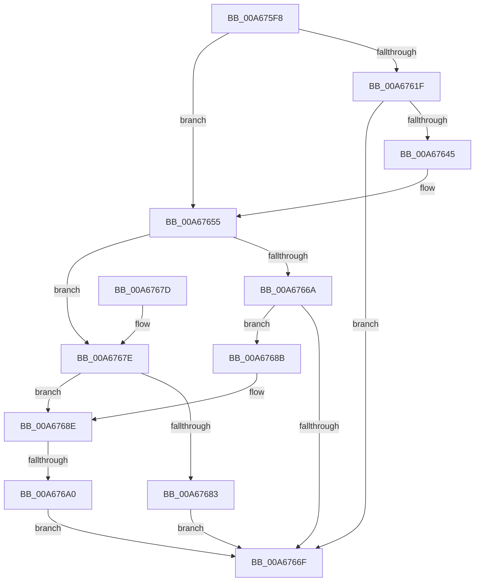

# EtwpCheckForStackTracingExtension

- RVA: `0x00A675F8`–`0x00A676A8` (길이 `176` bytes)
- VA: `0x0000000140A675F8`
- 실행 섹션: `PAGE`
- PDB 이름 있음: `예`; PDB Function 태그: `예`
- unwind 정보 RVA: `0x000ACE78`
- 디코드: `52`개 명령, `176/176` bytes 표시
- 미해석 바이트: `0` (있으면 어셈블리에 `.byte`로 보존)

> 이 문서는 커널 이미지의 기계어와 PDB 기호를 분석해 생성했습니다. 4번과 5번은 함수 원형과 자료형을 바이너리 사용 방식에서 추정한 C 해석이며 원본 소스 복구 결과는 아닙니다.

## 1. Dependencies

- 직접 호출 지점: **4**; 고유 호출 대상: **2**
- 직접 호출자로 확인된 함수: **2**
- RIP 상대 이미지 참조: **0**

### Outgoing calls
- `0x00A67612` → [EtwpGetFlagExtension](EtwpGetFlagExtension_function_00A67748.md) (function, `0x00A67748`)
- `0x00A67639` → [EtwpUpdateStackTracing](EtwpUpdateStackTracing_function_00A6778C.md) (function, `0x00A6778C`)
- `0x00A6764D` → [EtwpGetFlagExtension](EtwpGetFlagExtension_function_00A67748.md) (function, `0x00A67748`)
- `0x00A6765D` → [EtwpGetFlagExtension](EtwpGetFlagExtension_function_00A67748.md) (function, `0x00A67748`)

### Direct callers
- [EtwpStartLogger](../A9/EtwpStartLogger_function_00A99D80.md) at `0x00A9AAC1`
- [EtwpUpdateTrace](../AB/EtwpUpdateTrace_function_00ABCC7C.md) at `0x00ABCF43`

### Static image references
- 디코드된 RIP-relative 메모리 참조가 없습니다.

## 2. Other-region calls and transfers

- 다른 실행 섹션으로 향하는 call: **0**
- call이 아닌 외부 분기/꼬리 이동: **1**
  - `0x00A6769A` → [sub_00B3EB10](../B3/Unknown_function_00B3EB10.md) (`tail-transfer`)

## 3. Assembly (complete function range)

```asm
00A675F8  48 89 5C 24 08                  mov qword ptr [rsp + 8], rbx
00A675FD  57                              push rdi
00A675FE  48 83 EC 20                     sub rsp, 0x20
00A67602  45 33 DB                        xor r11d, r11d
00A67605  48 8B FA                        mov rdi, rdx
00A67608  48 8B D9                        mov rbx, rcx
00A6760B  45 33 D2                        xor r10d, r10d
00A6760E  41 8D 53 03                     lea edx, [r11 + 3]
00A67612  E8 31 01 00 00                  call 0x140a67748
00A67617  48 8B D0                        mov rdx, rax
00A6761A  48 85 C0                        test rax, rax
00A6761D  74 36                           je 0x140a67655
00A6761F  0F B7 00                        movzx eax, word ptr [rax]
00A67622  48 83 C2 04                     add rdx, 4
00A67626  66 C1 E0 02                     shl ax, 2
00A6762A  48 8B CF                        mov rcx, rdi
00A6762D  66 83 E8 04                     sub ax, 4
00A67631  44 0F B7 C0                     movzx r8d, ax
00A67635  41 C1 E8 02                     shr r8d, 2
00A67639  E8 4E 01 00 00                  call 0x140a6778c
00A6763E  44 8B D0                        mov r10d, eax
00A67641  85 C0                           test eax, eax
00A67643  78 2A                           js 0x140a6766f
00A67645  BA 05 00 00 00                  mov edx, 5
00A6764A  48 8B CB                        mov rcx, rbx
00A6764D  E8 F6 00 00 00                  call 0x140a67748
00A67652  4C 8B D8                        mov r11, rax
00A67655  BA 07 00 00 00                  mov edx, 7
00A6765A  48 8B CB                        mov rcx, rbx
00A6765D  E8 E6 00 00 00                  call 0x140a67748
00A67662  48 8B C8                        mov rcx, rax
00A67665  4D 85 DB                        test r11, r11
00A67668  75 14                           jne 0x140a6767e
00A6766A  48 85 C0                        test rax, rax
00A6766D  75 1C                           jne 0x140a6768b
00A6766F  48 8B 5C 24 30                  mov rbx, qword ptr [rsp + 0x30]
00A67674  41 8B C2                        mov eax, r10d
00A67677  48 83 C4 20                     add rsp, 0x20
00A6767B  5F                              pop rdi
00A6767C  C3                              ret
00A6767D  CC                              int3
00A6767E  48 85 C9                        test rcx, rcx
00A67681  74 0B                           je 0x140a6768e
00A67683  41 BA 03 03 00 C0               mov r10d, 0xc0000303
00A67689  EB E4                           jmp 0x140a6766f
00A6768B  4C 8B D9                        mov r11, rcx
00A6768E  41 0F B7 03                     movzx eax, word ptr [r11]
00A67692  66 C1 E0 02                     shl ax, 2
00A67696  66 83 F8 0C                     cmp ax, 0xc
00A6769A  0F 84 70 74 0D 00               je 0x140b3eb10
00A676A0  41 BA 0D 00 00 C0               mov r10d, 0xc000000d
00A676A6  EB C7                           jmp 0x140a6766f
```

## 4. C-style interpretation (structured pseudocode)

```c
__int64 __fastcall EtwpCheckForStackTracingExtension(__int64 a1, __int64 a2)
{
    __int64 result;
    __int64 v_r10;
    __int64 v_r11;
    __int64 v_rsp;
    unsigned __int64 v_stack_p8;

    v_stack_p8 = v_rbx;
    v_rsp = (v_rsp) - (32);
    v_r11 = 0;
    v_r10 = 0;
    result = EtwpGetFlagExtension(a1, v_r11 + 3, a3, a4);
    if (result == 0) goto loc_00A67655;
    a2 = (result) + (4);
    result = (unsigned __int16)((*(unsigned __int16 *)(result)) << (2));
    result = (unsigned __int16)((result) - (4));
    a3 = (unsigned int)(((unsigned __int16)(result)) >> (2));
    result = EtwpUpdateStackTracing(a2, a2, a3, a4);
    if (sign_flag) goto loc_00A6766F;
    result = EtwpGetFlagExtension(a1, 5, a3, a4);
loc_00A67655:
    result = EtwpGetFlagExtension(a1, 7, a3, a4);
    if (result != 0) goto loc_00A6767E;
    if (result != 0) goto loc_00A6768B;
loc_00A6766F:
    v_rsp = (v_rsp) + (32);
    return (unsigned int)((unsigned int)((unsigned int)((unsigned int)(result))));
loc_00A6767E:
    if (result == 0) goto loc_00A6768E;
    goto loc_00A6766F;
loc_00A6768B:
loc_00A6768E:
    result = (unsigned __int16)((*(unsigned __int16 *)(result)) << (2));
    goto loc_00A6766F;
}
```

## 5. (Beta) C Style

```c
int64_t EtwpCheckForStackTracingExtension(int64_t Arg1, int64_t Arg2)
{
    int64_t result;
    int64_t local_r10;
    int64_t local_r11;
    int64_t local_rsp;
    uint64_t v_stack_p8;

    v_stack_p8 = local_rbx;
    local_rsp = (local_rsp) - (32);
    local_r11 = 0;
    local_r10 = 0;
    result = EtwpGetFlagExtension(Arg1, local_r11 + 3, a3, a4);
    if (result == 0) goto loc_00A67655;
    Arg2 = (result) + (4);
    result = (uint16_t)((*(uint16_t *)(result)) << (2));
    result = (uint16_t)((result) - (4));
    a3 = (uint32_t)(((uint16_t)(result)) >> (2));
    result = EtwpUpdateStackTracing(Arg2, Arg2, a3, a4);
    if (sign_flag) goto loc_00A6766F;
    result = EtwpGetFlagExtension(Arg1, 5, a3, a4);
loc_00A67655:
    result = EtwpGetFlagExtension(Arg1, 7, a3, a4);
    if (result != 0) goto loc_00A6767E;
    if (result != 0) goto loc_00A6768B;
loc_00A6766F:
    local_rsp = (local_rsp) + (32);
    return (uint32_t)((uint32_t)((uint32_t)((uint32_t)(result))));
loc_00A6767E:
    if (result == 0) goto loc_00A6768E;
    goto loc_00A6766F;
loc_00A6768B:
loc_00A6768E:
    result = (uint16_t)((*(uint16_t *)(result)) << (2));
    goto loc_00A6766F;
}
```

## 6. Execution-region graph

[열기: 2D/3D 그래프와 함수 탐색 컨트롤 패널](../../../control-panel.html?section=page&rva=0x00A675F8&view=graph)

- 2D 그래프는 위에서 아래로 흐르고, 3D 그래프는 빈 공간을 드래그해 회전합니다. Shift+드래그는 이동, 휠은 확대·축소, 함수 노드 선택은 대상 보고서 이동입니다.

### Static fallback


