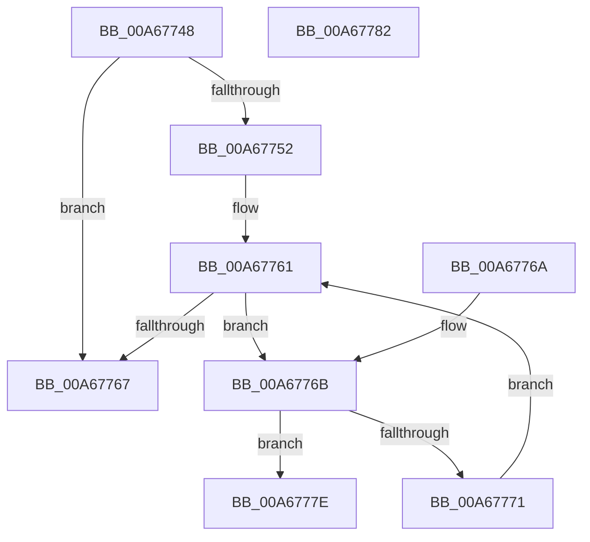

# EtwpGetFlagExtension

- RVA: `0x00A67748`–`0x00A67783` (길이 `59` bytes)
- VA: `0x0000000140A67748`
- 실행 섹션: `PAGE`
- PDB 이름 있음: `예`; PDB Function 태그: `아니요`
- unwind 정보 RVA: `0x000DB714`
- 디코드: `22`개 명령, `59/59` bytes 표시
- 미해석 바이트: `0` (있으면 어셈블리에 `.byte`로 보존)

> 이 문서는 커널 이미지의 기계어와 PDB 기호를 분석해 생성했습니다. 4번과 5번은 함수 원형과 자료형을 바이너리 사용 방식에서 추정한 C 해석이며 원본 소스 복구 결과는 아닙니다.

## 1. Dependencies

- 직접 호출 지점: **0**; 고유 호출 대상: **0**
- 직접 호출자로 확인된 함수: **5**
- RIP 상대 이미지 참조: **0**

### Outgoing calls
- 직접 디코드된 call 명령이 없습니다.

### Direct callers
- [EtwpUpdatePerProcessTracing](EtwpUpdatePerProcessTracing_function_00A67374.md) at `0x00A673FF`
- [EtwpUpdateLoggerGroupMasks](EtwpUpdateLoggerGroupMasks_function_00A67490.md) at `0x00A674E6`
- [EtwpCheckForStackTracingExtension](EtwpCheckForStackTracingExtension_function_00A675F8.md) at `0x00A67612`
- [EtwpCheckForStackTracingExtension](EtwpCheckForStackTracingExtension_function_00A675F8.md) at `0x00A6764D`
- [EtwpCheckForStackTracingExtension](EtwpCheckForStackTracingExtension_function_00A675F8.md) at `0x00A6765D`
- [EtwpCheckForPoolTagFilterExtension](EtwpCheckForPoolTagFilterExtension_function_00A676B0.md) at `0x00A676D2`
- [EtwpStartLogger](../A9/EtwpStartLogger_function_00A99D80.md) at `0x00A9A37D`
- [EtwpStartLogger](../A9/EtwpStartLogger_function_00A99D80.md) at `0x00A9A714`

### Static image references
- 디코드된 RIP-relative 메모리 참조가 없습니다.

## 2. Other-region calls and transfers

- 다른 실행 섹션으로 향하는 call: **0**
- 별도 외부 분기/꼬리 이동을 확인하지 못했습니다.

## 3. Assembly (complete function range)

```asm
00A67748  8B 41 48                        mov eax, dword ptr [rcx + 0x48]
00A6774B  45 33 C0                        xor r8d, r8d
00A6774E  85 C0                           test eax, eax
00A67750  79 15                           jns 0x140a67767
00A67752  0F B7 C0                        movzx eax, ax
00A67755  48 03 C1                        add rax, rcx
00A67758  44 0F B7 48 02                  movzx r9d, word ptr [rax + 2]
00A6775D  48 8D 48 04                     lea rcx, [rax + 4]
00A67761  66 45 3B C1                     cmp r8w, r9w
00A67765  72 04                           jb 0x140a6776b
00A67767  33 C0                           xor eax, eax
00A67769  C3                              ret
00A6776A  CC                              int3
00A6776B  66 39 51 02                     cmp word ptr [rcx + 2], dx
00A6776F  74 0D                           je 0x140a6777e
00A67771  0F B7 01                        movzx eax, word ptr [rcx]
00A67774  66 41 FF C0                     inc r8w
00A67778  48 8D 0C 81                     lea rcx, [rcx + rax*4]
00A6777C  EB E3                           jmp 0x140a67761
00A6777E  48 8B C1                        mov rax, rcx
00A67781  C3                              ret
00A67782  CC                              int3
```

## 4. C-style interpretation (structured pseudocode)

```c
__int64 __fastcall EtwpGetFlagExtension(__int64 a1, unsigned __int16 a2, int a3)
{
    __int64 result;

    a3 = 0;
    if (!sign_flag) goto loc_00A67767;
    result = ((unsigned __int16)((unsigned int)(*(unsigned int *)(a1 + 72)))) + (a1);
loc_00A67761:
    if (0 < ((unsigned __int16)(*(unsigned __int16 *)(result + 2)))) goto loc_00A6776B;
loc_00A67767:
    result = 0;
    return result;
loc_00A6776B:
    if ((*(unsigned __int16 *)(result + 4 + 2)) == a2) goto loc_00A6777E;
    a3 = (unsigned __int16)((a3) + 1);
    goto loc_00A67761;
loc_00A6777E:
    return result + 4 + *(unsigned __int16 *)(result + 4) * 4;
}
```

## 5. (Beta) C Style

```c
int64_t EtwpGetFlagExtension(void *Arg1, uint16_t Arg2, int32_t Arg3)
{
    uint8_t *arg1 = (uint8_t *)Arg1;

    int64_t result;

    Arg3 = 0;
    if (!sign_flag) goto loc_00A67767;
    result = ((uint16_t)((uint32_t)(*(uint32_t *)(arg1 + 0x48)))) + (Arg1);
loc_00A67761:
    if (0 < ((uint16_t)(*(uint16_t *)(result + 0x2)))) goto loc_00A6776B;
loc_00A67767:
    result = 0;
    return result;
loc_00A6776B:
    if ((*(uint16_t *)(result + 0x4 + 0x2)) == Arg2) goto loc_00A6777E;
    Arg3 = (uint16_t)((Arg3) + 1);
    goto loc_00A67761;
loc_00A6777E:
    return result + 4 + *(uint16_t *)(result + 0x4) * 4;
}
```

### 관측된 메모리 오프셋

구조체 형식이 확인되지 않은 접근은 인자 기준의 오프셋으로만 기록했습니다.

| 기준 인자 | 오프셋 표현 | 폭 (bit) | 접근 |
|---|---:|---:|---|
| `Arg1` | `+ 0x48` | `32` | `R` |

## 6. Execution-region graph

[열기: 2D/3D 그래프와 함수 탐색 컨트롤 패널](../../../control-panel.html?section=page&rva=0x00A67748&view=graph)

- 2D 그래프는 위에서 아래로 흐르고, 3D 그래프는 빈 공간을 드래그해 회전합니다. Shift+드래그는 이동, 휠은 확대·축소, 함수 노드 선택은 대상 보고서 이동입니다.

### Static fallback


