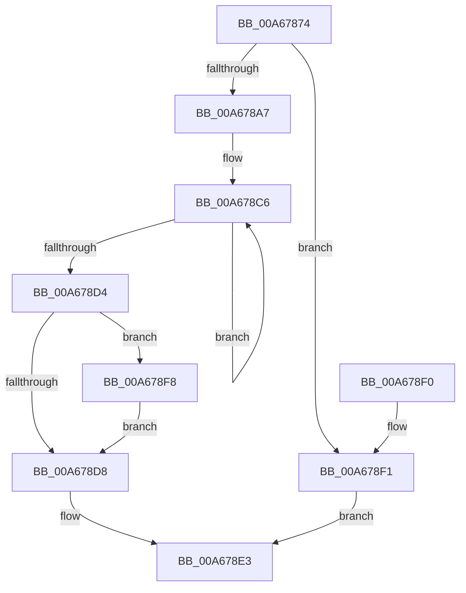

# EtwpInitializeClassicStackTracing

- RVA: `0x00A67874`–`0x00A678FF` (길이 `139` bytes)
- VA: `0x0000000140A67874`
- 실행 섹션: `PAGE`
- PDB 이름 있음: `예`; PDB Function 태그: `아니요`
- unwind 정보 RVA: `0x0008A6D8`
- 디코드: `35`개 명령, `139/139` bytes 표시
- 미해석 바이트: `0` (있으면 어셈블리에 `.byte`로 보존)

> 이 문서는 커널 이미지의 기계어와 PDB 기호를 분석해 생성했습니다. 4번과 5번은 함수 원형과 자료형을 바이너리 사용 방식에서 추정한 C 해석이며 원본 소스 복구 결과는 아닙니다.

## 1. Dependencies

- 직접 호출 지점: **3**; 고유 호출 대상: **3**
- 직접 호출자로 확인된 함수: **1**
- RIP 상대 이미지 참조: **0**

### Outgoing calls
- `0x00A6788A` → [EtwpPreallocateApcPool](EtwpPreallocateApcPool_function_00A67908.md) (function, `0x00A67908`)
- `0x00A6789D` → [ExAllocatePool2](../../poolcode/B8/ExAllocatePool2_function_00B820F0.md) (function, `0x00B820F0`)
- `0x00A678F8` → [EtwpReferenceStackLookasideList](../A7/EtwpReferenceStackLookasideList_function_00A7EF68.md) (function, `0x00A7EF68`)

### Direct callers
- [EtwpUpdateStackTracing](EtwpUpdateStackTracing_function_00A6778C.md) at `0x00A677E9`

### Static image references
- 디코드된 RIP-relative 메모리 참조가 없습니다.

## 2. Other-region calls and transfers

- 다른 실행 섹션으로 향하는 call: **1**
  - `0x00A6789D` → [ExAllocatePool2](../../poolcode/B8/ExAllocatePool2_function_00B820F0.md) (`PAGE` → `POOLCODE`)
- 별도 외부 분기/꼬리 이동을 확인하지 못했습니다.

## 3. Assembly (complete function range)

```asm
00A67874  48 89 5C 24 08                  mov qword ptr [rsp + 8], rbx
00A67879  57                              push rdi
00A6787A  48 83 EC 20                     sub rsp, 0x20
00A6787E  48 8B D9                        mov rbx, rcx
00A67881  33 FF                           xor edi, edi
00A67883  48 81 C1 40 03 00 00            add rcx, 0x340
00A6788A  E8 79 00 00 00                  call 0x140a67908
00A6788F  BA 00 04 00 00                  mov edx, 0x400
00A67894  8D 4F 40                        lea ecx, [rdi + 0x40]
00A67897  41 B8 45 74 77 6D               mov r8d, 0x6d777445
00A6789D  E8 4E A8 11 00                  call 0x140b820f0
00A678A2  48 85 C0                        test rax, rax
00A678A5  74 4A                           je 0x140a678f1
00A678A7  BA 00 20 00 00                  mov edx, 0x2000
00A678AC  48 89 83 18 04 00 00            mov qword ptr [rbx + 0x418], rax
00A678B3  89 93 10 04 00 00               mov dword ptr [rbx + 0x410], edx
00A678B9  0F 0D 8B 30 03 00 00            prefetchw byte ptr [rbx + 0x330]
00A678C0  8B 83 30 03 00 00               mov eax, dword ptr [rbx + 0x330]
00A678C6  8B C8                           mov ecx, eax
00A678C8  0B CA                           or ecx, edx
00A678CA  F0 0F B1 8B 30 03 00 00         lock cmpxchg dword ptr [rbx + 0x330], ecx
00A678D2  75 F2                           jne 0x140a678c6
00A678D4  85 C2                           test edx, eax
00A678D6  74 20                           je 0x140a678f8
00A678D8  F0 81 8B 30 03 00 00 80 00 00 00  lock or dword ptr [rbx + 0x330], 0x80
00A678E3  48 8B 5C 24 30                  mov rbx, qword ptr [rsp + 0x30]
00A678E8  8B C7                           mov eax, edi
00A678EA  48 83 C4 20                     add rsp, 0x20
00A678EE  5F                              pop rdi
00A678EF  C3                              ret
00A678F0  CC                              int3
00A678F1  BF 17 00 00 C0                  mov edi, 0xc0000017
00A678F6  EB EB                           jmp 0x140a678e3
00A678F8  E8 6B 76 01 00                  call 0x140a7ef68
00A678FD  EB D9                           jmp 0x140a678d8
```

## 4. C-style interpretation (structured pseudocode)

```c
__int64 __fastcall EtwpInitializeClassicStackTracing(__int64 a1)
{
    __int64 result;
    __int64 v_rdi;
    __int64 v_rsp;
    unsigned __int64 v_stack_p8;

    v_stack_p8 = v_rbx;
    v_rsp = (v_rsp) - (32);
    v_rdi = 0;
    a1 = (a1) + (832);
    result = EtwpPreallocateApcPool(a1, a2, a3, a4);
    result = ExAllocatePool2(v_rdi + 64, (unsigned int)(0x400ULL), (unsigned int)(0x6D777445ULL), a4);
    if (result == 0) goto loc_00A678F1;
    *(unsigned __int64 *)(a1 + 1048) = result;
    *(unsigned int *)(a1 + 1040) = (unsigned int)((unsigned int)(0x2000ULL));
loc_00A678C6:
    a1 = (unsigned int)(((unsigned int)((unsigned int)((unsigned int)(*(unsigned int *)(a1 + 816))))) | ((unsigned int)((unsigned int)(0x2000ULL))));
    if (condition_is_not_equal) goto loc_00A678C6;
    if ((((unsigned int)((unsigned int)(0x2000ULL))) & ((unsigned int)((unsigned int)(*(unsigned int *)(a1 + 816))))) == 0) goto loc_00A678F8;
loc_00A678D8:
loc_00A678E3:
    v_rsp = (v_rsp) + (32);
    return 0;
loc_00A678F1:
    goto loc_00A678E3;
loc_00A678F8:
    result = EtwpReferenceStackLookasideList(a1, (unsigned int)(0x2000ULL), (unsigned int)(0x6D777445ULL), a4);
    goto loc_00A678D8;
}
```

## 5. (Beta) C Style

```c
int64_t EtwpInitializeClassicStackTracing(void *Arg1)
{
    uint8_t *arg1 = (uint8_t *)Arg1;

    int64_t result;
    int64_t local_rdi;
    int64_t local_rsp;
    uint64_t v_stack_p8;

    v_stack_p8 = local_rbx;
    local_rsp = (local_rsp) - (32);
    local_rdi = 0;
    Arg1 = (Arg1) + (832);
    result = EtwpPreallocateApcPool(Arg1, a2, a3, a4);
    result = ExAllocatePool2(local_rdi + 64, (uint32_t)(0x400ULL), (uint32_t)(0x6D777445ULL), a4);
    if (result == 0) goto loc_00A678F1;
    *(uint64_t *)(arg1 + 0x418) = result;
    *(uint32_t *)(arg1 + 0x410) = (uint32_t)((uint32_t)(0x2000ULL));
loc_00A678C6:
    Arg1 = (uint32_t)(((uint32_t)((uint32_t)((uint32_t)(*(uint32_t *)(arg1 + 0x330))))) | ((uint32_t)((uint32_t)(0x2000ULL))));
    if (condition_is_not_equal) goto loc_00A678C6;
    if ((((uint32_t)((uint32_t)(0x2000ULL))) & ((uint32_t)((uint32_t)(*(uint32_t *)(arg1 + 0x330))))) == 0) goto loc_00A678F8;
loc_00A678D8:
loc_00A678E3:
    local_rsp = (local_rsp) + (32);
    return 0;
loc_00A678F1:
    goto loc_00A678E3;
loc_00A678F8:
    result = EtwpReferenceStackLookasideList(Arg1, (uint32_t)(0x2000ULL), (uint32_t)(0x6D777445ULL), a4);
    goto loc_00A678D8;
}
```

### 관측된 메모리 오프셋

구조체 형식이 확인되지 않은 접근은 인자 기준의 오프셋으로만 기록했습니다.

| 기준 인자 | 오프셋 표현 | 폭 (bit) | 접근 |
|---|---:|---:|---|
| `Arg1` | `+ 0x330` | `8` | `R` |
| `Arg1` | `+ 0x330` | `32` | `R` |
| `Arg1` | `+ 0x330` | `32` | `R/W` |
| `Arg1` | `+ 0x410` | `32` | `W` |
| `Arg1` | `+ 0x418` | `64` | `W` |

## 6. Execution-region graph

[열기: 2D/3D 그래프와 함수 탐색 컨트롤 패널](../../../control-panel.html?section=page&rva=0x00A67874&view=graph)

- 2D 그래프는 위에서 아래로 흐르고, 3D 그래프는 빈 공간을 드래그해 회전합니다. Shift+드래그는 이동, 휠은 확대·축소, 함수 노드 선택은 대상 보고서 이동입니다.

### Static fallback


