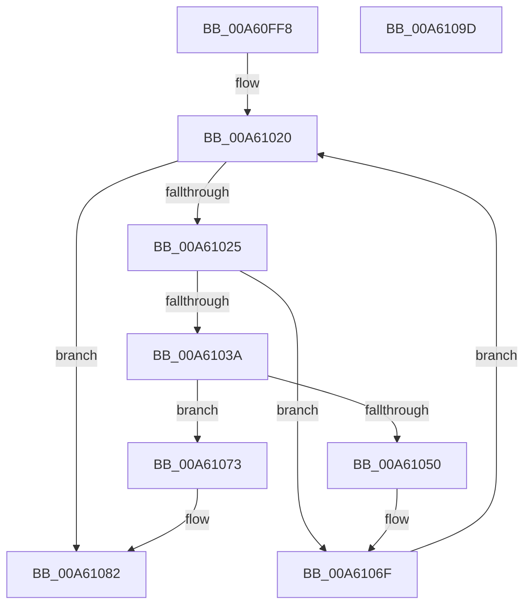

# EtwpLookupLoggerIdByName

- RVA: `0x00A60FF8`–`0x00A6109E` (길이 `166` bytes)
- VA: `0x0000000140A60FF8`
- 실행 섹션: `PAGE`
- PDB 이름 있음: `예`; PDB Function 태그: `아니요`
- unwind 정보 RVA: `0x00060300`
- 디코드: `50`개 명령, `166/166` bytes 표시
- 미해석 바이트: `0` (있으면 어셈블리에 `.byte`로 보존)

> 이 문서는 커널 이미지의 기계어와 PDB 기호를 분석해 생성했습니다. 4번과 5번은 함수 원형과 자료형을 바이너리 사용 방식에서 추정한 C 해석이며 원본 소스 복구 결과는 아닙니다.

## 1. Dependencies

- 직접 호출 지점: **4**; 고유 호출 대상: **4**
- 직접 호출자로 확인된 함수: **1**
- RIP 상대 이미지 참조: **0**

### Outgoing calls
- `0x00A6102D` → [EtwpAcquireLoggerContextByLoggerId](../93/EtwpAcquireLoggerContextByLoggerId_function_00932920.md) (function, `0x00932920`)
- `0x00A61047` → [RtlEqualUnicodeString](../93/RtlEqualUnicodeString_function_00932A20.md) (function, `0x00932A20`)
- `0x00A6106A` → [ExReleaseRundownProtectionCacheAwareEx](../../text/25/ExReleaseRundownProtectionCacheAwareEx_function_0025F050.md) (function, `0x0025F050`)
- `0x00A61078` → [EtwpReleaseLoggerContext](../A0/EtwpReleaseLoggerContext_function_00A04160.md) (function, `0x00A04160`)

### Direct callers
- [EtwpStartLogger](../A9/EtwpStartLogger_function_00A99D80.md) at `0x00A9A195`

### Static image references
- 디코드된 RIP-relative 메모리 참조가 없습니다.

## 2. Other-region calls and transfers

- 다른 실행 섹션으로 향하는 call: **1**
  - `0x00A6106A` → [ExReleaseRundownProtectionCacheAwareEx](../../text/25/ExReleaseRundownProtectionCacheAwareEx_function_0025F050.md) (`PAGE` → `.text`)
- 별도 외부 분기/꼬리 이동을 확인하지 못했습니다.

## 3. Assembly (complete function range)

```asm
00A60FF8  48 89 5C 24 08                  mov qword ptr [rsp + 8], rbx
00A60FFD  48 89 6C 24 10                  mov qword ptr [rsp + 0x10], rbp
00A61002  48 89 74 24 18                  mov qword ptr [rsp + 0x18], rsi
00A61007  57                              push rdi
00A61008  41 56                           push r14
00A6100A  41 57                           push r15
00A6100C  48 83 EC 20                     sub rsp, 0x20
00A61010  4D 8B F0                        mov r14, r8
00A61013  4C 8B FA                        mov r15, rdx
00A61016  48 8B E9                        mov rbp, rcx
00A61019  BE 96 02 00 C0                  mov esi, 0xc0000296
00A6101E  33 DB                           xor ebx, ebx
00A61020  3B 5D 10                        cmp ebx, dword ptr [rbp + 0x10]
00A61023  73 5D                           jae 0x140a61082
00A61025  45 33 C0                        xor r8d, r8d
00A61028  8B D3                           mov edx, ebx
00A6102A  48 8B CD                        mov rcx, rbp
00A6102D  E8 EE 18 ED FF                  call 0x140932920
00A61032  48 8B F8                        mov rdi, rax
00A61035  48 85 C0                        test rax, rax
00A61038  74 35                           je 0x140a6106f
00A6103A  48 8D 88 88 00 00 00            lea rcx, [rax + 0x88]
00A61041  41 B0 01                        mov r8b, 1
00A61044  49 8B D7                        mov rdx, r15
00A61047  E8 D4 19 ED FF                  call 0x140932a20
00A6104C  84 C0                           test al, al
00A6104E  75 23                           jne 0x140a61073
00A61050  48 8B 87 50 05 00 00            mov rax, qword ptr [rdi + 0x550]
00A61057  BA 01 00 00 00                  mov edx, 1
00A6105C  44 8B 07                        mov r8d, dword ptr [rdi]
00A6105F  48 8B 88 C0 02 00 00            mov rcx, qword ptr [rax + 0x2c0]
00A61066  4A 8B 0C C1                     mov rcx, qword ptr [rcx + r8*8]
00A6106A  E8 E1 DF 7F FF                  call 0x14025f050
00A6106F  FF C3                           inc ebx
00A61071  EB AD                           jmp 0x140a61020
00A61073  33 D2                           xor edx, edx
00A61075  48 8B CF                        mov rcx, rdi
00A61078  E8 E3 30 FA FF                  call 0x140a04160
00A6107D  33 F6                           xor esi, esi
00A6107F  41 89 1E                        mov dword ptr [r14], ebx
00A61082  48 8B 5C 24 40                  mov rbx, qword ptr [rsp + 0x40]
00A61087  8B C6                           mov eax, esi
00A61089  48 8B 74 24 50                  mov rsi, qword ptr [rsp + 0x50]
00A6108E  48 8B 6C 24 48                  mov rbp, qword ptr [rsp + 0x48]
00A61093  48 83 C4 20                     add rsp, 0x20
00A61097  41 5F                           pop r15
00A61099  41 5E                           pop r14
00A6109B  5F                              pop rdi
00A6109C  C3                              ret
00A6109D  CC                              int3
```

## 4. C-style interpretation (structured pseudocode)

```c
__int64 __fastcall EtwpLookupLoggerIdByName(__int64 a1, __int64 a2, __int64 a3)
{
    __int64 result;
    __int64 v_rbx;
    __int64 v_rsi;
    __int64 v_rsp;
    unsigned __int64 v_stack_p10;
    unsigned __int64 v_stack_p18;
    unsigned __int64 v_stack_p8;

    v_stack_p8 = v_rbx;
    v_stack_p10 = v_rbp;
    v_stack_p18 = v_rsi;
    v_rsp = (v_rsp) - (32);
    v_rbx = 0;
loc_00A61020:
    if (0 >= (*(unsigned int *)(a1 + 16))) goto loc_00A61082;
    a3 = 0;
    result = EtwpAcquireLoggerContextByLoggerId(a1, 0, a3, a4);
    if (result == 0) goto loc_00A6106F;
    result = RtlEqualUnicodeString(result + 136, a2, 1, a4);
    if ((unsigned __int8)(result) != 0) goto loc_00A61073;
    result = ExReleaseRundownProtectionCacheAwareEx(*(unsigned __int64 *)(*(unsigned __int64 *)(*(unsigned __int64 *)(result + 1360) + 704) + (unsigned int)(*(unsigned int *)(result)) * 8), 1, (unsigned int)(*(unsigned int *)(result)), a4);
loc_00A6106F:
    v_rbx = (unsigned int)((v_rbx) + 1);
    goto loc_00A61020;
loc_00A61073:
    a2 = 0;
    result = EtwpReleaseLoggerContext(result, a2, (unsigned int)(*(unsigned int *)(result)), a4);
    v_rsi = 0;
    *(unsigned int *)(a3) = (unsigned int)(v_rbx);
loc_00A61082:
    v_rsp = (v_rsp) + (32);
    return 0;
}
```

## 5. (Beta) C Style

```c
int64_t EtwpLookupLoggerIdByName(void *Arg1, int64_t Arg2, void *Arg3)
{
    uint8_t *arg1 = (uint8_t *)Arg1;
    uint8_t *arg3 = (uint8_t *)Arg3;

    int64_t result;
    int64_t local_rbx;
    int64_t local_rsi;
    int64_t local_rsp;
    uint64_t v_stack_p10;
    uint64_t v_stack_p18;
    uint64_t v_stack_p8;

    v_stack_p8 = local_rbx;
    v_stack_p10 = local_rbp;
    v_stack_p18 = local_rsi;
    local_rsp = (local_rsp) - (32);
    local_rbx = 0;
loc_00A61020:
    if (0 >= (*(uint32_t *)(arg1 + 0x10))) goto loc_00A61082;
    Arg3 = 0;
    result = EtwpAcquireLoggerContextByLoggerId(Arg1, 0, Arg3, a4);
    if (result == 0) goto loc_00A6106F;
    result = RtlEqualUnicodeString(result + 136, Arg2, 1, a4);
    if ((uint8_t)(result) != 0) goto loc_00A61073;
    result = ExReleaseRundownProtectionCacheAwareEx(*(uint64_t *)(*(uint64_t *)(*(uint64_t *)(result + 0x550) + 0x2C0) + (uint32_t)(*(uint32_t *)(result)) * 8), 1, (uint32_t)(*(uint32_t *)(result)), a4);
loc_00A6106F:
    local_rbx = (uint32_t)((local_rbx) + 1);
    goto loc_00A61020;
loc_00A61073:
    Arg2 = 0;
    result = EtwpReleaseLoggerContext(result, Arg2, (uint32_t)(*(uint32_t *)(result)), a4);
    local_rsi = 0;
    *(uint32_t *)(arg3) = (uint32_t)(local_rbx);
loc_00A61082:
    local_rsp = (local_rsp) + (32);
    return 0;
}
```

### 관측된 메모리 오프셋

구조체 형식이 확인되지 않은 접근은 인자 기준의 오프셋으로만 기록했습니다.

| 기준 인자 | 오프셋 표현 | 폭 (bit) | 접근 |
|---|---:|---:|---|
| `Arg1` | `+ 0x10` | `32` | `R` |
| `Arg3` | `+ 0x0` | `32` | `W` |

## 6. Execution-region graph

[열기: 2D/3D 그래프와 함수 탐색 컨트롤 패널](../../../control-panel.html?section=page&rva=0x00A60FF8&view=graph)

- 2D 그래프는 위에서 아래로 흐르고, 3D 그래프는 빈 공간을 드래그해 회전합니다. Shift+드래그는 이동, 휠은 확대·축소, 함수 노드 선택은 대상 보고서 이동입니다.

### Static fallback


