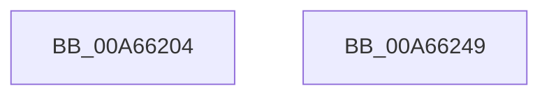

# EtwpOpenConsumer

- RVA: `0x00A66204`–`0x00A6624A` (길이 `70` bytes)
- VA: `0x0000000140A66204`
- 실행 섹션: `PAGE`
- PDB 이름 있음: `예`; PDB Function 태그: `아니요`
- unwind 정보 RVA: `0x00063458`
- 디코드: `15`개 명령, `70/70` bytes 표시
- 미해석 바이트: `0` (있으면 어셈블리에 `.byte`로 보존)

> 이 문서는 커널 이미지의 기계어와 PDB 기호를 분석해 생성했습니다. 4번과 5번은 함수 원형과 자료형을 바이너리 사용 방식에서 추정한 C 해석이며 원본 소스 복구 결과는 아닙니다.

## 1. Dependencies

- 직접 호출 지점: **1**; 고유 호출 대상: **1**
- 직접 호출자로 확인된 함수: **1**
- RIP 상대 이미지 참조: **1**

### Outgoing calls
- `0x00A6623F` → [ObOpenObjectByPointer](../8B/ObOpenObjectByPointer_function_008B7420.md) (function, `0x008B7420`)

### Direct callers
- [EtwpRealtimeConnect](EtwpRealtimeConnect_function_00A65C88.md) at `0x00A65E52`

### Static image references
- `0x00A66230` → RVA `0x00FC6A98` (`ALMOSTRO`; read)

## 2. Other-region calls and transfers

- 다른 실행 섹션으로 향하는 call: **0**
- 별도 외부 분기/꼬리 이동을 확인하지 못했습니다.

## 3. Assembly (complete function range)

```asm
00A66204  48 83 EC 48                     sub rsp, 0x48
00A66208  65 48 8B 04 25 88 01 00 00      mov rax, qword ptr gs:[0x188]
00A66211  41 B9 28 00 00 00               mov r9d, 0x28
00A66217  48 89 4C 24 30                  mov qword ptr [rsp + 0x30], rcx
00A6621C  45 33 C0                        xor r8d, r8d
00A6621F  C6 44 24 28 00                  mov byte ptr [rsp + 0x28], 0
00A66224  BA 00 02 00 00                  mov edx, 0x200
00A66229  4C 8B 90 B8 00 00 00            mov r10, qword ptr [rax + 0xb8]
00A66230  48 8B 05 61 08 56 00            mov rax, qword ptr [rip + 0x560861]
00A66237  49 8B CA                        mov rcx, r10
00A6623A  48 89 44 24 20                  mov qword ptr [rsp + 0x20], rax
00A6623F  E8 DC 11 E5 FF                  call 0x1408b7420
00A66244  48 83 C4 48                     add rsp, 0x48
00A66248  C3                              ret
00A66249  CC                              int3
```

## 4. C-style interpretation (structured pseudocode)

```c
__int64 __fastcall EtwpOpenConsumer(__int64 a1, __int64 a2, int a3)
{
    __int64 result;
    __int64 v_rsp;
    unsigned __int64 v_stack_m18;
    unsigned __int8 v_stack_m20;
    unsigned __int64 v_stack_m28;

    v_rsp = (v_rsp) - (72);
    v_stack_m18 = a1;
    a3 = 0;
    v_stack_m20 = 0;
    v_stack_m28 = *(unsigned __int64 *)(v_rip + 5638241);
    result = ObOpenObjectByPointer(*(unsigned __int64 *)(*(unsigned __int64 *)(gs_base + (0 + 392)) + 184), 512, a3, 40);
    v_rsp = (v_rsp) + (72);
    return result;
}
```

## 5. (Beta) C Style

```c
int64_t EtwpOpenConsumer(int64_t Arg1, int64_t Arg2, int32_t Arg3)
{
    int64_t result;
    int64_t local_rsp;
    uint64_t v_stack_m18;
    uint8_t v_stack_m20;
    uint64_t v_stack_m28;

    local_rsp = (local_rsp) - (72);
    v_stack_m18 = Arg1;
    Arg3 = 0;
    v_stack_m20 = 0;
    v_stack_m28 = *(uint64_t *)(v_rip + 0x560861);
    result = ObOpenObjectByPointer(*(uint64_t *)(*(uint64_t *)(gs_base + (0 + 0x188)) + 0xB8), 512, Arg3, 40);
    local_rsp = (local_rsp) + (72);
    return result;
}
```

## 6. Execution-region graph

[열기: 2D/3D 그래프와 함수 탐색 컨트롤 패널](../../../control-panel.html?section=page&rva=0x00A66204&view=graph)

- 2D 그래프는 위에서 아래로 흐르고, 3D 그래프는 빈 공간을 드래그해 회전합니다. Shift+드래그는 이동, 휠은 확대·축소, 함수 노드 선택은 대상 보고서 이동입니다.

### Static fallback


