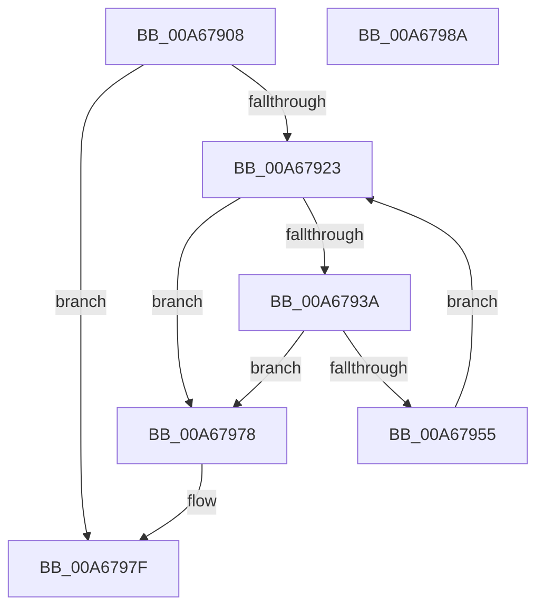

# EtwpPreallocateApcPool

- RVA: `0x00A67908`–`0x00A6798B` (길이 `131` bytes)
- VA: `0x0000000140A67908`
- 실행 섹션: `PAGE`
- PDB 이름 있음: `예`; PDB Function 태그: `아니요`
- unwind 정보 RVA: `0x0005CAAC`
- 디코드: `33`개 명령, `131/131` bytes 표시
- 미해석 바이트: `0` (있으면 어셈블리에 `.byte`로 보존)

> 이 문서는 커널 이미지의 기계어와 PDB 기호를 분석해 생성했습니다. 4번과 5번은 함수 원형과 자료형을 바이너리 사용 방식에서 추정한 C 해석이며 원본 소스 복구 결과는 아닙니다.

## 1. Dependencies

- 직접 호출 지점: **3**; 고유 호출 대상: **2**
- 직접 호출자로 확인된 함수: **3**
- RIP 상대 이미지 참조: **0**

### Outgoing calls
- `0x00A67948` → [ExAllocatePool2](../../poolcode/B8/ExAllocatePool2_function_00B820F0.md) (function, `0x00B820F0`)
- `0x00A67964` → [ExpInterlockedPushEntrySList](../../text/6B/ExpInterlockedPushEntrySList_function_006BA5B0.md) (function, `0x006BA5B0`)
- `0x00A67971` → [ExpInterlockedPushEntrySList](../../text/6B/ExpInterlockedPushEntrySList_function_006BA5B0.md) (function, `0x006BA5B0`)

### Direct callers
- [EtwpUpdateContextRegisterTraceEvents](../7B/EtwpUpdateContextRegisterTraceEvents_function_007B7B98.md) at `0x007B7C2D`
- [EtwpEnableGuid](../A5/EtwpEnableGuid_function_00A5CD28.md) at `0x00A5D224`
- [EtwpInitializeClassicStackTracing](EtwpInitializeClassicStackTracing_function_00A67874.md) at `0x00A6788A`

### Static image references
- 디코드된 RIP-relative 메모리 참조가 없습니다.

## 2. Other-region calls and transfers

- 다른 실행 섹션으로 향하는 call: **3**
  - `0x00A67948` → [ExAllocatePool2](../../poolcode/B8/ExAllocatePool2_function_00B820F0.md) (`PAGE` → `POOLCODE`)
  - `0x00A67964` → [ExpInterlockedPushEntrySList](../../text/6B/ExpInterlockedPushEntrySList_function_006BA5B0.md) (`PAGE` → `.text`)
  - `0x00A67971` → [ExpInterlockedPushEntrySList](../../text/6B/ExpInterlockedPushEntrySList_function_006BA5B0.md) (`PAGE` → `.text`)
- 별도 외부 분기/꼬리 이동을 확인하지 못했습니다.

## 3. Assembly (complete function range)

```asm
00A67908  48 89 5C 24 08                  mov qword ptr [rsp + 8], rbx
00A6790D  57                              push rdi
00A6790E  48 83 EC 20                     sub rsp, 0x20
00A67912  8B 81 A4 00 00 00               mov eax, dword ptr [rcx + 0xa4]
00A67918  48 8B D9                        mov rbx, rcx
00A6791B  3B 81 A8 00 00 00               cmp eax, dword ptr [rcx + 0xa8]
00A67921  7D 5C                           jge 0x140a6797f
00A67923  B8 01 00 00 00                  mov eax, 1
00A67928  F0 0F C1 83 A4 00 00 00         lock xadd dword ptr [rbx + 0xa4], eax
00A67930  FF C0                           inc eax
00A67932  3B 83 A8 00 00 00               cmp eax, dword ptr [rbx + 0xa8]
00A67938  77 3E                           ja 0x140a67978
00A6793A  BA A0 00 00 00                  mov edx, 0xa0
00A6793F  41 B8 45 74 77 41               mov r8d, 0x41777445
00A67945  8D 4A A8                        lea ecx, [rdx - 0x58]
00A67948  E8 A3 A7 11 00                  call 0x140b820f0
00A6794D  48 8B F8                        mov rdi, rax
00A67950  48 85 C0                        test rax, rax
00A67953  74 23                           je 0x140a67978
00A67955  48 8D 50 60                     lea rdx, [rax + 0x60]
00A67959  48 89 98 80 00 00 00            mov qword ptr [rax + 0x80], rbx
00A67960  48 8D 4B 10                     lea rcx, [rbx + 0x10]
00A67964  E8 47 2C C5 FF                  call 0x1406ba5b0
00A67969  48 8D 57 70                     lea rdx, [rdi + 0x70]
00A6796D  48 8D 4B 20                     lea rcx, [rbx + 0x20]
00A67971  E8 3A 2C C5 FF                  call 0x1406ba5b0
00A67976  EB AB                           jmp 0x140a67923
00A67978  F0 FF 8B A4 00 00 00            lock dec dword ptr [rbx + 0xa4]
00A6797F  48 8B 5C 24 30                  mov rbx, qword ptr [rsp + 0x30]
00A67984  48 83 C4 20                     add rsp, 0x20
00A67988  5F                              pop rdi
00A67989  C3                              ret
00A6798A  CC                              int3
```

## 4. C-style interpretation (structured pseudocode)

```c
__int64 __fastcall EtwpPreallocateApcPool(__int64 a1)
{
    __int64 result;
    __int64 v_rsp;
    unsigned __int64 v_stack_p8;

    v_stack_p8 = v_rbx;
    v_rsp = (v_rsp) - (32);
    if (((unsigned int)((unsigned int)(*(unsigned int *)(a1 + 164)))) >= (*(unsigned int *)(a1 + 168))) goto loc_00A6797F;
loc_00A67923:
    result = (unsigned int)((1) + 1);
    if (((unsigned int)(result)) > (*(unsigned int *)(a1 + 168))) goto loc_00A67978;
    result = ExAllocatePool2(160 - 88, 160, (unsigned int)(0x41777445ULL), a4);
    if (result == 0) goto loc_00A67978;
    *(unsigned __int64 *)(result + 128) = a1;
    result = ExpInterlockedPushEntrySList(a1 + 16, result + 96, (unsigned int)(0x41777445ULL), a4);
    result = ExpInterlockedPushEntrySList(a1 + 32, result + 112, (unsigned int)(0x41777445ULL), a4);
    goto loc_00A67923;
loc_00A67978:
loc_00A6797F:
    v_rsp = (v_rsp) + (32);
    return result;
}
```

## 5. (Beta) C Style

```c
int64_t EtwpPreallocateApcPool(void *Arg1)
{
    uint8_t *arg1 = (uint8_t *)Arg1;

    int64_t result;
    int64_t local_rsp;
    uint64_t v_stack_p8;

    v_stack_p8 = local_rbx;
    local_rsp = (local_rsp) - (32);
    if (((uint32_t)((uint32_t)(*(uint32_t *)(arg1 + 0xA4)))) >= (*(uint32_t *)(arg1 + 0xA8))) goto loc_00A6797F;
loc_00A67923:
    result = (uint32_t)((1) + 1);
    if (((uint32_t)(result)) > (*(uint32_t *)(arg1 + 0xA8))) goto loc_00A67978;
    result = ExAllocatePool2(160 - 88, 160, (uint32_t)(0x41777445ULL), a4);
    if (result == 0) goto loc_00A67978;
    *(void **)(result + 0x80) = Arg1;
    result = ExpInterlockedPushEntrySList(Arg1 + 16, result + 96, (uint32_t)(0x41777445ULL), a4);
    result = ExpInterlockedPushEntrySList(Arg1 + 32, result + 112, (uint32_t)(0x41777445ULL), a4);
    goto loc_00A67923;
loc_00A67978:
loc_00A6797F:
    local_rsp = (local_rsp) + (32);
    return result;
}
```

### 관측된 메모리 오프셋

구조체 형식이 확인되지 않은 접근은 인자 기준의 오프셋으로만 기록했습니다.

| 기준 인자 | 오프셋 표현 | 폭 (bit) | 접근 |
|---|---:|---:|---|
| `Arg1` | `+ 0x10` | `64` | `R` |
| `Arg1` | `+ 0x20` | `64` | `R` |
| `Arg1` | `+ 0xA4` | `32` | `R` |
| `Arg1` | `+ 0xA4` | `32` | `R/W` |
| `Arg1` | `+ 0xA8` | `32` | `R` |

## 6. Execution-region graph

[열기: 2D/3D 그래프와 함수 탐색 컨트롤 패널](../../../control-panel.html?section=page&rva=0x00A67908&view=graph)

- 2D 그래프는 위에서 아래로 흐르고, 3D 그래프는 빈 공간을 드래그해 회전합니다. Shift+드래그는 이동, 휠은 확대·축소, 함수 노드 선택은 대상 보고서 이동입니다.

### Static fallback


