# EtwpRealtimeConnect

- RVA: `0x00A65C88`–`0x00A661FE` (길이 `1,398` bytes)
- VA: `0x0000000140A65C88`
- 실행 섹션: `PAGE`
- PDB 이름 있음: `예`; PDB Function 태그: `아니요`
- unwind 정보 RVA: `0x000B3938`
- 디코드: `319`개 명령, `1,398/1,398` bytes 표시
- 미해석 바이트: `0` (있으면 어셈블리에 `.byte`로 보존)

> 이 문서는 커널 이미지의 기계어와 PDB 기호를 분석해 생성했습니다. 4번과 5번은 함수 원형과 자료형을 바이너리 사용 방식에서 추정한 C 해석이며 원본 소스 복구 결과는 아닙니다.

## 1. Dependencies

- 직접 호출 지점: **24**; 고유 호출 대상: **18**
- 직접 호출자로 확인된 함수: **1**
- RIP 상대 이미지 참조: **2**

### Outgoing calls
- `0x00A65D32` → [ProbeForWrite](../8E/ProbeForWrite_function_008E91C0.md) (function, `0x008E91C0`)
- `0x00A65D43` → [ProbeForWrite](../8E/ProbeForWrite_function_008E91C0.md) (function, `0x008E91C0`)
- `0x00A65DEB` → [ProbeForWrite](../8E/ProbeForWrite_function_008E91C0.md) (function, `0x008E91C0`)
- `0x00A65DF7` → [PsGetCurrentServerSiloGlobals](../../text/2F/PsGetCurrentServerSiloGlobals_function_002FE1F0.md) (function, `0x002FE1F0`)
- `0x00A65E18` → [EtwpAcquireLoggerContextByLoggerId](../93/EtwpAcquireLoggerContextByLoggerId_function_00932920.md) (function, `0x00932920`)
- `0x00A65E3E` → [EtwpCheckLoggerControlAccess](../8C/EtwpCheckLoggerControlAccess_function_008C0AE0.md) (function, `0x008C0AE0`)
- `0x00A65E52` → [EtwpOpenConsumer](EtwpOpenConsumer_function_00A66204.md) (function, `0x00A66204`)
- `0x00A65E8A` → [ObReferenceObjectByHandle](../86/ObReferenceObjectByHandle_function_00868DB0.md) (function, `0x00868DB0`)
- `0x00A65EC7` → [ObReferenceObjectByHandle](../86/ObReferenceObjectByHandle_function_00868DB0.md) (function, `0x00868DB0`)
- `0x00A65F40` → [ObCreateObjectEx](../89/ObCreateObjectEx_function_0089B1E0.md) (function, `0x0089B1E0`)
- `0x00A65F5F` → [memset](../../text/6C/memset_function_006C6C40.md) (function, `0x006C6C40`)
- `0x00A6606B` → [ObInsertObjectEx](../8B/ObInsertObjectEx_function_008B97A0.md) (function, `0x008B97A0`)
- `0x00A66084` → [KeReleaseMutex](../../text/39/KeReleaseMutex_function_00396810.md) (function, `0x00396810`)
- `0x00A660A3` → [ExReleaseRundownProtectionCacheAwareEx](../../text/25/ExReleaseRundownProtectionCacheAwareEx_function_0025F050.md) (function, `0x0025F050`)
- `0x00A660CD` → [KeReleaseMutex](../../text/39/KeReleaseMutex_function_00396810.md) (function, `0x00396810`)
- `0x00A660EC` → [ExReleaseRundownProtectionCacheAwareEx](../../text/25/ExReleaseRundownProtectionCacheAwareEx_function_0025F050.md) (function, `0x0025F050`)
- `0x00A6614D` → [KeAbPreAcquire](../../text/21/KeAbPreAcquire_function_00210230.md) (function, `0x00210230`)
- `0x00A66166` → [ExfAcquirePushLockExclusiveEx](../../text/20/ExfAcquirePushLockExclusiveEx_function_0020FC90.md) (function, `0x0020FC90`)
- `0x00A661A7` → [KeAbPostRelease](../../text/2E/KeAbPostRelease_function_002E1600.md) (function, `0x002E1600`)
- `0x00A661B4` → [EtwpSynchronizeWithLogger](EtwpSynchronizeWithLogger_function_00A66250.md) (function, `0x00A66250`)
- `0x00A661C1` → [ExfReleasePushLock](../../text/26/ExfReleasePushLock_function_002638D0.md) (function, `0x002638D0`)
- `0x00A661DA` → [ZwClose](../../text/6A/ZwClose_function_006AD2B0.md) (function, `0x006AD2B0`)
- `0x00A661E7` → [ObfDereferenceObject](../../text/2F/ObfDereferenceObject_function_002F9350.md) (function, `0x002F9350`)
- `0x00A661F4` → [ObfDereferenceObject](../../text/2F/ObfDereferenceObject_function_002F9350.md) (function, `0x002F9350`)

### Direct callers
- [NtTraceControl](../A9/NtTraceControl_function_00A9ED40.md) at `0x00A9F027`

### Static image references
- `0x00A65E63` → RVA `0x00FC6B80` (`ALMOSTRO`; read)
- `0x00A65F0F` → RVA `0x00FC53B0` (`ALMOSTRO`; read)

## 2. Other-region calls and transfers

- 다른 실행 섹션으로 향하는 call: **13**
  - `0x00A65DF7` → [PsGetCurrentServerSiloGlobals](../../text/2F/PsGetCurrentServerSiloGlobals_function_002FE1F0.md) (`PAGE` → `.text`)
  - `0x00A65F5F` → [memset](../../text/6C/memset_function_006C6C40.md) (`PAGE` → `.text`)
  - `0x00A66084` → [KeReleaseMutex](../../text/39/KeReleaseMutex_function_00396810.md) (`PAGE` → `.text`)
  - `0x00A660A3` → [ExReleaseRundownProtectionCacheAwareEx](../../text/25/ExReleaseRundownProtectionCacheAwareEx_function_0025F050.md) (`PAGE` → `.text`)
  - `0x00A660CD` → [KeReleaseMutex](../../text/39/KeReleaseMutex_function_00396810.md) (`PAGE` → `.text`)
  - `0x00A660EC` → [ExReleaseRundownProtectionCacheAwareEx](../../text/25/ExReleaseRundownProtectionCacheAwareEx_function_0025F050.md) (`PAGE` → `.text`)
  - `0x00A6614D` → [KeAbPreAcquire](../../text/21/KeAbPreAcquire_function_00210230.md) (`PAGE` → `.text`)
  - `0x00A66166` → [ExfAcquirePushLockExclusiveEx](../../text/20/ExfAcquirePushLockExclusiveEx_function_0020FC90.md) (`PAGE` → `.text`)
  - `0x00A661A7` → [KeAbPostRelease](../../text/2E/KeAbPostRelease_function_002E1600.md) (`PAGE` → `.text`)
  - `0x00A661C1` → [ExfReleasePushLock](../../text/26/ExfReleasePushLock_function_002638D0.md) (`PAGE` → `.text`)
  - `0x00A661DA` → [ZwClose](../../text/6A/ZwClose_function_006AD2B0.md) (`PAGE` → `.text`)
  - `0x00A661E7` → [ObfDereferenceObject](../../text/2F/ObfDereferenceObject_function_002F9350.md) (`PAGE` → `.text`)
  - `0x00A661F4` → [ObfDereferenceObject](../../text/2F/ObfDereferenceObject_function_002F9350.md) (`PAGE` → `.text`)
- 별도 외부 분기/꼬리 이동을 확인하지 못했습니다.

## 3. Assembly (complete function range)

```asm
00A65C88  48 8B C4                        mov rax, rsp
00A65C8B  53                              push rbx
00A65C8C  56                              push rsi
00A65C8D  57                              push rdi
00A65C8E  41 54                           push r12
00A65C90  41 55                           push r13
00A65C92  41 56                           push r14
00A65C94  41 57                           push r15
00A65C96  48 81 EC F0 00 00 00            sub rsp, 0xf0
00A65C9D  48 8B F1                        mov rsi, rcx
00A65CA0  33 C9                           xor ecx, ecx
00A65CA2  48 89 48 80                     mov qword ptr [rax - 0x80], rcx
00A65CA6  89 48 8C                        mov dword ptr [rax - 0x74], ecx
00A65CA9  89 48 A4                        mov dword ptr [rax - 0x5c], ecx
00A65CAC  48 89 4C 24 50                  mov qword ptr [rsp + 0x50], rcx
00A65CB1  44 8B F9                        mov r15d, ecx
00A65CB4  44 8B E1                        mov r12d, ecx
00A65CB7  8B 06                           mov eax, dword ptr [rsi]
00A65CB9  89 84 24 38 01 00 00            mov dword ptr [rsp + 0x138], eax
00A65CC0  48 89 4C 24 68                  mov qword ptr [rsp + 0x68], rcx
00A65CC5  4C 8B 4E 10                     mov r9, qword ptr [rsi + 0x10]
00A65CC9  4C 89 8C 24 A0 00 00 00         mov qword ptr [rsp + 0xa0], r9
00A65CD1  48 8B 46 08                     mov rax, qword ptr [rsi + 8]
00A65CD5  48 89 44 24 70                  mov qword ptr [rsp + 0x70], rax
00A65CDA  8B 5E 04                        mov ebx, dword ptr [rsi + 4]
00A65CDD  89 9C 24 40 01 00 00            mov dword ptr [rsp + 0x140], ebx
00A65CE4  8B C3                           mov eax, ebx
00A65CE6  C1 E8 0C                        shr eax, 0xc
00A65CE9  89 84 24 48 01 00 00            mov dword ptr [rsp + 0x148], eax
00A65CF0  4C 8B 76 30                     mov r14, qword ptr [rsi + 0x30]
00A65CF4  4C 89 B4 24 80 00 00 00         mov qword ptr [rsp + 0x80], r14
00A65CFC  48 8B 7E 28                     mov rdi, qword ptr [rsi + 0x28]
00A65D00  48 89 BC 24 88 00 00 00         mov qword ptr [rsp + 0x88], rdi
00A65D08  4C 8B 6E 38                     mov r13, qword ptr [rsi + 0x38]
00A65D0C  4C 89 AC 24 90 00 00 00         mov qword ptr [rsp + 0x90], r13
00A65D14  48 8B 4E 40                     mov rcx, qword ptr [rsi + 0x40]
00A65D18  48 89 4C 24 78                  mov qword ptr [rsp + 0x78], rcx
00A65D1D  8D 50 1F                        lea edx, [rax + 0x1f]
00A65D20  48 C1 EA 03                     shr rdx, 3
00A65D24  81 E2 FC FF FF 1F               and edx, 0x1ffffffc
00A65D2A  45 8D 44 24 04                  lea r8d, [r12 + 4]
00A65D2F  49 8B C9                        mov rcx, r9
00A65D32  E8 89 34 E8 FF                  call 0x1408e91c0
00A65D37  8B D3                           mov edx, ebx
00A65D39  45 8D 44 24 04                  lea r8d, [r12 + 4]
00A65D3E  48 8B 4C 24 70                  mov rcx, qword ptr [rsp + 0x70]
00A65D43  E8 78 34 E8 FF                  call 0x1408e91c0
00A65D48  49 8B CE                        mov rcx, r14
00A65D4B  48 BA 00 00 FF FF FF 7F 00 00   movabs rdx, 0x7fffffff0000
00A65D55  4C 3B F2                        cmp r14, rdx
00A65D58  48 0F 43 CA                     cmovae rcx, rdx
00A65D5C  8B 01                           mov eax, dword ptr [rcx]
00A65D5E  89 01                           mov dword ptr [rcx], eax
00A65D60  49 8B CD                        mov rcx, r13
00A65D63  4C 3B EA                        cmp r13, rdx
00A65D66  48 0F 43 CA                     cmovae rcx, rdx
00A65D6A  8B 01                           mov eax, dword ptr [rcx]
00A65D6C  89 01                           mov dword ptr [rcx], eax
00A65D6E  48 8B 4C 24 78                  mov rcx, qword ptr [rsp + 0x78]
00A65D73  48 3B CA                        cmp rcx, rdx
00A65D76  48 0F 43 CA                     cmovae rcx, rdx
00A65D7A  8B 01                           mov eax, dword ptr [rcx]
00A65D7C  89 01                           mov dword ptr [rcx], eax
00A65D7E  65 48 8B 04 25 88 01 00 00      mov rax, qword ptr gs:[0x188]
00A65D87  48 89 84 24 E0 00 00 00         mov qword ptr [rsp + 0xe0], rax
00A65D8F  48 8B 80 B8 00 00 00            mov rax, qword ptr [rax + 0xb8]
00A65D96  33 DB                           xor ebx, ebx
00A65D98  41 BD 4C 01 00 00               mov r13d, 0x14c
00A65D9E  45 8D 75 78                     lea r14d, [r13 + 0x78]
00A65DA2  48 39 98 10 03 00 00            cmp qword ptr [rax + 0x310], rbx
00A65DA9  74 1F                           je 0x140a65dca
00A65DAB  0F B7 80 EC 06 00 00            movzx eax, word ptr [rax + 0x6ec]
00A65DB2  66 41 3B C5                     cmp ax, r13w
00A65DB6  75 19                           jne 0x140a65dd1
00A65DB8  B0 01                           mov al, 1
00A65DBA  88 84 24 30 01 00 00            mov byte ptr [rsp + 0x130], al
00A65DC1  84 C0                           test al, al
00A65DC3  BA 04 00 00 00                  mov edx, 4
00A65DC8  75 18                           jne 0x140a65de2
00A65DCA  BA 08 00 00 00                  mov edx, 8
00A65DCF  EB 11                           jmp 0x140a65de2
00A65DD1  66 41 3B C6                     cmp ax, r14w
00A65DD5  74 E1                           je 0x140a65db8
00A65DD7  8A C3                           mov al, bl
00A65DD9  88 9C 24 30 01 00 00            mov byte ptr [rsp + 0x130], bl
00A65DE0  EB DF                           jmp 0x140a65dc1
00A65DE2  41 B8 04 00 00 00               mov r8d, 4
00A65DE8  48 8B CF                        mov rcx, rdi
00A65DEB  E8 D0 33 E8 FF                  call 0x1408e91c0
00A65DF0  EB 05                           jmp 0x140a65df7
00A65DF2  E9 B4 02 00 00                  jmp 0x140a660ab
00A65DF7  E8 F4 83 89 FF                  call 0x1402fe1f0
00A65DFC  48 8B 80 40 03 00 00            mov rax, qword ptr [rax + 0x340]
00A65E03  48 89 84 24 98 00 00 00         mov qword ptr [rsp + 0x98], rax
00A65E0B  41 B0 01                        mov r8b, 1
00A65E0E  8B 94 24 38 01 00 00            mov edx, dword ptr [rsp + 0x138]
00A65E15  48 8B C8                        mov rcx, rax
00A65E18  E8 03 CB EC FF                  call 0x140932920
00A65E1D  48 8B F8                        mov rdi, rax
00A65E20  48 85 C0                        test rax, rax
00A65E23  0F 84 EC 02 00 00               je 0x140a66115
00A65E29  F7 40 0C 00 01 00 00            test dword ptr [rax + 0xc], 0x100
00A65E30  0F 84 89 02 00 00               je 0x140a660bf
00A65E36  48 8B D0                        mov rdx, rax
00A65E39  B9 00 04 00 00                  mov ecx, 0x400
00A65E3E  E8 9D AC E5 FF                  call 0x1408c0ae0
00A65E43  8B D8                           mov ebx, eax
00A65E45  85 C0                           test eax, eax
00A65E47  0F 88 77 02 00 00               js 0x140a660c4
00A65E4D  48 8D 4C 24 68                  lea rcx, [rsp + 0x68]
00A65E52  E8 AD 03 00 00                  call 0x140a66204
00A65E57  8B D8                           mov ebx, eax
00A65E59  33 C0                           xor eax, eax
00A65E5B  85 DB                           test ebx, ebx
00A65E5D  0F 88 61 02 00 00               js 0x140a660c4
00A65E63  4C 8B 05 16 0D 56 00            mov r8, qword ptr [rip + 0x560d16]
00A65E6A  48 8B 4E 18                     mov rcx, qword ptr [rsi + 0x18]
00A65E6E  48 89 44 24 58                  mov qword ptr [rsp + 0x58], rax
00A65E73  48 89 44 24 28                  mov qword ptr [rsp + 0x28], rax
00A65E78  48 8D 44 24 58                  lea rax, [rsp + 0x58]
00A65E7D  48 89 44 24 20                  mov qword ptr [rsp + 0x20], rax
00A65E82  41 B1 01                        mov r9b, 1
00A65E85  BA 02 00 00 00                  mov edx, 2
00A65E8A  E8 21 2F E0 FF                  call 0x140868db0
00A65E8F  8B D8                           mov ebx, eax
00A65E91  4C 8B 64 24 58                  mov r12, qword ptr [rsp + 0x58]
00A65E96  33 C0                           xor eax, eax
00A65E98  85 DB                           test ebx, ebx
00A65E9A  0F 88 24 02 00 00               js 0x140a660c4
00A65EA0  4C 8B 05 D9 0C 56 00            mov r8, qword ptr [rip + 0x560cd9]
00A65EA7  48 8B 4E 20                     mov rcx, qword ptr [rsi + 0x20]
00A65EAB  48 89 44 24 60                  mov qword ptr [rsp + 0x60], rax
00A65EB0  48 89 44 24 28                  mov qword ptr [rsp + 0x28], rax
00A65EB5  48 8D 44 24 60                  lea rax, [rsp + 0x60]
00A65EBA  48 89 44 24 20                  mov qword ptr [rsp + 0x20], rax
00A65EBF  41 B1 01                        mov r9b, 1
00A65EC2  BA 02 00 00 00                  mov edx, 2
00A65EC7  E8 E4 2E E0 FF                  call 0x140868db0
00A65ECC  8B D8                           mov ebx, eax
00A65ECE  4C 8B 7C 24 60                  mov r15, qword ptr [rsp + 0x60]
00A65ED3  33 C9                           xor ecx, ecx
00A65ED5  85 C0                           test eax, eax
00A65ED7  0F 88 E7 01 00 00               js 0x140a660c4
00A65EDD  C7 84 24 B0 00 00 00 30 00 00 00  mov dword ptr [rsp + 0xb0], 0x30
00A65EE8  48 89 8C 24 B8 00 00 00         mov qword ptr [rsp + 0xb8], rcx
00A65EF0  C7 84 24 C8 00 00 00 40 00 00 00  mov dword ptr [rsp + 0xc8], 0x40
00A65EFB  48 89 8C 24 C0 00 00 00         mov qword ptr [rsp + 0xc0], rcx
00A65F03  0F 57 C0                        xorps xmm0, xmm0
00A65F06  F3 0F 7F 84 24 D0 00 00 00      movdqu xmmword ptr [rsp + 0xd0], xmm0
00A65F0F  48 8B 15 9A F4 55 00            mov rdx, qword ptr [rip + 0x55f49a]
00A65F16  48 89 4C 24 48                  mov qword ptr [rsp + 0x48], rcx
00A65F1B  48 8D 44 24 50                  lea rax, [rsp + 0x50]
00A65F20  48 89 44 24 40                  mov qword ptr [rsp + 0x40], rax
00A65F25  89 4C 24 38                     mov dword ptr [rsp + 0x38], ecx
00A65F29  89 4C 24 30                     mov dword ptr [rsp + 0x30], ecx
00A65F2D  C7 44 24 28 A0 00 00 00         mov dword ptr [rsp + 0x28], 0xa0
00A65F35  41 B1 01                        mov r9b, 1
00A65F38  4C 8D 84 24 B0 00 00 00         lea r8, [rsp + 0xb0]
00A65F40  E8 9B 52 E3 FF                  call 0x14089b1e0
00A65F45  8B D8                           mov ebx, eax
00A65F47  85 C0                           test eax, eax
00A65F49  0F 88 75 01 00 00               js 0x140a660c4
00A65F4F  33 D2                           xor edx, edx
00A65F51  41 B8 A0 00 00 00               mov r8d, 0xa0
00A65F57  48 8B 5C 24 50                  mov rbx, qword ptr [rsp + 0x50]
00A65F5C  48 8B CB                        mov rcx, rbx
00A65F5F  E8 DC 0C C6 FF                  call 0x1406c6c40
00A65F64  8B 84 24 38 01 00 00            mov eax, dword ptr [rsp + 0x138]
00A65F6B  66 89 43 58                     mov word ptr [rbx + 0x58], ax
00A65F6F  48 8B 44 24 68                  mov rax, qword ptr [rsp + 0x68]
00A65F74  48 89 43 10                     mov qword ptr [rbx + 0x10], rax
00A65F78  65 48 8B 04 25 88 01 00 00      mov rax, qword ptr gs:[0x188]
00A65F81  48 8B 88 B8 00 00 00            mov rcx, qword ptr [rax + 0xb8]
00A65F88  48 8B 54 24 50                  mov rdx, qword ptr [rsp + 0x50]
00A65F8D  48 89 4A 18                     mov qword ptr [rdx + 0x18], rcx
00A65F91  48 8B 44 24 58                  mov rax, qword ptr [rsp + 0x58]
00A65F96  48 89 42 30                     mov qword ptr [rdx + 0x30], rax
00A65F9A  48 8B 44 24 60                  mov rax, qword ptr [rsp + 0x60]
00A65F9F  48 89 42 38                     mov qword ptr [rdx + 0x38], rax
00A65FA3  48 8B 84 24 80 00 00 00         mov rax, qword ptr [rsp + 0x80]
00A65FAB  48 89 42 40                     mov qword ptr [rdx + 0x40], rax
00A65FAF  48 8B 84 24 88 00 00 00         mov rax, qword ptr [rsp + 0x88]
00A65FB7  48 89 42 48                     mov qword ptr [rdx + 0x48], rax
00A65FBB  48 8B 44 24 70                  mov rax, qword ptr [rsp + 0x70]
00A65FC0  48 89 42 70                     mov qword ptr [rdx + 0x70], rax
00A65FC4  8B 84 24 40 01 00 00            mov eax, dword ptr [rsp + 0x140]
00A65FCB  89 42 78                        mov dword ptr [rdx + 0x78], eax
00A65FCE  48 8B 84 24 90 00 00 00         mov rax, qword ptr [rsp + 0x90]
00A65FD6  48 89 82 88 00 00 00            mov qword ptr [rdx + 0x88], rax
00A65FDD  48 8B 4C 24 78                  mov rcx, qword ptr [rsp + 0x78]
00A65FE2  48 89 8A 90 00 00 00            mov qword ptr [rdx + 0x90], rcx
00A65FE9  48 8B 84 24 98 00 00 00         mov rax, qword ptr [rsp + 0x98]
00A65FF1  48 89 82 98 00 00 00            mov qword ptr [rdx + 0x98], rax
00A65FF8  8B 84 24 48 01 00 00            mov eax, dword ptr [rsp + 0x148]
00A65FFF  89 42 60                        mov dword ptr [rdx + 0x60], eax
00A66002  48 8B 84 24 A0 00 00 00         mov rax, qword ptr [rsp + 0xa0]
00A6600A  48 89 42 68                     mov qword ptr [rdx + 0x68], rax
00A6600E  65 48 8B 04 25 88 01 00 00      mov rax, qword ptr gs:[0x188]
00A66017  48 8B 80 B8 00 00 00            mov rax, qword ptr [rax + 0xb8]
00A6601E  45 33 FF                        xor r15d, r15d
00A66021  4C 39 B8 10 03 00 00            cmp qword ptr [rax + 0x310], r15
00A66028  0F 85 EE 00 00 00               jne 0x140a6611c
00A6602E  41 8A D7                        mov dl, r15b
00A66031  48 8B 4C 24 50                  mov rcx, qword ptr [rsp + 0x50]
00A66036  8A 41 5A                        mov al, byte ptr [rcx + 0x5a]
00A66039  24 EF                           and al, 0xef
00A6603B  0A C2                           or al, dl
00A6603D  88 41 5A                        mov byte ptr [rcx + 0x5a], al
00A66040  48 89 71 28                     mov qword ptr [rcx + 0x28], rsi
00A66044  48 8D 46 48                     lea rax, [rsi + 0x48]
00A66048  48 89 44 24 30                  mov qword ptr [rsp + 0x30], rax
00A6604D  48 8D 84 24 A8 00 00 00         lea rax, [rsp + 0xa8]
00A66055  48 89 44 24 28                  mov qword ptr [rsp + 0x28], rax
00A6605A  44 89 7C 24 20                  mov dword ptr [rsp + 0x20], r15d
00A6605F  33 D2                           xor edx, edx
00A66061  44 8D 4A 01                     lea r9d, [rdx + 1]
00A66065  41 B8 00 04 00 00               mov r8d, 0x400
00A6606B  E8 30 37 E5 FF                  call 0x1408b97a0
00A66070  44 8B F0                        mov r14d, eax
00A66073  85 C0                           test eax, eax
00A66075  0F 89 C3 00 00 00               jns 0x140a6613e
00A6607B  48 8D 8F 78 02 00 00            lea rcx, [rdi + 0x278]
00A66082  33 D2                           xor edx, edx
00A66084  E8 87 07 93 FF                  call 0x140396810
00A66089  44 8B 07                        mov r8d, dword ptr [rdi]
00A6608C  48 8B 87 50 05 00 00            mov rax, qword ptr [rdi + 0x550]
00A66093  48 8B 88 C0 02 00 00            mov rcx, qword ptr [rax + 0x2c0]
00A6609A  BA 01 00 00 00                  mov edx, 1
00A6609F  4A 8B 0C C1                     mov rcx, qword ptr [rcx + r8*8]
00A660A3  E8 A8 8F 7F FF                  call 0x14025f050
00A660A8  41 8B C6                        mov eax, r14d
00A660AB  48 81 C4 F0 00 00 00            add rsp, 0xf0
00A660B2  41 5F                           pop r15
00A660B4  41 5E                           pop r14
00A660B6  41 5D                           pop r13
00A660B8  41 5C                           pop r12
00A660BA  5F                              pop rdi
00A660BB  5E                              pop rsi
00A660BC  5B                              pop rbx
00A660BD  C3                              ret
00A660BE  CC                              int3
00A660BF  BB 0D 00 00 C0                  mov ebx, 0xc000000d
00A660C4  48 8D 8F 78 02 00 00            lea rcx, [rdi + 0x278]
00A660CB  33 D2                           xor edx, edx
00A660CD  E8 3E 07 93 FF                  call 0x140396810
00A660D2  44 8B 07                        mov r8d, dword ptr [rdi]
00A660D5  48 8B 87 50 05 00 00            mov rax, qword ptr [rdi + 0x550]
00A660DC  48 8B 88 C0 02 00 00            mov rcx, qword ptr [rax + 0x2c0]
00A660E3  BA 01 00 00 00                  mov edx, 1
00A660E8  4A 8B 0C C1                     mov rcx, qword ptr [rcx + r8*8]
00A660EC  E8 5F 8F 7F FF                  call 0x14025f050
00A660F1  48 8B 4C 24 68                  mov rcx, qword ptr [rsp + 0x68]
00A660F6  48 85 C9                        test rcx, rcx
00A660F9  0F 85 DB 00 00 00               jne 0x140a661da
00A660FF  4D 85 E4                        test r12, r12
00A66102  0F 85 DC 00 00 00               jne 0x140a661e4
00A66108  4D 85 FF                        test r15, r15
00A6610B  0F 85 E0 00 00 00               jne 0x140a661f1
00A66111  8B C3                           mov eax, ebx
00A66113  EB 96                           jmp 0x140a660ab
00A66115  B8 0D 00 00 C0                  mov eax, 0xc000000d
00A6611A  EB 8F                           jmp 0x140a660ab
00A6611C  0F B7 80 EC 06 00 00            movzx eax, word ptr [rax + 0x6ec]
00A66123  66 41 3B C5                     cmp ax, r13w
00A66127  0F 85 9B 00 00 00               jne 0x140a661c8
00A6612D  B0 01                           mov al, 1
00A6612F  84 C0                           test al, al
00A66131  B2 10                           mov dl, 0x10
00A66133  0F 84 F5 FE FF FF               je 0x140a6602e
00A66139  E9 F3 FE FF FF                  jmp 0x140a66031
00A6613E  48 8D 9F B0 02 00 00            lea rbx, [rdi + 0x2b0]
00A66145  45 33 C0                        xor r8d, r8d
00A66148  33 D2                           xor edx, edx
00A6614A  48 8B CB                        mov rcx, rbx
00A6614D  E8 DE A0 7A FF                  call 0x140210230
00A66152  48 8B F0                        mov rsi, rax
00A66155  F0 48 0F BA 2B 00               lock bts qword ptr [rbx], 0
00A6615B  73 0E                           jae 0x140a6616b
00A6615D  4C 8B C3                        mov r8, rbx
00A66160  48 8B D0                        mov rdx, rax
00A66163  48 8B CB                        mov rcx, rbx
00A66166  E8 25 9B 7A FF                  call 0x14020fc90
00A6616B  48 85 F6                        test rsi, rsi
00A6616E  74 04                           je 0x140a66174
00A66170  C6 46 0A 01                     mov byte ptr [rsi + 0xa], 1
00A66174  48 8B 44 24 50                  mov rax, qword ptr [rsp + 0x50]
00A66179  48 89 87 60 01 00 00            mov qword ptr [rdi + 0x160], rax
00A66180  0F 0D 0B                        prefetchw byte ptr [rbx]
00A66183  48 8B 03                        mov rax, qword ptr [rbx]
00A66186  48 8B C8                        mov rcx, rax
00A66189  48 83 E1 F0                     and rcx, 0xfffffffffffffff0
00A6618D  48 8D 50 F0                     lea rdx, [rax - 0x10]
00A66191  48 83 F9 10                     cmp rcx, 0x10
00A66195  49 0F 46 D7                     cmovbe rdx, r15
00A66199  A8 02                           test al, 2
00A6619B  75 21                           jne 0x140a661be
00A6619D  F0 48 0F B1 13                  lock cmpxchg qword ptr [rbx], rdx
00A661A2  75 1A                           jne 0x140a661be
00A661A4  48 8B CB                        mov rcx, rbx
00A661A7  E8 54 B4 87 FF                  call 0x1402e1600
00A661AC  BA 20 00 00 00                  mov edx, 0x20
00A661B1  48 8B CF                        mov rcx, rdi
00A661B4  E8 97 00 00 00                  call 0x140a66250
00A661B9  E9 BD FE FF FF                  jmp 0x140a6607b
00A661BE  48 8B CB                        mov rcx, rbx
00A661C1  E8 0A D7 7F FF                  call 0x1402638d0
00A661C6  EB DC                           jmp 0x140a661a4
00A661C8  66 41 3B C6                     cmp ax, r14w
00A661CC  41 8A C7                        mov al, r15b
00A661CF  0F 85 5A FF FF FF               jne 0x140a6612f
00A661D5  E9 53 FF FF FF                  jmp 0x140a6612d
00A661DA  E8 D1 70 C4 FF                  call 0x1406ad2b0
00A661DF  E9 1B FF FF FF                  jmp 0x140a660ff
00A661E4  49 8B CC                        mov rcx, r12
00A661E7  E8 64 31 89 FF                  call 0x1402f9350
00A661EC  E9 17 FF FF FF                  jmp 0x140a66108
00A661F1  49 8B CF                        mov rcx, r15
00A661F4  E8 57 31 89 FF                  call 0x1402f9350
00A661F9  E9 13 FF FF FF                  jmp 0x140a66111
```

## 4. C-style interpretation (structured pseudocode)

```c
__int64 __fastcall EtwpRealtimeConnect(__int64 a1)
{
    __int64 result;
    __int64 v_r15;
    __int64 v_rbx;
    __int64 v_rsp;
    unsigned __int64 v_stack_m100;
    unsigned __int64 v_stack_m108;
    unsigned __int64 v_stack_m48;
    unsigned __int64 v_stack_m58;
    unsigned int v_stack_m60;
    unsigned __int64 v_stack_m68;
    unsigned __int64 v_stack_m70;
    unsigned int v_stack_m78;
    unsigned __int64 v_stack_m80;
    unsigned __int64 v_stack_m88;
    unsigned __int64 v_stack_m90;
    unsigned __int64 v_stack_m98;
    unsigned __int64 v_stack_mA0;
    unsigned __int64 v_stack_mA8;
    unsigned __int64 v_stack_mB0;
    unsigned __int64 v_stack_mB8;
    unsigned __int64 v_stack_mC0;
    unsigned __int64 v_stack_mC8;
    unsigned __int64 v_stack_mD0;
    unsigned __int64 v_stack_mD8;
    unsigned __int64 v_stack_mE0;
    unsigned __int64 v_stack_mE8;
    unsigned int v_stack_mF0;
    unsigned int v_stack_mF8;
    unsigned int v_stack_p10;
    unsigned int v_stack_p18;
    unsigned int v_stack_p20;
    unsigned __int64 v_stack_p50;
    unsigned __int64 v_stack_p68;
    unsigned __int8 v_stack_p8;

    v_rsp = (v_rsp) - (240);
    a1 = 0;
    *(unsigned __int64 *)(v_rsp - 128) = 0;
    *(unsigned int *)(v_rsp - 116) = 0;
    *(unsigned int *)(v_rsp - 92) = 0;
    v_stack_mD8 = 0;
    v_stack_p10 = (unsigned int)((unsigned int)(*(unsigned int *)(a1)));
    v_stack_mC0 = 0;
    v_stack_m88 = *(unsigned __int64 *)(a1 + 16);
    v_stack_mB8 = *(unsigned __int64 *)(a1 + 8);
    v_stack_p18 = (unsigned int)((unsigned int)(*(unsigned int *)(a1 + 4)));
    result = (unsigned int)(((unsigned int)((unsigned int)((unsigned int)(*(unsigned int *)(a1 + 4))))) >> (12));
    v_stack_p20 = (unsigned int)(result);
    v_stack_mA8 = *(unsigned __int64 *)(a1 + 48);
    v_stack_mA0 = *(unsigned __int64 *)(a1 + 40);
    v_stack_m98 = *(unsigned __int64 *)(a1 + 56);
    v_stack_mB0 = *(unsigned __int64 *)(a1 + 64);
    a2 = (result + 31) >> (3);
    a2 = (unsigned int)((a2) & (0x1FFFFFFCULL));
    result = ProbeForWrite(*(unsigned __int64 *)(a1 + 16), a2, 0 + 4, *(unsigned __int64 *)(a1 + 16));
    result = ProbeForWrite(v_stack_mB8, (unsigned int)((unsigned int)((unsigned int)(*(unsigned int *)(a1 + 4)))), 0 + 4, *(unsigned __int64 *)(a1 + 16));
    a1 = *(unsigned __int64 *)(a1 + 48);
    if ((*(unsigned __int64 *)(a1 + 48)) >= ((unsigned int)((unsigned int)((unsigned int)(*(unsigned int *)(a1 + 4)))))) { a1 = (unsigned int)((unsigned int)((unsigned int)(*(unsigned int *)(a1 + 4)))); }
    *(unsigned int *)(a1) = (unsigned int)((unsigned int)(*(unsigned int *)(a1)));
    a1 = *(unsigned __int64 *)(a1 + 56);
    if ((*(unsigned __int64 *)(a1 + 56)) >= ((unsigned int)((unsigned int)((unsigned int)(*(unsigned int *)(a1 + 4)))))) { a1 = (unsigned int)((unsigned int)((unsigned int)(*(unsigned int *)(a1 + 4)))); }
    *(unsigned int *)(a1) = (unsigned int)((unsigned int)(*(unsigned int *)(a1)));
    a1 = v_stack_mB0;
    if (v_stack_mB0 >= ((unsigned int)((unsigned int)((unsigned int)(*(unsigned int *)(a1 + 4)))))) { a1 = (unsigned int)((unsigned int)((unsigned int)(*(unsigned int *)(a1 + 4)))); }
    *(unsigned int *)(a1) = (unsigned int)((unsigned int)(*(unsigned int *)(a1)));
    v_stack_m48 = *(unsigned __int64 *)(gs_base + (0 + 392));
    v_rbx = 0;
    if ((*(unsigned __int64 *)(*(unsigned __int64 *)(*(unsigned __int64 *)(gs_base + (0 + 392)) + 184) + 784)) == 0) goto loc_00A65DCA;
    if (((unsigned __int16)(*(unsigned __int16 *)(*(unsigned __int64 *)(*(unsigned __int64 *)(gs_base + (0 + 392)) + 184) + 1772))) != 332) goto loc_00A65DD1;
loc_00A65DB8:
    v_stack_p8 = 1;
loc_00A65DC1:
    if (1 != 0) goto loc_00A65DE2;
loc_00A65DCA:
    goto loc_00A65DE2;
loc_00A65DD1:
    if (1 == ((unsigned __int16)(332 + 120))) goto loc_00A65DB8;
    v_stack_p8 = 0;
    goto loc_00A65DC1;
loc_00A65DE2:
    result = ProbeForWrite(*(unsigned __int64 *)(a1 + 40), 8, 4, *(unsigned __int64 *)(a1 + 16));
    goto loc_00A65DF7;
loc_00A65DF7:
    result = PsGetCurrentServerSiloGlobals(*(unsigned __int64 *)(a1 + 40), 8, 4, *(unsigned __int64 *)(a1 + 16));
    v_stack_m90 = *(unsigned __int64 *)(result + 832);
    result = EtwpAcquireLoggerContextByLoggerId(*(unsigned __int64 *)(result + 832), (unsigned int)(v_stack_p10), 1, *(unsigned __int64 *)(a1 + 16));
    if (result == 0) goto loc_00A66115;
    if (((*(unsigned int *)(result + 12)) & (256)) == 0) goto loc_00A660BF;
    result = EtwpCheckLoggerControlAccess((unsigned int)(0x400ULL), result, 1, *(unsigned __int64 *)(a1 + 16));
    if (sign_flag) goto loc_00A660C4;
    result = EtwpOpenConsumer(v_stack_mC0, result, 1, *(unsigned __int64 *)(a1 + 16));
    result = 0;
    if (sign_flag) goto loc_00A660C4;
    v_stack_mD0 = 0;
    v_stack_m100 = 0;
    v_stack_m108 = v_stack_mD0;
    result = ObReferenceObjectByHandle(*(unsigned __int64 *)(a1 + 24), 2, *(unsigned __int64 *)(v_rip + 5639446), 1);
    result = 0;
    if (sign_flag) goto loc_00A660C4;
    v_stack_mC8 = 0;
    v_stack_m100 = 0;
    v_stack_m108 = v_stack_mC8;
    result = ObReferenceObjectByHandle(*(unsigned __int64 *)(a1 + 32), 2, *(unsigned __int64 *)(v_rip + 5639385), 1);
    a1 = 0;
    if (sign_flag) goto loc_00A660C4;
    v_stack_m78 = 48;
    v_stack_m70 = 0;
    v_stack_m60 = 64;
    v_stack_m68 = 0;
    v_stack_m58 = v_xmm0;
    v_stack_mE0 = 0;
    v_stack_mE8 = v_stack_mD8;
    v_stack_mF0 = 0;
    v_stack_mF8 = 0;
    v_stack_m100 = 160;
    result = ObCreateObjectEx(a1, *(unsigned __int64 *)(v_rip + 5633178), v_stack_m78, 1);
    if (sign_flag) goto loc_00A660C4;
    a2 = 0;
    result = memset(v_stack_mD8, a2, 160, 1);
    *(unsigned __int16 *)(v_stack_mD8 + 88) = (unsigned __int16)((unsigned int)(v_stack_p10));
    *(unsigned __int64 *)(v_stack_mD8 + 16) = v_stack_mC0;
    *(unsigned __int64 *)(v_stack_mD8 + 24) = *(unsigned __int64 *)(*(unsigned __int64 *)(gs_base + (0 + 392)) + 184);
    *(unsigned __int64 *)(v_stack_mD8 + 48) = v_stack_mD0;
    *(unsigned __int64 *)(v_stack_mD8 + 56) = v_stack_mC8;
    *(unsigned __int64 *)(v_stack_mD8 + 64) = v_stack_mA8;
    *(unsigned __int64 *)(v_stack_mD8 + 72) = v_stack_mA0;
    *(unsigned __int64 *)(v_stack_mD8 + 112) = v_stack_mB8;
    *(unsigned int *)(v_stack_mD8 + 120) = (unsigned int)((unsigned int)(v_stack_p18));
    *(unsigned __int64 *)(v_stack_mD8 + 136) = v_stack_m98;
    *(unsigned __int64 *)(v_stack_mD8 + 144) = v_stack_mB0;
    *(unsigned __int64 *)(v_stack_mD8 + 152) = v_stack_m90;
    *(unsigned int *)(v_stack_mD8 + 96) = (unsigned int)((unsigned int)(v_stack_p20));
    *(unsigned __int64 *)(v_stack_mD8 + 104) = v_stack_m88;
    v_r15 = 0;
    if ((*(unsigned __int64 *)(*(unsigned __int64 *)(*(unsigned __int64 *)(gs_base + (0 + 392)) + 184) + 784)) != 0) goto loc_00A6611C;
loc_00A6602E:
loc_00A66031:
    result = (unsigned __int8)((*(unsigned __int8 *)(v_stack_mD8 + 90)) & (239));
    result = (unsigned __int8)((result) | (0));
    *(unsigned __int8 *)(v_stack_mD8 + 90) = (unsigned __int8)(result);
    *(unsigned __int64 *)(v_stack_mD8 + 40) = 0;
    v_stack_mF8 = a1 + 72;
    v_stack_m100 = v_stack_m80;
    v_stack_m108 = 0;
    a2 = 0;
    result = ObInsertObjectEx(v_stack_mD8, a2, (unsigned int)(0x400ULL), a2 + 1);
    if (!sign_flag) goto loc_00A6613E;
loc_00A6607B:
    a2 = 0;
    result = KeReleaseMutex(result + 632, a2, (unsigned int)(0x400ULL), a2 + 1);
    result = ExReleaseRundownProtectionCacheAwareEx(*(unsigned __int64 *)(*(unsigned __int64 *)(*(unsigned __int64 *)(result + 1360) + 704) + (unsigned int)(*(unsigned int *)(result)) * 8), 1, (unsigned int)(*(unsigned int *)(result)), a2 + 1);
loc_00A660AB:
    v_rsp = (v_rsp) + (240);
    return (unsigned int)((unsigned int)((unsigned int)((unsigned int)(result))));
loc_00A660BF:
loc_00A660C4:
    a2 = 0;
    result = KeReleaseMutex(result + 632, a2, (unsigned int)(*(unsigned int *)(result)), a2 + 1);
    result = ExReleaseRundownProtectionCacheAwareEx(*(unsigned __int64 *)(*(unsigned __int64 *)(*(unsigned __int64 *)(result + 1360) + 704) + (unsigned int)(*(unsigned int *)(result)) * 8), 1, (unsigned int)(*(unsigned int *)(result)), a2 + 1);
    if (v_stack_p68 != 0) goto loc_00A661DA;
loc_00A660FF:
    if (v_stack_mD0 != 0) goto loc_00A661E4;
loc_00A66108:
    if (0 != 0) goto loc_00A661F1;
loc_00A66111:
    goto loc_00A660AB;
loc_00A66115:
    goto loc_00A660AB;
loc_00A6611C:
    if (((unsigned __int16)(*(unsigned __int16 *)((unsigned int)(0xC000000DULL) + 1772))) != 332) goto loc_00A661C8;
loc_00A6612D:
loc_00A6612F:
    if (1 == 0) goto loc_00A6602E;
    goto loc_00A66031;
loc_00A6613E:
    a3 = 0;
    a2 = 0;
    result = KeAbPreAcquire(result + 688, a2, a3, a2 + 1);
    if (!(condition_is_above_or_equal)) {
        a3 = result + 688;
        a2 = result;
        a1 = result + 688;
        result = ExfAcquirePushLockExclusiveEx(a1, a2, a3, a2 + 1);
    }
    if (result != 0) {
        *(unsigned __int8 *)(result + 10) = 1;
    }
    *(unsigned __int64 *)(result + 352) = v_stack_p50;
    a1 = (*(unsigned __int64 *)(result + 688)) & (-16);
    a2 = *(unsigned __int64 *)(result + 688) - 16;
    if (a1 <= 16) { a2 = 0; }
    if ((((unsigned __int8)(*(unsigned __int64 *)(result + 688))) & (2)) != 0) goto loc_00A661BE;
    if ((((unsigned __int8)(*(unsigned __int64 *)(result + 688))) & (2)) != 0) goto loc_00A661BE;
loc_00A661A4:
    result = KeAbPostRelease(result + 688, a2, a3, a2 + 1);
    result = EtwpSynchronizeWithLogger(result, 32, a3, a2 + 1);
    goto loc_00A6607B;
loc_00A661BE:
    result = ExfReleasePushLock(result + 688, 32, a3, a2 + 1);
    goto loc_00A661A4;
loc_00A661C8:
    if (((unsigned __int16)(result)) != ((unsigned __int16)((unsigned int)((unsigned int)(result))))) goto loc_00A6612F;
    goto loc_00A6612D;
loc_00A661DA:
    result = ZwClose(result + 688, 32, a3, a2 + 1);
    goto loc_00A660FF;
loc_00A661E4:
    result = ObfDereferenceObject(v_stack_mD0, 32, a3, a2 + 1);
    goto loc_00A66108;
loc_00A661F1:
    result = ObfDereferenceObject(0, 32, a3, a2 + 1);
    goto loc_00A66111;
}
```

## 5. (Beta) C Style

```c
int64_t EtwpRealtimeConnect(void *Arg1)
{
    uint8_t *arg1 = (uint8_t *)Arg1;

    int64_t result;
    int64_t local_r15;
    int64_t local_rbx;
    int64_t local_rsp;
    uint64_t v_stack_m100;
    uint64_t v_stack_m108;
    uint64_t v_stack_m48;
    uint64_t v_stack_m58;
    uint32_t v_stack_m60;
    uint64_t v_stack_m68;
    uint64_t v_stack_m70;
    uint32_t v_stack_m78;
    uint64_t v_stack_m80;
    uint64_t v_stack_m88;
    uint64_t v_stack_m90;
    uint64_t v_stack_m98;
    uint64_t v_stack_mA0;
    uint64_t v_stack_mA8;
    uint64_t v_stack_mB0;
    uint64_t v_stack_mB8;
    uint64_t v_stack_mC0;
    uint64_t v_stack_mC8;
    uint64_t v_stack_mD0;
    uint64_t v_stack_mD8;
    uint64_t v_stack_mE0;
    uint64_t v_stack_mE8;
    uint32_t v_stack_mF0;
    uint32_t v_stack_mF8;
    uint32_t v_stack_p10;
    uint32_t v_stack_p18;
    uint32_t v_stack_p20;
    uint64_t v_stack_p50;
    uint64_t v_stack_p68;
    uint8_t v_stack_p8;

    local_rsp = (local_rsp) - (240);
    Arg1 = 0;
    *(uint64_t *)(local_rsp - 0x80) = 0;
    *(uint32_t *)(local_rsp - 0x74) = 0;
    *(uint32_t *)(local_rsp - 0x5C) = 0;
    v_stack_mD8 = 0;
    v_stack_p10 = (uint32_t)((uint32_t)(*(uint32_t *)(arg1)));
    v_stack_mC0 = 0;
    v_stack_m88 = *(uint64_t *)(arg1 + 0x10);
    v_stack_mB8 = *(uint64_t *)(arg1 + 0x8);
    v_stack_p18 = (uint32_t)((uint32_t)(*(uint32_t *)(arg1 + 0x4)));
    result = (uint32_t)(((uint32_t)((uint32_t)((uint32_t)(*(uint32_t *)(arg1 + 0x4))))) >> (12));
    v_stack_p20 = (uint32_t)(result);
    v_stack_mA8 = *(uint64_t *)(arg1 + 0x30);
    v_stack_mA0 = *(uint64_t *)(arg1 + 0x28);
    v_stack_m98 = *(uint64_t *)(arg1 + 0x38);
    v_stack_mB0 = *(uint64_t *)(arg1 + 0x40);
    a2 = (result + 31) >> (3);
    a2 = (uint32_t)((a2) & (0x1FFFFFFCULL));
    result = ProbeForWrite(*(uint64_t *)(arg1 + 0x10), a2, 0 + 4, *(uint64_t *)(arg1 + 0x10));
    result = ProbeForWrite(v_stack_mB8, (uint32_t)((uint32_t)((uint32_t)(*(uint32_t *)(arg1 + 0x4)))), 0 + 4, *(uint64_t *)(arg1 + 0x10));
    Arg1 = *(uint64_t *)(arg1 + 0x30);
    if ((*(uint64_t *)(arg1 + 0x30)) >= ((uint32_t)((uint32_t)((uint32_t)(*(uint32_t *)(arg1 + 0x4)))))) { Arg1 = (uint32_t)((uint32_t)((uint32_t)(*(uint32_t *)(arg1 + 0x4)))); }
    *(uint32_t *)(arg1) = (uint32_t)((uint32_t)(*(uint32_t *)(arg1)));
    Arg1 = *(uint64_t *)(arg1 + 0x38);
    if ((*(uint64_t *)(arg1 + 0x38)) >= ((uint32_t)((uint32_t)((uint32_t)(*(uint32_t *)(arg1 + 0x4)))))) { Arg1 = (uint32_t)((uint32_t)((uint32_t)(*(uint32_t *)(arg1 + 0x4)))); }
    *(uint32_t *)(arg1) = (uint32_t)((uint32_t)(*(uint32_t *)(arg1)));
    Arg1 = v_stack_mB0;
    if (v_stack_mB0 >= ((uint32_t)((uint32_t)((uint32_t)(*(uint32_t *)(arg1 + 0x4)))))) { Arg1 = (uint32_t)((uint32_t)((uint32_t)(*(uint32_t *)(arg1 + 0x4)))); }
    *(uint32_t *)(arg1) = (uint32_t)((uint32_t)(*(uint32_t *)(arg1)));
    v_stack_m48 = *(uint64_t *)(gs_base + (0 + 0x188));
    local_rbx = 0;
    if ((*(uint64_t *)(*(uint64_t *)(*(uint64_t *)(gs_base + (0 + 0x188)) + 0xB8) + 0x310)) == 0) goto loc_00A65DCA;
    if (((uint16_t)(*(uint16_t *)(*(uint64_t *)(*(uint64_t *)(gs_base + (0 + 0x188)) + 0xB8) + 0x6EC))) != 332) goto loc_00A65DD1;
loc_00A65DB8:
    v_stack_p8 = 1;
loc_00A65DC1:
    if (1 != 0) goto loc_00A65DE2;
loc_00A65DCA:
    goto loc_00A65DE2;
loc_00A65DD1:
    if (1 == ((uint16_t)(332 + 120))) goto loc_00A65DB8;
    v_stack_p8 = 0;
    goto loc_00A65DC1;
loc_00A65DE2:
    result = ProbeForWrite(*(uint64_t *)(arg1 + 0x28), 8, 4, *(uint64_t *)(arg1 + 0x10));
    goto loc_00A65DF7;
loc_00A65DF7:
    result = PsGetCurrentServerSiloGlobals(*(uint64_t *)(arg1 + 0x28), 8, 4, *(uint64_t *)(arg1 + 0x10));
    v_stack_m90 = *(uint64_t *)(result + 0x340);
    result = EtwpAcquireLoggerContextByLoggerId(*(uint64_t *)(result + 0x340), (uint32_t)(v_stack_p10), 1, *(uint64_t *)(arg1 + 0x10));
    if (result == 0) goto loc_00A66115;
    if (((*(uint32_t *)(result + 0xC)) & (256)) == 0) goto loc_00A660BF;
    result = EtwpCheckLoggerControlAccess((uint32_t)(0x400ULL), result, 1, *(uint64_t *)(arg1 + 0x10));
    if (sign_flag) goto loc_00A660C4;
    result = EtwpOpenConsumer(v_stack_mC0, result, 1, *(uint64_t *)(arg1 + 0x10));
    result = 0;
    if (sign_flag) goto loc_00A660C4;
    v_stack_mD0 = 0;
    v_stack_m100 = 0;
    v_stack_m108 = v_stack_mD0;
    result = ObReferenceObjectByHandle(*(uint64_t *)(arg1 + 0x18), 2, *(uint64_t *)(v_rip + 0x560D16), 1);
    result = 0;
    if (sign_flag) goto loc_00A660C4;
    v_stack_mC8 = 0;
    v_stack_m100 = 0;
    v_stack_m108 = v_stack_mC8;
    result = ObReferenceObjectByHandle(*(uint64_t *)(arg1 + 0x20), 2, *(uint64_t *)(v_rip + 0x560CD9), 1);
    Arg1 = 0;
    if (sign_flag) goto loc_00A660C4;
    v_stack_m78 = 48;
    v_stack_m70 = 0;
    v_stack_m60 = 64;
    v_stack_m68 = 0;
    v_stack_m58 = v_xmm0;
    v_stack_mE0 = 0;
    v_stack_mE8 = v_stack_mD8;
    v_stack_mF0 = 0;
    v_stack_mF8 = 0;
    v_stack_m100 = 160;
    result = ObCreateObjectEx(Arg1, *(uint64_t *)(v_rip + 0x55F49A), v_stack_m78, 1);
    if (sign_flag) goto loc_00A660C4;
    a2 = 0;
    result = memset(v_stack_mD8, a2, 160, 1);
    *(uint16_t *)(v_stack_mD8 + 0x58) = (uint16_t)((uint32_t)(v_stack_p10));
    *(uint64_t *)(v_stack_mD8 + 0x10) = v_stack_mC0;
    *(uint64_t *)(v_stack_mD8 + 0x18) = *(uint64_t *)(*(uint64_t *)(gs_base + (0 + 0x188)) + 0xB8);
    *(uint64_t *)(v_stack_mD8 + 0x30) = v_stack_mD0;
    *(uint64_t *)(v_stack_mD8 + 0x38) = v_stack_mC8;
    *(uint64_t *)(v_stack_mD8 + 0x40) = v_stack_mA8;
    *(uint64_t *)(v_stack_mD8 + 0x48) = v_stack_mA0;
    *(uint64_t *)(v_stack_mD8 + 0x70) = v_stack_mB8;
    *(uint32_t *)(v_stack_mD8 + 0x78) = (uint32_t)((uint32_t)(v_stack_p18));
    *(uint64_t *)(v_stack_mD8 + 0x88) = v_stack_m98;
    *(uint64_t *)(v_stack_mD8 + 0x90) = v_stack_mB0;
    *(uint64_t *)(v_stack_mD8 + 0x98) = v_stack_m90;
    *(uint32_t *)(v_stack_mD8 + 0x60) = (uint32_t)((uint32_t)(v_stack_p20));
    *(uint64_t *)(v_stack_mD8 + 0x68) = v_stack_m88;
    local_r15 = 0;
    if ((*(uint64_t *)(*(uint64_t *)(*(uint64_t *)(gs_base + (0 + 0x188)) + 0xB8) + 0x310)) != 0) goto loc_00A6611C;
loc_00A6602E:
loc_00A66031:
    result = (uint8_t)((*(uint8_t *)(v_stack_mD8 + 0x5A)) & (239));
    result = (uint8_t)((result) | (0));
    *(uint8_t *)(v_stack_mD8 + 0x5A) = (uint8_t)(result);
    *(uint64_t *)(v_stack_mD8 + 0x28) = 0;
    v_stack_mF8 = Arg1 + 72;
    v_stack_m100 = v_stack_m80;
    v_stack_m108 = 0;
    a2 = 0;
    result = ObInsertObjectEx(v_stack_mD8, a2, (uint32_t)(0x400ULL), a2 + 1);
    if (!sign_flag) goto loc_00A6613E;
loc_00A6607B:
    a2 = 0;
    result = KeReleaseMutex(result + 632, a2, (uint32_t)(0x400ULL), a2 + 1);
    result = ExReleaseRundownProtectionCacheAwareEx(*(uint64_t *)(*(uint64_t *)(*(uint64_t *)(result + 0x550) + 0x2C0) + (uint32_t)(*(uint32_t *)(result)) * 8), 1, (uint32_t)(*(uint32_t *)(result)), a2 + 1);
loc_00A660AB:
    local_rsp = (local_rsp) + (240);
    return (uint32_t)((uint32_t)((uint32_t)((uint32_t)(result))));
loc_00A660BF:
loc_00A660C4:
    a2 = 0;
    result = KeReleaseMutex(result + 632, a2, (uint32_t)(*(uint32_t *)(result)), a2 + 1);
    result = ExReleaseRundownProtectionCacheAwareEx(*(uint64_t *)(*(uint64_t *)(*(uint64_t *)(result + 0x550) + 0x2C0) + (uint32_t)(*(uint32_t *)(result)) * 8), 1, (uint32_t)(*(uint32_t *)(result)), a2 + 1);
    if (v_stack_p68 != 0) goto loc_00A661DA;
loc_00A660FF:
    if (v_stack_mD0 != 0) goto loc_00A661E4;
loc_00A66108:
    if (0 != 0) goto loc_00A661F1;
loc_00A66111:
    goto loc_00A660AB;
loc_00A66115:
    goto loc_00A660AB;
loc_00A6611C:
    if (((uint16_t)(*(uint16_t *)((uint32_t)(0xC000000DULL) + 0x6EC))) != 332) goto loc_00A661C8;
loc_00A6612D:
loc_00A6612F:
    if (1 == 0) goto loc_00A6602E;
    goto loc_00A66031;
loc_00A6613E:
    a3 = 0;
    a2 = 0;
    result = KeAbPreAcquire(result + 688, a2, a3, a2 + 1);
    if (!(condition_is_above_or_equal)) {
        a3 = result + 688;
        a2 = result;
        Arg1 = result + 688;
        result = ExfAcquirePushLockExclusiveEx(Arg1, a2, a3, a2 + 1);
    }
    if (result != 0) {
        *(uint8_t *)(result + 0xA) = 1;
    }
    *(uint64_t *)(result + 0x160) = v_stack_p50;
    Arg1 = (*(uint64_t *)(result + 0x2B0)) & (-16);
    a2 = *(uint64_t *)(result + 0x2B0) - 16;
    if (Arg1 <= 16) { a2 = 0; }
    if ((((uint8_t)(*(uint64_t *)(result + 0x2B0))) & (2)) != 0) goto loc_00A661BE;
    if ((((uint8_t)(*(uint64_t *)(result + 0x2B0))) & (2)) != 0) goto loc_00A661BE;
loc_00A661A4:
    result = KeAbPostRelease(result + 688, a2, a3, a2 + 1);
    result = EtwpSynchronizeWithLogger(result, 32, a3, a2 + 1);
    goto loc_00A6607B;
loc_00A661BE:
    result = ExfReleasePushLock(result + 688, 32, a3, a2 + 1);
    goto loc_00A661A4;
loc_00A661C8:
    if (((uint16_t)(result)) != ((uint16_t)((uint32_t)((uint32_t)(result))))) goto loc_00A6612F;
    goto loc_00A6612D;
loc_00A661DA:
    result = ZwClose(result + 688, 32, a3, a2 + 1);
    goto loc_00A660FF;
loc_00A661E4:
    result = ObfDereferenceObject(v_stack_mD0, 32, a3, a2 + 1);
    goto loc_00A66108;
loc_00A661F1:
    result = ObfDereferenceObject(0, 32, a3, a2 + 1);
    goto loc_00A66111;
}
```

### 관측된 메모리 오프셋

구조체 형식이 확인되지 않은 접근은 인자 기준의 오프셋으로만 기록했습니다.

| 기준 인자 | 오프셋 표현 | 폭 (bit) | 접근 |
|---|---:|---:|---|
| `Arg1` | `+ 0x0` | `32` | `R` |
| `Arg1` | `+ 0x4` | `32` | `R` |
| `Arg1` | `+ 0x8` | `64` | `R` |
| `Arg1` | `+ 0x10` | `64` | `R` |
| `Arg1` | `+ 0x18` | `64` | `R` |
| `Arg1` | `+ 0x20` | `64` | `R` |
| `Arg1` | `+ 0x28` | `64` | `R` |
| `Arg1` | `+ 0x30` | `64` | `R` |
| `Arg1` | `+ 0x38` | `64` | `R` |
| `Arg1` | `+ 0x40` | `64` | `R` |
| `Arg1` | `+ 0x48` | `64` | `R` |

## 6. Execution-region graph

[열기: 2D/3D 그래프와 함수 탐색 컨트롤 패널](../../../control-panel.html?section=page&rva=0x00A65C88&view=graph)

- 2D 그래프는 위에서 아래로 흐르고, 3D 그래프는 빈 공간을 드래그해 회전합니다. Shift+드래그는 이동, 휠은 확대·축소, 함수 노드 선택은 대상 보고서 이동입니다.

### Static fallback

```mermaid
flowchart TD
  bb_00A65C88[BB_00A65C88]
  bb_00A65DAB[BB_00A65DAB]
  bb_00A65DB8[BB_00A65DB8]
  bb_00A65DC1[BB_00A65DC1]
  bb_00A65DCA[BB_00A65DCA]
  bb_00A65DD1[BB_00A65DD1]
  bb_00A65DD7[BB_00A65DD7]
  bb_00A65DE2[BB_00A65DE2]
  bb_00A65DF2[BB_00A65DF2]
  bb_00A65DF7[BB_00A65DF7]
  bb_00A65E29[BB_00A65E29]
  bb_00A65E36[BB_00A65E36]
  bb_00A65E4D[BB_00A65E4D]
  bb_00A65E63[BB_00A65E63]
  bb_00A65EA0[BB_00A65EA0]
  bb_00A65EDD[BB_00A65EDD]
  bb_00A65F4F[BB_00A65F4F]
  bb_00A6602E[BB_00A6602E]
  bb_00A66031[BB_00A66031]
  bb_00A6607B[BB_00A6607B]
  bb_00A660AB[BB_00A660AB]
  bb_00A660BE[BB_00A660BE]
  bb_00A660BF[BB_00A660BF]
  bb_00A660C4[BB_00A660C4]
  bb_00A660FF[BB_00A660FF]
  bb_00A66108[BB_00A66108]
  bb_00A66111[BB_00A66111]
  bb_00A66115[BB_00A66115]
  bb_00A6611C[BB_00A6611C]
  bb_00A6612D[BB_00A6612D]
  bb_00A6612F[BB_00A6612F]
  bb_00A66139[BB_00A66139]
  bb_00A6613E[BB_00A6613E]
  bb_00A6615D[BB_00A6615D]
  bb_00A6616B[BB_00A6616B]
  bb_00A66170[BB_00A66170]
  bb_00A66174[BB_00A66174]
  bb_00A6619D[BB_00A6619D]
  bb_00A661A4[BB_00A661A4]
  bb_00A661BE[BB_00A661BE]
  bb_00A661C8[BB_00A661C8]
  bb_00A661D5[BB_00A661D5]
  bb_00A661DA[BB_00A661DA]
  bb_00A661E4[BB_00A661E4]
  bb_00A661F1[BB_00A661F1]
  bb_00A65C88 -->|branch| bb_00A65DCA
  bb_00A65C88 -->|fallthrough| bb_00A65DAB
  bb_00A65DAB -->|branch| bb_00A65DD1
  bb_00A65DAB -->|fallthrough| bb_00A65DB8
  bb_00A65DB8 -->|flow| bb_00A65DC1
  bb_00A65DC1 -->|branch| bb_00A65DE2
  bb_00A65DC1 -->|fallthrough| bb_00A65DCA
  bb_00A65DCA -->|branch| bb_00A65DE2
  bb_00A65DD1 -->|branch| bb_00A65DB8
  bb_00A65DD1 -->|fallthrough| bb_00A65DD7
  bb_00A65DD7 -->|branch| bb_00A65DC1
  bb_00A65DE2 -->|branch| bb_00A65DF7
  bb_00A65DF2 -->|branch| bb_00A660AB
  bb_00A65DF7 -->|branch| bb_00A66115
  bb_00A65DF7 -->|fallthrough| bb_00A65E29
  bb_00A65E29 -->|branch| bb_00A660BF
  bb_00A65E29 -->|fallthrough| bb_00A65E36
  bb_00A65E36 -->|branch| bb_00A660C4
  bb_00A65E36 -->|fallthrough| bb_00A65E4D
  bb_00A65E4D -->|branch| bb_00A660C4
  bb_00A65E4D -->|fallthrough| bb_00A65E63
  bb_00A65E63 -->|branch| bb_00A660C4
  bb_00A65E63 -->|fallthrough| bb_00A65EA0
  bb_00A65EA0 -->|branch| bb_00A660C4
  bb_00A65EA0 -->|fallthrough| bb_00A65EDD
  bb_00A65EDD -->|branch| bb_00A660C4
  bb_00A65EDD -->|fallthrough| bb_00A65F4F
  bb_00A65F4F -->|branch| bb_00A6611C
  bb_00A65F4F -->|fallthrough| bb_00A6602E
  bb_00A6602E -->|flow| bb_00A66031
  bb_00A66031 -->|branch| bb_00A6613E
  bb_00A66031 -->|fallthrough| bb_00A6607B
  bb_00A6607B -->|flow| bb_00A660AB
  bb_00A660BE -->|flow| bb_00A660BF
  bb_00A660BF -->|flow| bb_00A660C4
  bb_00A660C4 -->|branch| bb_00A661DA
  bb_00A660C4 -->|fallthrough| bb_00A660FF
  bb_00A660FF -->|branch| bb_00A661E4
  bb_00A660FF -->|fallthrough| bb_00A66108
  bb_00A66108 -->|branch| bb_00A661F1
  bb_00A66108 -->|fallthrough| bb_00A66111
  bb_00A66111 -->|branch| bb_00A660AB
  bb_00A66115 -->|branch| bb_00A660AB
  bb_00A6611C -->|branch| bb_00A661C8
  bb_00A6611C -->|fallthrough| bb_00A6612D
  bb_00A6612D -->|flow| bb_00A6612F
  bb_00A6612F -->|branch| bb_00A6602E
  bb_00A6612F -->|fallthrough| bb_00A66139
  bb_00A66139 -->|branch| bb_00A66031
  bb_00A6613E -->|branch| bb_00A6616B
  bb_00A6613E -->|fallthrough| bb_00A6615D
  bb_00A6615D -->|flow| bb_00A6616B
  bb_00A6616B -->|branch| bb_00A66174
  bb_00A6616B -->|fallthrough| bb_00A66170
  bb_00A66170 -->|flow| bb_00A66174
  bb_00A66174 -->|branch| bb_00A661BE
  bb_00A66174 -->|fallthrough| bb_00A6619D
  bb_00A6619D -->|branch| bb_00A661BE
  bb_00A6619D -->|fallthrough| bb_00A661A4
  bb_00A661A4 -->|branch| bb_00A6607B
  bb_00A661BE -->|branch| bb_00A661A4
  bb_00A661C8 -->|branch| bb_00A6612F
  bb_00A661C8 -->|fallthrough| bb_00A661D5
  bb_00A661D5 -->|branch| bb_00A6612D
  bb_00A661DA -->|branch| bb_00A660FF
  bb_00A661E4 -->|branch| bb_00A66108
  bb_00A661F1 -->|branch| bb_00A66111
```


