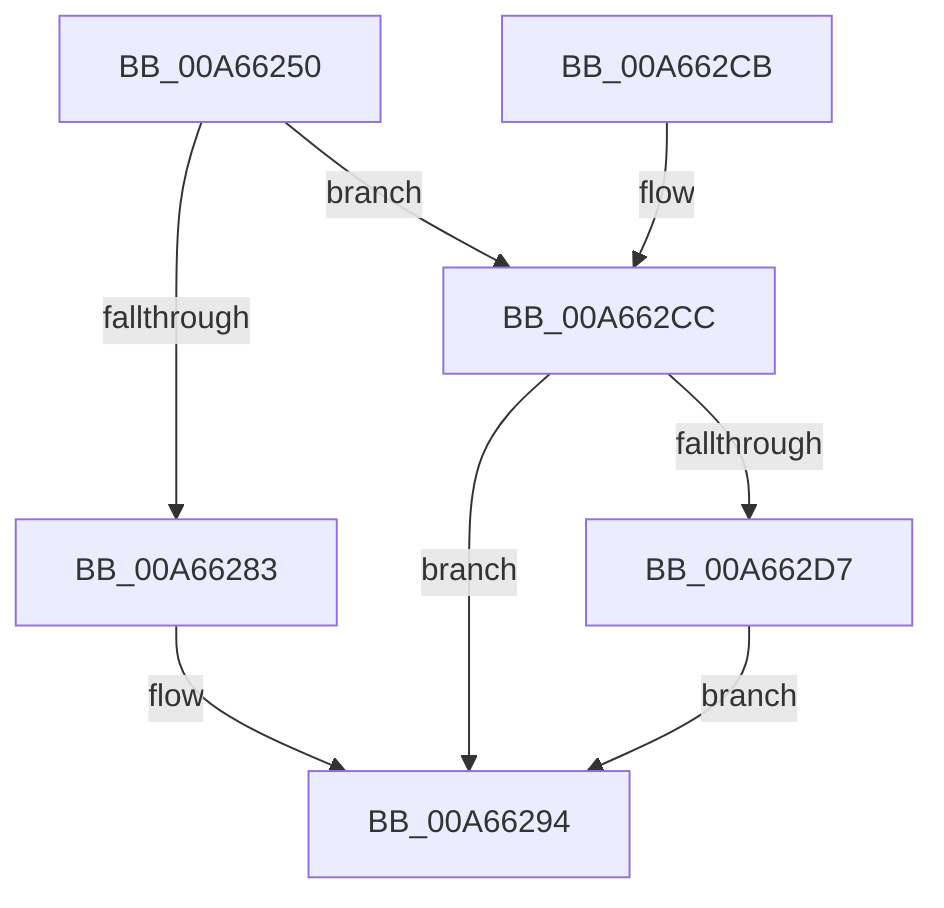

# EtwpSynchronizeWithLogger

- RVA: `0x00A66250`–`0x00A662EA` (길이 `154` bytes)
- VA: `0x0000000140A66250`
- 실행 섹션: `PAGE`
- PDB 이름 있음: `예`; PDB Function 태그: `아니요`
- unwind 정보 RVA: `0x0008FB4C`
- 디코드: `41`개 명령, `154/154` bytes 표시
- 미해석 바이트: `0` (있으면 어셈블리에 `.byte`로 보존)

> 이 문서는 커널 이미지의 기계어와 PDB 기호를 분석해 생성했습니다. 4번과 5번은 함수 원형과 자료형을 바이너리 사용 방식에서 추정한 C 해석이며 원본 소스 복구 결과는 아닙니다.

## 1. Dependencies

- 직접 호출 지점: **6**; 고유 호출 대상: **5**
- 직접 호출자로 확인된 함수: **6**
- RIP 상대 이미지 참조: **0**

### Outgoing calls
- `0x00A6626E` → [KeResetEvent](../../text/24/KeResetEvent_function_00248350.md) (function, `0x00248350`)
- `0x00A6627A` → [KeGetEffectiveIrql](../../text/2F/KeGetEffectiveIrql_function_002F8030.md) (function, `0x002F8030`)
- `0x00A6628F` → [KeSetEvent](../../text/33/KeSetEvent_function_0033F310.md) (function, `0x0033F310`)
- `0x00A662A5` → [KeWaitForSingleObject](../../text/20/KeWaitForSingleObject_function_0020E6B0.md) (function, `0x0020E6B0`)
- `0x00A662B0` → [KeResetEvent](../../text/24/KeResetEvent_function_00248350.md) (function, `0x00248350`)
- `0x00A662E3` → [KeInsertQueueDpc](../../text/20/KeInsertQueueDpc_function_00207C50.md) (function, `0x00207C50`)

### Direct callers
- [EtwpTransitionToRealtime](../../text/65/EtwpTransitionToRealtime_function_006518D8.md) at `0x00651962`
- [EtwpTransitionToRealtime](../../text/65/EtwpTransitionToRealtime_function_006518D8.md) at `0x006519EF`
- [EtwpIncrementTraceFile](../7B/EtwpIncrementTraceFile_function_007B9210.md) at `0x007B9289`
- [EtwpIncrementTraceFile](../7B/EtwpIncrementTraceFile_function_007B9210.md) at `0x007B92B0`
- [EtwpRealtimeConnect](EtwpRealtimeConnect_function_00A65C88.md) at `0x00A661B4`
- [EtwpUpdateTrace](../AB/EtwpUpdateTrace_function_00ABCC7C.md) at `0x00ABCE5C`
- [EtwpUpdateTrace](../AB/EtwpUpdateTrace_function_00ABCC7C.md) at `0x00ABCE69`
- [EtwpUpdateTrace](../AB/EtwpUpdateTrace_function_00ABCC7C.md) at `0x00ABCEDC`
- [EtwpUpdateTrace](../AB/EtwpUpdateTrace_function_00ABCC7C.md) at `0x00ABCFFF`
- [EtwpFlushTrace](../AF/EtwpFlushTrace_function_00AF47B4.md) at `0x00AF4957`
- [sub_00B48F36](../B4/Unknown_function_00B48F36.md) at `0x00B48FAF`
- [sub_00B48F36](../B4/Unknown_function_00B48F36.md) at `0x00B48FBE`

### Static image references
- 디코드된 RIP-relative 메모리 참조가 없습니다.

## 2. Other-region calls and transfers

- 다른 실행 섹션으로 향하는 call: **6**
  - `0x00A6626E` → [KeResetEvent](../../text/24/KeResetEvent_function_00248350.md) (`PAGE` → `.text`)
  - `0x00A6627A` → [KeGetEffectiveIrql](../../text/2F/KeGetEffectiveIrql_function_002F8030.md) (`PAGE` → `.text`)
  - `0x00A6628F` → [KeSetEvent](../../text/33/KeSetEvent_function_0033F310.md) (`PAGE` → `.text`)
  - `0x00A662A5` → [KeWaitForSingleObject](../../text/20/KeWaitForSingleObject_function_0020E6B0.md) (`PAGE` → `.text`)
  - `0x00A662B0` → [KeResetEvent](../../text/24/KeResetEvent_function_00248350.md) (`PAGE` → `.text`)
  - `0x00A662E3` → [KeInsertQueueDpc](../../text/20/KeInsertQueueDpc_function_00207C50.md) (`PAGE` → `.text`)
- 별도 외부 분기/꼬리 이동을 확인하지 못했습니다.

## 3. Assembly (complete function range)

```asm
00A66250  48 89 5C 24 08                  mov qword ptr [rsp + 8], rbx
00A66255  48 89 74 24 10                  mov qword ptr [rsp + 0x10], rsi
00A6625A  57                              push rdi
00A6625B  48 83 EC 30                     sub rsp, 0x30
00A6625F  48 8D B1 C8 01 00 00            lea rsi, [rcx + 0x1c8]
00A66266  48 8B F9                        mov rdi, rcx
00A66269  48 8B CE                        mov rcx, rsi
00A6626C  8B DA                           mov ebx, edx
00A6626E  E8 DD 20 7E FF                  call 0x140248350
00A66273  F0 09 9F 38 03 00 00            lock or dword ptr [rdi + 0x338], ebx
00A6627A  E8 B1 1D 89 FF                  call 0x1402f8030
00A6627F  3C 02                           cmp al, 2
00A66281  77 49                           ja 0x140a662cc
00A66283  48 8D 8F E0 01 00 00            lea rcx, [rdi + 0x1e0]
00A6628A  45 33 C0                        xor r8d, r8d
00A6628D  33 D2                           xor edx, edx
00A6628F  E8 7C 90 8D FF                  call 0x14033f310
00A66294  48 83 64 24 20 00               and qword ptr [rsp + 0x20], 0
00A6629A  45 33 C9                        xor r9d, r9d
00A6629D  45 33 C0                        xor r8d, r8d
00A662A0  33 D2                           xor edx, edx
00A662A2  48 8B CE                        mov rcx, rsi
00A662A5  E8 06 84 7A FF                  call 0x14020e6b0
00A662AA  8B 5F 28                        mov ebx, dword ptr [rdi + 0x28]
00A662AD  48 8B CE                        mov rcx, rsi
00A662B0  E8 9B 20 7E FF                  call 0x140248350
00A662B5  83 67 28 00                     and dword ptr [rdi + 0x28], 0
00A662B9  8B C3                           mov eax, ebx
00A662BB  48 8B 5C 24 40                  mov rbx, qword ptr [rsp + 0x40]
00A662C0  48 8B 74 24 48                  mov rsi, qword ptr [rsp + 0x48]
00A662C5  48 83 C4 30                     add rsp, 0x30
00A662C9  5F                              pop rdi
00A662CA  C3                              ret
00A662CB  CC                              int3
00A662CC  F0 0F BA AF 38 03 00 00 08      lock bts dword ptr [rdi + 0x338], 8
00A662D5  72 BD                           jb 0x140a66294
00A662D7  48 8D 8F 38 02 00 00            lea rcx, [rdi + 0x238]
00A662DE  45 33 C0                        xor r8d, r8d
00A662E1  33 D2                           xor edx, edx
00A662E3  E8 68 19 7A FF                  call 0x140207c50
00A662E8  EB AA                           jmp 0x140a66294
```

## 4. C-style interpretation (structured pseudocode)

```c
__int64 __fastcall EtwpSynchronizeWithLogger(__int64 a1, int a2, int a3, int a4)
{
    __int64 result;
    __int64 v_rsp;
    unsigned __int64 v_stack_m18;
    unsigned __int64 v_stack_p10;
    unsigned __int64 v_stack_p8;

    v_stack_p8 = v_rbx;
    v_stack_p10 = v_rsi;
    v_rsp = (v_rsp) - (48);
    result = KeResetEvent(a1 + 456, a2, a3, a4);
    result = KeGetEffectiveIrql(a1 + 456, a2, a3, a4);
    if (((unsigned __int8)(result)) > 2) goto loc_00A662CC;
    a3 = 0;
    a2 = 0;
    result = KeSetEvent(a1 + 480, a2, a3, a4);
loc_00A66294:
    a4 = 0;
    a3 = 0;
    a2 = 0;
    result = KeWaitForSingleObject(a1 + 456, a2, a3, a4);
    result = KeResetEvent(a1 + 456, a2, a3, a4);
    v_rsp = (v_rsp) + (48);
    return (unsigned int)((unsigned int)((unsigned int)(*(unsigned int *)(a1 + 40))));
loc_00A662CC:
    if (condition_is_below) goto loc_00A66294;
    a3 = 0;
    a2 = 0;
    result = KeInsertQueueDpc(a1 + 568, a2, a3, a4);
    goto loc_00A66294;
}
```

## 5. (Beta) C Style

```c
int64_t EtwpSynchronizeWithLogger(void *Arg1, int32_t Arg2, int32_t Arg3, int32_t Arg4)
{
    uint8_t *arg1 = (uint8_t *)Arg1;

    int64_t result;
    int64_t local_rsp;
    uint64_t v_stack_m18;
    uint64_t v_stack_p10;
    uint64_t v_stack_p8;

    v_stack_p8 = local_rbx;
    v_stack_p10 = local_rsi;
    local_rsp = (local_rsp) - (48);
    result = KeResetEvent(Arg1 + 456, Arg2, Arg3, Arg4);
    result = KeGetEffectiveIrql(Arg1 + 456, Arg2, Arg3, Arg4);
    if (((uint8_t)(result)) > 2) goto loc_00A662CC;
    Arg3 = 0;
    Arg2 = 0;
    result = KeSetEvent(Arg1 + 480, Arg2, Arg3, Arg4);
loc_00A66294:
    Arg4 = 0;
    Arg3 = 0;
    Arg2 = 0;
    result = KeWaitForSingleObject(Arg1 + 456, Arg2, Arg3, Arg4);
    result = KeResetEvent(Arg1 + 456, Arg2, Arg3, Arg4);
    local_rsp = (local_rsp) + (48);
    return (uint32_t)((uint32_t)((uint32_t)(*(uint32_t *)(arg1 + 0x28))));
loc_00A662CC:
    if (condition_is_below) goto loc_00A66294;
    Arg3 = 0;
    Arg2 = 0;
    result = KeInsertQueueDpc(Arg1 + 568, Arg2, Arg3, Arg4);
    goto loc_00A66294;
}
```

### 관측된 메모리 오프셋

구조체 형식이 확인되지 않은 접근은 인자 기준의 오프셋으로만 기록했습니다.

| 기준 인자 | 오프셋 표현 | 폭 (bit) | 접근 |
|---|---:|---:|---|
| `Arg1` | `+ 0x28` | `32` | `R` |
| `Arg1` | `+ 0x28` | `32` | `R/W` |
| `Arg1` | `+ 0x1C8` | `64` | `R` |
| `Arg1` | `+ 0x1E0` | `64` | `R` |
| `Arg1` | `+ 0x238` | `64` | `R` |
| `Arg1` | `+ 0x338` | `32` | `R/W` |

## 6. Execution-region graph

[열기: 2D/3D 그래프와 함수 탐색 컨트롤 패널](../../../control-panel.html?section=page&rva=0x00A66250&view=graph)

- 2D 그래프는 위에서 아래로 흐르고, 3D 그래프는 빈 공간을 드래그해 회전합니다. Shift+드래그는 이동, 휠은 확대·축소, 함수 노드 선택은 대상 보고서 이동입니다.

### Static fallback


