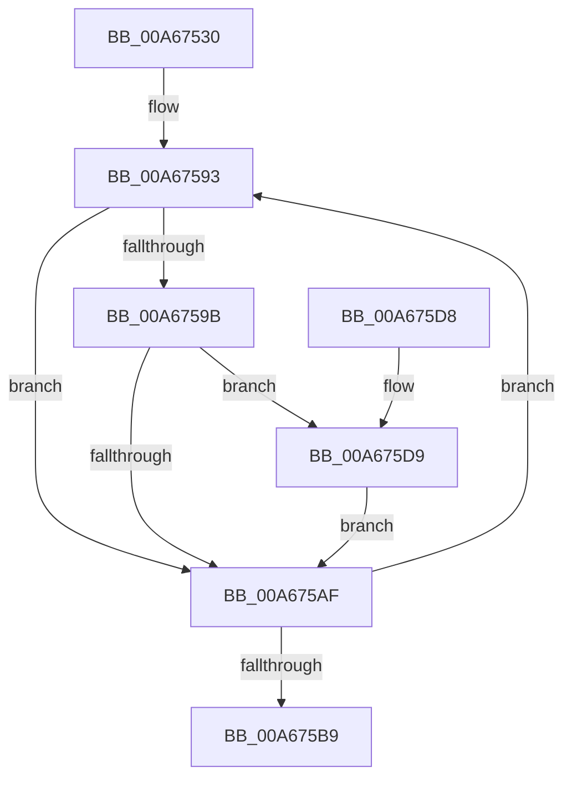

# EtwpUpdateGroupMasks

- RVA: `0x00A67530`–`0x00A675EF` (길이 `191` bytes)
- VA: `0x0000000140A67530`
- 실행 섹션: `PAGE`
- PDB 이름 있음: `예`; PDB Function 태그: `아니요`
- unwind 정보 RVA: `0x000B3C68`
- 디코드: `43`개 명령, `191/191` bytes 표시
- 미해석 바이트: `0` (있으면 어셈블리에 `.byte`로 보존)

> 이 문서는 커널 이미지의 기계어와 PDB 기호를 분석해 생성했습니다. 4번과 5번은 함수 원형과 자료형을 바이너리 사용 방식에서 추정한 C 해석이며 원본 소스 복구 결과는 아닙니다.

## 1. Dependencies

- 직접 호출 지점: **2**; 고유 호출 대상: **2**
- 직접 호출자로 확인된 함수: **2**
- RIP 상대 이미지 참조: **2**

### Outgoing calls
- `0x00A675C1` → [EtwpUpdateSelectedGroupMasks](../../text/49/EtwpUpdateSelectedGroupMasks_function_0049B114.md) (function, `0x0049B114`)
- `0x00A675CE` → [_security_check_cookie](../../text/6A/_security_check_cookie_function_006AC640.md) (function, `0x006AC640`)

### Direct callers
- [EtwpUpdateLoggerGroupMasks](EtwpUpdateLoggerGroupMasks_function_00A67490.md) at `0x00A674C5`
- [sub_00B3C988](../B3/Unknown_function_00B3C988.md) at `0x00B3CC31`

### Static image references
- `0x00A67534` → RVA `0x00E0A740` (`.data`; read)
- `0x00A67548` → RVA `0x00B4D4C0` (`EtwpEnableFlagMap`; read)

## 2. Other-region calls and transfers

- 다른 실행 섹션으로 향하는 call: **2**
  - `0x00A675C1` → [EtwpUpdateSelectedGroupMasks](../../text/49/EtwpUpdateSelectedGroupMasks_function_0049B114.md) (`PAGE` → `.text`)
  - `0x00A675CE` → [_security_check_cookie](../../text/6A/_security_check_cookie_function_006AC640.md) (`PAGE` → `.text`)
- 별도 외부 분기/꼬리 이동을 확인하지 못했습니다.

## 3. Assembly (complete function range)

```asm
00A67530  48 83 EC 58                     sub rsp, 0x58
00A67534  48 8B 05 05 32 3A 00            mov rax, qword ptr [rip + 0x3a3205]
00A6753B  48 33 C4                        xor rax, rsp
00A6753E  48 89 44 24 40                  mov qword ptr [rsp + 0x40], rax
00A67543  83 4C 24 3C FF                  or dword ptr [rsp + 0x3c], 0xffffffff
00A67548  4C 8D 0D 71 5F 0E 00            lea r9, [rip + 0xe5f71]
00A6754F  4C 8B C2                        mov r8, rdx
00A67552  C7 44 24 20 FF FF FF 1F         mov dword ptr [rsp + 0x20], 0x1fffffff
00A6755A  4C 8B D9                        mov r11, rcx
00A6755D  C7 44 24 24 FF FF FF 3F         mov dword ptr [rsp + 0x24], 0x3fffffff
00A67565  C7 44 24 28 FF FF FF 5F         mov dword ptr [rsp + 0x28], 0x5fffffff
00A6756D  41 BA 08 00 00 00               mov r10d, 8
00A67573  C7 44 24 2C FF FF FF 7F         mov dword ptr [rsp + 0x2c], 0x7fffffff
00A6757B  C7 44 24 30 FF FF FF 9F         mov dword ptr [rsp + 0x30], 0x9fffffff
00A67583  C7 44 24 34 FF FF FF BF         mov dword ptr [rsp + 0x34], 0xbfffffff
00A6758B  C7 44 24 38 FF FF FF DF         mov dword ptr [rsp + 0x38], 0xdfffffff
00A67593  41 8B 11                        mov edx, dword ptr [r9]
00A67596  4D 85 C0                        test r8, r8
00A67599  74 14                           je 0x140a675af
00A6759B  8B C2                           mov eax, edx
00A6759D  48 C1 E8 1D                     shr rax, 0x1d
00A675A1  41 8B 0C 80                     mov ecx, dword ptr [r8 + rax*4]
00A675A5  23 CA                           and ecx, edx
00A675A7  F7 C1 FF FF FF 1F               test ecx, 0x1fffffff
00A675AD  75 2A                           jne 0x140a675d9
00A675AF  49 83 C1 08                     add r9, 8
00A675B3  49 83 EA 01                     sub r10, 1
00A675B7  75 DA                           jne 0x140a67593
00A675B9  48 8D 54 24 20                  lea rdx, [rsp + 0x20]
00A675BE  49 8B CB                        mov rcx, r11
00A675C1  E8 4E 3B A3 FF                  call 0x14049b114
00A675C6  48 8B 4C 24 40                  mov rcx, qword ptr [rsp + 0x40]
00A675CB  48 33 CC                        xor rcx, rsp
00A675CE  E8 6D 50 C4 FF                  call 0x1406ac640
00A675D3  48 83 C4 58                     add rsp, 0x58
00A675D7  C3                              ret
00A675D8  CC                              int3
00A675D9  41 8B 51 04                     mov edx, dword ptr [r9 + 4]
00A675DD  8B C2                           mov eax, edx
00A675DF  81 E2 FF FF FF 1F               and edx, 0x1fffffff
00A675E5  48 C1 E8 1D                     shr rax, 0x1d
00A675E9  41 09 14 80                     or dword ptr [r8 + rax*4], edx
00A675ED  EB C0                           jmp 0x140a675af
```

## 4. C-style interpretation (structured pseudocode)

```c
__int64 __fastcall EtwpUpdateGroupMasks(__int64 a1, __int64 a2)
{
    __int64 result;
    __int64 v_r10;
    __int64 v_rsp;
    unsigned __int64 v_stack_m18;
    unsigned int v_stack_m1C;
    unsigned int v_stack_m20;
    unsigned int v_stack_m24;
    unsigned int v_stack_m28;
    unsigned int v_stack_m2C;
    unsigned int v_stack_m30;
    unsigned int v_stack_m34;
    unsigned int v_stack_m38;

    v_rsp = (v_rsp) - (88);
    result = (*(unsigned __int64 *)(v_rip + 3813893)) ^ (v_rsp);
    v_stack_m18 = result;
    v_stack_m38 = 0x1FFFFFFFULL;
    v_stack_m34 = 0x3FFFFFFFULL;
    v_stack_m30 = 0x5FFFFFFFULL;
    v_stack_m2C = 0x7FFFFFFFULL;
    v_stack_m28 = 0x9FFFFFFFULL;
    v_stack_m24 = 0xBFFFFFFFULL;
    v_stack_m20 = 0xDFFFFFFFULL;
loc_00A67593:
    if (a2 == 0) goto loc_00A675AF;
    result = ((unsigned int)((unsigned int)((unsigned int)(*(unsigned int *)(v_rip + 941937))))) >> (29);
    a1 = (unsigned int)(((unsigned int)(*(unsigned int *)(a2 + result * 4))) & ((unsigned int)((unsigned int)(*(unsigned int *)(v_rip + 941937)))));
    if ((((unsigned int)(a1)) & (0x1FFFFFFFULL)) != 0) goto loc_00A675D9;
loc_00A675AF:
    a4 = (v_rip + 941937) + (8);
    v_r10 = (8) - (1);
    if (condition_is_not_equal) goto loc_00A67593;
    result = EtwpUpdateSelectedGroupMasks(a1, v_stack_m38, a2, a4);
    a1 = (v_stack_m18) ^ (v_rsp);
    result = _security_check_cookie(a1, v_stack_m38, a2, a4);
    v_rsp = (v_rsp) + (88);
    return result;
loc_00A675D9:
    a2 = (unsigned int)(((unsigned int)(*(unsigned int *)(a4 + 4))) & (0x1FFFFFFFULL));
    result = ((unsigned int)((unsigned int)((unsigned int)(*(unsigned int *)(a4 + 4))))) >> (29);
    goto loc_00A675AF;
}
```

## 5. (Beta) C Style

```c
int64_t EtwpUpdateGroupMasks(int64_t Arg1, int64_t Arg2)
{
    int64_t result;
    int64_t local_r10;
    int64_t local_rsp;
    uint64_t v_stack_m18;
    uint32_t v_stack_m1C;
    uint32_t v_stack_m20;
    uint32_t v_stack_m24;
    uint32_t v_stack_m28;
    uint32_t v_stack_m2C;
    uint32_t v_stack_m30;
    uint32_t v_stack_m34;
    uint32_t v_stack_m38;

    local_rsp = (local_rsp) - (88);
    result = (*(uint64_t *)(v_rip + 0x3A3205)) ^ (local_rsp);
    v_stack_m18 = result;
    v_stack_m38 = 0x1FFFFFFFULL;
    v_stack_m34 = 0x3FFFFFFFULL;
    v_stack_m30 = 0x5FFFFFFFULL;
    v_stack_m2C = 0x7FFFFFFFULL;
    v_stack_m28 = 0x9FFFFFFFULL;
    v_stack_m24 = 0xBFFFFFFFULL;
    v_stack_m20 = 0xDFFFFFFFULL;
loc_00A67593:
    if (Arg2 == 0) goto loc_00A675AF;
    result = ((uint32_t)((uint32_t)((uint32_t)(*(uint32_t *)(v_rip + 0xE5F71))))) >> (29);
    Arg1 = (uint32_t)(((uint32_t)(*(uint32_t *)(Arg2 + result * 4))) & ((uint32_t)((uint32_t)(*(uint32_t *)(v_rip + 0xE5F71)))));
    if ((((uint32_t)(Arg1)) & (0x1FFFFFFFULL)) != 0) goto loc_00A675D9;
loc_00A675AF:
    a4 = (v_rip + 941937) + (8);
    local_r10 = (8) - (1);
    if (condition_is_not_equal) goto loc_00A67593;
    result = EtwpUpdateSelectedGroupMasks(Arg1, v_stack_m38, Arg2, a4);
    Arg1 = (v_stack_m18) ^ (local_rsp);
    result = _security_check_cookie(Arg1, v_stack_m38, Arg2, a4);
    local_rsp = (local_rsp) + (88);
    return result;
loc_00A675D9:
    Arg2 = (uint32_t)(((uint32_t)(*(uint32_t *)(a4 + 0x4))) & (0x1FFFFFFFULL));
    result = ((uint32_t)((uint32_t)((uint32_t)(*(uint32_t *)(a4 + 0x4))))) >> (29);
    goto loc_00A675AF;
}
```

## 6. Execution-region graph

[열기: 2D/3D 그래프와 함수 탐색 컨트롤 패널](../../../control-panel.html?section=page&rva=0x00A67530&view=graph)

- 2D 그래프는 위에서 아래로 흐르고, 3D 그래프는 빈 공간을 드래그해 회전합니다. Shift+드래그는 이동, 휠은 확대·축소, 함수 노드 선택은 대상 보고서 이동입니다.

### Static fallback


