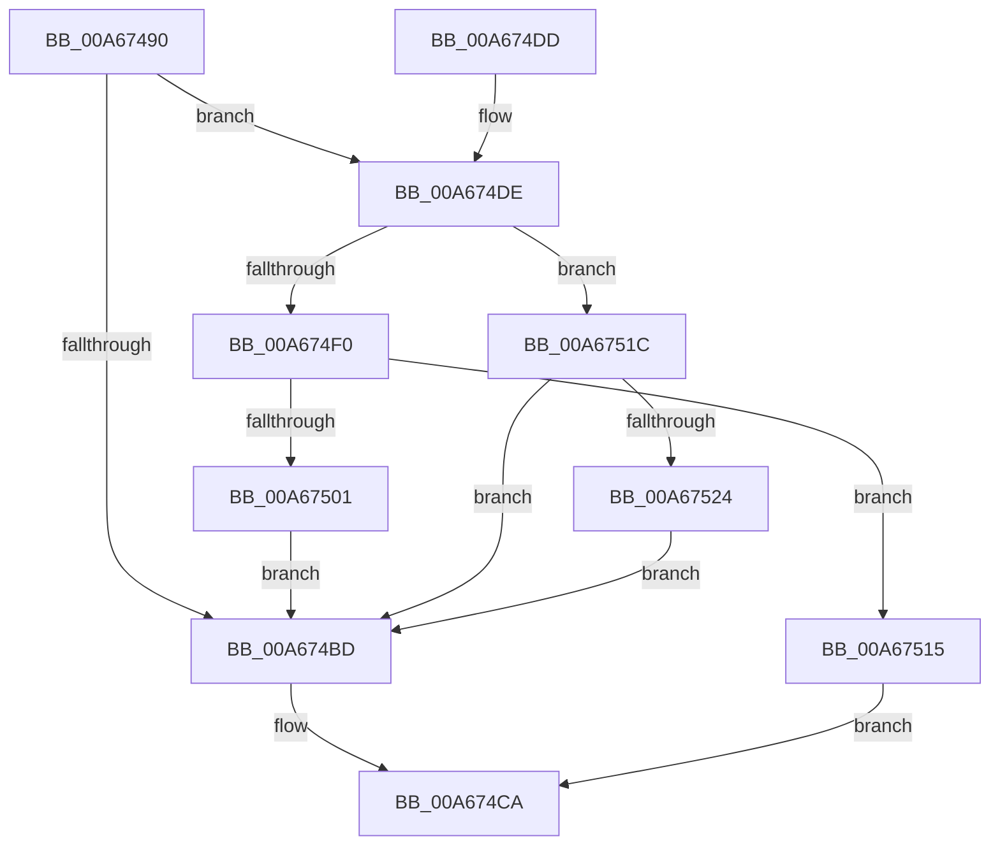

# EtwpUpdateLoggerGroupMasks

- RVA: `0x00A67490`–`0x00A6752A` (길이 `154` bytes)
- VA: `0x0000000140A67490`
- 실행 섹션: `PAGE`
- PDB 이름 있음: `예`; PDB Function 태그: `아니요`
- unwind 정보 RVA: `0x000B3C54`
- 디코드: `44`개 명령, `154/154` bytes 표시
- 미해석 바이트: `0` (있으면 어셈블리에 `.byte`로 보존)

> 이 문서는 커널 이미지의 기계어와 PDB 기호를 분석해 생성했습니다. 4번과 5번은 함수 원형과 자료형을 바이너리 사용 방식에서 추정한 C 해석이며 원본 소스 복구 결과는 아닙니다.

## 1. Dependencies

- 직접 호출 지점: **4**; 고유 호출 대상: **4**
- 직접 호출자로 확인된 함수: **3**
- RIP 상대 이미지 참조: **1**

### Outgoing calls
- `0x00A674C5` → [EtwpUpdateGroupMasks](EtwpUpdateGroupMasks_function_00A67530.md) (function, `0x00A67530`)
- `0x00A674D2` → [_security_check_cookie](../../text/6A/_security_check_cookie_function_006AC640.md) (function, `0x006AC640`)
- `0x00A674E6` → [EtwpGetFlagExtension](EtwpGetFlagExtension_function_00A67748.md) (function, `0x00A67748`)
- `0x00A6750E` → [memcpy](../../text/6C/memcpy_function_006C6840.md) (function, `0x006C6840`)

### Direct callers
- [EtwpStopLoggerInstance](../9B/EtwpStopLoggerInstance_function_009BEB94.md) at `0x009BED71`
- [EtwpStartLogger](../A9/EtwpStartLogger_function_00A99D80.md) at `0x00A9AD90`
- [EtwpUpdateTrace](../AB/EtwpUpdateTrace_function_00ABCC7C.md) at `0x00ABCF9C`

### Static image references
- `0x00A67496` → RVA `0x00E0A740` (`.data`; read)

## 2. Other-region calls and transfers

- 다른 실행 섹션으로 향하는 call: **2**
  - `0x00A674D2` → [_security_check_cookie](../../text/6A/_security_check_cookie_function_006AC640.md) (`PAGE` → `.text`)
  - `0x00A6750E` → [memcpy](../../text/6C/memcpy_function_006C6840.md) (`PAGE` → `.text`)
- 별도 외부 분기/꼬리 이동을 확인하지 못했습니다.

## 3. Assembly (complete function range)

```asm
00A67490  40 53                           push rbx
00A67492  48 83 EC 50                     sub rsp, 0x50
00A67496  48 8B 05 A3 32 3A 00            mov rax, qword ptr [rip + 0x3a32a3]
00A6749D  48 33 C4                        xor rax, rsp
00A674A0  48 89 44 24 40                  mov qword ptr [rsp + 0x40], rax
00A674A5  0F 57 C0                        xorps xmm0, xmm0
00A674A8  4C 8B D2                        mov r10, rdx
00A674AB  48 8B D9                        mov rbx, rcx
00A674AE  0F 11 44 24 20                  movups xmmword ptr [rsp + 0x20], xmm0
00A674B3  0F 11 44 24 30                  movups xmmword ptr [rsp + 0x30], xmm0
00A674B8  48 85 D2                        test rdx, rdx
00A674BB  75 21                           jne 0x140a674de
00A674BD  48 8D 54 24 20                  lea rdx, [rsp + 0x20]
00A674C2  48 8B CB                        mov rcx, rbx
00A674C5  E8 66 00 00 00                  call 0x140a67530
00A674CA  48 8B 4C 24 40                  mov rcx, qword ptr [rsp + 0x40]
00A674CF  48 33 CC                        xor rcx, rsp
00A674D2  E8 69 51 C4 FF                  call 0x1406ac640
00A674D7  48 83 C4 50                     add rsp, 0x50
00A674DB  5B                              pop rbx
00A674DC  C3                              ret
00A674DD  CC                              int3
00A674DE  BA 01 00 00 00                  mov edx, 1
00A674E3  49 8B CA                        mov rcx, r10
00A674E6  E8 5D 02 00 00                  call 0x140a67748
00A674EB  48 85 C0                        test rax, rax
00A674EE  74 2C                           je 0x140a6751c
00A674F0  0F B7 08                        movzx ecx, word ptr [rax]
00A674F3  66 C1 E1 02                     shl cx, 2
00A674F7  66 83 E9 04                     sub cx, 4
00A674FB  66 83 F9 20                     cmp cx, 0x20
00A674FF  77 14                           ja 0x140a67515
00A67501  44 0F B7 C1                     movzx r8d, cx
00A67505  48 8D 50 04                     lea rdx, [rax + 4]
00A67509  48 8D 4C 24 20                  lea rcx, [rsp + 0x20]
00A6750E  E8 2D F3 C5 FF                  call 0x1406c6840
00A67513  EB A8                           jmp 0x140a674bd
00A67515  B8 0D 00 00 C0                  mov eax, 0xc000000d
00A6751A  EB AE                           jmp 0x140a674ca
00A6751C  41 8B 42 48                     mov eax, dword ptr [r10 + 0x48]
00A67520  85 C0                           test eax, eax
00A67522  78 99                           js 0x140a674bd
00A67524  89 44 24 20                     mov dword ptr [rsp + 0x20], eax
00A67528  EB 93                           jmp 0x140a674bd
```

## 4. C-style interpretation (structured pseudocode)

```c
__int64 __fastcall EtwpUpdateLoggerGroupMasks(__int64 a1, __int64 a2)
{
    __int64 result;
    __int64 v_rsp;
    unsigned __int64 v_stack_m18;
    unsigned __int64 v_stack_m28;
    unsigned __int64 v_stack_m38;
    unsigned __int64 v_stack_p20;

    v_rsp = (v_rsp) - (80);
    result = (*(unsigned __int64 *)(v_rip + 3814051)) ^ (v_rsp);
    v_stack_m18 = result;
    v_stack_m38 = v_xmm0;
    v_stack_m28 = v_xmm0;
    if (a2 != 0) goto loc_00A674DE;
loc_00A674BD:
    result = EtwpUpdateGroupMasks(a1, v_stack_m38, a3, a4);
loc_00A674CA:
    a1 = (v_stack_m18) ^ (v_rsp);
    result = _security_check_cookie(a1, v_stack_m38, a3, a4);
    v_rsp = (v_rsp) + (80);
    return result;
loc_00A674DE:
    result = EtwpGetFlagExtension(a2, 1, a3, a4);
    if (result == 0) goto loc_00A6751C;
    a1 = (unsigned __int16)((*(unsigned __int16 *)(result)) << (2));
    a1 = (unsigned __int16)((a1) - (4));
    if (((unsigned __int16)(a1)) > 32) goto loc_00A67515;
    result = memcpy(v_stack_p20, result + 4, (unsigned __int16)(a1), a4);
    goto loc_00A674BD;
loc_00A67515:
    goto loc_00A674CA;
loc_00A6751C:
    if (sign_flag) goto loc_00A674BD;
    v_stack_p20 = (unsigned int)((unsigned int)(*(unsigned int *)(a2 + 72)));
    goto loc_00A674BD;
}
```

## 5. (Beta) C Style

```c
int64_t EtwpUpdateLoggerGroupMasks(int64_t Arg1, int64_t Arg2)
{
    int64_t result;
    int64_t local_rsp;
    uint64_t v_stack_m18;
    uint64_t v_stack_m28;
    uint64_t v_stack_m38;
    uint64_t v_stack_p20;

    local_rsp = (local_rsp) - (80);
    result = (*(uint64_t *)(v_rip + 0x3A32A3)) ^ (local_rsp);
    v_stack_m18 = result;
    v_stack_m38 = v_xmm0;
    v_stack_m28 = v_xmm0;
    if (Arg2 != 0) goto loc_00A674DE;
loc_00A674BD:
    result = EtwpUpdateGroupMasks(Arg1, v_stack_m38, a3, a4);
loc_00A674CA:
    Arg1 = (v_stack_m18) ^ (local_rsp);
    result = _security_check_cookie(Arg1, v_stack_m38, a3, a4);
    local_rsp = (local_rsp) + (80);
    return result;
loc_00A674DE:
    result = EtwpGetFlagExtension(Arg2, 1, a3, a4);
    if (result == 0) goto loc_00A6751C;
    Arg1 = (uint16_t)((*(uint16_t *)(result)) << (2));
    Arg1 = (uint16_t)((Arg1) - (4));
    if (((uint16_t)(Arg1)) > 32) goto loc_00A67515;
    result = memcpy(v_stack_p20, result + 4, (uint16_t)(Arg1), a4);
    goto loc_00A674BD;
loc_00A67515:
    goto loc_00A674CA;
loc_00A6751C:
    if (sign_flag) goto loc_00A674BD;
    v_stack_p20 = (uint32_t)((uint32_t)(*(uint32_t *)(Arg2 + 0x48)));
    goto loc_00A674BD;
}
```

## 6. Execution-region graph

[열기: 2D/3D 그래프와 함수 탐색 컨트롤 패널](../../../control-panel.html?section=page&rva=0x00A67490&view=graph)

- 2D 그래프는 위에서 아래로 흐르고, 3D 그래프는 빈 공간을 드래그해 회전합니다. Shift+드래그는 이동, 휠은 확대·축소, 함수 노드 선택은 대상 보고서 이동입니다.

### Static fallback


